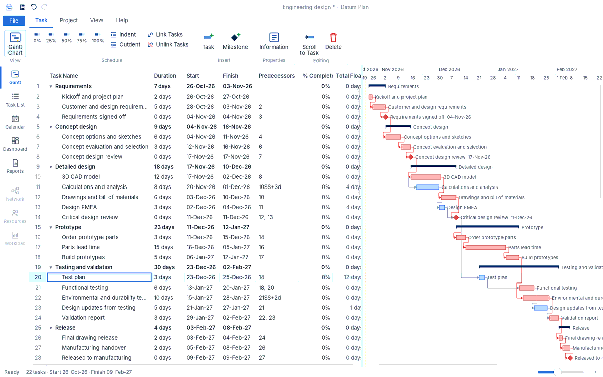
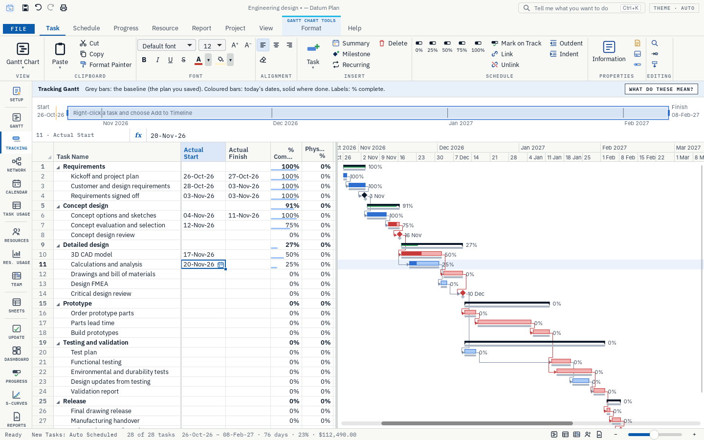
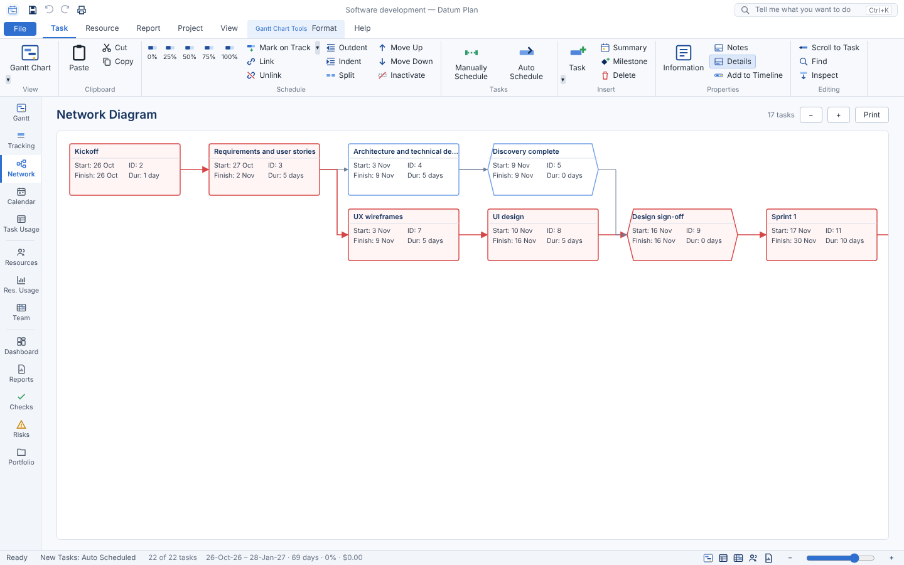
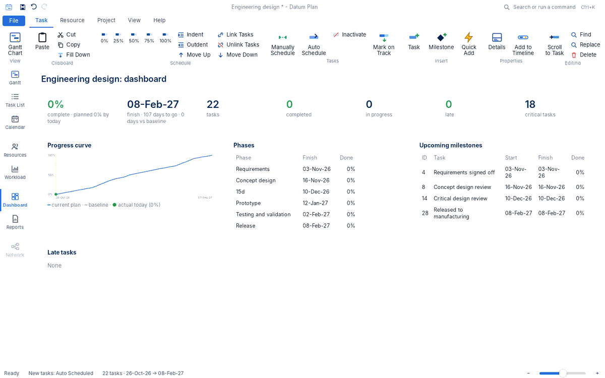

<div align="center">


# Datum Plan

**Plan, schedule, track and report your projects: one small, fast app for Windows.**

[](https://github.com/Edgar-Mendonca/Datum-Plan/releases/latest)
[](https://github.com/Edgar-Mendonca/Datum-Plan/actions/workflows/ci.yml)
[](https://github.com/Edgar-Mendonca/Datum-Plan/releases)
[](LICENSE)
[](https://github.com/Edgar-Mendonca/Datum-Plan/releases/latest)
[](crates/core)
[](https://tauri.app)
[](ui/src)

[](https://github.com/Edgar-Mendonca/Datum-Plan/releases/latest)
[](CHANGELOG.md)
[](https://github.com/Edgar-Mendonca/Datum-Plan/issues/new)
[](docs/MEMORY.md)

</div>



## Why Datum Plan

Datum Plan is a complete project scheduling and control tool, written from scratch with its own scheduling engine in Rust. It brings planning, scheduling, resources, costs, progress tracking, reporting and spreadsheets together in one window. You don't need several tools and exports.

- **Small and fast.** About 3.6 MB to install. It opens in a moment and stays smooth with large plans.
- **Everything included.** Network logic, resource levelling, earned value, S-curves, dashboards, printing and Excel-style formulas are all built in.
- **Easy to learn.** A ribbon, a sheet that works like a spreadsheet, plain-language help, a glossary of planning terms, and templates with real teams and man-hours.
- **Private.** Plans are `.dplan` files on your own computer. The only network call is the update check.
- **Always improving.** Small releases, installed with one click from inside the app.

## Features

### Plan
- A task sheet that works like a spreadsheet:
  - drag-select ranges and select whole rows and columns;
  - copy and paste with Excel, with Paste Special (values, formats, transpose);
  - a fill handle that continues series;
  - Sum, Average and Count of the selection;
  - fonts, colours, fill and alignment.
- Outline (WBS) with summaries, milestones, recurring tasks, manual or automatic scheduling, inactive tasks and splits.
- Links of every type (Finish-to-Start, Start-to-Start, Finish-to-Finish, Start-to-Finish) with lags and leads in days, hours or percent.
- About 450 fields; rename any column, and hide, unhide, delete or reorder columns with the Columns dialog.
- **Formula columns** in Excel syntax that refer to other columns, e.g. `=[% Complete]-[Baseline % Complete]` or `=IF([Finish]>[Baseline Finish],"Late","On time")`, with about 400 Excel functions.
- **Sheets:** spreadsheet tabs inside the plan for quantities, estimates and progress measurement, able to read the tasks.
- **Project Setup** walks you through a new plan: details, Activity IDs, calendar, currency, WBS, team and branding. Templates for engineering, EPC, construction, software and research come with people, rates, assignments and costs.

### Schedule
- A critical path engine that works to the minute, with working calendars, holidays, task and resource calendars, all constraint types, deadlines and elapsed durations.
- Longest path, float paths, free and total float, retained logic or progress override, scheduling from the finish.
- Resource levelling (all tasks or a selection) and clearing it again.
- A schedule health check with drill-down to the tasks behind each finding.

### Resources and cost
- Work, material and cost resources, with groups, rates over time, overtime, cost per use, availability, and 8-hour days or any calendar you set.
- Man-hours and costs per task, resource and period; resource usage, histograms and overallocation warnings; Team Planner.
- Fixed costs, expenses, any currency, and cash flow.

### Track progress
- Status date, % complete, actual dates, remaining duration, Mark on Track, Update Progress for a whole period, and Close Period with snapshots.
- **11 baselines** and the **Tracking Gantt**: baseline bars under the current bars, the done part solid, and % labels.
- Earned value (SPI, CPI, EAC, TCPI), period-by-period comparison, S-curves (planned, actual and forecast), and milestone tracking.

### Report, print and share
- **Dashboard** with key figures and charts, **Progress reports** for any week or month with notes and photos, **S-curves**, and a **Report Builder** with templates (weekly management, monthly client, schedule health, cost).
- **Print to paper or PDF from every view:** paper size, orientation, scaling or fit to pages, margins, date ranges, page ranges, headers and footers with your logo and your client's, page numbers and a legend.
- Excel export keeps formulas and formatting. Also exports to CSV, HTML, iCalendar and JSON, and imports and exports the common project exchange files (XML, XER, PMXML, MPX).

### Views
Gantt Chart · Tracking Gantt · Network Diagram (whiteboard canvas, legend, WBS bands, mini-map, path highlight) · Calendar · Timeline with a zoom box · Task Usage · Resource Sheet · Resource Usage · Resource Graph · Team Planner · Relationship Diagram · Sheets · Dashboard · Progress · S-Curves · Checks · Risks · Portfolio.

### Help when you need it
Tell Me (Ctrl+K) finds any command. Help › **Getting Started** and a searchable **Glossary** explain every term. Light, dark or automatic theme.





## Install

1. Download `DatumPlan-x.y.z-setup.exe` from [Releases](https://github.com/Edgar-Mendonca/Datum-Plan/releases/latest).
2. Run it. It installs for your user account, with no administrator rights needed. The installer is not code-signed yet, so on the first install Windows may show *"Windows protected your PC"*. Click **More info › Run anyway**.
3. Later versions install from inside the app: **File › Home › Update now**, or click the amber **Update available** badge. Every download is checked against its SHA-256 checksum.

## Your first plan in five minutes

1. **File › New** and pick a template (or Blank Project), then follow **Setup**.
2. Type task names, durations (`5d`, `2w`, `0` for a milestone) and predecessors (`3`, `4SS+2d`).
3. Indent tasks to build the outline; assign people in the Resource Names column (`Design Engineer[50%]`).
4. **Progress › Set Baseline**, then record progress as work happens and open the **Tracking Gantt**.
5. **Report › Dashboard** or **File › Print** to share it.

## Roadmap

See the [changelog](CHANGELOG.md) for every release and the [roadmap](docs/MEMORY.md#3-roadmap) for what is next: schedule risk analysis (Monte Carlo), a shared resource pool across plans, portfolio dashboards, signed installers, and working together on shared plans.

Datum Plan is part of [Datum](https://edgar-mendonca.github.io/Datum/); see its page: https://edgar-mendonca.github.io/Datum/apps/plan. [docs/FAMILY.md](docs/FAMILY.md) describes the shared design.

## Build from source

You need Rust (stable) and Node.js 20+. On Linux, also install `libwebkit2gtk-4.1-dev libgtk-3-dev librsvg2-dev`.

```bash
npm ci
npm run build:ui                      # build the window (Vite + SolidJS)
cargo run -p datum-plan               # run the app
cargo test --workspace                # engine tests
npm run check:ui                      # type-check the window
node tests_ui/run.cjs                 # UI tests (Playwright)
npm run build                         # Windows installer (on Windows)
```

The engine (scheduling, resources, costs, reports, file formats) is in `crates/core`; the desktop shell in `src-tauri`; the window in `ui/src`. Architecture and decisions are in [docs/MEMORY.md](docs/MEMORY.md).

## Feedback

Found a bug or have an idea? [Open an issue](https://github.com/Edgar-Mendonca/Datum-Plan/issues/new). The app has the same link under Help › Report an Issue.

## Licence

MIT © 2026 Edgar Mendonca. Third-party notices are in [NOTICE](NOTICE).
