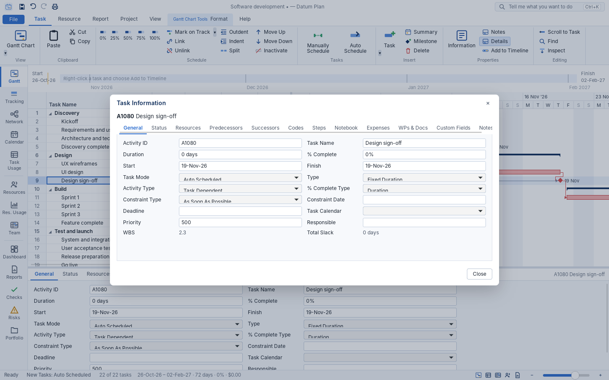
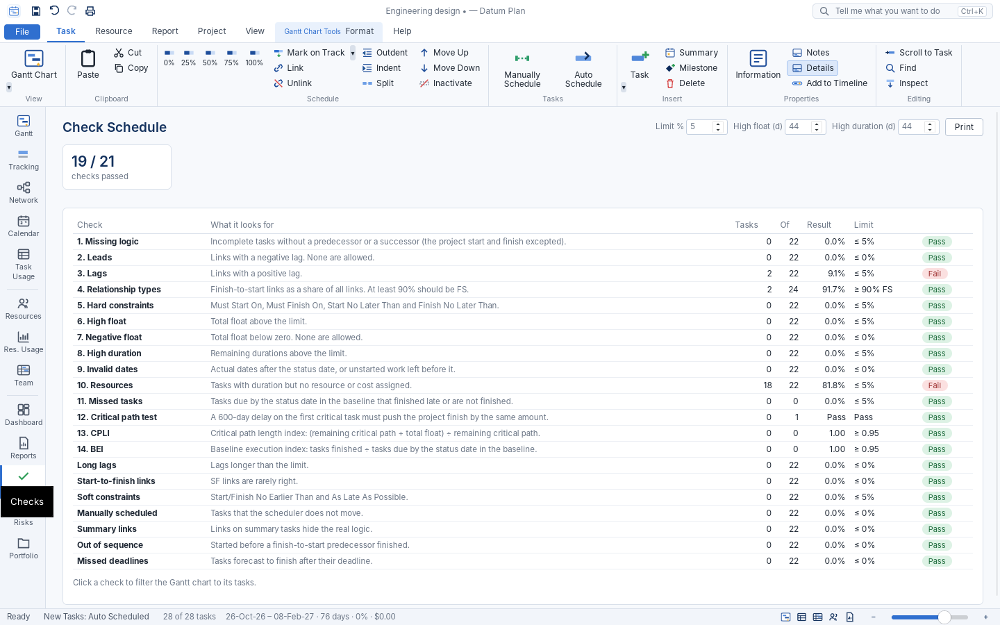

<div align="center">


# Datum Plan

**Project scheduling for Windows: the strengths of Microsoft Project and Primavera P6 in one small, fast app.**

[Download for Windows](https://github.com/Edgar-Mendonca/Datum-Plan/releases/latest) · [What's new](CHANGELOG.md) · [Project memory and roadmap](docs/MEMORY.md)

</div>


## Install

1. Download `DatumPlan-x.y.z-setup.exe` from [Releases](https://github.com/Edgar-Mendonca/Datum-Plan/releases/latest).
2. Run it. It installs for your user account, with no administrator rights needed. The installer is not code-signed yet, so on the first install Windows may show *"Windows protected your PC"*. Click **More info › Run anyway**.
3. Later versions install themselves. Open **File › Home** (or click the amber **Update available** badge) and click **Update now**.

## What it does today

- **MS Project look, P6 power:** ribbon with dropdowns, Tell Me command search, a dense task sheet with about 450 fields, an interactive Gantt chart with a timeline, and a Primavera-style details pane (General, Status, Resources, Predecessors, Successors, Codes, Steps, Notebook, Expenses, Documents, Custom Fields, Risks, Notes).
- **Scheduling to the minute:** calendars with working hours and holidays, task and resource calendars, all constraints and deadlines, manual and inactive tasks, elapsed durations, percentage lags, splits, task types, P6 activity types, retained logic or progress override, longest path, float paths, schedule from finish, and resource leveling.
- **Custom fields and formulas:** aliases, lookup tables, MS Project formulas, rollups and graphical indicators; P6 activity codes.
- **Views:** Gantt, Tracking Gantt, Network Diagram, Calendar, Task Usage, Resource Sheet, Resource Usage, Resource Graph, Team Planner, Dashboard, Reports, Check Schedule, Risks and Portfolio. Tables, filters, groups and sorts like MS Project.
- **Progress and cost control:** status date, Update Project, 11 baselines, snapshots, rate tables, fixed costs and expenses, any currency, and earned value (SPI, CPI, EAC, TCPI).
- **Reports:** dashboard with S-curves, weekly and monthly progress reports, earned value, cost and cash flow, milestones, DCMA 14-point schedule check, compare projects; your logo on every page; print to PDF or save as HTML.
- **Exchange:** MS Project XML, Primavera P6 XER and P6 XML, MPX, Excel, CSV, iCalendar, HTML and JSON.
- **New projects:** a skippable Project Setup panel (details, Activity IDs, calendar, currency, WBS, resources, branding) and six templates.
- **Local and private:** plans are `.dplan` files on your computer. The only network call is the update check. One-click updates with SHA-256 verification, with an optional beta channel.






See the [changelog](CHANGELOG.md) for details and the [roadmap](docs/MEMORY.md#3-roadmap) for what comes next.

## Build from source

You need Rust (stable) and Node.js 20+. On Linux, also install `libwebkit2gtk-4.1-dev libgtk-3-dev librsvg2-dev`.

```bash
npm ci
npm run dev        # build the UI (Vite + SolidJS) and run the app
cargo test         # engine tests
npm run build      # Windows installer (on Windows)
```

## Release a new version

1. Bump `version` in `src-tauri/Cargo.toml` (and `crates/core/Cargo.toml`).
2. Add a `## x.y.z — date` section at the top of `CHANGELOG.md`. It becomes the release notes and the in-app "What's new".
3. `git tag vx.y.z && git push origin vx.y.z`. GitHub Actions builds the installer and publishes the release.

## Licence

MIT © 2026 Edgar Mendonca
