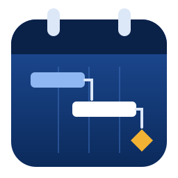
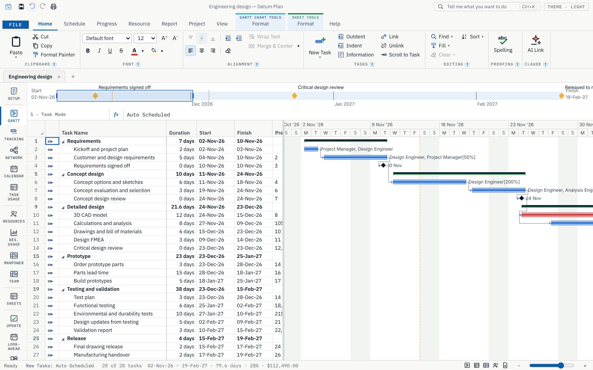
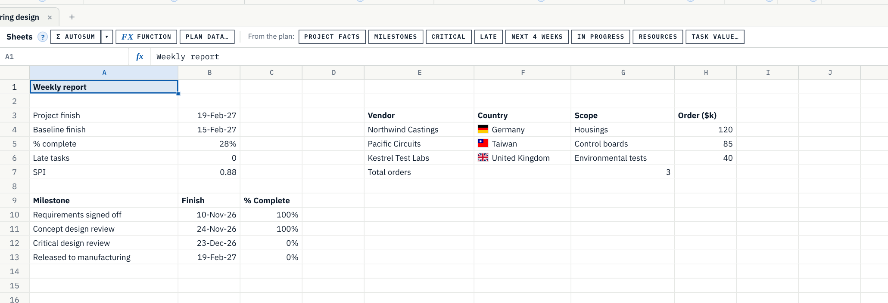
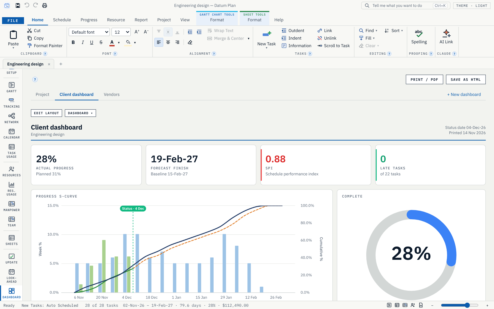
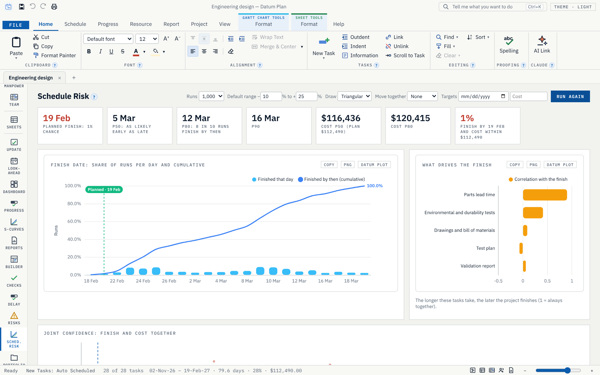
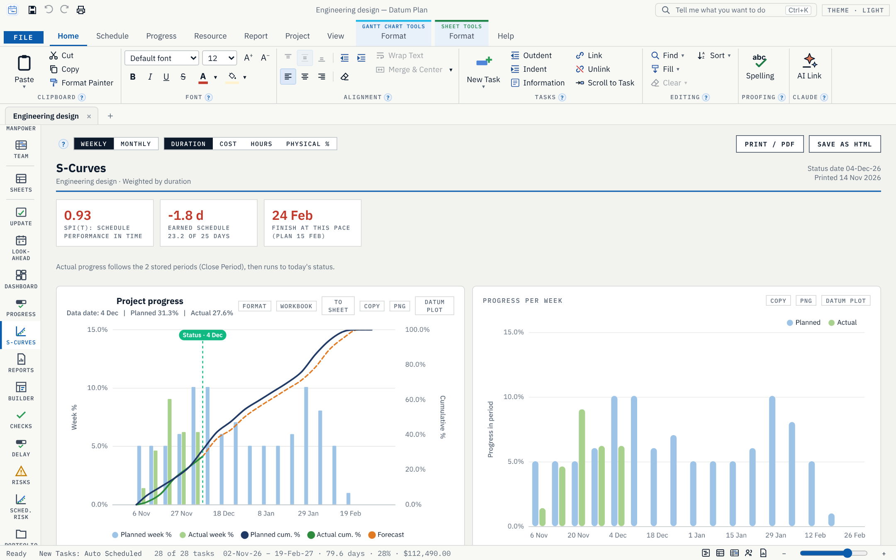
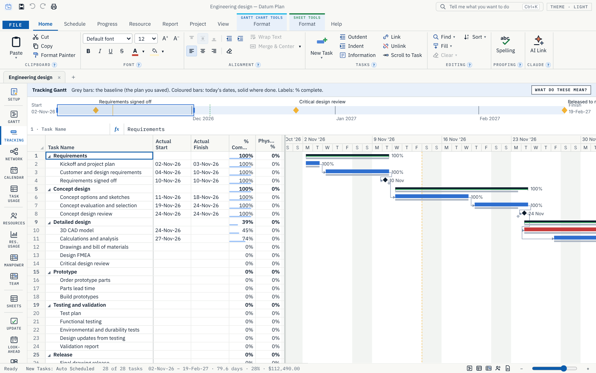
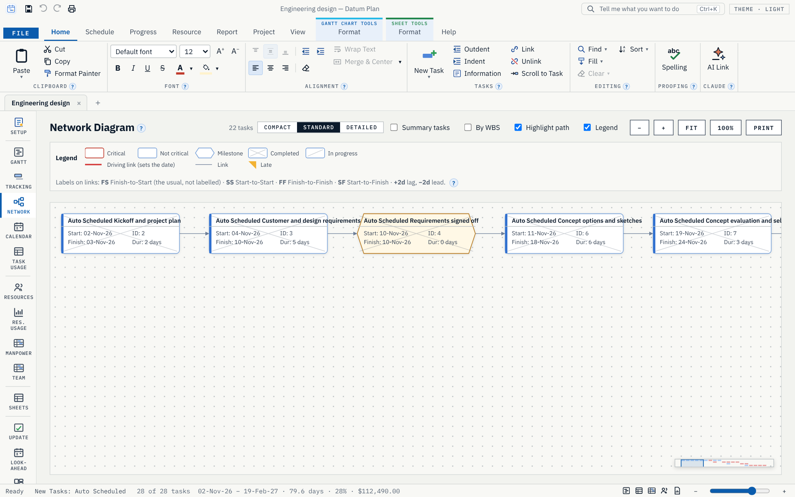
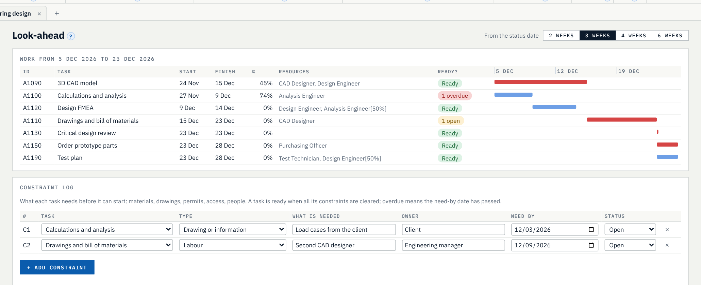

<div align="center">



# Datum Plan

**Plan, schedule, track and report your projects. Comes with an AI Link.<br>One small, fast, private app for Windows.**

[](https://github.com/Edgar-Mendonca/Datum-Plan/releases/latest)
[](https://github.com/Edgar-Mendonca/Datum-Plan/actions/workflows/ci.yml)
[](https://github.com/Edgar-Mendonca/Datum-Plan/releases)
[](LICENSE)
[](https://github.com/Edgar-Mendonca/Datum-Plan/releases/latest)
[](#ai-link-an-assistant-works-on-your-plan)
[](crates/core)
[](https://tauri.app)

[](https://github.com/Edgar-Mendonca/Datum-Plan/releases/latest)
[-22B8E6?style=for-the-badge&logo=readthedocs&logoColor=white)](https://github.com/Edgar-Mendonca/Datum-Plan/releases/latest/download/DatumPlan-Guide-en.pdf)
[](CHANGELOG.md)
[](https://github.com/Edgar-Mendonca/Datum-Plan/issues/new)

</div>



Datum Plan is a complete project scheduling and control tool, written from scratch with its own critical path engine in Rust. Planning, scheduling, resources, cost, progress, risk, delay analysis, registers, spreadsheets and dashboards live in one window and one file, and an AI assistant can work on the plan with you. About 7 MB to install, no account, no telemetry: your plans stay on your computer.

## What makes it different

| | |
|---|---|
| 🤖 **AI Link: an assistant works on your plan** | Ask in plain words: *"Add a 3-day pump test after task 24 and link handover to it"*, *"Which tasks are late and why?"*, *"Write this month's status report"*. **147 tools**, one-click setup, every change shown at once and undone with Ctrl+Z. |
| 🧭 **Task Path** | Click a task: its driving predecessors, other predecessors, driven successors and other successors light up in the sheet and the Gantt. |
| ⚖️ **Delay analysis built in** | As-planned against as-built, windows between snapshots, time impact, impacted as-planned and collapsed as-built, on the data your plan already holds, with delay events and fragnets. |
| 📑 **Registers in the plan** | The contract (dates with delay damages, payment milestones), the vendor document register (review cycle, return codes, transmittals) and procurement (orders, expediting, float to need), each tied to tasks and progress (Project › Modules switches them on). |
| 🧮 **Spreadsheets and dashboards inside the plan** | Sheet tabs with 490 functions that read the schedule live by name (`Tasks[Finish]`, `SPI`, `ProjectFinish`), and dashboards you lay out yourself: numbers, rings, charts, tables, flags. |
| 🎲 **Schedule risk** | Monte Carlo on durations and the risk register: P50, P80, P90 finish and cost, criticality, the tasks that drive the finish, correlation and joint confidence. |
| 🩺 **Schedule health with a history** | 21 quality checks with a weighted score you can tune, its trend over the snapshots, a log of logic changes between updates, ghost bars and a milestone trend chart. |
| 🔗 **Projects made of plans** | A master plan and its subplans, links between plans in separate files, a combined view, and one click to bring every open plan up to date. |
| 🔄 **Files that travel** | XER written for the version the receiver runs (codes, custom fields, steps, notes), Project XML, PMXML, MPX, workbooks with formulas; every import ends with a report that checks each task's dates against the file. |
| 🔒 **Local and private** | Plans are `.dplan` files on your computer. No sign-in, no cloud, no telemetry. The only network call is the update check (and the AI Link, only on this computer, only while you switch it on). |

## AI Link: an assistant works on your plan

**Home › AI Link** connects an AI assistant on your computer to the plan you have open, through the Model Context Protocol (MCP), and lets it read and change the plan live. For now it links to Claude Desktop, with your own account; no API key is needed.

1. **Turn on.** Only an assistant on this computer can reach the plan (127.0.0.1), with a key that changes each time.
2. **Add the link to your assistant.** One click makes an extension and opens it: click **Install**. Nothing to edit.
3. **Ask.** Start a new chat in the assistant.

The assistant reads before it changes, keeps to the plan's rules (a locked baseline stays locked) and never saves unless you ask. Each change is one Undo step with a note saying what it did. New tools arrive with each Datum Plan update; nothing needs installing again.

<details>
<summary><b>The 147 tools</b></summary>

| Area | The assistant can |
|---|---|
| Plans | list open plans, switch, save (when asked), undo, redo |
| Reading | plan summary, tasks with any filter and fields, one task in full, fields, sheets |
| Tasks | add, change, delete, link, unlink, indent, outdent, move, notes, constraints, deadlines, split, recurring tasks |
| Progress | progress, status date, mark on track, Update Project, steps, rules of credit |
| Resources | list, add, change, delete, assign, unassign, assignments, usage by resource, task or trade |
| Calendars | list, read, add, change working hours and holidays, delete |
| Codes, fields, filters | activity codes, custom fields (formulas, value lists), built-in and saved filters, any filter rule |
| Quality and risk | schedule checks and health score, health settings, schedule risk, risk register |
| Delays | delay events, fragnets, the delay analyses |
| Reporting | S-curve, look-ahead, constraint log, snapshots, period report, milestone trend, earned value and earned schedule |
| Baselines | set, list, compare, clear, interim plans |
| Registers | contract dates and payments, vendor documents and submissions, orders and expediting |
| Levelling | preview, level, clear |
| Sheets and looks | type in cells, add, rename, delete, format, number formats, defined names, task formatting, dashboards |
| Paths and exports | Task Path; save the plan in 10 formats or a register as a workbook to Downloads |

</details>

The link is a standard MCP server: other AI apps that run local MCP tools may work with it too (the command is in the AI Link dialog). `datum-cli mcp` also works on plan files without the window.

## Everything else, in one window

### Plan
- A task sheet that works like a spreadsheet: ranges, copy and paste with other spreadsheets, Paste Special, fill series, formats, spelling (UK or US).
- Outline (WBS), milestones, recurring tasks, manual or automatic scheduling, inactive tasks and splits; every link type with lags and leads in days, hours or percent.
- About 450 fields, formula columns in spreadsheet syntax (`=IF([Finish]>[Baseline Finish],"Late","On time")`), activity codes and custom fields.
- **Project Setup** and templates for engineering, EPC, construction, software and research, with people, rates, assignments and costs.

### Schedule
- Critical path to the minute: working calendars, holidays, task and resource calendars, all constraint types, deadlines, elapsed durations, scheduling from the finish.
- Longest path, float paths, free and total float, retained logic or progress override; Task Path for any task.
- Resource levelling with a preview of what moves before anything changes.

### Resources and cost
- Work, material and cost resources; rates over time, overtime, cost per use, availability; man-hours and cost per task, resource and period.
- Usage, histograms and over-allocation per person or per trade; Team Planner; fixed costs, expenses, any currency, cash flow.

### Track progress
- Status date, actuals, Update Progress for a period, Close Period with snapshots; **11 baselines** with a lock, and the **Tracking Gantt**.
- Earned value and **earned schedule**; S-curves (planned, actual, forecast) that look like a report and export as a workbook with a native chart.
- Progress by **rules of credit** or **installed quantities**; a **look-ahead** with a constraint log; **manpower** by trade.

### Report, print and share
- Dashboard, your own dashboards, progress reports with notes and photos, a report builder.
- Print to paper or PDF from every view, with your logo and your client's, headers, footers, page ranges and a legend.
- Imports and exports: workbook (.xlsx, with formulas), ODS, CSV, Project XML, XER, PMXML, MPX, JSON, HTML, iCalendar.

### Views
Gantt · Tracking Gantt · Network Diagram · Calendar · Timeline · Task Usage · Resource Sheet · Resource Usage · Resource Graph · Team Planner · Relationship Diagram · Sheets · Dashboards · Progress · S-Curves · Schedule Risk · Look-ahead · Manpower · Checks · Risks · Delay Analysis · Contract · Documents · Procurement · Portfolio.

<table>
<tr><td width="50%"><br><sub><b>Sheets</b> read the schedule live by name.</sub></td>
<td width="50%"><br><sub><b>Your own dashboards</b>, laid out tile by tile.</sub></td></tr>
<tr><td><br><sub><b>Schedule risk</b>: how likely each finish date is, and why.</sub></td>
<td><br><sub><b>S-curves</b>: planned, actual and forecast.</sub></td></tr>
<tr><td><br><sub><b>Tracking Gantt</b> against any of 11 baselines.</sub></td>
<td><br><sub><b>Network Diagram</b> on a whiteboard canvas.</sub></td></tr>
</table>


<sub><b>Look-ahead</b> of the next weeks with the constraint log: what must be in place before each task can start.</sub>

## Dates you can trust

Every release is checked against hand-worked scheduling cases, plan files that carry their own dates, thousands of random plans and edits, damaged files, and a window with 100,000 tasks. Releases are small and frequent, and install from inside the app with a checksum check.

## Install

1. Download `DatumPlan-x.y.z-setup.exe` from [Releases](https://github.com/Edgar-Mendonca/Datum-Plan/releases/latest).
2. Run it. It installs for your user account, with no administrator rights. The installer is not code-signed yet, so Windows may show *"Windows protected your PC"*: click **More info › Run anyway**.
3. Later versions install from inside the app: **File › Home › Update now**, or the amber **Update available** badge.

## The guide

The **Datum Plan Guide** walks through everything step by step, with pictures: [English (PDF)](https://github.com/Edgar-Mendonca/Datum-Plan/releases/latest/download/DatumPlan-Guide-en.pdf) · [中文 (PDF)](https://github.com/Edgar-Mendonca/Datum-Plan/releases/latest/download/DatumPlan-Guide-zh.pdf). In the app: **Help › Guide**, Tell Me (Ctrl+K) finds any command, and a glossary explains every term.

## Your first plan in five minutes

1. **File › New** and pick a template (or Blank Project), then follow **Setup**.
2. Type task names, durations (`5d`, `2w`, `0` for a milestone) and predecessors (`3`, `4SS+2d`).
3. Indent tasks to build the outline; assign people in the Resource Names column (`Design Engineer[50%]`).
4. **Progress › Set Baseline**, then record progress as work happens and open the **Tracking Gantt**.
5. **Report › Dashboard** or **File › Print** to share it, or ask the AI Link: *"Write a short status report."*

## Roadmap

Next: work contours (resource curves), detailed work editing, roles, expected finish, a parity check against plans exported from the scheduler you use at work, probabilistic risk branching, weather risk, a time-scaled logic diagram and a time-location (linear) view. See the [changelog](CHANGELOG.md) for every release and the [roadmap](docs/MEMORY.md#3-roadmap) for the details.

Datum Plan stays local and private: no multi-user server, no cloud version, no telemetry.

## Command line

`datum-cli` (on the [Releases](https://github.com/Edgar-Mendonca/Datum-Plan/releases/latest) page) works with plans without the window:

```bash
datum-cli info plan.dplan                     # dates, tasks, cost, critical tasks
datum-cli schedule plan.xer --csv             # every task with its dates and float
datum-cli apply plan.dplan --op '{"Set":{"uid":2,"field":"dur","value":"4d"}}' --save new.dplan
datum-cli export plan.dplan plan.xlsx         # any export format
datum-cli risk plan.dplan --runs 2000         # P50, P80, P90 finish
datum-cli mcp                                 # an MCP server that works on plan files
```

## Build from source

You need Rust (stable) and Node.js 20+. On Linux, also install `libwebkit2gtk-4.1-dev libgtk-3-dev librsvg2-dev`.

```bash
npm ci
npm run build:ui                      # build the window (Vite + SolidJS)
cargo run -p datum-plan               # run the app
cargo test --workspace                # engine tests (cases, parity files, random plans, AI tools)
npm run check:ui && node tests_ui/run.cjs   # type-check and UI tests (Playwright)
npm run build                         # Windows installer (on Windows)
```

The engine (scheduling, resources, cost, reports, file formats, the AI tools) is in `crates/core`; the desktop shell and the AI Link in `src-tauri`; the window in `ui/src`. Architecture and decisions are in [docs/MEMORY.md](docs/MEMORY.md).

Datum Plan is part of [Datum](https://edgar-mendonca.github.io/Datum/), a family of engineering tools; see its page: https://edgar-mendonca.github.io/Datum/apps/plan.

## Feedback

Found a bug or have an idea? [Open an issue](https://github.com/Edgar-Mendonca/Datum-Plan/issues/new), or use Help › Report an Issue in the app.

## Licence

MIT © 2026 Edgar Mendonca. Third-party notices are in [NOTICE](NOTICE).

Product and file-format names are trademarks of their owners and are used only to describe file compatibility.
