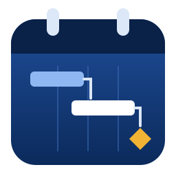

# Datum Plan: brainstorm and plan

> **Update:** decisions made after this brainstorm (a Rust engine instead of porting Cairn, a custom updater, the release plan) are in [MEMORY.md](MEMORY.md). This file stays as the original feature map.



**Goal:** a desktop project scheduler with the features of Microsoft Project and Primavera P6 combined. You install it once from a GitHub Release `.exe`, and every later version installs itself from an **Update** button on the Home screen.

This document is for discussion. Nothing here is fixed until we agree on it.

---

## 1. Lessons from what you have already built

| Repo | What we reuse | What we change |
| --- | --- | --- |
| **Cairn** (web planner, v0.8) | About 7,000 lines of tested TypeScript scheduling engine: calendars, FS/SS/FF/SF links with lags, constraints, critical path and float, task types, effort-driven work, leveling, baselines, earned value, timephased work, formulas, plus MSPDI XML, XER, MPX, XLSX and CSV import/export. The engine has no UI code, so it can move over as it is. | Cairn moved away from the MS Project look (a menu bar instead of the ribbon, plain-language names). Datum Plan goes the other way: a ribbon, standard P6/MSP terms, and a multi-project database. |
| **CentriForge** (Compressor Suite) | The launcher layout (version, *What's new*, update panel), the release workflow that builds on `windows-latest` from a `v*` tag, and release notes taken from `CHANGELOG.md`. | CentriForge bundles Python with PyInstaller and Inno Setup, and the update downloads the whole installer. Tauri has a built-in signed updater, and the installer is about 10 MB instead of about 150 MB. |

---

## 2. Architecture

> "Tauri6" is probably **Tauri 2**, which is the current major version. It uses a Rust backend and the system WebView2 on Windows for the frontend.

```
┌────────────────────────── Datum Plan.exe (Tauri 2) ──────────────────────────┐
│  Frontend (WebView2): TypeScript (strict) + React + CSS                       │
│   ├─ ui/        ribbon, backstage (File), views, dialogs, Home / update panel │
│   ├─ grid/      virtualised spreadsheet grid (100k rows)                      │
│   ├─ gantt/     canvas Gantt renderer + timescale                             │
│   └─ engine/    scheduling engine (ported from Cairn), runs in a Web Worker   │
│                       ▲  typed IPC (tauri invoke, generated types)            │
│  Backend (Rust)       ▼                                                       │
│   ├─ db/        SQLite (rusqlite): projects, EPS, resources, codes, baselines │
│   ├─ io/        file formats (XER, P6 XML, MSPDI XML, XLSX, later .mpp)       │
│   ├─ updater    tauri-plugin-updater → GitHub Releases (signed)               │
│   └─ fs, print/PDF, autosave, crash recovery, logging                         │
└──────────────────────────────────────────────────────────────────────────────┘
```

**Main decisions (proposed):**

1. **Where the engine runs.** Port Cairn's TypeScript engine and run it in a Web Worker so the UI stays responsive. Cairn's tests come with it. We would move the CPM pass to Rust only if profiling shows it is needed, for example above 50,000 activities. Cairn's tests would then check that the Rust engine gives the same results. This is the fastest route to a working 0.1 without giving up performance later.
2. **Storage in the P6 style, files in the MSP style.** Use a local SQLite database that holds many projects (EPS tree, shared resource pool, global calendars and codes), as P6 does. Also add **File › Save As `.dpln`**: a single-project SQLite file you can email, as MSP does.
3. **Strict TypeScript everywhere:** `strict`, `noUncheckedIndexedAccess`, ESLint, Vitest. Rust uses `clippy -D warnings`. CI runs all of these on every push.
4. **Rendering.** The Gantt and grids use canvas and virtualisation, not DOM nodes for each row. Cairn's DOM rows slow down at about 5,000 tasks, and P6 users regularly open 20,000-activity schedules.

### The update flow (what you asked for)

- **Home screen** shows: logo, current version, **Check for updates**, recent projects and a *What's new* card.
- Clicking *Check for updates* makes the app read `latest.json` from the newest GitHub Release. If a newer version exists, a dialog shows the **version, date, size and changelog**, with **Update now** and **Later** buttons.
- **Update now** downloads, verifies the signature, installs silently and restarts. There is no uninstalling or reinstalling, and your projects and settings stay where they are.
- It can also check quietly on startup, at most once a day, and show a badge on the Home tab.
- **Release pipeline:** bump the version, then `git tag v0.2.0 && git push --tags`. GitHub Actions builds the NSIS `.exe`, signs the update bundle, writes `latest.json`, and publishes the release with notes from `CHANGELOG.md`.
- **One-time setup on your side:** generate an updater signing key. I can give you the exact commands. Store it as two GitHub secrets: `TAURI_SIGNING_PRIVATE_KEY` and its password.
- **Windows SmartScreen:** without a paid code-signing certificate, Windows shows *"Windows protected your PC"* on the first install. Click *More info › Run anyway*. Updates after that do not show the warning. We can add a certificate later (Azure Trusted Signing costs about $10 a month).

---

## 3. Feature map: MS Project + Primavera P6

Legend: **0.1** = first release, then later versions. ★ = in P6 only, ◆ = in MSP only, neither = in both.

### Enterprise structure
- ★ EPS (Enterprise Project Structure) tree with many projects in one database
- ★ OBS (responsibility) and user access
- ◆ Master projects and subprojects, and a shared resource pool across projects
- Project portfolios and filters across projects

### Planning
- WBS with WBS codes; MSP-style outline indenting (0.1)
- Activities/tasks: task-dependent ★, resource-dependent ★, level of effort ★, WBS summary ★, start/finish milestones (0.1 basic types)
- ◆ Manual and auto-scheduled tasks, recurring tasks, split tasks, inactive tasks
- Durations: original, remaining, at-completion; duration types (fixed units, fixed work, fixed duration ±units/time)
- Relationships FS/SS/FF/SF with lag and lead (0.1)
- Constraints: ASAP, ALAP, SNET, SNLT, FNET, FNLT, MSO, MFO; ★ mandatory start/finish, ★ secondary constraints, deadlines (0.1)
- Calendars: global, project, resource, task; exceptions, shifts, holidays (0.1: global and project)
- ★ Activity codes, ★ steps, ★ notebook topics; ◆ notes and hyperlinks
- Custom fields / UDFs with ◆ formulas and graphical indicators

### Scheduling engine
- Forward and backward pass, total and free float, critical path (0.1)
- ★ Longest path, ★ multiple float paths, ★ "critical = float ≤ x"
- ★ Data date; ★ Retained Logic, Progress Override and Actual Dates options
- ★ Open ends, out-of-sequence and constraint report (**Schedule Log**)
- ★ **Check Schedule**, including DCMA 14-point
- Resource leveling (priority, delay only within float, split)
- Schedule backwards from the finish date (◆)

### Resources and costs
- Labour, non-labour, material, cost resources; ★ roles; max units over time
- Rates over time, overtime, cost per use, ★ expenses, ★ cost accounts, ★ funding sources
- Resource curves and contours; assignments with units, work, cost
- Resource usage and task usage tables (timephased), resource histogram/profile
- ◆ Team Planner (drag work between people)

### Progress and control
- % complete types: ★ physical, duration, units; actual start/finish; remaining duration
- ◆ Update Project / mark on track; ★ store period performance
- Baselines: ◆ 11 baselines plus interim plans; ★ unlimited baselines, compare any
- Earned value: PV, EV, AC, SPI, CPI, EAC, ETC, VAC, TCPI
- Progress line, ★ progress spotlight, status date
- ★ Thresholds, issues and risks register

### Views and layouts
- Gantt chart with the table on the left and bars on the right (0.1)
- Tracking Gantt / baseline comparison
- Network diagram (MSP PERT boxes) and ★ activity network
- ◆ Timeline view, ◆ Calendar view, ◆ Task form / ★ bottom detail tabs
- Resource sheet, resource usage, task usage, resource graph
- ★ Layouts (saved column + bar + filter + group sets), ◆ views, tables, groups and filters
- Bar styles, text styles, gridlines, timescale with 3 tiers
- Group by WBS / codes / any field, sort, filter, highlight filters
- Dark and light themes (default: dark blue)

### Reports, print and exchange
- Print and PDF with page setup, legends, headers and footers
- Built-in reports: overview, critical tasks, late tasks, cost overview, cash flow, S-curve, EV, milestones
- Import and export: **XER** (0.1 import), **P6 XML**, **MSPDI XML** (0.1 import), MPX, XLSX/CSV, ICS
- **`.mpp` read**: see the open questions. No Rust or JS library reads it today. Options: bundle MPXJ (Java, adds about 40 MB), or a .NET sidecar.
- Copy and paste to and from Excel in the grid

### Productivity
- Undo and redo across everything (0.1)
- Command search (Ctrl+K, from Cairn), Quick-add line (Ctrl+J, from Cairn)
- ★ Global Change (bulk "if/then" edits), find and replace, fill down
- Keyboard-first grid editing, MSP shortcuts (0.1)
- Autosave and crash recovery (0.1)
- Later: scripting/API, plugins, multi-user (server sync)

---

## 4. UI concept

Dark-blue theme. The layout follows MS Project, and the panels follow P6:

```
┌───────────────────────────────────────────────────────────────────────────┐
│ [logo] Datum Plan  │ File  Home  Task  Resource  Report  Project  View  ⟳ │ ← title + ribbon tabs
│ ┌Ribbon groups───────────────────────────────────────────────────────────┐ │
├──────┬───────────────────────────────────────────┬────────────────────────┤
│ EPS/ │  Grid (WBS / activities)  │ Gantt          │                        │
│ Proj │  ID  Name   Dur Start ... │ ▬▬▬▬▬ ◆       │  (optional side panel)  │
│ tree │                           │    ▬▬▬▬▬▬     │                        │
├──────┴───────────────────────────┴────────────────┴────────────────────────┤
│ Bottom details: General │ Status │ Resources │ Relationships │ Notes │ Steps│ ← P6-style tabs
├───────────────────────────────────────────────────────────────────────────┤
│ Status bar: data date · new tasks: auto · filter · zoom slider            │
└───────────────────────────────────────────────────────────────────────────┘
```

- **File › Backstage**, as in MSP: New, Open, Save As, Import/Export, Print, Options, **About and Updates**.
- **Home** tab as the start screen: recent projects, templates, *What's new*, **Check for updates**.
- **Palette:** navy `#0B2A5B`, primary `#1F4E9A`, accent sky `#8FB8F2`, milestone/attention amber `#F2B233`, critical red `#E04F4F`. There will be a light theme too.
- **Logo (draft above):** a calendar with binding rings, Gantt bars linked by arrows, and an amber milestone diamond. Feedback welcome.

**MSP screenshots would help a lot:** the Gantt view, the ribbon tabs, Task Information, and Options. P6 screenshots of Activities with the bottom tabs and the Layout dialog would help too.

We copy *features and workflow*. We do not copy Microsoft's or Oracle's icons, names or logos, so the app has its own look and stays clear of trade-dress issues.

---

## 5. Release roadmap (proposal)

| Version | Theme | Contents |
| --- | --- | --- |
| **0.1** | Shell + updater + core plan | Tauri 2 app, NSIS `.exe` on GitHub Releases, **Home screen with Check for updates + changelog + one-click update**, logo/theme, ribbon skeleton, one project per file (`.dpln`), WBS/task grid with inline edit, indent/outdent, FS/SS/FF/SF links, CPM with critical path, Gantt with zoom and link drawing, project calendar, undo/redo, autosave, import of MSPDI XML and XER |
| 0.2 | Resources and costs | Resource sheet, assignments, rates, usage views, histogram, leveling |
| 0.3 | Progress | Baselines, data date, actuals, % complete types, tracking Gantt, earned value |
| 0.4 | P6 enterprise | SQLite multi-project DB, EPS/OBS, activity codes, UDFs, layouts, global change |
| 0.5 | Analysis | Schedule log, Check Schedule / DCMA, longest path, multiple float paths, network diagram |
| 0.6 | Output | Reports, print/PDF, export to XER / P6 XML / MSPDI / XLSX |
| 0.7+ | Power features | Timeline, Team Planner, formulas, risks/issues, `.mpp` import, performance at 100k activities, multi-user |

Each release gets a `CHANGELOG.md` entry, which the update dialog shows.

---

## 6. Open questions for you

1. **Name:** is **Datum Plan** (from the repo name) the final name? *Datum* means a fixed reference point, which suits a schedule baseline.
2. **Platforms:** Windows only for now, or macOS and Linux builds as well? Tauri builds all three, but each one adds CI time and testing.
3. **Look and terms:** a full MS Project–style ribbon, plus P6 terms (Activity, WBS, Data Date) where P6 has the concept. Is that the mix you want?
4. **Cairn engine:** OK to port it in as the starting point, keeping MIT attribution? That saves weeks.
5. **`.mpp`:** how important is opening `.mpp` files directly? It decides whether we ship a Java/.NET sidecar.
6. **Code signing:** accept the SmartScreen prompt on the first install for now?
7. **Screenshots:** please send MSP and P6 screenshots of the views you use most.
