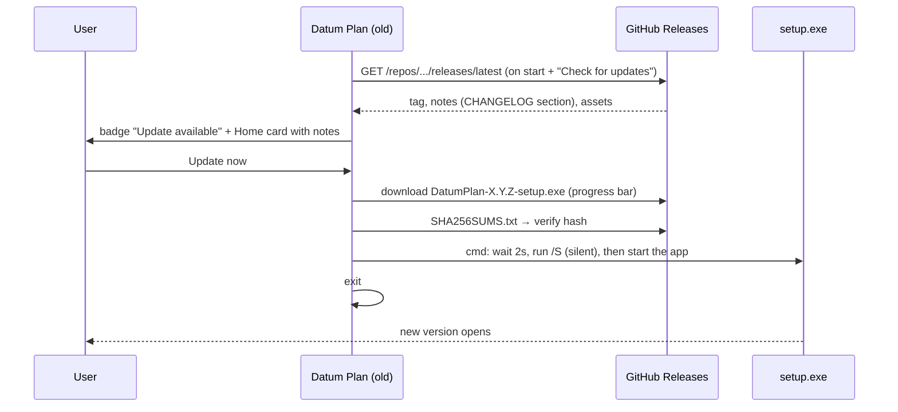
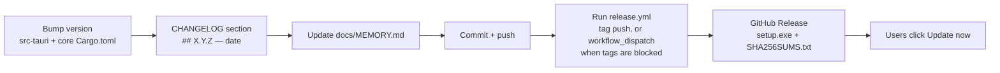

# Datum Plan: project memory

> **Paste this file at the start of each new session**, or just open the repo: `CLAUDE.md` tells Claude to read it.
> It records what exists, why, and what comes next. Update it at the end of every session.

| | |
| --- | --- |
| **Product** | Datum Plan: a Windows desktop scheduler combining MS Project (look, ease of use) and Primavera P6 (power features) |
| **Current version** | **0.3.0** (released 2026-10-24). Earlier: 0.1.0, 0.1.1, 0.2.0 |
| **Repo** | `Edgar-Mendonca/Datum-Plan` · working branch `claude/fervent-keller-ddas5s` (currently also the default branch) |
| **Stack** | Rust (engine + shell), Tauri 2, WebView2, SolidJS + Vite UI in strict TypeScript (TSX), plain CSS |
| **Code size** | About 9,300 lines: core 5,700 (with 460 lines of tests), shell 700, UI 2,900 TSX + CSS |
| **Installer** | NSIS `.exe`, per-user install. 1.7 MB (0.1.0), 1.8 MB (0.1.1), 2.4 MB (0.2.0); UI bundle 200 kB JS (61 kB gzip) in 0.3.0 |
| **Reference repos** | `Edgar-Mendonca/Cairn` (the earlier web planner: feature and template reference) · `Compressor-Engineering-Suite` (the Home/update pattern) |

---

## 1. Architecture

```mermaid
flowchart LR
  subgraph UI["Window (WebView2) · ui/src/*.tsx → Vite → ui/dist"]
    Store[store.ts: signals for plan, view, table, filter,<br/>group, sort, selection; act(op) and refresh()]
    Rib[ribbon.tsx: tabs, dropdowns, QAT, Tell Me]
    Grid[grid.tsx: virtual rows, inline edit,<br/>header menus, column drag/resize]
    Gantt[gantt.tsx: canvas Gantt + timeline]
    Det[details.tsx: P6 tabs]
    Views[views.tsx: network, calendar, usage, resources,<br/>graph, team, risks, checks, portfolio]
    Rep[reports.tsx: dashboard, report gallery, charts]
    Dlg[dialogs.tsx: information, calendars, custom fields,<br/>filters, groups, sorts, baselines, import, compare]
    BS[backstage.tsx + setup.tsx: File, Options, updates,<br/>Project Setup panel]
  end
  subgraph Shell["src-tauri (Rust)"]
    Cmd[main.rs: state · apply · history · query · resources · field_list<br/>task_info · usage · curve · checks · network · compare · workspace<br/>open · save · import · export · save_file · pick_logo · options · recovery]
    Upd[update.rs: GitHub API · beta channel · SHA-256 · silent install]
  end
  subgraph Core["crates/core (pure Rust, 18 tests)"]
    Doc[doc.rs: Op enum · undo/redo · .dplan]
    Sched[sched.rs: CPM · calendars · progress · LOE<br/>longest path · float paths · from finish]
    Level[level.rs: resource leveling]
    Fields[fields.rs: Calc · ~450 fields · EV · custom fields<br/>formulas · indicators · filter tests]
    Query[query.rs: filter · group · sort · outline → Grid + bars]
    Rep2[report.rs · check.rs · network.rs<br/>usage · curves · compare · DCMA · layout]
    Form[formula.rs: MSP formula language]
    Load[load.rs: timephased work and cost]
    IO[io/: mspdi · xer · table · formats pmxml/mpx/ics/html/json]
  end
  UI -- "invoke(cmd, args)" --> Cmd
  Cmd --> Doc & Query & Rep2 & IO
  Doc --> Sched
  Query --> Fields --> Sched & Load & Form
  Rep2 --> Fields
```

**Rules:**
- The UI never calculates dates, values or filters. Every edit is an `Op`; the core applies it to a copy, normalises, schedules and keeps it only if valid.
- After an edit `apply` returns `Out` (project settings without tasks + `Summary`). The window then calls `query(Query)` for the rows it shows; `Calc` (fields.rs) evaluates any field for any row.
- Window-only settings (saved filters, extra tables) live in `Project.ui`; the Entry table's columns in `Project.columns`.

### Time model (since 0.2)
- **Instants** are minutes since 1970-01-01 00:00 local time. **Durations and lags** are working minutes.
- `Project.day_min` (default 480) converts days. A week is 5 days and a month is 20 days.
- `Task.unit` remembers how the duration was typed (h, d, w, mo) so it is shown the same way.
- **Calendars:** `week: [Vec<(start_min, end_min)>; 7]` (Monday first) plus `exceptions` (date ranges; empty hours mean not working).
- The project calendar is `Project.calendar`. Each task can use its own `Task.cal`.
- **Scheduling:**
  - Forward pass: `ES = max(link requirements, constraints, data date)`, snapped to working time. Milestones may sit at the end of a shift.
  - Backward pass: works on late dates, which SNLT, FNLT, MSO, MFO and deadlines all limit.
  - Lags count on the successor's calendar.
  - Total float = working time between EF and LF.
  - A link to or from a summary applies to every leaf task under it.
  - `normalize()` drops links between a task and its own ancestors.
- **Progress:** an actual finish fixes the task. An actual start with % < 100 puts the remaining work after the status date (status date + 1 day, 00:00). Unstarted tasks cannot start before the status date. Setting % fills in actual dates; 0% clears them.

### Files

| Path | What it does |
| --- | --- |
| `crates/core/src/model.rs` | File format 3: Task (also task type, effort, activity/% complete type, physical %, elapsed, splits, leveling delay, priority, fixed cost + accrual, custom values, codes, steps, notebook, expenses, docs, 11 baselines in `bls`), Resource (rate tables, availability, calendar, overtime), Project (setup fields, logo, currency, Activity ID numbering, `SchedOpts`, custom field defs, codes, risks, snapshots, `ui`). Migrates formats 1–2. |
| `crates/core/src/cal.rs` | `WorkCal`: working-time arithmetic. |
| `crates/core/src/sched.rs` | CPM → `Sched` (es/ef/ls/lf/tf/ff, edges with driving flags, longest path, float paths, calendars incl. a 24-hour one). `critical()` follows the options. |
| `crates/core/src/level.rs` | Serial leveling with a fixed rank; `clear`. |
| `crates/core/src/load.rs` | Work/cost per task, assignment and day (rate tables, accruals, actuals); `buckets(day/week/month/quarter)`. |
| `crates/core/src/formula.rs` | MS Project formula parser and evaluator (34 functions). |
| `crates/core/src/fields.rs` | Field registry (`task_fields`, `resource_fields`), `Calc` (one scheduled plan + loads + EV), `val/text/format/icon`, filter `test`, `money`. |
| `crates/core/src/query.rs` | `Query` → `Grid` (cols, rows with cells, icons, bar geometry), built-in filters, `Summary`. |
| `crates/core/src/report.rs` | Usage grids, cost/EV curves, compare. |
| `crates/core/src/check.rs` | DCMA 14 + P6 checks with limits. |
| `crates/core/src/network.rs` | Network Diagram layout (columns by logic, rows by predecessor position). |
| `crates/core/src/parse.rs` | Durations (also elapsed), dates, predecessors (also % lags), resources, quick add. |
| `crates/core/src/doc.rs` | Ops (see the enum: edits, Level, Split, Interim, UpdateProject, Snapshot, ProjectSet, FieldDef, CodeDef, Risk, TaskList, ResJson, Ui, Baseline n, …), undo/redo, `.dplan`. |
| `crates/core/src/io/` | `mspdi.rs`, `xer.rs`, `table.rs` (CSV/XLSX in with mapping; out with chosen columns), `formats.rs` (JSON, HTML, ICS, MPX, PMXML out), `xml.rs`. JSON/dplan import. |
| `crates/core/examples/` | `bench.rs` (20k-task timing), `dump.rs` (JSON fixtures for UI tests). |
| `crates/core/src/tests.rs` | 18 tests. |
| `src-tauri/src/main.rs` | Commands listed in the diagram; options (date format, autosave, beta, default currency, company, logo, workspace, setup panel); backups of format < 3 files; recovery. |
| `src-tauri/src/update.rs` | Updater; `check(beta)` reads `/releases` when beta is on; versions compare with pre-release tags. |
| `ui/index.html` | Root and the icon sprite (about 65 icons). `ui/public/logo.svg`. |
| `ui/src/api.ts` | Types matching the Rust JSON, `invoke`, date and money helpers. |
| `ui/src/store.ts` | Global signals, built-in tables, `query()`, `refresh()`, `act()`, menus, dialogs, toast. |
| `ui/src/cmds.ts` | Command functions `C` and the `ALL_CMDS` list for Tell Me. |
| `ui/src/ui.tsx` | Icon, Menu (with submenus), Dialog, Tabs, form helpers. |
| `ui/src/grid.tsx`, `gantt.tsx`, `details.tsx`, `views.tsx`, `reports.tsx`, `dialogs.tsx`, `ribbon.tsx`, `backstage.tsx`, `setup.tsx`, `main.tsx` | As in the diagram. `styles.css` holds the light theme and print styles. |

### Update flow



### Release flow



---

## 2. Decisions

| Date | Decision | Why |
| --- | --- | --- |
| 2026-10-24 | Name **Datum Plan**, file extension `.dplan` | The user chose it. |
| 2026-10-24 | **Rust engine** in `crates/core`; Cairn is only a reference | The user wants everything in Rust for a small, robust app. |
| 2026-10-24 | UI in plain TypeScript with no framework, split into 7 script files joined by tsc | Small bundle; modules without a bundler. |
| 2026-10-24 | Custom updater (GitHub API + SHA-256 + NSIS `/S`); per-user install | Needs no signing secrets; silent updates. |
| 2026-10-24 | Windows only; no `.mpp` (closed format) | The user's choice. Exchange formats are dplan, XML, XER, XLSX and CSV. |
| 0.1.1 | Light theme, new logo, Cairn-style sidebar, general templates | The user's feedback on 0.1.0. |
| 0.2.0 | **Minute-precision engine with real calendars** (replacing whole days) | Needed for hours, shifts, holidays and P6/MSP exchange. Old files migrate (day × 480). |
| 0.2.0 | Several roadmap steps shipped as one release (0.1.2–0.1.4, calendars, constraints, logic, exchange, resources, baselines/progress) | The user asked for all of it in 0.2. |
| 0.2.0 | Links on summaries apply to every leaf under them; links to one's own summary are dropped | Simple and close to MSP. P6 has no summary links anyway. |
| 0.2.0 | Status date semantics: progress up to the end of that day; remaining work starts the next day | MSP-like status date. XER `last_recalc_date` maps to status = data date − 1. |
| 0.2.0 | Work-resource units: `50%`, `0.5` or `50`; material: quantity; cost: amount | Matches MSP habits. |
| 0.2.0 | Predecessor IDs typed with new rows (quick add, paste) mean the IDs shown before the insert | What the user sees on screen. |
| 0.2.0 | XML reader written by hand instead of quick-xml | The quick-xml API changes a lot between versions; MSPDI only needs elements and text. |
| 0.2.0 | Recovery copy in AppData, not autosave over the user's file | Safe: never overwrites a file without asking. |
| 0.3 plan | **SolidJS + Vite** for the UI (not Astro) | Small reactive components for MSP-level dialogs, ribbon and report designer. Astro targets content sites. |
| 0.3 plan | **Local-first:** `.dplan` files plus a workspace file; no server, no cloud, no telemetry (the only network call is the update check) | Open source, everything stays on the user's computer. |
| 0.3 plan | Betas through an opt-in updater channel; slipped items go to 0.3.1 | The user wants to check the big release step by step. |
| 0.3 plan | **Datum scheduling style** (PLAN-0.3 §3.P): fixed duration, single Progress field, retained logic, slack ≤ 0 critical with a longest-path switch, auto actuals, an Explain panel, calculated cells marked | The user wants something easier than both MSP and P6. |
| 0.3 plan | **Project Setup** panel (skippable, docked right) as step one of every new plan; all ISO currencies; logo and company branding; Activity IDs A1000+10; MSP-style network; MSP density; English only; beta backups | The user's answers, 2026-10-24. |
| 0.3 plan | `docs/reference/MSP-P6-feature-reference.md` (from the user) is the behaviour spec; its C2 scenarios become tests and a checklist | A shared, written definition of done. |
| 0.3.0 | Shipped as one release (no betas) because the user asked to "build and release 0.3" | Betas stay available through the opt-in channel for later versions. |
| 0.3.0 | The engine owns fields, filters, groups and sorts (`Calc` + `query`); the window asks for rows per view | One place for values, exports use the same text; 20k tasks query in ~50 ms. |
| 0.3.0 | Print/PDF through the WebView print dialog ("Save as PDF") with print CSS, instead of a PDF library | No extra dependency; works for every view and report. |
| 0.3.0 | Templates still use the Project Setup panel (setup_done = false) | Setup is step one of every new plan, as agreed. |

---

## 3. Roadmap

✅ done · 🔜 next · ⬜ planned. Small releases; every one goes through the in-app updater.

| Version | Theme | Contents | Status |
| --- | --- | --- | --- |
| **0.1.0** | Shell + updater + core | Installer, Home, updater, ribbon, grid, summaries, links, CPM, Gantt, undo, `.dplan` | ✅ |
| **0.1.1** | Look, views, reports | Light theme, logo, sidebar, templates, drag bars, Calendar, Dashboard, weekly/monthly report | ✅ |
| **0.2.0** | The big one | Grid power (any column, clipboard, fill, move, find/replace, menus), Gantt power (timeline, progress drag, details pane, link editing), Ctrl+K, Ctrl+J, Options, recovery, minute calendars + exceptions + task calendars, all constraints + deadlines, manual/inactive tasks, summary links, status date + actuals + Mark on Track, baselines + variance, resources + costs + workload, import/export XML/XER/XLSX/CSV | ✅ |
| **0.3.0** | MSP look + P6 power (one big release) | Everything planned for 0.2.1 → 0.5.2, network diagram included. Full scope and beta milestones in **[PLAN-0.3.md](PLAN-0.3.md)**: MSP ribbon with dropdowns and Format tabs, about 450 fields + custom fields/formulas/lookups/indicators, Field Settings, Information dialogs, tables, filters, groups and views, formatting, task types, leveling, P6 activity types, longest path, usage views, Team Planner, Network Diagram, 11 baselines, Update Project, earned value, costs, report gallery and designer, page setup/PDF, DCMA check, compare, risks, EPS workspace, new formats (P6 XML, MPX, ICS, HTML, JSON) | ✅ (see 0.3.1 for what slipped) |
| 0.3.1 | Foundation (plan under review: [PLAN-0.3.1.md](PLAN-0.3.1.md)) | CentriForge design system and shell, Gridcraft formula engine, Excel-like spreadsheet grid (ranges, fill, clipboard, formula bar), Excel formula columns, bug fixes, Playwright CI tests | 🔜 |
| 0.3.2 | Progress & reporting | Reporting periods, Update Progress workflow, period comparison, Dashboard → Charts → Tables → Notes reports, PDF/Excel | ⬜ |
| 0.3.3 | Builder & power | Report builder, sheet tabs, xlsx with formulas, recurring tasks, relationship diagram, global change, EPS | ⬜ |
| 0.6.0 | Portfolio | Portfolio dashboard, master/subprojects, shared resource pool, cross-project links | ⬜ |
| 0.6.1 | Hardening | 100k-activity performance, code signing, signed updater, crash reports, dark theme | ⬜ |
| 1.0.0 | Stable | — | ⬜ |

### Features that go beyond MSP and P6
- Weekly/monthly progress reports ✅
- Dashboard with S-curve and baseline curve ✅
- Command search ✅ and quick-add sentences ✅
- Recovery copies ✅
- Project Setup panel, DCMA check with drill-down, risk register, snapshots with trend ✅ (0.3.0)
- Later: schedule health score, one-click report pack, what-if comparison

### Gap analysis (MSP, P6 and Cairn vs Datum Plan)
| Area | MS Project | Primavera P6 | Cairn 0.8 | Datum Plan |
| --- | --- | --- | --- | --- |
| Grid, outline, links, CPM | ✓ | ✓ | ✓ | ✓ 0.1 |
| Interactive Gantt, timeline | ✓ | partial | ✓ | ✓ 0.2 |
| Column picker | ✓ | ✓ | ✓ | ✓ 0.2 (custom fields and formulas in 0.3) |
| Calendars (hours, exceptions, many) | ✓ | ✓ | ✓ | ✓ 0.2 (resource calendars in 0.3) |
| Constraints, deadlines, manual, inactive | ✓ | ✓ | ✓ | ✓ 0.2 |
| Task types, effort-driven, recurring, split | ✓ | duration types | ✓ | ✓ 0.3 (recurring in 0.3.1) |
| File exchange (XLSX, CSV, XML, XER) | ✓ | ✓ | ✓ | ✓ 0.2 |
| Resources, costs, workload | ✓ | ✓ | ✓ | ✓ 0.2 (leveling in 0.3, rates over time in 0.3) |
| Baseline, actuals, status date | ✓ | ✓ | ✓ | ✓ 0.2 (11 baselines and earned value in 0.3) |
| EPS, activity codes, multi-project | master projects | ✓ | — | ✓ 0.3 codes + portfolio folder |
| Filters, groups, layouts, global change | ✓ | ✓ | ✓ | ✓ 0.3 (global change 0.3.1) |
| Schedule check, longest path, float paths | — | ✓ | partial | ✓ 0.3 |
| Network diagram | ✓ | ✓ | ✓ | ✓ 0.3 |
| Dashboards and periodic reports | basic | basic | 16 reports | ✓ 0.3 (10 reports + dashboard) |

---

## 4. Session log

### 2026-10-24: Session 1 (brainstorm + 0.1.0)
- Read Cairn and CentriForge. Wrote the brainstorm and a draft logo.
- The user approved the name, Windows only, no `.mpp`, Rust/Tauri 2, and small releases. They sent MS Project screenshots.
- Built and released 0.1.0: Rust core, Tauri shell, custom updater, TypeScript UI, CI and release workflows.

### 2026-10-24: Session 2 (0.1.1)
- Feedback: too dark, logo too heavy, no domain sample, Gantt not interactive, wanted a Cairn sidebar and periodic reporting.
- Released 0.1.1: light theme, new logo, sidebar, templates, drag bars, Calendar, Dashboard, Reports. Rewrote the roadmap.

### 2026-10-24: Session 3 (0.2.0)
- The user asked for 0.1.2, 0.1.3, 0.1.4 and the "0.2 onwards" items (calendars, constraints, exchange, resources) all in 0.2. They shared a "P6 planning basics" chart (EPS/WBS/activities/calendars/relationships/F9/critical path/resource loading/baseline/update progress).
- Rewrote the engine on minutes with real calendars. Added constraints, deadlines, ALAP, manual and inactive tasks, summary links, status date and actuals, resources and costs, workload, and baselines.
- Added IO: MSPDI, XER, XLSX/CSV, all with round-trip tests.
- Split the UI into 7 files. Added the column picker, clipboard, fill, move, find/replace, context menus, timeline strip, progress drag, details pane, Resource Sheet, Workload, Change Working Time, Options, recovery, Ctrl+K and Ctrl+J.
- Bugs fixed during testing:
  - dialogs lost their inputs on OK (also present in 0.1.x)
  - camelCase fields were missing in the view JSON
  - the details pane overlapped the Gantt canvas (fixed with a ResizeObserver)
  - pressing Enter in Ctrl+K also clicked the dialog it opened
  - quick-add IDs were shifted by the new row
  - CSV header guessing put two columns on the same field
  - alphanumeric predecessor IDs were dropped
- Checked by running the real app under Xvfb: Gantt, right-click menu, timeline, details (General/Relationships/Resources), Resource Sheet, Workload, palette, Change Working Time (Saturday working moved the finish from 08-Feb to 21-Jan), CSV import with mapping, baseline bars, Dashboard. 13 core tests and clippy `-D warnings` pass.
- Released 0.2.0.

### 2026-10-24: Session 4 (0.3 brainstorm)
- Feedback on 0.2.0:
  - the UI does not feel like MSP/P6
  - too few fields, and no custom fields, formulas or Field Settings
  - weak information dialogs and reporting
  - ribbon buttons such as "Gantt Chart" should be dropdowns
  - wants MSP's timeline and more save formats
- Shared MSP screenshots: the column header menu, the Custom Fields dialog, the Task ribbon and the timeline.
- Agreed that 0.2.1 → 0.5.2 become a single 0.3 release. Wrote [PLAN-0.3.md](PLAN-0.3.md) (audit, principles, feature catalogue A–O, architecture changes, beta milestones, open decisions). Waiting for the user's review and decisions before building.
- The user answered all questions and supplied `docs/reference/MSP-P6-feature-reference.md`. Plan updated with the Datum scheduling style, the Project Setup workflow, currency, branding, capacity and behaviour rules (§3.P–T).

---

### 2026-10-24: Session 5 (0.3.0)
- The user said "build and release 0.3". Built it as one release.
- Engine: model format 3; scheduler upgrades (elapsed, % lags, splits, LOE/WBS summary, retained logic/progress override, schedule from finish, longest path, float paths, lag calendars); leveling; task types; formula language; field registry with EV; query API; usage/curves/compare; DCMA + P6 checks; network layout; new export formats. Benchmark: 20k tasks schedule 36 ms, calc 44 ms, grid 49 ms (release).
- Shell: new commands, beta channel, backups of older plans, logo picker, file saving for pictures and HTML.
- UI: rewritten in SolidJS + Vite (10 TSX files). Ribbon with dropdowns, Tell Me, grid with header menus, Gantt + timeline, P6 details tabs, all views, reports, dialogs, Project Setup panel.
- Tested in the real app under Xvfb: templates, Project Setup, inline edits rescheduling, context menu, Task Information, baseline + progress, Tracking Gantt, weekly report, Network Diagram, Calendar, Task Usage, Checks, Dashboard. Bugs fixed: a global `svg` size rule hid the network diagram; Enter in a dialog's first select did not press OK; select text clipped in WebKitGTK; keys only worked with focus inside the app div.
- UI test harness: `cargo run -p datum-core --example dump > fix.json`, then a Playwright script that serves `ui/dist` with a mocked `window.__TAURI__` (kept in the session scratchpad; rebuild it from this note if needed).

### 2026-10-24: Session 6 (0.3.1 brainstorm)
- The user reviewed 0.3.0: buggy, misaligned cells, no range selection, no obvious formulas (e.g. % complete − baseline %), weak reporting (wants dashboard → charts → tables → notes, week vs previous week with variance), UI not up to CentriForge's standard.
- References given: `storytold/gridcraft` (pure Rust Excel engine, MIT/Apache; cloned read-only), `Edgar-Mendonca/Compressor-Engineering-Suite` (design to copy: IBM Plex, square, mono labels, Launcher/Workspace), Cairn. The user suggested Python libraries.
- Wrote [PLAN-0.3.1.md](PLAN-0.3.1.md): diagnosis, Gridcraft crates as pinned dependencies, canvas spreadsheet grid, CentriForge shell and modules, period reporting, Python recommendation (none in 0.3.x), release steps 0.3.1–0.3.3, 10 questions. Waiting for answers and the user's bug write-up.

---

## 5. Known limits and next steps
- Windows SmartScreen warns on the first install (unsigned). Updates after that are silent.
- XER/PMXML/MPX exports are checked against our own readers only; needs real P6 and MS Project tests. Custom fields and codes are not yet written to XER/MSPDI.
- The grid fetches all visible rows per change (about 8 MB JSON at 20k tasks); fine to ~20k, 100k needs row windows (0.6.1).
- Not built yet (0.3.1): report designer, Page Setup dialog, bar/text style editors, recurring tasks, Relationship diagram, global change, EPS tree, the reference's C2 scenario tests.
- Templates have no resources or costs, so cost reports are empty until resources are added.
