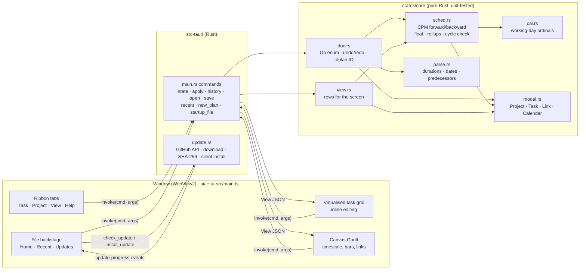
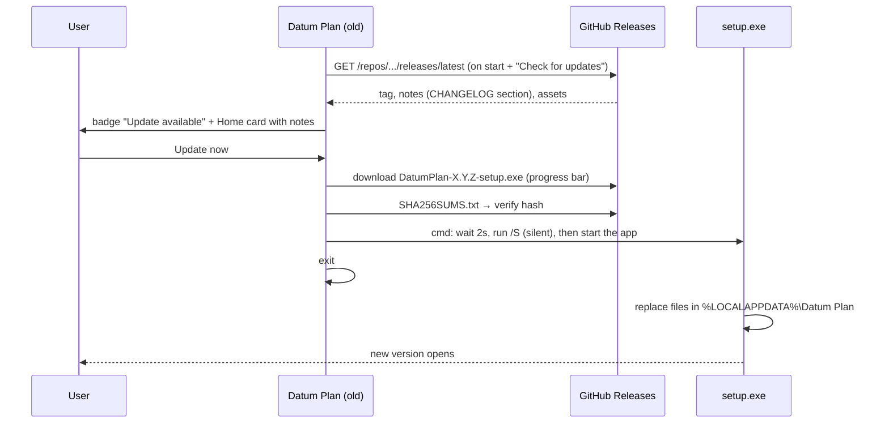
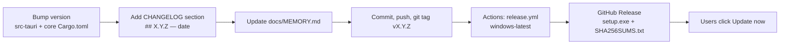

# Datum Plan: project memory

> **Paste this file at the start of each new session**, or just open the repo: `CLAUDE.md` tells Claude to read it.
> It records what exists, why, and what comes next. Update it at the end of every session.

| | |
| --- | --- |
| **Product** | Datum Plan: a Windows desktop scheduler combining MS Project (look, ease of use) and Primavera P6 (power features) |
| **Current version** | **0.1.0** (released 2026-10-24) |
| **Repo** | `Edgar-Mendonca/Datum-Plan` · working branch `claude/fervent-keller-ddas5s` (currently also the default branch) |
| **Stack** | Rust (engine + shell), Tauri 2, WebView2, strict TypeScript UI with no framework, plain CSS |
| **Code size** | About 2,100 lines in total: core about 880, shell about 310, UI about 900 |
| **Installer** | NSIS `.exe`, per-user install (size to be confirmed from the first release) |
| **Reference repos** | `Edgar-Mendonca/Cairn` (the earlier web planner, used only as a feature reference) · `Compressor-Engineering-Suite` (the Home/update pattern) |

---

## 1. Architecture

**Rule:** the UI never calculates dates. Every edit is an `Op` sent to Rust. The core applies it to a copy, normalises it, re-schedules it, and only keeps it if it is valid (so cycles are refused). It then returns a complete `View` that the UI draws.

### Files

| Path | What it does |
| --- | --- |
| `crates/core/src/model.rs` | Plan model. `Project{name,start,calendar,tasks,next_uid}`, `Task{uid,name,level,dur,preds,pct,snet,notes}`. Outline by `level`, MSP-style: a task is a summary if the next row is deeper. `normalize()` repairs levels and links. |
| `crates/core/src/cal.rs` | `WorkCal`: maps working-day ordinal ↔ date (week mask + holidays), growing lazily. |
| `crates/core/src/sched.rs` | CPM. Kahn topological order over leaf tasks. ES/EF forward, LS/LF backward, TF and FF. Summaries roll up from their leaves. SNET constraint. |
| `crates/core/src/parse.rs` | `5d / 2w / 1mo` durations, `24-Oct-26` dates, `3SS+2d` predecessor syntax (row IDs ↔ uids). |
| `crates/core/src/doc.rs` | `Op` (Insert, Delete, Set, Indent, Outdent, Link, Unlink, Project, Batch), undo/redo of up to 200 snapshots, open and save of `.dplan` (pretty JSON). |
| `crates/core/src/view.rs` | Builds `View{rows,start,finish,week,...}` with display strings and epoch-day numbers for the Gantt. |
| `crates/core/src/lib.rs` | Module list plus `sample()`: the compressor-package demo plan. |
| `crates/core/src/tests.rs` | 8 tests: calendar, CPM and float, link types and lags, constraint and rollup, cycle and undo, indent/link/delete, parsing, sample round-trip. |
| `src-tauri/src/main.rs` | Tauri commands, recent-files list (`%APPDATA%/com.edgarmendonca.datumplan/recent.json`), the unsaved-changes guard on close, `.dplan` passed on the command line. |
| `src-tauri/src/update.rs` | Reads `releases/latest` from the GitHub API, picks the `*-setup.exe` and `SHA256SUMS.txt` assets, streams the download with progress events, verifies the hash, then runs `cmd /C ping … & start /wait setup.exe /S & start app.exe` and exits. Only accepts URLs under this repo's releases. Uses the system certificate store and proxy environment variables. |
| `src-tauri/tauri.conf.json` | Window, CSP, NSIS (`installMode: currentUser`), `.dplan` file association, icons. |
| `ui/index.html` | Layout skeleton plus the SVG icon sprite. |
| `ui/styles.css` | Theme tokens (navy `#0B2A5B`, blue `#1F4E9A`, amber `#F2B233`, critical `#D64545`), ribbon, grid, backstage, dialogs. |
| `ui-src/main.ts` | The whole UI: grid virtualisation, cell editor, keyboard, canvas Gantt (timescale tiers, links, critical path), ribbon definition, backstage Home, update card, dialogs. Compiles to `ui/main.js` (gitignored). |
| `.github/workflows/ci.yml` | On every push: clippy `-D warnings`, cargo tests, TypeScript build. |
| `.github/workflows/release.yml` | On a `v*` tag: Windows build, rename to `DatumPlan-X.Y.Z-setup.exe`, write `SHA256SUMS.txt`, take notes from CHANGELOG, publish the release. |

### Update flow

### Release flow (for each version)

---

## 2. Decisions

| Date | Decision | Why |
| --- | --- | --- |
| 2026-10-24 | Name **Datum Plan**, file extension `.dplan` | The user chose it. *Datum* means a reference point. |
| 2026-10-24 | **Rust engine** in `crates/core` instead of porting Cairn's TypeScript | The user wants everything in Rust for a small, robust app. Cairn is only a feature reference. |
| 2026-10-24 | UI in **plain TypeScript, no framework** (no React) | Smallest bundle and fewest dependencies. The webview layer only draws. |
| 2026-10-24 | **Custom updater** (GitHub API + SHA-256 + NSIS `/S`) instead of `tauri-plugin-updater` | Needs no signing-key secrets, so it worked from 0.1.0. Can move to the signed Tauri updater later. |
| 2026-10-24 | Per-user NSIS install | No admin prompt, so silent updates work. |
| 2026-10-24 | Durations in whole working days for 0.1 | Simple and correct. Hours and minutes come with real calendars in 0.2. |
| 2026-10-24 | Links only between leaf tasks; indenting under a linked task removes its links | P6 behaviour, and simpler. Summary links are on the roadmap (0.2.2). |
| 2026-10-24 | Windows only; no `.mpp` support | The user's choice. `.mpp` is proprietary. Exchange formats are dplan, XML, CSV, Excel and XER. |
| 2026-10-24 | Look: MS Project layout (backstage Home, ribbon, vertical view label, grid + Gantt) in navy | Matches the user's screenshots of MS Project. |

---

## 3. Roadmap

✅ done · 🔜 next · ⬜ planned

| Version | Theme | Contents | Status |
| --- | --- | --- | --- |
| **0.1.0** | Shell + updater + core | Installer, Home/backstage, update check and one-click install, ribbon, grid editing, summaries, FS/SS/FF/SF links, CPM + float, Gantt, undo/redo, `.dplan`, recent files, sample plan | ✅ |
| 0.1.1 | Grid power | Column picker (insert/hide any field, like "Add New Column"), move rows, copy/paste and fill down, find (Ctrl+F), column sort | 🔜 |
| 0.1.2 | Gantt interaction | Drag bars (move/resize), drag to link, bar tooltips, timeline strip above the Gantt, zoom presets | ⬜ |
| 0.1.3 | Comfort | Options dialog (date format, default units), autosave + crash recovery, dark theme, remember window/column layout | ⬜ |
| 0.2.0 | Calendars | Hour/minute precision, working hours, holidays and exceptions, multiple calendars, task calendars | ⬜ |
| 0.2.1 | Constraints | SNLT, FNET, FNLT, MSO, MFO, ALAP, deadlines, manual scheduling, inactive tasks | ⬜ |
| 0.2.2 | Logic | Links on summaries, elapsed and % lags, task types (fixed units/work/duration) | ⬜ |
| 0.3.0 | Excel / CSV | Import with column mapping, export | ⬜ |
| 0.3.1 | MS Project XML | MSPDI import/export | ⬜ |
| 0.3.2 | Primavera | XER import/export, P6 XML | ⬜ |
| 0.4.0 | Resources | Resource sheet, roles, assignments, units, Team Planner | ⬜ |
| 0.4.1 | Usage | Task/resource usage (timephased), histograms | ⬜ |
| 0.4.2 | Leveling | Resource leveling with priorities | ⬜ |
| 0.5.0 | Costs | Rates over time, expenses, cost accounts, cash flow | ⬜ |
| 0.6.0 | Progress | Baselines (11+), status/data date, actuals, % complete types, tracking Gantt, progress line | ⬜ |
| 0.6.1 | Earned value | PV/EV/AC, SPI/CPI, EAC, S-curves | ⬜ |
| 0.7.0 | P6 enterprise | EPS/WBS, activity codes, UDFs, layouts, multi-project database (SQLite) | ⬜ |
| 0.7.1 | Views | Filters, groups, sorting, saved views, Global Change | ⬜ |
| 0.8.0 | Analysis | Schedule log, Check Schedule / DCMA 14-point, longest path, multiple float paths | ⬜ |
| 0.8.1 | Network | Network diagram / activity network | ⬜ |
| 0.9.0 | Output | Print and page setup, PDF, built-in reports, dashboards | ⬜ |
| 0.9.1 | Hardening | 100k-activity performance, code signing, installer polish | ⬜ |
| 1.0.0 | Stable | — | ⬜ |

---

## 4. Session log

### 2026-10-24: Session 1 (brainstorm + 0.1.0)
- Read Cairn (TS/React web planner) and CentriForge (Python/PyInstaller suite with a launcher updater) for reference.
- Wrote `docs/BRAINSTORM.md` (the feature map of MSP + P6) and a draft logo (`docs/brand/datum-plan-icon.svg`).
- The user approved the name, Windows only, no `.mpp`, everything in Rust/Tauri 2, and small step-by-step releases. They sent MS Project screenshots (Home backstage, ribbons, Gantt with timeline, column list, Task Information).
- Built 0.1.0: the Rust core with 8 tests, the Tauri shell, the custom updater, the TypeScript UI, CI and release workflows, CHANGELOG, README and this file.
- Checked by running the real app under Xvfb: Home, sample plan, grid typing, Task Information, indent + undo, View tab, Save dialog → `.dplan`, Recent list, update check against GitHub.
- Tagged `v0.1.0` so release.yml publishes the installer.

---

## 5. Known limits and next steps
- Windows SmartScreen warns on the first install because the installer is unsigned. Updates after that are silent.
- Scrolling 10k+ rows is untested (the grid is virtualised and links loop over all rows); profile this in 0.9.1.
- The end-to-end updater can only be tested once 0.1.1 is released: install 0.1.0, then click Update now.
- Next session: start **0.1.1** (column picker, move rows, copy/paste, find).
