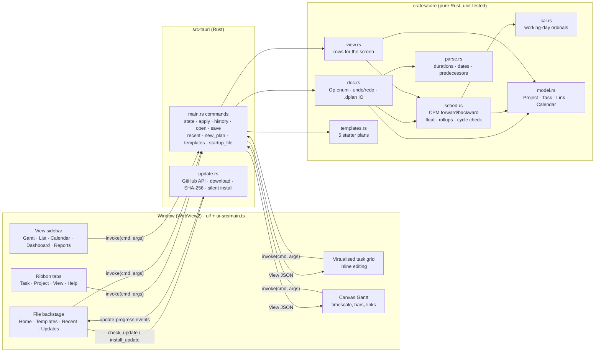
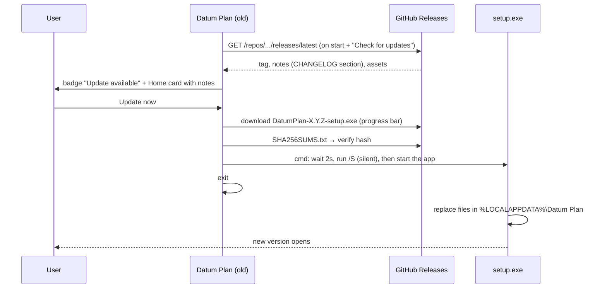
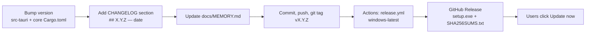

# Datum Plan: project memory

> **Paste this file at the start of each new session**, or just open the repo: `CLAUDE.md` tells Claude to read it.
> It records what exists, why, and what comes next. Update it at the end of every session.

| | |
| --- | --- |
| **Product** | Datum Plan: a Windows desktop scheduler combining MS Project (look, ease of use) and Primavera P6 (power features) |
| **Current version** | **0.1.1** (released 2026-10-24) · 0.1.0 released the same day |
| **Repo** | `Edgar-Mendonca/Datum-Plan` · working branch `claude/fervent-keller-ddas5s` (currently also the default branch) |
| **Stack** | Rust (engine + shell), Tauri 2, WebView2, strict TypeScript UI with no framework, plain CSS |
| **Code size** | About 2,700 lines in total: core about 1,000, shell about 340, UI about 1,350 |
| **Installer** | NSIS `.exe`, per-user install, **1.7 MB** (v0.1.0) |
| **Reference repos** | `Edgar-Mendonca/Cairn` (the earlier web planner, used only as a feature reference) · `Compressor-Engineering-Suite` (the Home/update pattern) |

---

## 1. Architecture

**Rule:** the UI never calculates dates. Every edit is an `Op` sent to Rust. The core applies it to a copy, normalises it, re-schedules it, and only keeps it if it is valid (so cycles are refused). It then returns a complete `View` that the UI draws.

### Files

| Path | What it does |
| --- | --- |
| `crates/core/src/model.rs` | Plan model. `Project{name,start,calendar,tasks,next_uid}`, `Task{uid,name,level,dur,preds,pct,snet,notes}`. Outline by `level`, MSP-style: a task is a summary if the next row is deeper. `normalize()` repairs levels and links. |
| `crates/core/src/cal.rs` | `WorkCal`: maps working-day ordinal ↔ date (week mask + holidays), growing lazily. |
| `crates/core/src/sched.rs` | CPM. Kahn topological order over leaf tasks. ES/EF forward, LS/LF backward, TF and FF. Summaries roll up from their leaves. SNET constraint. |
| `crates/core/src/parse.rs` | `5d / 2w / 1mo` durations, `24-Oct-26` dates, `3SS+2d` predecessor syntax (row IDs ↔ uids). |
| `crates/core/src/doc.rs` | `Op` (Insert, Delete, Set, Indent, Outdent, Link, Unlink, Project, Batch), undo/redo of up to 200 snapshots, open and save of `.dplan` (pretty JSON). |
| `crates/core/src/view.rs` | Builds `View{rows,start,finish,week,...}` with display strings and epoch-day numbers for the Gantt. |
| `crates/core/src/templates.rs` | 5 starter plans (engineering, EPC, software, building, research), one line per task: `level\|name\|duration\|predecessors`. |
| `crates/core/src/lib.rs` | Module list. |
| `crates/core/src/tests.rs` | 9 tests: calendar, CPM and float, link types and lags, constraint and rollup, cycle and undo, indent/link/delete, parsing, templates round-trip, finish → duration. |
| `src-tauri/src/main.rs` | Tauri commands, recent-files list (`%APPDATA%/com.edgarmendonca.datumplan/recent.json`), the unsaved-changes guard on close, `.dplan` passed on the command line. |
| `src-tauri/src/update.rs` | Reads `releases/latest` from the GitHub API, picks the `*-setup.exe` and `SHA256SUMS.txt` assets, streams the download with progress events, verifies the hash, then runs `cmd /C ping … & start /wait setup.exe /S & start app.exe` and exits. Only accepts URLs under this repo's releases. Uses the system certificate store and proxy environment variables. |
| `src-tauri/tauri.conf.json` | Window, CSP, NSIS (`installMode: currentUser`), `.dplan` file association, icons. |
| `ui/index.html` | Layout skeleton plus the SVG icon sprite. |
| `ui/styles.css` | Light theme tokens (text navy `#14325E`, primary `#2F6FCF`, sky `#9CC2F7`, amber `#F2B233`, critical `#D64545`, panels `#F7F9FC`), ribbon, sidebar, grid, pages, backstage, dialogs, print styles. |
| `ui-src/main.ts` | The whole UI: grid virtualisation, cell editor, keyboard, canvas Gantt (timescale tiers, links, critical path, drag to move/resize/link, tooltips), ribbon, view sidebar, Calendar/Dashboard/Report pages (computed from rows: planned % curve, late = finish before today and not 100%), backstage Home with template cards, update card, dialogs. Compiles to `ui/main.js` (gitignored). |
| `.github/workflows/ci.yml` | On every push: clippy `-D warnings`, cargo tests, TypeScript build. |
| `.github/workflows/release.yml` | On a `v*` tag: Windows build, rename to `DatumPlan-X.Y.Z-setup.exe`, write `SHA256SUMS.txt`, take notes from CHANGELOG, publish the release. |

### Update flow

### Release flow (for each version)

---

## 2. Decisions

| Date | Decision | Why |
| --- | --- | --- |
| 2026-10-24 | Name **Datum Plan**, file extension `.dplan` | The user chose it. *Datum* means a reference point. |
| 2026-10-24 | **Rust engine** in `crates/core` instead of porting Cairn's TypeScript | The user wants everything in Rust for a small, robust app. Cairn is only a feature reference. |
| 2026-10-24 | UI in **plain TypeScript, no framework** (no React) | Smallest bundle and fewest dependencies. The webview layer only draws. |
| 2026-10-24 | **Custom updater** (GitHub API + SHA-256 + NSIS `/S`) instead of `tauri-plugin-updater` | Needs no signing-key secrets, so it worked from 0.1.0. Can move to the signed Tauri updater later. |
| 2026-10-24 | Per-user NSIS install | No admin prompt, so silent updates work. |
| 2026-10-24 | Durations in whole working days for 0.1 | Simple and correct. Hours and minutes come with real calendars in 0.2. |
| 2026-10-24 | Links only between leaf tasks; indenting under a linked task removes its links | P6 behaviour, and simpler. Summary links are on the roadmap (0.2.2). |
| 2026-10-24 | Windows only; no `.mpp` support | The user's choice. `.mpp` is proprietary. Exchange formats are dplan, XML, CSV, Excel and XER. |
| 2026-10-24 | Look: MS Project layout (backstage Home, ribbon, grid + Gantt) | Matches the user's screenshots of MS Project. |
| 2026-10-24 (0.1.1) | **Light theme** and a new light logo; Cairn-style **left view sidebar** | The user found 0.1.0 too dark and wants Cairn's sidebar navigation. |
| 2026-10-24 (0.1.1) | No domain sample. **General templates** with mini-Gantt previews | The app is general purpose. |
| 2026-10-24 (0.1.1) | Dashboard and reports are computed in the UI from the View rows | They need no engine change. They move to Rust when actuals and baselines arrive (0.6). |
| 2026-10-24 (0.1.1) | Dragging a bar sets SNET (MSP behaviour); dragging the end sets Finish → duration; dragging vertically links | Matches MS Project. |

---

## 3. Roadmap

✅ done · 🔜 next · ⬜ planned. One small release at a time; every release goes through the in-app updater.

| Version | Theme | Contents | Status |
| --- | --- | --- | --- |
| **0.1.0** | Shell + updater + core | Installer, Home/backstage, update check and one-click install, ribbon, grid editing, summaries, FS/SS/FF/SF links, CPM + float, Gantt, undo/redo, `.dplan`, recent files | ✅ |
| **0.1.1** | Look, views, reports | Light theme and new logo, view sidebar, 5 templates with previews, drag to move/resize/link bars, tooltips, editable Finish, Task List, Calendar, Dashboard (S-curve, phases, milestones, late), weekly/monthly progress report with print/PDF | ✅ |
| 0.1.2 | Grid power | Column picker (any field, "Add New Column"), hide/reorder columns, move rows (Alt+Shift+↑/↓), cut/copy/paste rows and cells, fill down, Find/Replace (Ctrl+F/H), WBS code column, wrap text | 🔜 |
| 0.1.3 | Gantt power | Timeline strip above the Gantt, right-click menus, drag progress, link dialog (double-click a link to edit type/lag), bottom detail pane with P6-style tabs (General, Relationships, Notes), timescale dialog, zoom presets | ⬜ |
| 0.1.4 | Comfort | Options dialog (date format, units, default mode), autosave + crash recovery, Ctrl+K command search, quick-add line (`Pour slab 5d after 4`), remember layout, optional dark theme | ⬜ |
| 0.2.0 | Calendars | Hour/minute precision, working hours and shifts, holidays and exceptions, multiple calendars, task calendars | ⬜ |
| 0.2.1 | Constraints and modes | SNLT, FNET, FNLT, MSO, MFO, ALAP, deadlines, manual scheduling, inactive tasks | ⬜ |
| 0.2.2 | Logic | Links on summaries, elapsed/% lags, task types, effort-driven, recurring tasks, split tasks, schedule from finish | ⬜ |
| 0.3.0 | Excel / CSV | Import with column mapping, export | ⬜ |
| 0.3.1 | MS Project XML | MSPDI import/export | ⬜ |
| 0.3.2 | Primavera | XER and P6 XML import/export, MPX import | ⬜ |
| 0.3.3 | Print | Gantt printing with page setup, legend, PDF, PNG/SVG export | ⬜ |
| 0.4.0 | Resources | Resource sheet (work/material/cost), roles, max units, rates, assignments, Resources view | ⬜ |
| 0.4.1 | Workload | Team planner, Workload and Capacity views, task/resource usage (timephased), histograms | ⬜ |
| 0.4.2 | Leveling | Leveling (priority, within float, splitting), overallocation indicators | ⬜ |
| 0.5.0 | Costs | Rates over time, fixed costs, expenses, cost accounts, budget, cash-flow report | ⬜ |
| 0.6.0 | Tracking | Baselines (11, compare any), status/data date, actual start/finish, remaining duration, % complete types, update project, tracking Gantt, progress line | ⬜ |
| 0.6.1 | Earned value | PV/EV/AC, SPI/CPI, EAC/ETC/VAC/TCPI, S-curves against baseline | ⬜ |
| 0.6.2 | Reporting 2 | Reports with actuals vs baseline, period snapshots (store period performance), 3-week look-ahead, comments/photos per period, report pack to PDF/Excel, custom report builder | ⬜ |
| 0.7.0 | P6 enterprise | EPS tree, multi-project SQLite database, WBS codes, activity codes, UDFs, activity types (LOE, WBS summary, resource-dependent), steps | ⬜ |
| 0.7.1 | Layouts | Filters, groups, sort, saved layouts/views, highlight filters, Global Change | ⬜ |
| 0.8.0 | Analysis | Schedule log, Check Schedule (DCMA 14-point), longest path, multiple float paths, driving-path trace, schedule health score | ⬜ |
| 0.8.1 | Network | Network diagram (PERT boxes) and flow view | ⬜ |
| 0.8.2 | Risk | Risks and issues register, thresholds, what-if scenarios (compare two schedules) | ⬜ |
| 0.9.0 | Portfolio | Portfolio dashboard across projects, master/subprojects, shared resource pool | ⬜ |
| 0.9.1 | Hardening | 100k-activity performance, code signing, signed updater, crash reports | ⬜ |
| 1.0.0 | Stable | — | ⬜ |

### Features that go beyond MSP and P6
Weekly/monthly progress reports (started in 0.1.1), dashboard with S-curve (0.1.1), 3-week look-ahead, period snapshots with comments and photos, schedule health score, one-click PDF report pack, what-if comparison, quick-add sentences.

### Gap analysis: what MSP, P6 and Cairn have, and when Datum Plan gets it
| Area | MS Project | Primavera P6 | Cairn 0.8 | Datum Plan |
| --- | --- | --- | --- | --- |
| Grid editing, outline, links, CPM | ✓ | ✓ | ✓ | ✓ 0.1 |
| Interactive Gantt (drag) | ✓ | ✓ | ✓ | ✓ 0.1.1 (progress drag 0.1.3) |
| Column picker, custom fields, formulas | ✓ | UDFs | ✓ | 0.1.2 / 0.7.0 |
| Timeline view | ✓ | — | ✓ | 0.1.3 |
| Calendars (hours, holidays, many) | ✓ | ✓ | ✓ | 0.2.0 |
| Full constraints, manual tasks | ✓ | ✓ | ✓ | 0.2.1 |
| Task types, effort-driven, recurring, split | ✓ | duration types | ✓ | 0.2.2 |
| File exchange (XLSX, CSV, XML, XER) | ✓ | ✓ | ✓ | 0.3.x |
| Resources, usage, leveling | ✓ | ✓ | ✓ | 0.4.x |
| Costs, expenses, cash flow | ✓ | ✓ | ✓ | 0.5.0 |
| Baselines, actuals, earned value | ✓ | ✓ | ✓ | 0.6.x |
| EPS, activity codes, multi-project | master projects | ✓ | — | 0.7.0 |
| Filters, groups, layouts, global change | ✓ | ✓ | ✓ | 0.7.1 |
| Schedule check, longest path, float paths | — | ✓ | partial | 0.8.0 |
| Network diagram | ✓ | ✓ | ✓ | 0.8.1 |
| Dashboard and periodic progress reports | basic | basic | 16 reports | ✓ 0.1.1, more in 0.6.2 |

---

## 4. Session log

### 2026-10-24: Session 1 (brainstorm + 0.1.0)
- Read Cairn (TS/React web planner) and CentriForge (Python/PyInstaller suite with a launcher updater) for reference.
- Wrote `docs/BRAINSTORM.md` (the feature map of MSP + P6) and a draft logo (`docs/brand/datum-plan-icon.svg`).
- The user approved the name, Windows only, no `.mpp`, everything in Rust/Tauri 2, and small step-by-step releases. They sent MS Project screenshots (Home backstage, ribbons, Gantt with timeline, column list, Task Information).
- Built 0.1.0: the Rust core with 8 tests, the Tauri shell, the custom updater, the TypeScript UI, CI and release workflows, CHANGELOG, README and this file.
- Checked by running the real app under Xvfb: Home, sample plan, grid typing, Task Information, indent + undo, View tab, Save dialog → `.dplan`, Recent list, update check against GitHub.
- Released v0.1.0 through release.yml (workflow_dispatch, because the session proxy blocks pushing tags). CI and Release both green. Installer: `DatumPlan-0.1.0-setup.exe`, 1.7 MB.

### 2026-10-24: Session 2 (0.1.1)
- The user confirmed that 0.1.0 installed and works, and asked for a lighter look, a better logo, no compressor sample, a Gantt they can touch, a Cairn-style sidebar, weekly/monthly reporting, and a detailed version plan.
- Built 0.1.1 (see CHANGELOG). Checked it under Xvfb: template cards, Gantt drag-move, Dashboard, Reports, Calendar.
- Rewrote the roadmap into small steps from 0.1.2 to 1.0 and added the gap analysis against MSP, P6 and Cairn.
- Released 0.1.1. This is the first real test of the in-app updater from 0.1.0.

---

## 5. Known limits and next steps
- Windows SmartScreen warns on the first install because the installer is unsigned. Updates after that are silent.
- Scrolling 10k+ rows is untested (the grid is virtualised and links loop over all rows); profile this in 0.9.1.
- The end-to-end updater can only be tested once 0.1.1 is released: install 0.1.0, then click Update now.
- Updater end to end: 0.1.0 → 0.1.1 is the first live test. The user should confirm the update installs and restarts.
- Reports use planned dates and % complete. Actual dates and baselines arrive in 0.6.
- Next session: start **0.1.2** (column picker, move rows, copy/paste, find).
