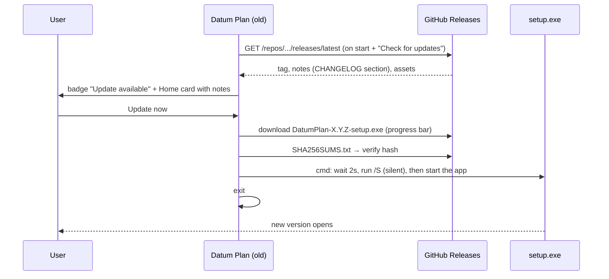
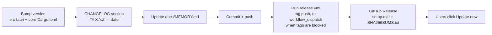

# Datum Plan: project memory

> **Paste this file at the start of each new session**, or just open the repo: `CLAUDE.md` tells Claude to read it.
> It records what exists, why, and what comes next. Update it at the end of every session.

| | |
| --- | --- |
| **Product** | Datum Plan: a Windows desktop scheduler combining MS Project (look, ease of use) and Primavera P6 (power features) |
| **Current version** | **0.4.4** (released 2026-10-29). Earlier: 0.1.0 … 0.4.3 |
| **Repo** | `Edgar-Mendonca/Datum-Plan` · working branch `claude/fervent-keller-ddas5s` (currently also the default branch) |
| **Stack** | Rust (engine + shell), Tauri 2, WebView2, SolidJS + Vite UI in strict TypeScript (TSX), plain CSS with light/dark tokens, Chart.js, IBM Plex fonts; Excel formulas from the GridCraft crates (pinned git dependency, see NOTICE) |
| **Code size** | About 9,300 lines: core 5,700 (with 460 lines of tests), shell 700, UI 2,900 TSX + CSS |
| **Installer** | NSIS `.exe`, per-user install. 1.7 MB (0.1.0), 1.8 MB (0.1.1), 2.4 MB (0.2.0); UI bundle 200 kB JS (61 kB gzip) in 0.3.0 |
| **Reference repos** | `Edgar-Mendonca/Cairn` (the earlier web planner: feature and template reference) · `Compressor-Engineering-Suite` (the Home/update pattern) |

---

## 1. Architecture

```mermaid
flowchart LR
  subgraph UI["Window (WebView2) · ui/src/*.tsx → Vite → ui/dist"]
    Store[store.ts: signals for plan, view, table, filter,<br/>group, sort, selection; act(op) and refresh()]
    Rib[ribbon.tsx: tabs, dropdowns, QAT, Tell Me]
    Grid[grid.tsx: virtual rows, inline edit,<br/>header menus, column drag/resize]
    Gantt[gantt.tsx: canvas Gantt + timeline]
    Det[details.tsx: P6 tabs]
    Views[views.tsx: network, calendar, usage, resources,<br/>graph, team, risks, checks, portfolio]
    Rep[reports.tsx: dashboard, report gallery, charts]
    Dlg[dialogs.tsx: information, calendars, custom fields,<br/>filters, groups, sorts, baselines, import, compare]
    BS[backstage.tsx + setup.tsx: File, Options, updates,<br/>Project Setup panel]
    Pl[plans.tsx: plan tabs, Link to Plan,<br/>Linked Plans panel]
  end
  subgraph Shell["src-tauri (Rust)"]
    Cmd[main.rs: state · apply · history · query · resources · field_list<br/>task_info · usage · curve · checks · network · compare · workspace<br/>open · save · import · export · save_file · pick_logo · options · recovery]
    Upd[update.rs: GitHub API · beta channel · SHA-256 · silent install]
  end
  subgraph Core["crates/core (pure Rust, 18 tests)"]
    Doc[doc.rs: Op enum · undo/redo · .dplan]
    Sched[sched.rs: CPM · calendars · progress · LOE<br/>longest path · float paths · from finish]
    Level[level.rs: resource leveling]
    Fields[fields.rs: Calc · ~450 fields · EV · custom fields<br/>formulas · indicators · filter tests]
    Query[query.rs: filter · group · sort · outline → Grid + bars]
    Rep2[report.rs · check.rs · network.rs<br/>usage · curves · compare · DCMA · layout]
    Form[formula.rs: MSP formula language]
    Sheet[sheet.rs: GridCraft Excel engine:<br/>formula columns · sheet tabs · Plan sheet]
    Links[links.rs: links between plans:<br/>states · refresh · update_all]
    Load[load.rs: timephased work and cost]
    IO[io/: mspdi · xer · table · formats pmxml/mpx/ics/html/json]
  end
  UI -- "invoke(cmd, args)" --> Cmd
  Cmd --> Doc & Query & Rep2 & IO
  Doc --> Sched
  Query --> Fields --> Sched & Load & Form & Sheet
  Rep2 --> Fields
  Cmd --> Links --> Sched
```

**Rules:**
- The UI never calculates dates, values or filters. Every edit is an `Op`; the core applies it to a copy, normalises, schedules and keeps it only if valid.
- After an edit `apply` returns `Out` (project settings without tasks + `Summary`). The window then calls `query(Query)` for the rows it shows; `Calc` (fields.rs) evaluates any field for any row.
- Window-only settings (saved filters, extra tables) live in `Project.ui`; the Entry table's columns in `Project.columns`.

### Time model (since 0.2)
- **Instants** are minutes since 1970-01-01 00:00 local time. **Durations and lags** are working minutes.
- `Project.day_min` (default 480) converts days. A week is 5 days and a month is 20 days.
- `Task.unit` remembers how the duration was typed (h, d, w, mo) so it is shown the same way.
- **Calendars:** `week: [Vec<(start_min, end_min)>; 7]` (Monday first) plus `exceptions` (date ranges; empty hours mean not working).
- The project calendar is `Project.calendar`. Each task can use its own `Task.cal`.
- **Scheduling:**
  - Forward pass: `ES = max(link requirements, constraints, data date)`, snapped to working time. Milestones may sit at the end of a shift.
  - Backward pass: works on late dates, which SNLT, FNLT, MSO, MFO and deadlines all limit.
  - Lags count on the successor's calendar.
  - Total float = working time between EF and LF.
  - A link to or from a summary applies to every leaf task under it.
  - `normalize()` drops links between a task and its own ancestors.
- **Progress:** an actual finish fixes the task. An actual start with % < 100 puts the remaining work after the status date (status date + 1 day, 00:00). Unstarted tasks cannot start before the status date. Setting % fills in actual dates; 0% clears them.

### Files

| Path | What it does |
| --- | --- |
| `crates/core/src/model.rs` | File format 3: Task (also task type, effort, activity/% complete type, physical %, elapsed, splits, leveling delay, priority, fixed cost + accrual, custom values, codes, steps, notebook, expenses, docs, 11 baselines in `bls`), Resource (rate tables, availability, calendar, overtime), Project (setup fields, logo, currency, Activity ID numbering, `SchedOpts`, custom field defs, codes, risks, snapshots, `ui`). Migrates formats 1–2. |
| `crates/core/src/cal.rs` | `WorkCal`: working-time arithmetic. |
| `crates/core/src/sched.rs` | CPM → `Sched` (es/ef/ls/lf/tf/ff, edges with driving flags, longest path, float paths, calendars incl. a 24-hour one). `critical()` follows the options. |
| `crates/core/src/level.rs` | Serial leveling with a fixed rank; `clear`. |
| `crates/core/src/load.rs` | Work/cost per task, assignment and day (rate tables, accruals, actuals); `buckets(day/week/month/quarter)`. |
| `crates/core/src/formula.rs` | MS Project formula parser and evaluator (34 functions). |
| `crates/core/src/fields.rs` | Field registry (`task_fields`, `resource_fields`), `Calc` (one scheduled plan + loads + EV), `val/text/format/icon`, filter `test`, `money`. |
| `crates/core/src/query.rs` | `Query` → `Grid` (cols, rows with cells, icons, bar geometry), built-in filters, `Summary`. |
| `crates/core/src/report.rs` | Usage grids, cost/EV curves, compare; reporting periods (`period_ends`), weighted progress S-curves (`scurve`: planned from baseline, actual linear from actual start to today's %, forecast), `period_report` (this vs previous period, WBS, lists, hours). |
| `crates/core/src/sheet.rs` | GridCraft bridge: value conversion (dates ↔ Excel serials, durations in days), `[Field]` translation, `task_formulas` (all Excel formula columns in one in-memory workbook, one row per task), `book`/`sheet_view` (Plan sheet with table `Tasks` + Resources sheet with table `Resources` + project names, then user tabs; GridCraft numfmt display with date/% inference; spilled cells), `functions`, `shift`/`adjust`/`rename` (formula reference rewriting). |
| `crates/core/src/check.rs` | DCMA 14 + P6 checks with limits. |
| `crates/core/src/network.rs` | Network Diagram layout (columns by logic, rows by predecessor position). |
| `crates/core/src/parse.rs` | Durations (also elapsed), dates, predecessors (also % lags), resources, quick add. |
| `crates/core/src/doc.rs` | Ops (see the enum: edits, Level, Split, Interim, UpdateProject, Snapshot, ProjectSet, FieldDef, CodeDef, Risk, TaskList, ResJson, Ui, Baseline n, …), undo/redo, `.dplan`. |
| `crates/core/src/io/` | `mspdi.rs`, `xer.rs`, `table.rs` (CSV/XLSX in with mapping; out with chosen columns), `formats.rs` (JSON, HTML, ICS, MPX, PMXML out), `xml.rs`. JSON/dplan import. |
| `crates/core/examples/` | `bench.rs` (20k-task timing), `dump.rs` (JSON fixtures for UI tests). |
| `crates/core/src/tests.rs` | Engine tests (26). |
| `crates/core/src/risk.rs` | Schedule risk (Monte Carlo): `SimOpts` (iterations, default range −low/+high %, seed), `simulate` → P10/50/80/90, chance of the planned finish, finish-day histogram, cost P50/P80, criticality, drivers (correlation), risk hit rates. Triangular draws; every run is a full `schedule()`. |
| `docs/guide/en.md`, `zh.md`, `img/`, `pdf/` | The Datum Plan Guide: Markdown sources (English, Simplified Chinese), screenshots, built PDFs (attached to every release as `DatumPlan-Guide-en.pdf` / `-zh.pdf`). |
| `tests_ui/guide_shots.cjs` | Guide screenshots: the built window with `dump guide` (a plan in progress) behind the mocked bridge, numbered markers drawn on the page, optional clip. Home and Project Setup come from the real app (Xvfb). |
| `scripts/guide.cjs` | Builds the guide PDFs: small Markdown subset → HTML (cover, clickable contents, figures, tips, tables, `[[keys]]`) → Chromium A4 PDF with page numbers; IBM Plex + Noto Sans SC (`@fontsource/noto-sans-sc`, dev only). `npm run guide` runs both scripts. |
| `crates/core/src/ops.rs` | The named operations catalogue (name, what it does, example JSON); a test applies every example. |
| `crates/cli/` | `datum-cli`: info, schedule, ops, apply, export, risk, lookahead, new, templates, and `mcp` (Model Context Protocol over stdio: open_plan, new_plan, get_schedule, list_operations, apply_operation, undo, schedule_risk, lookahead, save_plan…). Shipped as `datum-cli-X.Y.Z.exe` in each release (in SHA256SUMS.txt). |
| `crates/core/src/progress.rs` | Progress history: `credit_library`, `manpower` (people per period by trade: planned / done / forecast), `earned_schedule` (ES, SPI(t), SV(t), IEAC(t)), `lookahead` (tasks in the next weeks + open/overdue constraints). |
| `ui/src/progress.tsx` | Manpower and Look-ahead views, Rules of Credit dialog. |
| `ui/src/risk.tsx` | The Schedule Risk view (`simrisk`). |
| `crates/core/src/cases.rs` | Hand-worked scheduling cases (47 cases, 90+ task dates): rows as "duration \| preds \| field=value" set through `doc::set`, results as "early start, early finish, float". |
| `crates/core/src/parity.rs`, `crates/core/tests/parity/` | Parity files: XML/XER plans with their own dates (`network.xml`, `network.xer`, hand-made); the test reschedules and compares every task to the minute. Drop real exports from other tools in the folder. |
| `crates/core/src/hardening.rs` | Hardening tests: a failed edit changes nothing, 1,000 random plans schedule with sane dates, ~3,000 damaged XML/XER/JSON files never panic, 2,000 tasks reschedule fast (debug < 400 ms; release ~3 ms). |
| `deny.toml` | `cargo deny check`: advisories, licences (MIT-compatible list), sources (crates.io + gridcraft git). |
| `SECURITY.md`, `CONTRIBUTING.md` | How to report a problem, what the app protects; how to build and the checks to run. |
| `src-tauri/src/main.rs` | Commands listed in the diagram; options (date format, autosave, beta, default currency, company, logo, workspace, setup panel); backups of format < 3 files; recovery. |
| `src-tauri/src/update.rs` | Updater; `check(beta)` reads `/releases` when beta is on; versions compare with pre-release tags. |
| `ui/index.html` | Root and the icon sprite (about 65 icons). `ui/public/logo.svg`. |
| `ui/src/api.ts` | Types matching the Rust JSON, `invoke`, date and money helpers. |
| `ui/src/store.ts` | Global signals, built-in tables, `query()`, `refresh()`, `act()`, menus, dialogs, toast, theme (`applyTheme`, `themeTick`). |
| `ui/src/cmds.ts` | Command functions `C` and the `ALL_CMDS` list for Tell Me. |
| `ui/src/ui.tsx` | Icon, Menu (with submenus), Dialog (optional `help` key puts a ? in its header), Tabs, form helpers. |
| `ui/src/help.tsx` | "?" help: the `HELP` table (`{ t, what, how?, tip? }` per topic), `<Help k>` (the small ? button, `.help`), `helpCard(k)` (the card dialog, `.helpcard`). Ribbon groups take `h=` on `G`, pages `help=` on `Page`/`Tools`. Help › What Is This Tool? lists every topic. |
| `ui/src/grid.tsx` | Excel-like task sheet: one scroller with sticky header and frozen ID/name, ranges (`ranges` signal), fill handle, TSV clipboard via copy/paste events, `Cells` op for range edits, AutoFilter menus, header rename (`Title` op), `FormulaBar`. |
| `ui/src/dashboards.tsx` | Custom dashboards: `DashTabs`, `CustomDashboard` (12-column tile grid, edit mode, drag reorder, size menu), tile views (number, ring, chart, table, countries, text), `editTile` dialog, `TEMPLATES`; formulas evaluated in one `dash_eval` call; stored in `ui.dashboards`. |
| `ui/src/charts.tsx` | Chart.js wrapper used by every chart: modern style (smooth lines, faded fill, rounded bars, light grid), status pill, hover line, resize with box and for print, empty-data text, PNG save. |
| `ui/src/sheets.tsx` | Sheet tabs, Excel-like: point-and-click references with coloured boxes, suggestions + argument hints, AutoSum, fill/paste moving formulas (`formula_shift`), insert/delete rows/cols (`SheetInsert`), number formats, column widths, error tips, flag cells. |
| `ui/src/formulas.ts` | Pure formula-text helpers for the editor: `refs`, `canPoint`, `suggest`, `callAt`/`sigArgs`, `cycleAnchor` (F4), `ERRORS`. |
| `ui/src/sheetdlg.tsx` | Insert Function (search, categories) and Plan Data (live FILTER/SORT/CHOOSECOLS list of Tasks or Resources). |
| `ui/src/flags.tsx` | Country flags (flag-icons SVGs, MIT, lazy assets): `countryCode` (code/name/alias), `Flag`, `FlagText`, `CountryList`. |
| `ui/src/print.tsx` | File › Print (every view; `pkind()` = gantt / net / cal / table / flow; `Frame` draws paper + header/footer/legend; `vdata`/`vpages`/`ViewPage` for network tiles, calendar months and tables; `FlowDoc` prints report pages in a table whose thead/tfoot repeat, with page numbers from `@page` margin boxes): `PageSetup` (saved in `project.ui.page`), `layout()` makes one strip (table columns + chart) and cuts it into page windows (across then down), `Strip` draws a window, `Sheet` draws one page as SVG (table + Gantt + legend) with header/footer codes and logos; `printNow` renders `#printroot` and sets `@page` size, then `window.print()`. `PAPERS`. |
| `ui/src/roadmap.tsx` | File › Roadmap: the `ROADMAP` list (keep it in step with the roadmap table and "Pending and next" in this file). |
| `ui/src/selection.ts` | The grid engine's selection, shared by the task sheet and Sheets: `createSel` (ranges, active cell, pick/drag/rows/cols/all/each), `aggregate` (Sum/Average/Count). |
| `ui/src/cells.ts` | Shared by both grids: `parseTsv`/`toTsv`/`transpose`, `series` (Excel fill rules), `clip` (last copy: values + styles for Paste Special). |
| `ui/src/fmt.ts` | Text formatting: style strings `b;i;u;s;c:#hex;f:#hex;z:12;a:c`, `css()`, the focused grid registers a `Target` (get/set selected cells), toggle/setProp/clear, Format Painter. |
| `ui/src/tools.tsx` | Update Progress page, Relationship Diagram (SVG), Report Builder (sections, `TEMPLATES`, saved in `ui.reports`). |
| `tests_ui/run.cjs` | Playwright UI tests against the built UI with a mocked shell and `dump` fixture (alignment, ranges, menus, ribbon, sidebar, every view). Runs in CI. |
| `gantt.tsx`, `details.tsx`, `views.tsx`, `reports.tsx`, `dialogs.tsx`, `ribbon.tsx`, `backstage.tsx`, `setup.tsx`, `main.tsx` | As in the diagram. `styles.css` holds the light theme and print styles. |

### Update flow



### Release flow



### How we work (the workflow, since session 1)
1. **The user reviews the last release** in the app and sends screenshots with bugs and wishes.
2. **Diagnose first.** Reproduce the problem in the test harness or the real app before changing code. Small fixes go straight to a release.
3. **Bigger asks get a plan file** (`docs/PLAN-x.y.z.md`): feedback, diagnosis, proposal by area, size, and questions. The plan is logged in this file and pushed. Build only after the user answers.
4. **Build in small steps**, engine first (`crates/core`, with a unit test), then the UI. Keep code compact and in the surrounding style.
5. **Check in the real app** under Xvfb (`scratchpad/app.sh` restarts Xvfb and the app, opens the Engineering template and skips Setup), with screenshots of each change. Fix what looks wrong.
6. **Add a UI test** for every reported bug and new feature (`tests_ui/run.cjs`, Playwright against `ui/dist` with the `dump` fixture). Make sure it fails on the old code where possible.
7. **Run the checks:** clippy `-D warnings`, `cargo test --workspace`, `npm run check:ui`, and the UI tests after `npm run build:ui` + `cargo run -p datum-core --example dump > tests_ui/fixture.json`.
8. **Release:** bump both Cargo.toml files, write the CHANGELOG (it becomes the in-app "What's new"), update this file (version, roadmap, files, decisions, session log, limits), commit, push, run `release.yml` (workflow_dispatch), then watch CI + Release and confirm the installer.
9. **Report to the user** in plain language: what changed, what was checked, what is not done, and anything to check on Windows.

Releases so far: 0.1.0, 0.1.1, 0.2.0, 0.3.0 (MSP look + P6 power), 0.3.1 (Excel grid, formulas, periods), 0.3.2 (builder, power tools), 0.3.3 (hotfix), 0.3.4 (print + formatting), 0.3.5 (ribbon tabs, Setup page, columns), 0.3.6 (print every view, network, timeline zoom), 0.3.7 (tracking, templates, whiteboard network, grid engine), 0.3.8 (print links, date picker), 0.3.9 (? help beside the tools), 0.3.10 (Roadmap), 0.3.11 (hardening quick wins), 0.3.12 (trust in the dates), 0.4.0 (schedule risk, trades, levelling preview, import report), 0.4.1 (progress history), 0.4.2 (hardening, CLI + MCP, print), 0.4.3 (publisher "Datum"), 0.4.4 (the guide, English and Chinese).

---

## 2. Decisions

| Date | Decision | Why |
| --- | --- | --- |
| 2026-10-24 | Name **Datum Plan**, file extension `.dplan` | The user chose it. |
| 2026-10-24 | **Rust engine** in `crates/core`; Cairn is only a reference | The user wants everything in Rust for a small, robust app. |
| 2026-10-24 | UI in plain TypeScript with no framework, split into 7 script files joined by tsc | Small bundle; modules without a bundler. |
| 2026-10-24 | Custom updater (GitHub API + SHA-256 + NSIS `/S`); per-user install | Needs no signing secrets; silent updates. |
| 2026-10-24 | Windows only; no `.mpp` (closed format) | The user's choice. Exchange formats are dplan, XML, XER, XLSX and CSV. |
| 0.1.1 | Light theme, new logo, Cairn-style sidebar, general templates | The user's feedback on 0.1.0. |
| 0.2.0 | **Minute-precision engine with real calendars** (replacing whole days) | Needed for hours, shifts, holidays and P6/MSP exchange. Old files migrate (day × 480). |
| 0.2.0 | Several roadmap steps shipped as one release (0.1.2–0.1.4, calendars, constraints, logic, exchange, resources, baselines/progress) | The user asked for all of it in 0.2. |
| 0.2.0 | Links on summaries apply to every leaf under them; links to one's own summary are dropped | Simple and close to MSP. P6 has no summary links anyway. |
| 0.2.0 | Status date semantics: progress up to the end of that day; remaining work starts the next day | MSP-like status date. XER `last_recalc_date` maps to status = data date − 1. |
| 0.2.0 | Work-resource units: `50%`, `0.5` or `50`; material: quantity; cost: amount | Matches MSP habits. |
| 0.2.0 | Predecessor IDs typed with new rows (quick add, paste) mean the IDs shown before the insert | What the user sees on screen. |
| 0.2.0 | XML reader written by hand instead of quick-xml | The quick-xml API changes a lot between versions; MSPDI only needs elements and text. |
| 0.2.0 | Recovery copy in AppData, not autosave over the user's file | Safe: never overwrites a file without asking. |
| 0.3 plan | **SolidJS + Vite** for the UI (not Astro) | Small reactive components for MSP-level dialogs, ribbon and report designer. Astro targets content sites. |
| 0.3 plan | **Local-first:** `.dplan` files plus a workspace file; no server, no cloud, no telemetry (the only network call is the update check) | Open source, everything stays on the user's computer. |
| 0.3 plan | Betas through an opt-in updater channel; slipped items go to 0.3.1 | The user wants to check the big release step by step. |
| 0.3 plan | **Datum scheduling style** (PLAN-0.3 §3.P): fixed duration, single Progress field, retained logic, slack ≤ 0 critical with a longest-path switch, auto actuals, an Explain panel, calculated cells marked | The user wants something easier than both MSP and P6. |
| 0.3 plan | **Project Setup** panel (skippable, docked right) as step one of every new plan; all ISO currencies; logo and company branding; Activity IDs A1000+10; MSP-style network; MSP density; English only; beta backups | The user's answers, 2026-10-24. |
| 0.3 plan | `docs/reference/MSP-P6-feature-reference.md` (from the user) is the behaviour spec; its C2 scenarios become tests and a checklist | A shared, written definition of done. |
| 0.3.0 | Shipped as one release (no betas) because the user asked to "build and release 0.3" | Betas stay available through the opt-in channel for later versions. |
| 0.3.0 | The engine owns fields, filters, groups and sorts (`Calc` + `query`); the window asks for rows per view | One place for values, exports use the same text; 20k tasks query in ~50 ms. |
| 0.3.0 | Print/PDF through the WebView print dialog ("Save as PDF") with print CSS, instead of a PDF library | No extra dependency; works for every view and report. |
| 0.3.0 | Templates still use the Project Setup panel (setup_done = false) | Setup is step one of every new plan, as agreed. |
| 0.3.1 | Keep the MS Project ribbon and layout; adopt only CentriForge's styling (IBM Plex, palette, square controls, mono labels) | The user's answer: improve the current UI, don't replace the command bar. |
| 0.3.1 | Light / Dark / Auto theme via CSS tokens on `:root[data-theme]`; canvas colours read the tokens | The user asked for all three. |
| 0.3.1 | Formulas are per column (MS Project style) in Excel syntax with `[Field]` names, evaluated by GridCraft; cell references only in sheet tabs | The user's answer. GridCraft gives ~400 Excel functions without writing them. |
| 0.3.1 | GridCraft as a pinned git dependency (calc, model, core), not a fork | Small surface (one module), easy upgrades, attribution in NOTICE. |
| 0.3.1 | Grid stays DOM (virtual rows) with a single scroller and sticky header, not canvas | Fixes the alignment bug at the root; real inputs for editing. |
| 0.3.1 | Reporting periods per plan (week end day, month close day, weighting) chosen by the user | The user's answer: it varies by project. |
| 0.3.1 | Charts with Chart.js in a Prism style; PNG save on every chart | The user asked for elegant, hoverable charts like Prism/plotly; Chart.js is small. |
| 0.3.1 | Period notes and photos stored inside the .dplan (photos downscaled to 1400 px JPEG) | Portable single file; the user left it to us. |
| 0.3.2 | Big ribbon buttons with both a command and a menu are MS Project split buttons; contextual tabs carry their group label above the tab | The user's screenshots of 0.3.1. |
| 0.3.2 | Report Builder reports and conditional-format rules live in `project.ui` (no format change) | Saved with the plan, no migration. |
| 0.3.2 | Recurring tasks are a summary with SNET-constrained occurrences | Same as MS Project; occurrences stay ordinary tasks. |
| 0.3.3 | Effects that mirror outside selection into the grid use `on(sel, …)` with `untrack`, never track `cur`/`ranges` | Tracking `cur` made the effect run before the sel sync and snap the row back (the 0.3.3 bug). |
| 0.3.3 | Task sheet and Sheets tabs should share one grid component (selection, clipboard, fill, formula bar); GridCraft stays the formula engine underneath; scheduling stays in `crates/core` | The user asked to use the Sheets grid for scheduling. Task rows are not free cells (they carry types, links, outline, validation), so the shared part is the UI grid, not the data model. |
| 0.3.9 | **? help beside the tools in every Datum app**: a small ? beside each ribbon group, page, panel and main dialog opens a card (what it is for, how to use it) from one `HELP` table in `ui/src/help.tsx`; Help › What Is This Tool? lists them all. No separate teaching mode | The user's words: "at some of the tools, we can add a small question mark icon… we should do it in all of our applications." Built first in Datum Atlas 0.1.1; same code and styles in every app. |
| 0.4.4 | The guide is a PDF per language, downloaded on demand (not in the installer): `update::guide(lang)` fetches `DatumPlan-Guide-{lang}.pdf` from this version's release (else latest), requires a matching line in that release's SHA256SUMS.txt and a `%PDF` header, caps 60 MB, saves to Downloads ("Datum Plan Guide.pdf" / "Datum Plan 使用指南.pdf") with `write_atomic`, opens it | The user: keep the installer small; inside the app, one click. Same trust rules as updates. |
| 0.5.0 | Sheets read the plan through GridCraft tables and names (`Tasks[Finish]`, `Resources[Country]`, `ProjectFinish`, `SPI`), not copied values; the Plan sheet keeps its first 18 columns (A–R) so `Plan!M:M` formulas still work; percentages stay 0–100 like the task sheet | The user built Excel dashboards by copying MSP values by hand. Names are readable and survive column changes; old files keep working. |
| 0.5.0 | Excel habits come from GridCraft, not re-implemented: `shift_relative` for fill/paste, `adjust` for insert/delete rows/cols, `rename_sheet`/`delete_sheet`, `numfmt` for formats, `functions::all()` for suggestions | The user: use GridCraft's engine. Small bridge in `sheet.rs`. |
| 0.5.0 | Flags are a cell format ("flag") and a resource `country` field, drawn from flag-icons SVGs bundled as separate lazy files (not emoji) | Windows does not draw flag emoji. Files load only when shown; 271 SVGs ≈ 2.7 MB. |
| 0.5.0 | Custom dashboards are 0.5.3 (0.5.1 and 0.5.2 became fix and chart releases), built on the 0.5.0 sheets | Sheets first so dashboard tiles can read sheet ranges and plan names. |
| 0.5.3 | Custom dashboards live in `ui.dashboards` (JSON tiles), beside the built-in one, not in the Report Builder | The builder makes long reports (sections down the page); a dashboard is one board of tiles. Both reuse the same charts and tables. |
| 0.5.3 | Tiles read the plan through formulas (`sheet::eval`: one extra workbook sheet per formula; a plain `=Sheet!A1:C9` keeps that sheet's formats, flags included) | One way to get any figure, the same as Sheets; no special data model per tile. |
| 0.5.2 | Charts stay on Chart.js (not Plotly), restyled like the Chart.js samples: Tailwind-like palette replaces Okabe-Ito, no black axes, `cubicInterpolationMode: monotone` (no overshoot on S-curves), per-period lines straight; every chart registers in `live` and resizes on beforeprint/afterprint and with a ResizeObserver; the canvas is absolutely positioned so it never sizes its box | The user found the old Prism-style charts unattractive and saw charts cropped (printed canvases kept their screen width). Chart.js is small (~200 KB) and prints well; Plotly (~3.5 MB) suits Datum Plot. |
| 0.5.4 | Resource calendars are a project option, off by default (`opts.res_cals`), plus a per-task `ignore_rc`; with it on, a task's candidate calendars are one per work resource with units > 0 (intersected with the task calendar when it has one) and the one giving the latest finish wins (`pick` in sched.rs, `ci` is a `Cell` during the forward pass); a person's calendar is their base calendar plus `Resource.exceptions` | The user wanted it "as another part" that changes nothing already built. Latest-finish-wins is how both MSP (assignments on their own calendars) and P6 (resource-dependent activities) end a task; one calendar per task keeps float and the backward pass simple. |
| 0.5.5 | Links between plans are external predecessors on the task (`Task.ext`: file, uid, type, lag, plus the last known plan/code/name/start/finish), scheduled like a link from fixed dates; they change only on Update Links, never silently when another plan changes | Each team keeps its own file and stays in control ("if I have the control of linking or not linking"); a plan opened alone still schedules the same. Same idea as linked external activities elsewhere, kept simple. |
| 0.5.5 | Tabs live in the shell (`App { doc, others, cur }`): the shown plan is always `doc`, so every existing command works unchanged; `switch_tab` swaps | No change to the ~80 commands; one plan at a time in the engine. |
| 0.5.5 | Update All iterates passes over all open plans (and files of plans not open) until no date moves, at most 4×plans+4 passes, else an error (a loop) | Plans may link both ways (main → subplan → main); order-free and simple. |
| 0.5.5 | A combined master view (all linked plans in one Gantt) is left for 0.6 | The user asked for links and tabs first; the master view needs a read-only multi-plan query. |
| 0.5.6 | Links are shown where people look: marks by the ID and labels on the Gantt, in two colours (purple = waits for another plan, green = another plan waits for it); "waited on" is worked out by the shell from the other open plans (`waited_on`), not stored | The user could not tell from the main schedule what was linked to what. A link is stored once, on the waiting task; the other direction comes from the plans that are open. |
| 0.5.7 | "Moved" is worked out from open plans only (`link_status` schedules each open plan a link points at, on every `out`/`query`); closed plans are checked in Linked Plans | Cheap enough for a few plans; reading files on every edit would not be. Recovery is rewritten from the open tabs (`write_recovery`) after save, save all, close and autosave, instead of being cleared. |
| 0.5.8 | A project is a master plan holding the ordered list of its subplans with a depth (`SubPlan { file, name, level }`), each subplan naming its master (`Project.master`); no separate project file. Order and depth only arrange plans and tabs; dates come from links. One master per subplan; a master cannot be a subplan | The user: "the main is the master schedule, all the others are the sub… should look like a group… defining the hierarchy". Keeping the list in the master needs no new file type and travels with the folder. |
| 0.5.8 | The shell keeps a project's tabs together (`regroup` after every tab change and edit): master, then its open subplans in list order; colour by project name | Tabs read as one project without a separate project bar. |
| 0.5.8 | Adding a subplan saves the master (and a subplan's note of its master) only when that plan had no other unsaved changes (`save_if_clean`) | Otherwise a forgotten save loses the project list; other edits are never saved unasked. |
| 0.5.9 | The combined view is built by the shell after the master's own grid (`combined` in main.rs): each subplan's grid with the same columns and its project row as the subplan row; its tasks get `uid` 0 and `sub`/`suid`, links cleared, so nothing edits them and arrows never join the wrong tasks. Closed subplan files are cached by modified time (`App.files`). Expanded subplans are a window setting (`openSubs`), not saved | Read-only keeps one place to change each task (its own plan) and needs no cross-plan edits in the engine. |
| 0.5.10 | Save as PDF uses WebView2's PrintToPdf (`src-tauri/src/pdf.rs`, Windows only; `webview2-com` 0.39 as Tauri uses) with the page size, zero margins (Gantt pages hold their own margins) and no header/footer; elsewhere the print dialog. The page setup (`@page`, `html.printing`) is removed on `afterprint`, never on a timer | The user's PDFs had the browser's date/title/address and blank half-pages: WebView2 reads the page setup after `window.print()` returns, when the old code had already removed it. Direct PDF also makes the file exact and dialog-free. |
| 0.5.10 | Header & footer default to a simple form (pictures, title, subtitle, tick boxes) and print nothing the user did not choose; code boxes stay under Advanced; old page setups with their own text keep the code boxes | The user: "it should be very simple… not like MS Project"; professional prints show no program name. |
| 0.5.10 | Class names in `styles.css` are prefixed by their part (plan tabs `plantab`, print `p…`) | The plan tabs reused `ptab` and broke the print panel; third class clash after `fill`/`edit` (0.5.3) and `top` (0.5.1). |
| 0.4.4 | Guide text in Markdown in the repo; the Chinese guide keeps English UI names in bold with the Chinese meaning beside them; screenshots stay in English with numbered orange markers | The app is English-only; readers must find the buttons. Easy to keep up to date each release (CLAUDE.md step 3). |
| 0.4.3 | Windows publisher is "Datum" (`bundle.publisher`; the copyright stays "© 2026 Edgar Mendonca"). `src-tauri/windows/hooks.nsh` (NSIS_HOOK_PREINSTALL) reads the old `Software\Edgar Mendonca\Datum Plan` install-folder key, installs there if it differs, and deletes the old key | Family rule (FAMILY §9 in the hub). Tauri's NSIS remembers the folder under `Software\<publisher>\<product>`; the uninstall entry and the default folder use only the product name, so default installs update in place. |
| 0.4.2 | Release builds unwind (not abort); `guard()` in the shell turns a panic in apply/open/import/risk/level preview into an error message; a panic hook appends to `crash.log` in the app data folder | Abort closed the app on any panic and made the poisoned-lock recovery useless. |
| 0.4.2 | `Project::normalize` clamps spans to `MAX_SPAN` (10,000,000 working minutes ≈ 80 years), lags in % to ±10,000, units to 0–1000, non-finite numbers to 0, splits to 100, `day_min` to 1–1440; `parse::dur` caps at `MAX_SPAN`; `WorkCal` saturates at a horizon (1800–2600), `date_of` saturates | Hostile values panicked in calendar arithmetic (`succ_opt().unwrap()` past the last date). |
| 0.4.2 | `WorkCal::between` counts whole weeks arithmetically (plus exception corrections) for spans over 28 days; daily S-curves fall back to weeks beyond ~10 years | A task spanning centuries froze the S-curve (O(days²)). |
| 0.4.2 | Saves use `doc::write_atomic` (temp file + rename) for plans, autosave, recovery, options, recent, exports; reads use `doc::read_limited` (300 MB) | No half-written files; no out-of-memory on giant files. |
| 0.4.2 | Updater: SHA256SUMS.txt is required; exact file-name match; installer name `*-setup.exe` of safe characters; unique download folder; 200 MB cap | A release without checksums used to install unverified. |
| 0.4.2 | CSV export prefixes `'` to text starting with = + - @ (unless a plain number) | Formula (CSV) injection. |
| 0.4.2 | Money: each task's cost and actual cost rounded to the currency's minor unit before roll-up (rates keep their decimals); typed fixed costs rounded | Totals equal the sum of shown amounts, without changing the f64 model. |
| 0.4.2 | CLI and MCP change plans only through `Op` (the window's operations); the MCP server writes only plan/export extensions and only on `save_plan`; panics in a tool call are caught | One way to change a plan; safe for an assistant. |
| 0.4.2 | Print: Schedule Risk, Look-ahead and Manpower are flow views (`FLOWS`), named in `VIEW_NAMES`; the last risk run is stored in `project.ui.risk` | They printed the Dashboard (the `FLOWS` fallback). |
| 0.4.1 | Actual progress between stored periods is a straight line through each snapshot's % (then to today's % at the status date); tasks no snapshot recorded keep the old working-time line (`report::history`, `along`) | The actual S-curve should show when progress really happened; snapshots already stored each task's %. |
| 0.4.1 | Manpower "Done" is earned hours (planned hours × progress), not booked hours; planned spreads work evenly over baseline (or current) dates; people = hours ÷ one person's working hours in the period | There are no timesheets in the model; earned hours are honest and consistent with the S-curve. |
| 0.4.1 | Earned schedule uses the same weights and curves as the S-curve, in working days on the project calendar | One definition of progress everywhere; works without costs. |
| 0.4.1 | Rules of credit are step templates (`CreditRule`) that `ApplyCredit` copies into a task's steps and sets % Complete Type to Physical; quantities set physical % = installed ÷ planned. Physical % now drives the S-curve for physical tasks | Reuses steps and physical %, which already drove earned value. |
| 0.4.1 | Constraint log is `Project.log` (`LogItem`), edited with `Op::Log`; ready = no open items; overdue = open with a need-by date before the status date | Look-ahead planning needs readiness, not just dates. |
| 0.4.1 | `<select>` whose options load later marks the chosen `<option selected>` instead of `value=` on the select | Solid sets the select's value before async options exist, so it showed the first option. |
| 0.4.0 | Monte Carlo uses triangular draws (min, planned, max) and the full scheduler per run; a fixed seed (same plan + settings = same answer); risks 1–5 → 10/30/50/70/90 %; `Risk.days` = working days added to each linked task (opportunities subtract); cost scales with duration except fixed cost | Simple, explainable, and exact to the engine's own rules (calendars, constraints, progress). |
| 0.4.0 | Trades are the resources' Group; `usage("group")` sums work resources per group with capacity; rows carry `cap`, `Usage.person` = one person's hours per bucket (hours → people) | No new model field; the window shows the engine's capacity instead of computing it. |
| 0.4.0 | Levelling always previews (`level::preview` levels a clone and diffs the dates) | See what moves before changing the plan. |
| 0.4.0 | Imports return notes (`Imported::Plan(p, notes)`): reader notes plus a date comparison with the file (`io::stated_dates`, shared with the parity test) | The import report the user asked for in 0.3.12; the comparison makes every import a parity check. |
| 0.4.0 | Charts over plain numbers use `<Index>`, not `<For>` | `<For>` reuses nodes by value, so bars with equal values kept stale positions. |
| 0.3.12 | ALAP uses free float only: the largest shift (≤ free float) that every successor link still allows, found by bisection with the forward pass's own rule | Standard rule; using total float pushed ALAP tasks past their successors (found by the random-plan link check). |
| 0.3.12 | A started task's late start is that of its remaining work; finished successors (and, with progress override, started ones) do not limit a predecessor's late dates | Standard progress rules; the old backward pass gave false negative float under retained logic (found by a hand-worked case). |
| 0.3.12 | Parity files are hand-made until real exports are added; the README says "checked against hand-worked cases and plan files", never names another product | Honest claim; FAMILY §13. |
| 0.3.11 | `docs/site.json` carries `about` (two paragraphs) and `steps` (three) for the family site's app page; keep them true to the app and update them with every release; never name commercial products | The user, for the hub's `/apps/plan` page (FAMILY §10, §13). |
| 0.3.11 | rustfmt is not enforced; the code stays in its compact hand style | `cargo fmt` would add about 3,000 lines to ~7,400 and undo the compact style the user asked for. Clippy `-D warnings` stays the gate. |
| 0.3.11 | Hardening gates in CI: `cargo deny`, Windows + macOS `cargo test`, hardening tests in `cargo test` | Match the rigour of other open-source schedulers before adding features. |
| 0.3.11 | Without a status date, progress reports (Dashboard, period reports, S-curves) measure at max(today, latest recorded progress) (`Calc::progress_date`/`progress_at`), and the window says so (`Summary.measured_at`). Earned value and the fields still use the status date or today (`status_at`) | A plan updated ahead of time showed 0 % done. |
| 0.3.11 | The window's state lock recovers from a poisoned mutex (`St::lock`) | One panicking command used to lock every later command out. |
| 0.3.8 | The Datum apps share one design and workflow in [FAMILY.md](FAMILY.md); each app only changes its accent and logo glyph | The user is building a family of tools (next: Datum Plot = Prism + OriginPro) that must look and ship the same. |
| 0.3.7 | Templates carry `people`/`assign`/`costs`; Work is titled "Man-hours" | New users see loading, cost and man-hours immediately (the user's Cairn did this). |
| 0.3.7 | One grid *engine* (selection, clipboard, fill, formatting, keys) with two renderers (task outline vs A1 sheet) | The views differ in what a row is; sharing the behaviour removes the duplication without forcing one layout on both. |
| 0.3.7 | Network: `layout_with(rows, sums, wbs)`; bands returned with the layout | WBS banding and summary boxes come from the engine, so screen and print agree. |
| 0.3.6 | Other views print through one `Frame`; reports print as flowing documents (thead/tfoot repeat the header/footer, `@page @bottom-center` numbers pages) | Exact pages where the layout is ours (Gantt, network, calendar, tables); flowing pages where it is HTML. |
| 0.3.6 | Fill series follow Excel (numbers, text+number, dates by step; Ctrl copies) but durations, links and resources copy as in MS Project | Matches what users of both tools expect. |
| 0.3.6 | `open_url` only opens github.com/Edgar-Mendonca/Datum-Plan links | The window cannot be used to open arbitrary URLs. |
| 0.3.5 | Ribbon tabs: Task, Schedule, Progress (user rejected "Home"); the ribbon shrinks in steps (`data-fit` 0–3) and never scrolls | User feedback: crowded Task tab and a sideways scrollbar. |
| 0.3.5 | Hidden columns stay in the table with a negative width (`Project.columns` is now `i32`); `cols()` = shown, `allCols()` = all | Hide/unhide without losing the position; files stay compatible. |
| 0.3.5 | Print lays the table and chart out as one strip; pages are windows on it; ID + name repeat; column edges snap | Every column prints, like MS Project, with no overlap. |
| 0.3.4 | Printing lays out pages in the UI (SVG) and uses the WebView print dialog (Save as PDF), not a Rust PDF writer | Vector output, exact page sizes via `@page`, no new dependency; works the same on every view we lay out. |
| 0.3.4 | Cell formatting reuses the task's existing `style` JSON field (column key → style string); sheets get `SheetData.style` | No file-format change; old files load unchanged. |
| 0.3.3 | Every user-reported bug gets a UI test that fails on the broken build before the fix ships | Two clicks in a row were never tested; the 0.3.2 suite missed it. |
| 0.3.1 | No Python; a separate future app "Datum Plot" (Prism/Origin-like) may use Python | The user's answer. |

---

## 3. Roadmap

✅ done · 🔜 next · ⬜ planned. Small releases; every one goes through the in-app updater.

| Version | Theme | Contents | Status |
| --- | --- | --- | --- |
| **0.1.0** | Shell + updater + core | Installer, Home, updater, ribbon, grid, summaries, links, CPM, Gantt, undo, `.dplan` | ✅ |
| **0.1.1** | Look, views, reports | Light theme, logo, sidebar, templates, drag bars, Calendar, Dashboard, weekly/monthly report | ✅ |
| **0.2.0** | The big one | Grid power (any column, clipboard, fill, move, find/replace, menus), Gantt power (timeline, progress drag, details pane, link editing), Ctrl+K, Ctrl+J, Options, recovery, minute calendars + exceptions + task calendars, all constraints + deadlines, manual/inactive tasks, summary links, status date + actuals + Mark on Track, baselines + variance, resources + costs + workload, import/export XML/XER/XLSX/CSV | ✅ |
| **0.3.0** | MSP look + P6 power (one big release) | Everything planned for 0.2.1 → 0.5.2, network diagram included. Full scope and beta milestones in **[PLAN-0.3.md](PLAN-0.3.md)**: MSP ribbon with dropdowns and Format tabs, about 450 fields + custom fields/formulas/lookups/indicators, Field Settings, Information dialogs, tables, filters, groups and views, formatting, task types, leveling, P6 activity types, longest path, usage views, Team Planner, Network Diagram, 11 baselines, Update Project, earned value, costs, report gallery and designer, page setup/PDF, DCMA check, compare, risks, EPS workspace, new formats (P6 XML, MPX, ICS, HTML, JSON) | ✅ (see 0.3.1 for what slipped) |
| 0.3.1 | Foundation ([PLAN-0.3.1.md](PLAN-0.3.1.md)) | Excel-like grid, GridCraft formula columns, sheet tabs, reporting periods, period progress reports with notes/photos, Prism-style S-curves and dashboard, CentriForge styling, light/dark/auto | ✅ |
| 0.3.2 | Builder & power | Report builder and templates, Update Progress workflow, xlsx export with formulas, recurring tasks, relationship diagram, global change, EPS tree, conditional formatting, Playwright UI tests in CI | ✅ |
| 0.3.3 | Hotfix | Grid row selection stuck after the first click | ✅ |
| 0.3.4 | Print & format | Print page with Page Setup (ranges, paper, scaling, margins, header/footer codes, logos, legend, columns), vector pages; Font/Alignment formatting for task sheet and Sheets; Options page rebuilt | ✅ |
| 0.3.5 | Ribbon, Setup, columns, print ([PLAN-0.3.5.md](PLAN-0.3.5.md)) | Task/Schedule/Progress tabs, ribbon fits without scrolling, Setup page in the sidebar, nested menus, hide/unhide/delete columns + Columns dialog, print every column (strip layout) | ✅ |
| 0.3.6 | Print every view, Network, timeline zoom ([PLAN-0.3.6.md](PLAN-0.3.6.md)) | Font family + fill icon, everyday commands on the Task tab, Check-again feedback + GitHub/Releases/Issues links, Getting Started + Glossary, timeline zoom box, Network Diagram (legend, box styles, zoom, pan, mini-map, path), page layout for every view, xlsx formatting, series fill + Paste Special in both grids, Sheets freeze panes | ✅ |
| 0.3.7 | Tracking, templates, network, one grid | Real Tracking Gantt (baseline bars, Tracking table, banner); templates with people/8h/assignments/man-hours/costs; whiteboard network with summaries and WBS bands; shared grid engine (`selection.ts` + `cells.ts` + `fmt.ts`); icon set | ✅ |
| 0.3.8 | Fixes | Links in printed Gantt charts; date picker on date cells and fields | ✅ |
| 0.3.9 | Help | A ? beside every ribbon group, page, panel and main dialog; Help › What Is This Tool?; OK-less dialogs close with Escape | ✅ |
| 0.3.10 | Roadmap + fixes | File › Roadmap (`ui/src/roadmap.tsx` reading `docs/site.json`); print fit-to-pages fix; lighter network cross | ✅ |
| 0.3.11 | Fixes + hardening quick wins | Dashboard progress without a status date; date picker closes; hardening tests (found and fixed 2 XER crashes); poisoned-lock recovery; `cargo deny`; CI on Windows + macOS; SECURITY/CONTRIBUTING | ✅ |
| 0.3.12 | Trust in the dates | Hand-worked cases (`cases.rs`), parity files (`parity.rs`), random plans with constraints/calendars (links hold, tight forward pass, row order), random edit sequences, damaged CSV/xlsx; fixed ALAP (free float) and late dates of started work | ✅ |
| 0.4.0 | Risk & resources | Schedule Risk (Monte Carlo: P50/P80/P90, cost, criticality, drivers, risk delays, optimistic/pessimistic durations), workload by trade (Group) in hours or people, levelling preview, import report + XER activity types | ✅ |
| 0.4.1 | Progress history | Actual S-curve through the stored periods, Manpower by trade (planned / done / forecast), earned schedule, rules of credit + installed quantities, look-ahead with constraint log | ✅ |
| 0.4.4 | Guide | Datum Plan Guide in English and Simplified Chinese (PDF, ~30 pages, numbered screenshots); Help › Guide + File tile download, verify, save and open; first-start hint | ✅ |
| 0.5.0 | Sheets like Excel | Point-and-click formulas, suggestions, AutoSum, Insert Function, fill/paste with formulas, insert/delete rows/cols, Excel number formats, plan data by name (Tasks/Resources tables, project names), Plan Data live lists, country flags, resource Country | ✅ |
| 0.5.1 | Fixes | Gantt/sheet scroll echo (felt stuck); Tell Me backdrop was opaque (class `top` collided with the title bar) | ✅ |
| 0.5.2 | Charts | New Chart.js style (monotone smooth lines, gradient fill, rounded bars, light grid, point-style legend, dark tooltip, status pill); charts resize with their box and before printing (no cropping); equal heights per row; empty-data message | ✅ |
| 0.5.3 | Custom dashboards | Several per plan (tabs beside Project), templates; tiles: number (formula, format, green/red rule), progress ring, chart (plan chart or sheet range/formula: columns, stacked, bars, line, area, doughnut, pie), table (plan list or range/formula, flag columns), countries, text; drag to reorder, sizes; print | ✅ |
| 0.5.4 | Resource calendars | Per-person Working Time (base calendar + leave/part days), Schedule Options › Resource calendars (off by default), each assignment on its person's calendar and the task finishing with the last person, task calendar ∩ person calendar, Ignore Resource Calendar, capacity from personal calendars, MSPDI/XER round trip | ✅ |
| 0.5.5 | Plan tabs and links between plans | Tabs (one `Doc` per tab in the shell), external predecessors with last known dates, Link to Plan, Linked Plans panel (Up to date / Moved / Not found), Update This Plan / All Open Plans (fixpoint, loop refused), four-plan compressor-station example, recovery and Save All for every tab | ✅ |
| 0.5.6 | Linked tasks visible | ⇠/⇢ marks by the ID, Gantt labels before (waits for, purple) and after (waited on, green) the bar, both directions in Linked Plans, External Predecessors column beside Finish in the example, Christmas shutdown in the example calendars | ✅ |
| 0.5.7 | Links clearer, fixes | Go to linked task (mark menu, Linked Tasks…, opens the file if closed), moved warnings (amber ⇠!, Gantt label, ⟳ n on tabs), File › Close / Close All and tab menu, Browse in Link to Plan, recovery kept per unsaved tab, Escape closes menus | ✅ |
| 0.5.8 | Projects: master + subplans | `Project.subplans` (file, name, level) in the master and `Project.master` in each subplan; Subplans panel (dates, %, order, indent, remove), New Subplan (next to the master, same calendars), Add Existing, Open All, Close Project; tabs grouped and coloured per project (◆ master, › subplan), Open master chip; example is one project; browser context menu off | ✅ |
| 0.5.9 | Combined master view | Subplan rows (◇, purple bar) under the master's tasks, from files open or not; expand read-only; double-click/right-click to go to the task in its plan; Format › Show/Hide › Subplans | ✅ |
| 0.5.10 | Printing | Save as PDF straight from WebView2 (PrintToPdf: paper size, no browser header/footer); page setup kept until `afterprint`; print panel class clash fixed (`plantab`); simple Header & footer (3 pictures, title, subtitle, footer tick boxes; Advanced = code boxes); subplans in print (as shown / collapsed / expanded / none) | ✅ |
| 0.4.3 | Publisher | Windows publisher "Datum"; installer hook keeps a custom install folder | ✅ |
| 0.4.2 | Hardening, command line & print | Security/robustness pass (hostile values, atomic saves, crash log + unwind, updater, CSP, CSV injection, npm audit), `datum-cli` + MCP server + ops catalogue, exact money (cents), Schedule Risk / Look-ahead / Manpower print, risk run kept | ✅ |
| 0.6.0 | Portfolio | Portfolio dashboard, shared resource pool (links between plans 0.5.5, projects 0.5.8, combined view 0.5.9) | ⬜ |
| 0.6.1 | Hardening | 100k-activity performance, code signing, signed updater, crash reports, dark theme | ⬜ |
| 1.0.0 | Stable | — | ⬜ |

### Features that go beyond MSP and P6
- Weekly/monthly progress reports ✅
- Dashboard with S-curve and baseline curve ✅
- Command search ✅ and quick-add sentences ✅
- Recovery copies ✅
- Project Setup panel, DCMA check with drill-down, risk register, snapshots with trend ✅ (0.3.0)
- Later: schedule health score, one-click report pack, what-if comparison

### Gap analysis (MSP, P6 and Cairn vs Datum Plan)
| Area | MS Project | Primavera P6 | Cairn 0.8 | Datum Plan |
| --- | --- | --- | --- | --- |
| Grid, outline, links, CPM | ✓ | ✓ | ✓ | ✓ 0.1 |
| Interactive Gantt, timeline | ✓ | partial | ✓ | ✓ 0.2 |
| Column picker | ✓ | ✓ | ✓ | ✓ 0.2 (custom fields and formulas in 0.3) |
| Calendars (hours, exceptions, many) | ✓ | ✓ | ✓ | ✓ 0.2 (resource calendars in 0.3; they drive task dates in 0.5.4) |
| Constraints, deadlines, manual, inactive | ✓ | ✓ | ✓ | ✓ 0.2 |
| Task types, effort-driven, recurring, split | ✓ | duration types | ✓ | ✓ 0.3 (recurring in 0.3.1) |
| File exchange (XLSX, CSV, XML, XER) | ✓ | ✓ | ✓ | ✓ 0.2 |
| Resources, costs, workload | ✓ | ✓ | ✓ | ✓ 0.2 (leveling in 0.3, rates over time in 0.3) |
| Baseline, actuals, status date | ✓ | ✓ | ✓ | ✓ 0.2 (11 baselines and earned value in 0.3) |
| EPS, activity codes, multi-project | master projects | ✓ | — | ✓ 0.3 codes + portfolio folder |
| Filters, groups, layouts, global change | ✓ | ✓ | ✓ | ✓ 0.3 (global change 0.3.1) |
| Schedule check, longest path, float paths | — | ✓ | partial | ✓ 0.3 |
| Network diagram | ✓ | ✓ | ✓ | ✓ 0.3 |
| Dashboards and periodic reports | basic | basic | 16 reports | ✓ 0.3 (10 reports + dashboard) |

---

## 4. Session log

### 2026-10-24: Session 1 (brainstorm + 0.1.0)
- Read Cairn and CentriForge. Wrote the brainstorm and a draft logo.
- The user approved the name, Windows only, no `.mpp`, Rust/Tauri 2, and small releases. They sent MS Project screenshots.
- Built and released 0.1.0: Rust core, Tauri shell, custom updater, TypeScript UI, CI and release workflows.

### 2026-10-24: Session 2 (0.1.1)
- Feedback: too dark, logo too heavy, no domain sample, Gantt not interactive, wanted a Cairn sidebar and periodic reporting.
- Released 0.1.1: light theme, new logo, sidebar, templates, drag bars, Calendar, Dashboard, Reports. Rewrote the roadmap.

### 2026-10-24: Session 3 (0.2.0)
- The user asked for 0.1.2, 0.1.3, 0.1.4 and the "0.2 onwards" items (calendars, constraints, exchange, resources) all in 0.2. They shared a "P6 planning basics" chart (EPS/WBS/activities/calendars/relationships/F9/critical path/resource loading/baseline/update progress).
- Rewrote the engine on minutes with real calendars. Added constraints, deadlines, ALAP, manual and inactive tasks, summary links, status date and actuals, resources and costs, workload, and baselines.
- Added IO: MSPDI, XER, XLSX/CSV, all with round-trip tests.
- Split the UI into 7 files. Added the column picker, clipboard, fill, move, find/replace, context menus, timeline strip, progress drag, details pane, Resource Sheet, Workload, Change Working Time, Options, recovery, Ctrl+K and Ctrl+J.
- Bugs fixed during testing:
  - dialogs lost their inputs on OK (also present in 0.1.x)
  - camelCase fields were missing in the view JSON
  - the details pane overlapped the Gantt canvas (fixed with a ResizeObserver)
  - pressing Enter in Ctrl+K also clicked the dialog it opened
  - quick-add IDs were shifted by the new row
  - CSV header guessing put two columns on the same field
  - alphanumeric predecessor IDs were dropped
- Checked by running the real app under Xvfb: Gantt, right-click menu, timeline, details (General/Relationships/Resources), Resource Sheet, Workload, palette, Change Working Time (Saturday working moved the finish from 08-Feb to 21-Jan), CSV import with mapping, baseline bars, Dashboard. 13 core tests and clippy `-D warnings` pass.
- Released 0.2.0.

### 2026-10-24: Session 4 (0.3 brainstorm)
- Feedback on 0.2.0:
  - the UI does not feel like MSP/P6
  - too few fields, and no custom fields, formulas or Field Settings
  - weak information dialogs and reporting
  - ribbon buttons such as "Gantt Chart" should be dropdowns
  - wants MSP's timeline and more save formats
- Shared MSP screenshots: the column header menu, the Custom Fields dialog, the Task ribbon and the timeline.
- Agreed that 0.2.1 → 0.5.2 become a single 0.3 release. Wrote [PLAN-0.3.md](PLAN-0.3.md) (audit, principles, feature catalogue A–O, architecture changes, beta milestones, open decisions). Waiting for the user's review and decisions before building.
- The user answered all questions and supplied `docs/reference/MSP-P6-feature-reference.md`. Plan updated with the Datum scheduling style, the Project Setup workflow, currency, branding, capacity and behaviour rules (§3.P–T).

---

### 2026-10-24: Session 5 (0.3.0)
- The user said "build and release 0.3". Built it as one release.
- Engine: model format 3; scheduler upgrades (elapsed, % lags, splits, LOE/WBS summary, retained logic/progress override, schedule from finish, longest path, float paths, lag calendars); leveling; task types; formula language; field registry with EV; query API; usage/curves/compare; DCMA + P6 checks; network layout; new export formats. Benchmark: 20k tasks schedule 36 ms, calc 44 ms, grid 49 ms (release).
- Shell: new commands, beta channel, backups of older plans, logo picker, file saving for pictures and HTML.
- UI: rewritten in SolidJS + Vite (10 TSX files). Ribbon with dropdowns, Tell Me, grid with header menus, Gantt + timeline, P6 details tabs, all views, reports, dialogs, Project Setup panel.
- Tested in the real app under Xvfb: templates, Project Setup, inline edits rescheduling, context menu, Task Information, baseline + progress, Tracking Gantt, weekly report, Network Diagram, Calendar, Task Usage, Checks, Dashboard. Bugs fixed: a global `svg` size rule hid the network diagram; Enter in a dialog's first select did not press OK; select text clipped in WebKitGTK; keys only worked with focus inside the app div.
- UI test harness: `cargo run -p datum-core --example dump > fix.json`, then a Playwright script that serves `ui/dist` with a mocked `window.__TAURI__` (kept in the session scratchpad; rebuild it from this note if needed).

### 2026-10-24: Session 6 (0.3.1 brainstorm)
- The user reviewed 0.3.0: buggy, misaligned cells, no range selection, no obvious formulas (e.g. % complete − baseline %), weak reporting (wants dashboard → charts → tables → notes, week vs previous week with variance), UI not up to CentriForge's standard.
- References given: `storytold/gridcraft` (pure Rust Excel engine, MIT/Apache; cloned read-only), `Edgar-Mendonca/Compressor-Engineering-Suite` (design to copy: IBM Plex, square, mono labels, Launcher/Workspace), Cairn. The user suggested Python libraries.
- Wrote [PLAN-0.3.1.md](PLAN-0.3.1.md): diagnosis, Gridcraft crates as pinned dependencies, canvas spreadsheet grid, CentriForge shell and modules, period reporting, Python recommendation (none in 0.3.x), release steps 0.3.1–0.3.3, 10 questions. Waiting for answers and the user's bug write-up.

### 2026-10-24: Session 6, continued (0.3.1)
- Answers: keep the ribbon (style only), light/dark/auto, Excel formulas per column with field names, sheet tabs OK, no Python (future app Datum Plot), user-chosen periods, all kinds of S-curves (elegant, hoverable, printable), notes/photos our call, build it all as 0.3.1. Also: rename headings by double-click, rename tasks from the right-click menu, multi-cell selection like Excel. Screenshot showed misaligned headings.
- Engine: `sheet.rs` (GridCraft), `Cells`/`Title`/`Sheet`/`SheetCells`/`Note` ops, model `titles`, `sheets`, `periods`, `notes`; fields Baseline % Complete and % Complete Variance; periods, S-curves and period reports in `report.rs`; 19 tests.
- UI: grid rewrite, formula bar, Formula Column dialog, Sheets view, `charts.tsx`, Dashboard/Progress/S-Curves pages, period settings, theme switch, CentriForge styling.
- Bugs found while testing: context-menu items never ran (document mousedown closed the menu before click; Solid's delegated stopPropagation does not stop native listeners); a selection-sync effect reset ranges to the old column (fixed with `batch` + `untrack`); cost/hours S-curves showed duration-weighted values for plans without costs (now hidden, `SCurve.weight`).
- Checked in the real app (Xvfb): grid editing, range drag, formula column `=[% Complete]-[Baseline % Complete]`, Progress report, S-curves, Dashboard, Sheets with `=SUM(Plan!F2:F30)`, dark theme.

### 2026-10-24: Session 6, continued (0.3.2)
- User feedback on 0.3.1: dropdown arrows under big buttons, no icons in the heading menu, Format tab and Gantt Chart Tools label squeezed, Gantt Chart Style gallery missing, File sidebar black. All fixed.
- Engine: `Recurring` op, xlsx export with typed cells, live formulas, sheet tabs and a Plan sheet; EPS folders in `workspace`; 20 tests.
- UI: `tools.tsx` (Update Progress, Relationship Diagram, Report Builder), Global Change, conditional formatting, bar styles, gridlines, split buttons, menu icons.
- Tests: `tests_ui/run.cjs` in CI (Playwright). Caught a Sheets crash (ResizeObserver on a missing element) and a CSS class clash (`upd`).

### 2026-10-24: Session 6, continued (0.3.3 hotfix)
- User: could not click or select cells (row stuck on the first selection). Cause: in `grid.tsx` the effect that follows Gantt/find selection tracked `cur`, ran before the effect syncing `sel` from ranges, saw the old `sel` and reset the row. Fixed with `on(sel)` + `untrack`. New UI test "clicking cells selects each one" + "double-click edits a cell" (fails on 0.3.2, passes now). Checked in the real app, including Gantt bar clicks.
- User asked why not use the Sheets (GridCraft) grid for the schedule too. Answer: GridCraft is a calculation engine, not a UI grid; the Sheets view and the task sheet are both our own DOM grids. Plan: one shared grid component for both (0.4.x), keeping the scheduler's task rows. See decision log.

### 2026-10-24: Session 6, continued (0.3.4)
- User asked to merge 0.3.4 and 0.3.5 and fix: printing (incomplete pages, no page control, no date range, no headers/footers/logos/page numbers), the jumbled Options page (stray `<span />` after each `<h4>` shifted the label/control grid), and missing Excel text formatting.
- Built `print.tsx`, `fmt.ts`, `Style`/`SheetStyle` ops, new Options fields (openLast, startView, manualDefault, weekEnd, monthEnd, paper, landscape). Engine test 21. UI tests: Options alignment, Ctrl+B, print preview and print pages with `@page` size.
- Checked in the real app: formatting in task sheet and Sheets, Print page preview (fit to 1 page wide), Options.
- Not done from the planned 0.3.4 (one grid): moved to 0.3.5.

### 2026-10-24: Session 6, continued (0.3.5 feedback)
- User feedback on 0.3.4 (5 screenshots): Project Setup panel too big, move to the sidebar as first icon; ribbon scrolls sideways and the Task tab is crowded (captions cut, poor icons), split into more tabs (need not copy MSP); no Delete Column and no way to unhide; print shows only Name, Duration and a cut-off Start, wants all columns like MSP and the 0.3.4 limits done.
- Diagnosis and proposal in [PLAN-0.3.5.md](PLAN-0.3.5.md); questions sent; build after the answers.

### 2026-10-24: Session 6, continued (0.3.5)
- Answers: keep "Task" (no Home), add more tabs; Setup as a page; hide + unhide + delete columns; printing as proposed; other views' printing, the shared grid and xlsx formatting in 0.3.6.
- Also fixed: the Insert Column categories did not open (`Menu` supported one submenu level; now any depth).
- Built: ribbon tabs and fitting, Setup view, `DeleteField` op, hide/unhide/delete and Columns dialog, print strip layout with column chooser, text size, row height, fit columns, wrap names, notes pages. 22 engine tests; UI tests for nested menus, hide/unhide, printed columns, ribbon fit at 1280/1600 px, Setup page.

### 2026-10-24: Session 6, continued (0.3.6 feedback)
- User feedback on 0.3.5 (4 screenshots): wrong fill icon and no font family; empty space on the Task tab; "Check again" gives no feedback; wants a GitHub link; wants MS Project's timeline zoom box; the Network Diagram lacks a legend and print layout; do all of 0.3.6 (every view printable, the rest of the 0.3.4 limits).
- Plan and questions in [PLAN-0.3.6.md](PLAN-0.3.6.md).

### 2026-10-24: Session 6, continued (0.3.6)
- Answers: fonts as listed; Task tab extras as proposed; network boxes as proposed; everything in 0.3.6; add GitHub, Releases and Report-an-issue links; explain terms (SS, FF…) for new users.
- Built: font family (`n:` style), bucket icon, Task tab Schedule/Editing groups, ribbon folds per group from the right, `open_url`, Check-again spinner + time, Getting Started + Glossary dialogs, link-type labels in details, timeline zoom box (`inView`, `gantt-range`), Network (`NetBox`, `NetDraw`, `NetLegend`, Compact/Standard/Detailed, driving links, labels, zoom/fit/pan, mini-map, path highlight; engine `NetLink.driving/lag`), printing for every view, xlsx styles (`styled`, `task_style`), `cells.ts` series + Paste Special in both grids, Sheets fill handle, Ctrl+D/R, freeze panes. 23 engine tests; UI tests for every view's print pages, network legend, Help links, glossary, fonts.
- Not done: the task sheet and Sheets are still two components (they now share `cells.ts` and `fmt.ts`); full icon redraw; network layout by WBS. Moved to 0.3.7.

### 2026-10-24: Session 6, continued (0.3.7)
- User: Gantt and Tracking looked identical; wanted Cairn's whiteboard network look and cards; man-hours with 8-hour shifts and resources in the templates; finish the 0.3.7 carry-overs.
- Built: Tracking Gantt (view switches table, baseline grey bars, solid done part, % labels, banner + Set Baseline), templates with people/assignments/costs and Man-hours title, `network::layout_with` (summaries, WBS bands) + whiteboard cards, icon redraw, `selection.ts` shared by both grids (Sheets: multi-range, row/column selection, aggregates). 25 engine tests; UI tests for Tracking, WBS network, whiteboard.

### 2026-10-24: Session 6, continued (0.3.8)
- User: printed Gantt had no link lines; wanted a date picker for dates; asked to record the workflow.
- Built: link paths in `print.tsx` `Strip` (same elbow rules as the canvas), `DateBtn` (ui.tsx, uses `showPicker()` on a hidden `<input type=date>`) on the active date cell in the grid (`.gdate`) and on date fields in the details pane (`.dfield`). UI tests for both. Added "How we work" to this file.

### 2026-10-24: Session 6, end (family)
- User is starting Datum Plot (GraphPad Prism + OriginPro) in a new repo and chat, with the same style and workflow. Wrote `docs/FAMILY.md` (stack, colours with accents per app, type, logo rules, layout, components, icons, charts, printing, updates and releases, docs, workflow, new-app checklist) and a draft `docs/brand/datum-plot-icon.svg` (teal).

### 2026-10-24: Session 6, end (README)
- README rewritten as an independent product (no comparisons with other tools), with new screenshots (Gantt, Tracking, Network, Dashboard) taken from 0.3.8; old images removed. "Pending and next" written below, including 4 bugs found while taking the screenshots.

### 2026-10-24: Session 6, end (Datum Atlas brief)
- User created Datum-Plot and asked for a third app: materials selection and property charts (the scope of Ansys Granta Selector, but easier and better). Wrote `docs/briefs/DATUM-ATLAS.md` (concepts, features, window, architecture, data model, release plan, quality bar, questions), a draft logo `docs/brand/datum-atlas-icon.svg` (violet), and added Atlas to FAMILY.md. Recommended: name Datum Atlas, original referenced data (never copy proprietary databases), no Python inside the app.

### 2026-10-25: Session 7 (0.3.9, ? help)
- User: every Datum app gets a small ? beside its tools that says what the tool is for and how to use it (built first in Datum Atlas 0.1.1); no separate teaching mode.
- Built: `ui/src/help.tsx` copied from Atlas with 46 Plan topics; `G` (ribbon group) takes `h`, `Page`/`Tools` take `help`, `Dialog` takes `help`; ? in the details pane and Project Setup; Help › What Is This Tool?; `i-help` icon; the old ad-hoc `button.help` style replaced by the family `.help`/`.helpcard`. Found by the new UI test: a dialog with no input and no OK kept focus outside, so Escape did nothing; it now focuses its Close button. UI tests: ? beside Leveling opens its card, every Task-tab group has a ?, What Is This Tool? opens a card, ? beside a page title.
- The 4 bugs listed in §5 are still open (moved to 0.3.10).

### 2026-10-25: Session 8 (0.3.10, Roadmap)
- User: Plot and Atlas have a Roadmap tile on Home; add the same to Plan. Another session had already released 0.3.9 (? help), so this shipped as 0.3.10. Built `roadmap.tsx` (Home tile + File sidebar item), fixed the print fit-to-pages leftover page (`W = TW / (fit − 0.35)`) and lightened the network cross. UI tests for both. The roadmap lives in `docs/site.json` (imported by `roadmap.tsx`, `resolveJsonModule` on); the DATUM hub site will read the same file. Wrote the hub brief `docs/briefs/DATUM-HUB.md` and added DATUM to FAMILY.md.

---

### 2026-10-27: Session 8, end (open-source comparison)
- User asked for a quick comparison with ProjectCraft (github.com/UCS-Care-Group/projectcraft, Rust + egui, 0.0.1 pre-alpha, MS Project parity). Verdict: Datum Plan leads on features and polish; ProjectCraft leads on rigour (about 550 tests, date parity fixtures, CI gates, a command line). Wrote the "Hardening plan" in §5; nothing built yet.

### 2026-10-27: Session 9 (0.3.11, hardening quick wins)
- User: build 0.3.11 with the two bugs and the hardening quick wins; record everything here, in the CHANGELOG and in the DATUM hub memory.
- Built `crates/core/src/hardening.rs` (4 tests). On first run it found real faults: a damaged XER calendar sliced past the end (`pnode`, now clamped and depth-limited) and a WBS that loops back on itself recursed for ever (stack overflow; `walk` now visits each WBS node once). A random-plan "late before early" report turned out to be 17:00 vs 08:00 next morning (same working moment); the test compares in working time.
- Fixed the Dashboard 0 % (`Calc::progress_date`, `Summary.measured_at`, label and report header say the date used) and the date picker (input blurs after the pick; UI test). `St::lock()` recovers a poisoned mutex. `deny.toml` + `license = "MIT"` in both crates; CI jobs `deny` and `platforms` (Windows, macOS). SECURITY.md, CONTRIBUTING.md. Decided not to enforce rustfmt (compact style).
- Roadmap renumbered: 0.3.12 Trust in the dates, 0.4.0 Risk & resources, 0.4.1 Progress history, 0.4.2 Command line & automation (also in `docs/site.json`). Stale "templates have no resources" limit removed.

### 2026-10-28: Session 10 (site.json about and steps)
- User (from the hub): add `about` and `steps` to `docs/site.json` and link the family page from the README. Checked each sentence against the code: MPX is export-only, so "open from XML, XER, MPX" became "open from XML and XER or from Excel and CSV; export to Excel with formulas, XML, XER and MPX". README links https://edgar-mendonca.github.io/Datum/apps/plan.

### 2026-10-28: Session 11 (0.3.12, trust in the dates)
- User: build 0.3.12. Wrote `cases.rs` (hand-worked cases, dates worked out before running), `parity.rs` + `tests/parity` (hand-made XML and XER with their own dates; a deliberate wrong date is reported), and four new hardening tests (links hold + tight forward pass on decorated random plans, row-order independence, random edit sequences, damaged CSV/xlsx).
- Found and fixed: (1) a started successor's late start used its whole duration, so its predecessor showed negative float under retained logic; finished successors also limited predecessors; (2) ALAP tasks took their total float and could break a successor link (and a mixed-calendar negative lag case), now the largest shift within free float that every link allows. My own arithmetic was wrong in five expected values (checked each against the rules before changing the test).
- Ran the random tests 10× longer in release: clean. README gained "Dates you can trust"; site.json roadmap: 0.4.0 is next (with the import report).

### 2026-10-28: Session 12 (0.4.0, risk and resources)
- User: build 0.4.0. Built `risk.rs` (+ `dmin`/`dmax` task fields, `Risk.days`), usage by group with capacity and `person`, `level::preview`, import notes in both readers + `compare_dates`, XER activity types; window: Schedule Risk view and sidebar item, Delay (days) column, Resource Graph People/Trades and Hours/People, levelling preview dialog, import report dialog, help cards. 6 engine tests and 8 UI checks added.
- Checked in the real app (Engineering template): Schedule Risk (1 % chance of the planned 15 Feb; P50 19 Feb, P80 23 Feb; parts lead time drives the finish), levelling preview (5 tasks move, finish 15 → 19 Feb, overallocated days 4 → 0), trades in people. Found and fixed there: stale bars and labels in Resource Graph (`<For>` over numbers → `<Index>`), and the drivers chart skipping every other task name (`autoSkip: false` on horizontal bars).
- The first release run failed on Windows only: git checked the parity files out with CRLF, so the import-report test's own edit did not match (the readers trim `\r` and passed). The test now normalises line endings and `.gitattributes` keeps the parity files LF; checked locally with CRLF copies.
- Not built from the old 0.4 list: manpower planned vs actual (needs actuals history, moved to 0.4.1) and the shared resource pool (moved to 0.6 with the portfolio). Schedule Risk is not on the Print page yet.

### 2026-10-28: Session 13 (0.4.1, progress history)
- User: build 0.4.1. Built `progress.rs` (manpower, earned schedule, look-ahead, credit library), `report::history` (actual through snapshots), task quantities, `CreditRule`/`LogItem` with `Op::Credit`/`ApplyCredit`/`Log`; window: Manpower and Look-ahead views (sidebar + Progress tab), Rules of Credit dialog, earned-schedule KPIs on S-Curves and Dashboard. 5 engine tests (59 in all) and 5 UI checks.
- Checked in the real app (Engineering template): look-ahead from the status date with ready flags, adding a constraint (found and fixed the task box showing the first task: `<option selected>`; same fix in Resource Graph and the progress report's period list), Rules of Credit → Concrete steps in the Steps tab, Manpower (forecast line made straight: the smoothed curve overshot). My look-ahead test first expected an unstarted task before the status date; with a status date it moves after it (engine right).
- Not done: Manpower "Done" is earned hours, not timesheet hours; the look-ahead and Manpower are not on the Print page yet.

### 2026-10-29: Session 14 (0.4.2, hardening, command line, print)
- User: build 0.4.2 and 0.4.3 together overnight, with a complete security, robustness and hardening pass of the whole app.
- Audit and fixes. Probing hostile values found panics in calendar arithmetic (huge durations, lags, splits, delays) and a divide-by-zero (zero-length day); fixed with clamping in `normalize`, a calendar horizon and saturating dates. A battery (`hardening::exercise`) now runs every engine function on hostile plans, extreme edits and the random plans; it found the S-curve freezing on century-long plans (fast whole-week `between`, weekly fallback). Also: atomic saves, 300 MB read limit, unwind + `guard()` + crash.log (release builds aborted on any panic), updater requires checksums (it installed unverified without SHA256SUMS.txt), stricter CSP (and `blob:` images: progress-report photos were blocked), CSV formula injection, ics line breaks, `allowed_url`, `npm audit` in CI. Hostile sheet formulas were already safe (#CIRC!, #NUM!).
- Built `ops.rs` (catalogue), `crates/cli` (`datum-cli` + MCP server, tests drive a whole assistant session), money to the cent, the release ships `datum-cli-X.Y.Z.exe`. Print: the three views printed the Dashboard (fixed); risk charts full width on paper; last risk run in `project.ui.risk`. Found on the way: "-0 hrs" on an empty plan (float sum of nothing is -0).
- Not done: JSON schemas for every op (examples only); Tell Me still lists window commands; the CLI cannot import spreadsheets (column mapping is in the window).

### 2026-10-29: Session 15 (0.4.3, publisher "Datum")
- User (family rule): the Windows publisher becomes "Datum". Changed `bundle.publisher` (copyright unchanged); nothing else in the repo writes the publisher (LICENSE, NOTICE and README keep the copyright holder). Read Tauri's NSIS template (in the CLI binary): the uninstall key and the default folder use the product name, but the remembered install folder lives under `Software\<publisher>\<product>`, so added `windows/hooks.nsh` to carry a custom folder across. Not tested on a real Windows upgrade.

### 2026-10-29: Session 16 (0.4.4, the guide)
- User: users (some Chinese-speaking) need a guide, not a tutorial: English and mainland Simplified Chinese PDFs, inside the app as a PDF icon that downloads from GitHub (not in the installer); screenshots in English with markups.
- Built: `dump guide` (Engineering template with baseline, two closed periods, progress, risks with delays, constraints, timeline milestones; plus `query:timeline`, `query:tracking` and `resources` answers for the harness), `guide_shots.cjs` (21 shots; markers by selector, ribbon group caption or text; badge placement; clips), real-app Home and Setup shots with a PIL markup, `guide.cjs` (PDF builder), the guide texts, `update::guide` + `guide` command, Help › Guide, File › Guide tile, `i-pdf` icon, first-start hint, Tell Me entry, release attaches both PDFs (in SHA256SUMS). UI test for the dialog.
- Found on the way: the harness answered every query with the Gantt grid (timeline and Tracking looked wrong), fixed with per-query answers.
- Release check: the release has both PDFs and their SHA256SUMS lines; in the real app (Xvfb) Help › Guide › 中文 downloaded the v0.4.4 file, verified it, saved `~/Downloads/Datum Plan 使用指南.pdf` (identical to the release file) and opened it. On this Linux box Tauri's `download_dir()` failed (no XDG dirs), so after the release `update::guide` gained fallbacks (~/Downloads made if needed, Documents, temp); Windows always has Downloads, so 0.4.4 is unaffected. **Ship this fallback in the next release's CHANGELOG.**
- Not checked: a native Chinese reader has not reviewed the Chinese text.

### 2026-10-30: Session 17 (0.5.0, sheets like Excel)
- User: Sheets were unusable ("can't even SUM"); they build client dashboards in Excel by copying MPP values; wants GridCraft's engine used, and country flags for vendors. Asked for gaps vs other tools first (web search: update compare with logic change log, ghost bars, health trend, milestone trend, delay analysis, scenarios); agreed to start with sheets + dashboards.
- Diagnosis: the engine already calculated SUM; the window lacked Excel habits (clicking cells while typing committed the edit, no suggestions, fill/paste dropped formulas, dates as serials, plan data only as `Plan!M:M`).
- Built: `sheet.rs` tables/names/numfmt/spills/shift/adjust/rename; `Op::SheetInsert`, sheet rename/delete rewrite formulas and names stay unique; commands `sheet_catalog`, `formula_shift`; ops catalogue gains Sheet/SheetCells/SheetInsert; Excel export adds Tasks/Resources tables and names. UI: `sheets.tsx` rewritten, `formulas.ts`, `sheetdlg.tsx`, `flags.tsx`, resource Country column, `sheets` help topic. Real-app check (Xvfb) found and fixed: fast typing lost the second key; search in Insert Function kept the old pick.
- Tests: engine test `sheets_read_the_plan_by_name_and_behave_like_excel`; 9 new UI checks (flags, suggestions, Tab, pointing, Enter closes brackets, column suggestions, Plan Data, Insert Row, Country column). Guide: Sheets chapter rewritten (en + zh), shots `sheets`, `sheet-formula`; `scripts/guide.cjs` keeps code spans literal.
- Shipped the guide Downloads fallback (from session 16) in this release.
- Then 0.5.1 (same day, user report): scrolling the schedule stuck — grid and chart echoed each other's scrollTop through `chart-scroll`/`grid-scroll`, the late echo pulled the other pane back; now a pane moved by the other does not re-send (`echo` flag in grid.tsx and gantt.tsx). Tell Me showed a blank window: its overlay had class `top`, which also styles the title bar with an opaque background; renamed `.ov.high`. UI test added for the dimmed backdrop. Noticed (not fixed): timeline labels can overlap when milestones are close.
- Then 0.5.2: the user asked which chart library (Chart.js) and said the charts looked poor and were sometimes cropped. Restyled `charts.tsx` (all chart views share it), fixed cropping (resize with box and for print, two per row in print), equal heights, empty-data text; Manpower forecast straight. An S-curve forecast jump in the user's plan was a data issue in their file (user: ignore); an engine change for it was reverted. Guide pictures and PDFs rebuilt.
- Then 0.5.3 (user: build dashboards): `sheet::eval` + `dash_eval`, `PlannedPercent`; `dashboards.tsx`; ChartBox gains doughnut/pie, `size="fill"` and `bare`. Found in the harness and the real app: class names `fill` and `edit` (and generic `w3`/`h1`) collided with existing grid classes (tile sizes now `dw*`/`dh*`, edit mode `arranging`); tile formula fields lost focus after one key (fields rebuilt on each input; now a component); `VSTACK` with an empty `FILTER` padded `#N/A` (wrapped in `IFNA`). Harness: the mock keeps `Ui` changes and answers `dash_eval` from `dash_map` in the fixture. Guide: new section with shots `dashboards`, `dashboard-tile` (en + zh).
- Next: 0.5.x schedule quality (health trend, ghost bars, logic change log, milestone trend), then scenarios and delay analysis (open questions: which tiles first, Excel charts in export or PDF only, how many dashboards per plan — defaults chosen: several per plan, PDF print).

### 2026-10-31: Session 18 (0.5.4 resource calendars, 0.5.5 plan tabs and links)
- User (after a comparison with other scheduling tools and a public open-source clone): resource calendars only "partial"; wanted them to drive task dates "as another part" that changes nothing existing; and links between plans in tabs (a main schedule with subschedules, with control over linking), with a detailed example. Asked for 0.5.4 and 0.5.5 together.
- 0.5.4: `Resource.exceptions`, `SchedOpts.res_cals`, `Task.ignore_rc`; `WorkCal::intersect`; sched.rs builds personal calendars (`rcal`) and per-task candidates, `pick` chooses the latest finish; load/level/report use `s.cals[s.rcal[k]]` for capacity. MSPDI writes a non-base calendar per work resource (UID 1000+k) with the person's exceptions and `IgnoreResourceCalendar`; the reader keeps base and resource calendars apart. XER writes CA_Rsrc calendars and TT_Rsrc, reads RSRC clndr_id; TT_Task imports with `ignore_rc`. UI: Resource Information › Working Time, Schedule Options checkbox, `ignore_rc` in details, help topic `rescals`. Tests: `resource_calendars_drive_task_dates`, `resource_calendars_survive_exchange_files`. Guide section (en + zh) with shot `working-time` (real app, Xvfb).
- 0.5.5: `Task.ext` (`ExtLink`), scheduler treats each as a link from its stored dates; `Op::ExtSet`; field `ext` (External Predecessors); `links.rs` (`states`, `refresh`, `update_all`, `file_name`); `templates::linked_example` (4 plans, 13 links, resource calendars). Shell: tabs (`switch_tab`, `close_tab`, `save_all`), `link_targets`, `link_states`, `update_links`, `linked_example`; open shows an open file's tab; recovery and Save All per tab. UI: `plans.tsx` (tab strip, Link to Plan dialog, Linked Plans panel), Project tab group "Linked Plans", context menu, Tell Me, Ctrl+Tab/Ctrl+W, help `linkedplans`. Tests: `plans_linked_to_each_other_move_together`; 8 UI checks. Real app (Xvfb): example opens 4 tabs; delaying procurement manufacture shows Moved; Update All moved mechanical completion 16 Nov → 14 Dec and the finish to Feb 2028 in 3 passes. Fixed in the real app: the Link to Plan button label wrapped over its group caption (renamed from "Link to Another Plan"); the type/lag row stacked vertically. Guide chapter (en + zh) with shots `link-dialog`, `linked-plans`.
- The two features were built together and split into two commits for the two releases (0.5.4 without links.rs, plans.tsx and the tab commands).
- Then 0.5.6 (user: "how will I know what is linked to what… should be very simple"): `GRow.ext`/`ext_out`, `links::label`, shell `waited_on` + `link_users`; grid ID marks ⇠/⇢, Gantt labels (left label moves after the bar near the left edge), Linked Plans both directions; example: ext column beside Finish, Christmas/New Year shutdown in every calendar. Tests: row labels and shutdown in the engine test; 3 UI checks (fixture rows carry ext/ext_out, `link_users`). Guide: "See what is linked" with shot `linked-gantt` (real app). The user also asked about holidays: the project calendar already has exceptions (Change Working Time; Project Setup › Calendar).
- Then the user found it unclear ("I close it and open a new blank schedule, still I can see that main schedule"). Checked in the real app: New and Open add a tab beside the example's four (no Close existed); no data leaked. Listed the gaps, then agreed a plan: 0.5.7 fixes and clarity, 0.5.8 a project made of a master and its subplans, 0.5.9 the combined master view (hierarchy and order for display only, dates by links; one master per subplan; master view read-only; subplans next to the master by default).
- 0.5.7: shell `close_all`, `link_go`, `goto_link`, `link_target_file`, `link_status`, `write_recovery` (save no longer clears the other tabs' recovery); `TabInfo.moved`, `GRow.ext_moved`; UI `closeAll`, `goToLink`, `linkMenu`, tab right-click menu, File › Close / Close All, Browse in Link to Plan, Escape closes menus (`ui.tsx`). 5 UI checks. Real app: delaying procurement marked Main and Construction with ⟳ 1 and row 6 ⇠!; Go to opened Procurement at A1140; Close All asked to save Procurement and left one blank plan.
- 0.5.8: model `SubPlan`, `Project.subplans`/`master`, `Op::Subplans`/`Op::Master`, normalize (each file once, no level jumps); shell `place`/`regroup`, `TabInfo.role/group/level/project`, `new_subplan`, `add_subplan`, `remove_subplan`, `open_subplans`, `close_tabs`, `subplan_rows`, `save_if_clean`; UI `subplans` panel, `newSubplan`, `openAll`, `afterOpen`, `closeProject`, grouped tabs, Open master chip, help `subplans`; the window's browser context menu is off outside text fields. Engine test extended (example is one project; hierarchy normalised); 6 UI checks. Real app: example tabs grouped green; New Subplan "Civil design" under Engineering saved the master and sat after Engineering (»); Close Project closed all five; opening Engineering alone showed Open master, which opened Main and offered to open the other three, then grouped all in order. Guide: "A project: the master and its subplans" with shot `subplans`.
- 0.5.9: `GRow.sub`/`suid`, kind "subplan"; shell `query(q, subs)` + `combined` + `read_cached`; UI `showSubs`/`openSubs`/`toggleSub` (store), subplan rows in grid (◇, toggle, read-only, double-click goes to the task) and Gantt (purple summary bar, muted children, no drag), `subRowMenu`, Format › Show/Hide › Subplans. 3 UI checks (fixture `query_subs`). Real app: the master listed Engineering, Procurement, Construction with 110/220/308 days; expanding Engineering showed its 19 rows greyed; double-clicking Civil drawings IFC opened Engineering at A1110. Guide: "The combined view" with shot `combined`.
- Then 0.5.10 (user: header boxes squashed, "Datum Plan / tauri.localhost / date" on the PDF, blank pages printing the master with subplans, View tab scrolls sideways). Found: the `ptab` class clash (0.5.5) squashed the whole Page Setup panel; the print window read `@page` after it was removed (portrait sheets, split pages, browser header/footer). Built: `pdf.rs` + `save_pdf` (Windows PrintToPdf), `startJob`/`afterprint`, `savePdf`/`printNow`, simple Header & footer (`Head`/`Foot`, `pic`, `footParts`, migration in `load`), subplan print modes (`subGrid`), subplan bars in print. Checked: `cargo clippy --target x86_64-pc-windows-gnu -D warnings` (mingw installed), Chromium prints the pages to PDF in the UI tests (one A4 landscape sheet per page, also at 200 %), 8 new UI checks. The user's HABSHAN-7 files are private: used only in the scratchpad, never in the repo; updates to them go to the user as a separate zip.
- Next (from the agreed list): all done. Then schedule quality (health trend, ghost bars, logic change log, milestone trend), a shared resource pool, a portfolio dashboard.

## 5. Known limits and next steps

### Hardening plan (from the ProjectCraft comparison, 2026-10-27; not started)

Goal: match their rigour while keeping our lead on features. Quick wins done in 0.3.11; items 6–9 in 0.3.12; 10–12 are 0.4.2.

**Quick wins (hours each)**
1. ✅ (0.3.11; rustfmt left out, see §2) `cargo fmt --check` and `cargo deny` (licences, advisories) in CI; add `deny.toml`.
2. ✅ (0.3.11) CI on Windows and macOS too (Tauri builds there already); release stays Windows first.
3. ✅ (0.3.11; remaining `unwrap`s are guarded invariants or fixed dates) Never-crash pass: grep `unwrap()`/`expect()`/`panic!` outside tests in `crates/core` and `src-tauri`, replace with errors the window shows.
4. ✅ (0.3.11) A failed op changes nothing: one test that every op on bad input leaves the project equal to before.
5. ✅ (0.3.11; 2,000 tasks only) Speed gate: a test that 2,000 tasks reschedule in < 20 ms and 10,000 open in < 1 s (release build, CI).

**Trust in the dates (days each)**
6. ✅ (0.3.12: 47 tests, 47 hand-worked cases; keep adding a case per rule touched) More engine tests: aim for 300+. One file per area (calendars, constraints, link types, lags in %, levelling, progress override, retained logic, from-finish, elapsed). 
7. ✅ (0.3.12, own generator instead of `proptest`) Property tests (`proptest`): random plans never panic, early start ≤ late start, float ≥ 0 off the critical path, schedule is the same twice.
8. ✅ (0.3.12, hand-made files; real exports still wanted) Parity fixtures: sample MSP XML and XER files with the dates MS Project / P6 give them; a test checks we give the same dates. Show "Checked against N sample plans" in the README.
9. ✅ (0.3.12; the import report moves to 0.4.0) Hostile-file tests for XML, XER, MPX, xlsx import: damaged, huge, odd values; the import report lists what was changed or dropped.

**Reach (a week each)**
10. ✅ (0.4.2, `crates/cli`) `datum-cli` (new `apps/cli` or `src-cli`): open, schedule, run ops, export, print the schedule as a table. Uses `crates/core` only.
11. ✅ (0.4.2: `ops::catalog` with examples, not full JSON schemas; Tell Me keeps its own window commands) Every action is an op with a name and a JSON schema (`ops list`); the CLI, the ribbon and Tell Me share them. Then an MCP server so AI agents can build and update plans.
12. ✅ (0.4.2, rounded to minor units per task, f64 kept) Exact money: store costs in minor units (integers), not floats.
13. ✅ (0.3.11, no separate threat model yet) Docs they have that we lack: SECURITY.md, CONTRIBUTING.md, a threat model (files hold people's names; the only network call is the updater).

**Keep (where we lead):** the window (ribbon, sidebar, 18 views), tracking and EVM, reports and print, formulas and Sheets, XER and P6 power features, in-app updates, the Datum family.

### Pending and next (written at the end of 0.3.8)

**Bugs found while taking the 0.3.8 README screenshots (fix first, 0.3.10):**
1. ✅ (0.3.10) Print, "Fit timescale to 1 page wide": when the table takes most of the page (the templates now have Man-hours and Cost columns), a second near-empty page appears. Cause: the shrink in `print.tsx` `layout()` aims at 35 % of the *old* width for the chart, but the chart minimum is 30 % of the *new* width. Use `W = TW / (fit − 0.35)` when `TW > (fit − 0.35) × W`.
2. ✅ (0.3.10) The Network Diagram's completed-task cross is too heavy and runs over the text: lighten it (opacity) or use a corner tick.
3. ✅ (0.3.11) The Dashboard shows "Actual progress 0 %" when no status date is set even though tasks are done: fall back to today (or the latest actual date) and say so.
4. ✅ (0.3.11, blur after the pick; still to confirm on Windows) On Linux the date picker stays open after a pick: check on Windows and close it after choosing.

**Not yet checked on a real Windows PC or against real files:**
- Print to PDF in WebView2 for every view (flowing report pages, page numbers from `@page` margin boxes).
- XER, PMXML and MPX against files from other tools; custom fields and codes are not yet written to XER/XML.
- The clipboard with real Excel; the Aptos font.

**Features still to build (roadmap):**
- ✅ 0.4.0 Risk and resources (schedule risk, trades, levelling preview, import report). Left for later: manpower planned vs actual (0.4.1), a shared resource pool across plans (0.6).
- ✅ 0.4.1 Progress history (actual S-curve through stored periods, earned schedule, manpower by trade, rules of credit and quantities, look-ahead with constraint log).
- Schedule quality: a health score with trend; baseline compare with ghost bars; a logic change log; a milestone trend chart.
- Beyond other tools: what-if scenarios (branch, compare, merge); delay analysis (as-planned vs as-built, time impact, windows); line of balance and takt for repetitive work; an optional assistant (review the schedule, draft a plan, write the report narrative).
- Portfolio: master plans and subprojects, cross-project links, a portfolio dashboard.
- Hardening: 100k-task speed (row windows), code signing, signed updates, crash reports.
- Working together: shared-folder check-out per WBS, comments, audit trail, field updates from a phone.
- Finishing: a text-styles editor (by task type), saved custom views, a user guide for 1.0.

**Known limits:**
- `datum-cli` reads .dplan, XML and XER (not spreadsheets); the ops catalogue has examples, not full JSON schemas.
- Manpower "Done" is earned hours from progress, not hours booked (no timesheets).
- Actual progress is modelled linearly between stored periods (snapshots); without snapshots, linearly from the actual start to today.
- Windows SmartScreen warns on the first install (unsigned). Updates after that are silent.
- XER/PMXML/MPX exports are checked against our own readers only; needs real P6 and MS Project tests. Custom fields and codes are not yet written to XER/MSPDI.
- The grid fetches all visible rows per change (about 8 MB JSON at 20k tasks); fine to ~20k, 100k needs row windows (0.6.1).
- Not built yet: the reference's C2 scenario tests. The task sheet and Sheets share one engine but keep two renderers. Report pages print as flowing HTML (no per-page preview).
- Fill handle and paste were checked by code review and in the harness, not with a real clipboard in the app.
