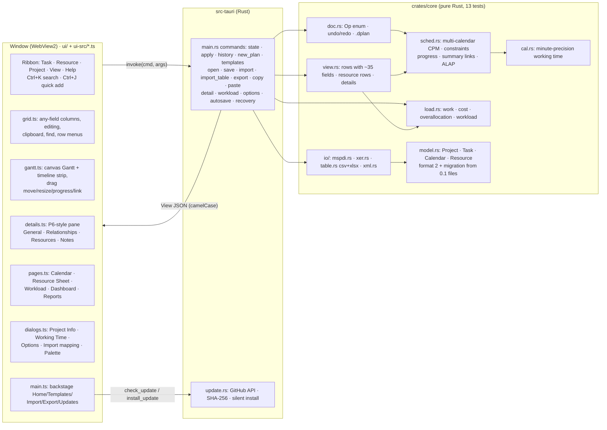
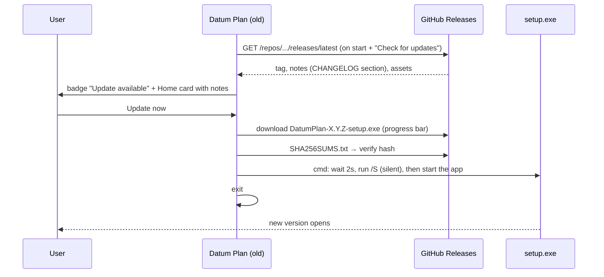
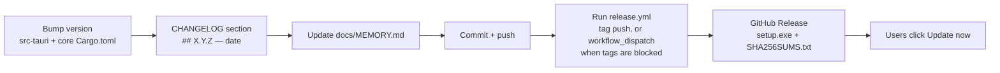

# Datum Plan: project memory

> **Paste this file at the start of each new session**, or just open the repo: `CLAUDE.md` tells Claude to read it.
> It records what exists, why, and what comes next. Update it at the end of every session.

| | |
| --- | --- |
| **Product** | Datum Plan: a Windows desktop scheduler combining MS Project (look, ease of use) and Primavera P6 (power features) |
| **Current version** | **0.2.0** (released 2026-10-24). Earlier: 0.1.0, 0.1.1 |
| **Repo** | `Edgar-Mendonca/Datum-Plan` · working branch `claude/fervent-keller-ddas5s` (currently also the default branch) |
| **Stack** | Rust (engine + shell), Tauri 2, WebView2, strict TypeScript UI with no framework, plain CSS |
| **Code size** | About 5,400 lines: core 3,000 (with 311 lines of tests), shell 520, UI 1,550 TypeScript + CSS |
| **Installer** | NSIS `.exe`, per-user install. 1.7 MB (0.1.0), 1.8 MB (0.1.1); 2.4 MB (0.2.0) |
| **Reference repos** | `Edgar-Mendonca/Cairn` (the earlier web planner: feature and template reference) · `Compressor-Engineering-Suite` (the Home/update pattern) |

---

## 1. Architecture

**Rules:**
- The UI never calculates dates.
- Every edit is an `Op` sent to Rust. The core applies it to a copy, normalises it, schedules it, and keeps it only if it is valid (so cycles are refused).
- The core then returns a complete `View`, formatted in the user's date format.
- Dashboard and report numbers are computed in the UI from that `View`.

### Time model (since 0.2)
- **Instants** are minutes since 1970-01-01 00:00 local time. **Durations and lags** are working minutes.
- `Project.day_min` (default 480) converts days. A week is 5 days and a month is 20 days.
- `Task.unit` remembers how the duration was typed (h, d, w, mo) so it is shown the same way.
- **Calendars:** `week: [Vec<(start_min, end_min)>; 7]` (Monday first) plus `exceptions` (date ranges; empty hours mean not working).
- The project calendar is `Project.calendar`. Each task can use its own `Task.cal`.
- **Scheduling:**
  - Forward pass: `ES = max(link requirements, constraints, data date)`, snapped to working time. Milestones may sit at the end of a shift.
  - Backward pass: works on late dates, which SNLT, FNLT, MSO, MFO and deadlines all limit.
  - Lags count on the successor's calendar.
  - Total float = working time between EF and LF.
  - A link to or from a summary applies to every leaf task under it.
  - `normalize()` drops links between a task and its own ancestors.
- **Progress:** an actual finish fixes the task. An actual start with % < 100 puts the remaining work after the status date (status date + 1 day, 00:00). Unstarted tasks cannot start before the status date. Setting % fills in actual dates; 0% clears them.

### Files

| Path | What it does |
| --- | --- |
| `crates/core/src/model.rs` | Model and file format 2: Task (dur, unit, preds, pct, constraint/cdate, deadline, manual/mstart, inactive, cal, actuals, res, bl, timeline, code, notes), Calendar, Exception, Resource, Project (status, day_min, manual_default, calendars, resources, columns). `from_json` upgrades 0.1 files. `normalize()` repairs data. |
| `crates/core/src/cal.rs` | `WorkCal`: `add`, `sub`, `between`, `next_start`, `prev_end`, `in_or_end`, `end_of`, `day_minutes`. `at(date)` and `date_of(t)` convert between dates and instants. |
| `crates/core/src/sched.rs` | CPM as described above. Returns `Sched` with es/ef/ls/lf/tf/ff, summary/off flags, calendar index per task, the calendars, and start/finish. |
| `crates/core/src/load.rs` | Work and cost per task and resource, daily load, overallocation, and `workload(weekly)` buckets for the Workload view. |
| `crates/core/src/parse.rs` | Durations with units, dates (display format first), predecessors `3SS+4h`, resources `Name[50%]`, constraint names, and the quick-add sentence parser. |
| `crates/core/src/doc.rs` | Ops: Insert, InsertRows, QuickAdd, Paste, Delete, Set (about 20 fields), Indent, Outdent, Move, Link, LinkSet, Unlink, MarkOnTrack, Baseline, Project, CalPut, CalDelete, ResInsert, ResSet, ResDelete, Columns, Batch. Also undo/redo (200 steps), `copy()`, and `set()` (reused by the importers). |
| `crates/core/src/view.rs` | `build(p, date_fmt, today)` → View (rows, resources, calendars, columns, totals, baseline finish and variance). `detail(uid)` → relationships and assignments. |
| `crates/core/src/templates.rs` | 5 starter plans as `level\|name\|duration\|preds` lines. |
| `crates/core/src/io/` | `mod.rs` dispatches by extension. `mspdi.rs`: MS Project XML in/out (calendars with exceptions, tasks, links, baselines, resources, assignments). `xer.rs`: P6 XER in/out (CALENDAR with clndr_data parser/writer, PROJECT, PROJWBS ↔ summaries, TASK, TASKPRED, RSRC, TASKRSRC). `table.rs`: CSV/XLSX read with header guessing + mapping → plan; CSV/XLSX write. `xml.rs`: a 60-line XML reader. |
| `crates/core/src/tests.rs` | 13 tests: calendar arithmetic, CPM/float, link types and hour lags, constraints/deadline/ALAP, task calendars, summary links, inactive tasks, progress/status date, edits/undo/move/paste, resources/costs/baseline/workload, calendar ops/project settings, quick add/rows, parsing, templates + 0.1 migration, and round trips for XML, XER, CSV and XLSX. |
| `src-tauri/src/main.rs` | App state (Doc, options, clipboard, pending import table), file dialogs, recent files, options.json, recovery.dplan in AppData (written by the `autosave` command on a UI timer; offered at start-up; cleared on save or a clean quit). |
| `src-tauri/src/update.rs` | Updater (unchanged since 0.1.0). |
| `ui/index.html` | Layout: title bar with search, ribbon, sidebar, timeline strip, grid, Gantt, details pane, page area, backstage, and the icon sprite (about 55 icons). |
| `ui/styles.css` | Light theme tokens, all components, print styles. |
| `ui-src/base.ts` | Types, the field catalogue `FIELDS`, state, core calls, dates, `dialog()` (resolves before removing, so inputs stay readable), `menu()`, toast. |
| `ui-src/grid.ts` | Columns from `V.columns`, render/virtualise, edit with choice lists, column picker/header menu/resize, row commands, clipboard (DOM copy/cut/paste events; internal marker plus TSV for Excel), find/replace, row menu. |
| `ui-src/gantt.ts` | Timescale (day/week/month/quarter/year), bars (baseline, manual, inactive, deadline, progress), links, today and status lines, timeline strip, zoom, drag modes `move`/`size`/`pct`/`link`. |
| `ui-src/details.ts` | The details pane and its tabs; edits go through `Set` and `LinkSet` ops. |
| `ui-src/pages.ts` | Calendar, Resource Sheet (inline editing), Workload heat table, Dashboard (KPIs, S-curve with baseline, phases, milestones, late), Reports (weekly/monthly, look-ahead, slipped vs baseline, print). |
| `ui-src/dialogs.ts` | Project Information, Change Working Time, Options, Import (mapping), Export, Ctrl+K palette, Ctrl+J quick add, shortcuts. |
| `ui-src/main.ts` | `CMDS` registry (ribbon, palette and keys share it), `RIBBON` layout, view sidebar, backstage, files, updates, keyboard, start-up (recovery prompt, autosave timer). |
| `ui-src/tsconfig.json` | Joins the 7 files in order into `ui/main.js` (no modules, one global scope). |

### Update flow

### Release flow

---

## 2. Decisions

| Date | Decision | Why |
| --- | --- | --- |
| 2026-10-24 | Name **Datum Plan**, file extension `.dplan` | The user chose it. |
| 2026-10-24 | **Rust engine** in `crates/core`; Cairn is only a reference | The user wants everything in Rust for a small, robust app. |
| 2026-10-24 | UI in plain TypeScript with no framework, split into 7 script files joined by tsc | Small bundle; modules without a bundler. |
| 2026-10-24 | Custom updater (GitHub API + SHA-256 + NSIS `/S`); per-user install | Needs no signing secrets; silent updates. |
| 2026-10-24 | Windows only; no `.mpp` (closed format) | The user's choice. Exchange formats are dplan, XML, XER, XLSX and CSV. |
| 0.1.1 | Light theme, new logo, Cairn-style sidebar, general templates | The user's feedback on 0.1.0. |
| 0.2.0 | **Minute-precision engine with real calendars** (replacing whole days) | Needed for hours, shifts, holidays and P6/MSP exchange. Old files migrate (day × 480). |
| 0.2.0 | Several roadmap steps shipped as one release (0.1.2–0.1.4, calendars, constraints, logic, exchange, resources, baselines/progress) | The user asked for all of it in 0.2. |
| 0.2.0 | Links on summaries apply to every leaf under them; links to one's own summary are dropped | Simple and close to MSP. P6 has no summary links anyway. |
| 0.2.0 | Status date semantics: progress up to the end of that day; remaining work starts the next day | MSP-like status date. XER `last_recalc_date` maps to status = data date − 1. |
| 0.2.0 | Work-resource units: `50%`, `0.5` or `50`; material: quantity; cost: amount | Matches MSP habits. |
| 0.2.0 | Predecessor IDs typed with new rows (quick add, paste) mean the IDs shown before the insert | What the user sees on screen. |
| 0.2.0 | XML reader written by hand instead of quick-xml | The quick-xml API changes a lot between versions; MSPDI only needs elements and text. |
| 0.2.0 | Recovery copy in AppData, not autosave over the user's file | Safe: never overwrites a file without asking. |
| 0.3 plan | **SolidJS + Vite** for the UI (not Astro) | Small reactive components for MSP-level dialogs, ribbon and report designer. Astro targets content sites. |
| 0.3 plan | **Local-first:** `.dplan` files plus a workspace file; no server, no cloud, no telemetry (the only network call is the update check) | Open source, everything stays on the user's computer. |
| 0.3 plan | Betas through an opt-in updater channel; slipped items go to 0.3.1 | The user wants to check the big release step by step. |

---

## 3. Roadmap

✅ done · 🔜 next · ⬜ planned. Small releases; every one goes through the in-app updater.

| Version | Theme | Contents | Status |
| --- | --- | --- | --- |
| **0.1.0** | Shell + updater + core | Installer, Home, updater, ribbon, grid, summaries, links, CPM, Gantt, undo, `.dplan` | ✅ |
| **0.1.1** | Look, views, reports | Light theme, logo, sidebar, templates, drag bars, Calendar, Dashboard, weekly/monthly report | ✅ |
| **0.2.0** | The big one | Grid power (any column, clipboard, fill, move, find/replace, menus), Gantt power (timeline, progress drag, details pane, link editing), Ctrl+K, Ctrl+J, Options, recovery, minute calendars + exceptions + task calendars, all constraints + deadlines, manual/inactive tasks, summary links, status date + actuals + Mark on Track, baselines + variance, resources + costs + workload, import/export XML/XER/XLSX/CSV | ✅ |
| **0.3.0** | MSP look + P6 power (one big release, shipped as betas) | Everything planned for 0.2.1 → 0.5.2, network diagram included. Full scope and beta milestones in **[PLAN-0.3.md](PLAN-0.3.md)**: MSP ribbon with dropdowns and Format tabs, about 450 fields + custom fields/formulas/lookups/indicators, Field Settings, Information dialogs, tables, filters, groups and views, formatting, task types, leveling, P6 activity types, longest path, usage views, Team Planner, Network Diagram, 11 baselines, Update Project, earned value, costs, report gallery and designer, page setup/PDF, DCMA check, compare, risks, EPS workspace, new formats (P6 XML, MPX, ICS, HTML, JSON) | 🔜 plan under review |
| 0.6.0 | Portfolio | Portfolio dashboard, master/subprojects, shared resource pool, cross-project links | ⬜ |
| 0.6.1 | Hardening | 100k-activity performance, code signing, signed updater, crash reports, dark theme | ⬜ |
| 1.0.0 | Stable | — | ⬜ |

### Features that go beyond MSP and P6
- Weekly/monthly progress reports ✅
- Dashboard with S-curve and baseline curve ✅
- Command search ✅ and quick-add sentences ✅
- Recovery copies ✅
- Later: period snapshots with comments and photos, schedule health score, one-click report pack, what-if comparison

### Gap analysis (MSP, P6 and Cairn vs Datum Plan)
| Area | MS Project | Primavera P6 | Cairn 0.8 | Datum Plan |
| --- | --- | --- | --- | --- |
| Grid, outline, links, CPM | ✓ | ✓ | ✓ | ✓ 0.1 |
| Interactive Gantt, timeline | ✓ | partial | ✓ | ✓ 0.2 |
| Column picker | ✓ | ✓ | ✓ | ✓ 0.2 (custom fields and formulas in 0.3) |
| Calendars (hours, exceptions, many) | ✓ | ✓ | ✓ | ✓ 0.2 (resource calendars in 0.3) |
| Constraints, deadlines, manual, inactive | ✓ | ✓ | ✓ | ✓ 0.2 |
| Task types, effort-driven, recurring, split | ✓ | duration types | ✓ | 0.3 |
| File exchange (XLSX, CSV, XML, XER) | ✓ | ✓ | ✓ | ✓ 0.2 |
| Resources, costs, workload | ✓ | ✓ | ✓ | ✓ 0.2 (leveling in 0.3, rates over time in 0.3) |
| Baseline, actuals, status date | ✓ | ✓ | ✓ | ✓ 0.2 (11 baselines and earned value in 0.3) |
| EPS, activity codes, multi-project | master projects | ✓ | — | 0.3 |
| Filters, groups, layouts, global change | ✓ | ✓ | ✓ | 0.3 |
| Schedule check, longest path, float paths | — | ✓ | partial | 0.3 |
| Network diagram | ✓ | ✓ | ✓ | 0.3 |
| Dashboards and periodic reports | basic | basic | 16 reports | ✓ 0.1.1/0.2, more in 0.3 |

---

## 4. Session log

### 2026-10-24: Session 1 (brainstorm + 0.1.0)
- Read Cairn and CentriForge. Wrote the brainstorm and a draft logo.
- The user approved the name, Windows only, no `.mpp`, Rust/Tauri 2, and small releases. They sent MS Project screenshots.
- Built and released 0.1.0: Rust core, Tauri shell, custom updater, TypeScript UI, CI and release workflows.

### 2026-10-24: Session 2 (0.1.1)
- Feedback: too dark, logo too heavy, no domain sample, Gantt not interactive, wanted a Cairn sidebar and periodic reporting.
- Released 0.1.1: light theme, new logo, sidebar, templates, drag bars, Calendar, Dashboard, Reports. Rewrote the roadmap.

### 2026-10-24: Session 3 (0.2.0)
- The user asked for 0.1.2, 0.1.3, 0.1.4 and the "0.2 onwards" items (calendars, constraints, exchange, resources) all in 0.2. They shared a "P6 planning basics" chart (EPS/WBS/activities/calendars/relationships/F9/critical path/resource loading/baseline/update progress).
- Rewrote the engine on minutes with real calendars. Added constraints, deadlines, ALAP, manual and inactive tasks, summary links, status date and actuals, resources and costs, workload, and baselines.
- Added IO: MSPDI, XER, XLSX/CSV, all with round-trip tests.
- Split the UI into 7 files. Added the column picker, clipboard, fill, move, find/replace, context menus, timeline strip, progress drag, details pane, Resource Sheet, Workload, Change Working Time, Options, recovery, Ctrl+K and Ctrl+J.
- Bugs fixed during testing:
  - dialogs lost their inputs on OK (also present in 0.1.x)
  - camelCase fields were missing in the view JSON
  - the details pane overlapped the Gantt canvas (fixed with a ResizeObserver)
  - pressing Enter in Ctrl+K also clicked the dialog it opened
  - quick-add IDs were shifted by the new row
  - CSV header guessing put two columns on the same field
  - alphanumeric predecessor IDs were dropped
- Checked by running the real app under Xvfb: Gantt, right-click menu, timeline, details (General/Relationships/Resources), Resource Sheet, Workload, palette, Change Working Time (Saturday working moved the finish from 08-Feb to 21-Jan), CSV import with mapping, baseline bars, Dashboard. 13 core tests and clippy `-D warnings` pass.
- Released 0.2.0.

### 2026-10-24: Session 4 (0.3 brainstorm)
- Feedback on 0.2.0:
  - the UI does not feel like MSP/P6
  - too few fields, and no custom fields, formulas or Field Settings
  - weak information dialogs and reporting
  - ribbon buttons such as "Gantt Chart" should be dropdowns
  - wants MSP's timeline and more save formats
- Shared MSP screenshots: the column header menu, the Custom Fields dialog, the Task ribbon and the timeline.
- Agreed that 0.2.1 → 0.5.2 become a single 0.3 release. Wrote [PLAN-0.3.md](PLAN-0.3.md) (audit, principles, feature catalogue A–O, architecture changes, beta milestones, open decisions). Waiting for the user's review and decisions before building.

---

## 5. Known limits and next steps
- Windows SmartScreen warns on the first install (unsigned). Updates after that are silent. **Confirm with the user that 0.1.x → 0.2.0 updated in-app.**
- XER export is checked against our own importer only. MSPDI export is checked against our own reader; it needs a real MS Project test.
- Large plans: the grid is virtualised, but `view::build` and links run on every edit. Profile 10k+ tasks in 0.6.1.
- Printing prints the current view only. Page setup comes in 0.2.1.
- Decisions are answered (see PLAN-0.3.md section 6). Next session: read the user's MS Project feature write-up (.md) and the answers to the follow-up questions, then start beta.1.
