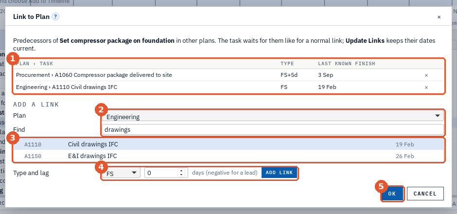
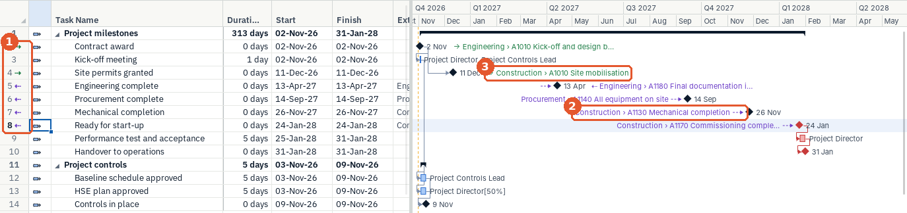
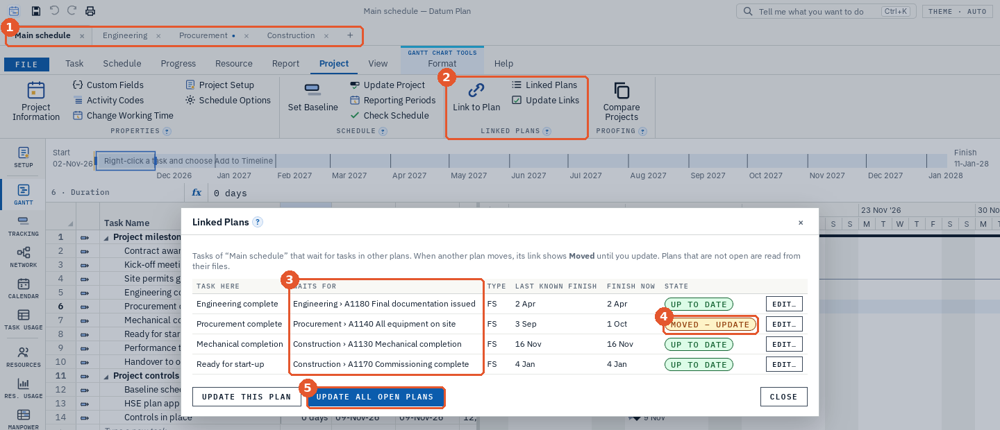

# Datum Plan Guide

## Welcome

Datum Plan is a project scheduling and control program for Windows. You list the work, link it, assign people and costs, and Datum Plan works out the dates, the critical path and the workload. As the project runs, you record progress and Datum Plan shows where you stand: against the baseline, in earned value, on S-curves and in reports you can print or send as PDF.

This guide takes you through Datum Plan step by step, from installing it to a full progress report. You do not need to read it in one go: each chapter stands on its own.

How to read this guide:

- Names in **bold** are buttons, tabs and boxes exactly as they appear in Datum Plan.
- An arrow › is a path: **Progress › Set Baseline** means the **Progress** tab, then the **Set Baseline** button.
- Keys are shown like this: [[Ctrl+S]].
- The orange numbers on the pictures match the numbered lists under them.

> **Tip.** Almost every tool in Datum Plan has a small **?** beside its name. Click it for a short card that says what the tool does and how to use it.

## Install, update and start

### Install

1. Download `DatumPlan-x.y.z-setup.exe` from the Releases page: github.com/Edgar-Mendonca/Datum-Plan/releases.
2. Run it. It installs for your own Windows account, so you do not need administrator rights.
3. The first time, Windows may show **Windows protected your PC**, because the installer is not code-signed yet. Click **More info**, then **Run anyway**.

### Updates

Datum Plan checks for a new version when it starts. When one is ready, an amber **Update available** badge appears; click it, or open **File** and click **Update now**. The download is checked against its checksum before it installs, and Datum Plan restarts by itself. Your plans are not touched.

### The Home page

1. **New plans.** Start from a blank project or a template. Templates come with tasks, links, people, rates and man-hours, so you can see a complete plan at once.
2. **Guide.** Downloads this guide (PDF) in English or Chinese.
3. **About and updates.** The version, **Check again** for updates, links to GitHub, the release notes and **Report an issue**.
4. **Recent plans.** Click one to open it.

The left side of the File page also has **Open**, **Import**, **Save**, **Save As**, **Export**, **Print**, **Roadmap**, **Options** and **Updates**. The arrow at the top goes back to the plan.

### Project Setup

When you start a new plan, **Project Setup** walks you through the basics. You can change everything later.

1. **The steps:** Project, Calendar, Currency, WBS, Resources, Branding and Done. Click a step to jump to it.
2. **The fields** of the current step: here the project name, code, start date, client, manager, location and how Activity IDs are numbered (for example A1000, A1010…).
3. **Next** goes to the next step; **Skip Setup** closes it and keeps what you entered.
4. **Setup** in the sidebar opens it again at any time.

## The window at a glance

1. **File and the ribbon tabs.** **File** opens the File page. The tabs are **Task**, **Schedule**, **Progress**, **Resource**, **Report**, **Project**, **View**, **Format** and **Help**.
2. **The ribbon.** The buttons of the chosen tab, in named groups. Each group has a **?**.
3. **The sidebar.** One click to each view: Setup, Gantt, Tracking, Network, Calendar, Task Usage, Resources, Res. Usage, Manpower, Team, Sheets, Update, Look-ahead, Dashboard, Progress, S-Curves, Reports, Builder, Checks, Risks, Sched. Risk and Portfolio.
4. **The timeline.** The whole project on one line. Drag the blue box to scroll the Gantt chart; right-click a task and choose **Add to Timeline** to show it here.
5. **The task sheet.** Works like a spreadsheet: type in the cells, select ranges, copy and paste with Excel, fill down.
6. **The Gantt chart.** Bars on a timescale. Blue bars are normal tasks, red bars are critical, black bars are summaries, diamonds are milestones. Drag a bar to move it, drag its end to change its duration.
7. **The details pane.** Everything about the selected task in tabs: General, Status, Resources, Predecessors, Successors, Codes, Steps, Notebook, Expenses, WPs & Docs, Custom Fields, Risks and Notes.
8. **Tell Me** ([[Ctrl+K]]). Type what you want to do, for example "baseline" or "level", and press [[Enter]].

The status bar at the bottom shows the number of tasks, the start and finish, the duration, % complete and the cost.

## Build your plan

### Tasks and durations

1. **A task row.** Type the name in **Task Name**. Press [[Insert]] (or **Task › Task**) to insert a new task above the selected one.
2. **Duration.** Type a number and a unit: `5d` (days), `2w` (weeks), `1mo` (months), `4h` (hours), `30m` (minutes). `0` makes a milestone. `3ed` is an elapsed duration that runs day and night, weekends included.
3. **Predecessors.** The tasks this one waits for, by their ID (the row number): `3`, or `3,4`, or with a link type and lag, `4SS+2d`.
4. **Insert group.** **Task**, **Summary**, **Milestone**, **Recurring** and **Delete**.

Datum Plan schedules automatically: when you change a duration or a link, every date that depends on it moves.

### The outline (WBS)

Indent tasks to put them under a summary task: select them and click **Indent** on the Task tab (or press [[Alt+Shift+→]]). The task above becomes a summary; its dates, work and cost add up from its tasks. **Outdent** ([[Alt+Shift+←]]) moves them back. Click the small triangle beside a summary to collapse it.

### Links between tasks

1. **Links.** **Link Tasks** links the selected tasks in order ([[Ctrl+F2]]). **Unlink** removes their links. **Relationships** shows each task's links in a diagram.
2. **Outline.** **Outdent**, **Indent**, **Outline Level** (show levels 1, 2, 3…), **Move Up** and **Move Down**.
3. **Leveling.** Resolves overallocated people (see "People, man-hours and costs").
4. **Paths.** **Critical Path** highlights the tasks that decide the finish date; **Longest Path** follows the chain of links to the last task; **Check Schedule** checks the plan's quality.

There are four link types. Most links are Finish-to-Start.

| Type | Code | Meaning |
|---|---|---|
| Finish-to-Start | FS | B starts after A finishes. Example: pour the concrete, then strip the formwork. |
| Start-to-Start | SS | B starts after A starts. Example: start testing two days after coding starts. |
| Finish-to-Finish | FF | B finishes after A finishes. Example: documentation finishes with the build. |
| Start-to-Finish | SF | B finishes after A starts. Rare; used for hand-overs between shifts. |

A **lag** adds waiting time (`4FS+2d`: two days after task 4 finishes); a negative lag is a lead (`4FS-1d`: one day before). A lag can also be a share of the predecessor's duration (`4SS+50%`).

### Constraints and deadlines

By default a task starts **As Soon As Possible**. In the details pane (**General** tab) you can give it a **Constraint Type** and **Constraint Date**: Start No Earlier Than, Finish No Later Than, Must Start On and the others. A **Deadline** does not move the task; it marks a date it should meet and shows a warning when it is late.

> **Tip.** Use constraints sparingly. A plan driven by links shows the real effect of a delay; a plan held by constraints hides it (negative float appears instead).

### Calendars

**Project › Change Working Time** sets the working days and hours (for example Monday to Friday, 08:00–12:00 and 13:00–17:00) and the exceptions: public holidays, shutdowns, a Saturday shift. You can make several calendars and give one to a task (**Task Calendar**) or to a person (**Base Calendar** in the Resource Sheet).

### Resource calendars

People do not all work the same days. With resource calendars, each person's work follows their own calendar, so leave, a part-time week or a site rota moves the tasks they work on.

1. Open **Resources**, click **Info…** on the person's row and choose **Working Time**.
2. **Base calendar** is the person's working week: the project calendar, or another calendar such as a six-day site week.
3. **Leave or exception** lists the days the person does not work (or works half days): annual leave, a training course, a holiday at home.
4. **+ Leave or exception** adds a line.

Then turn it on: **Project › Schedule Options › Resource calendars**. From then on each person's assignment runs on their own calendar, and a task finishes when the last person on it finishes. A task with its own **Task Calendar** works only when both the task and the person work. Plans that do not use this are not changed: it is off until you switch it on.

> **Tip.** A task that must keep its own calendar whoever works on it (a cure time, a delivery) gets **Ignore Resource Calendar = Yes** in its details.

### Check the schedule

**Schedule › Check Schedule** runs quality checks on the logic, float, durations and constraints (open ends, long lags, high float, negative float and more). Click a check to see the tasks behind it.

## People, man-hours and costs

### The Resource Sheet

Open **Resources** in the sidebar. Each row is a person, a crew, a material or a cost.

1. **Group** is the trade or role (Engineering, Civil, Electrical…). Manpower and the Resource Graph add people up by group.
2. **Std. Rate** is the cost per hour (for a material, per unit). **Max** is how much of the person is available: 100% is one full-time person, 300% a crew of three.

**Country** says where a person, crew or vendor comes from: type a code (DE) or a name (Germany) and its flag is shown. A sheet can list resources by country with **Plan Data…**.

### Assign people to tasks

Type in the **Resource Names** column of the task sheet, for example `Design Engineer` or `Design Engineer[50%], Analysis Engineer`. A new name creates the resource. The work (man-hours) and the cost follow from the duration, the units and the rates. You can also use **Resource › Assign Resources**.

### Workload, trades and levelling

**Res. Usage** shows each person's hours per day, week or month; red means more hours than the person has. **Resource › Resource Graph** shows the same as bars against the capacity line, per person or per trade, in hours or in people.

When someone is overallocated, **Resource › Level All** (or **Level Selection**) delays the tasks that have the most float until nobody is over. A preview first shows which tasks move and the new finish date; nothing changes until you click **Level**. **Clear Leveling** removes the delays again.

### Costs

Costs come from the people's rates, from a task's **Fixed Cost** (and its accrual: start, end or prorated) and from expenses in the details pane. All amounts are kept to the cent. The currency is set in **Project Setup** or **Project › Project Information**.

## Baseline and progress

### Save a baseline

When the plan is agreed, click **Progress › Set Baseline**. A baseline is a copy of the plan's dates, durations, work and cost; Datum Plan compares the live plan with it. There are 11 baselines (Baseline 0 to 10), so you can keep re-baselined versions too.

1. **Update.** Set % complete in steps (0%, 25%, 50%, 75%, 100%), **Mark on Track** (progress as planned up to the status date), **Update Tasks** and **Update Project**.
2. **Period.** **Update Progress** (the update page), **Look-ahead**, **Status Date** and **Reporting Periods** (when your weeks and months end).
3. **Baselines.** **Set Baseline**, **Store Snapshot**, **Show Baseline** (draw baseline bars) and **Tracking Gantt**.
4. **Progress Reports.** **Progress Report**, **S-Curves**, **Manpower** and **Dashboard**.
5. **Measure.** **Rules of Credit** (see below).

### The status date

The status date is the day your progress is measured to, for example the last Friday. Set it with **Progress › Status Date**. Work after the status date is planned; work before it should be done.

### Update progress each week

Open **Update** in the sidebar. It lists the tasks due in the period, with:

- **Actual Start** and **Actual Finish**: the real dates.
- **% Complete**: how far each task is.
- **Remaining Duration**: how long is left; change it when a task will take longer than planned.

**Set all to planned %** fills in the baseline's progress for everything, which you then correct where it differs. **Update Project…** marks work complete up to a date. When the period is updated, click **Close period**: Datum Plan stores everybody's progress at that date, so the S-curves, the dashboard and the trend reports show what really happened each period.

### The Tracking Gantt

1. Each task has two bars: the grey bar underneath is the baseline, the coloured bar is the current plan, solid where the work is done. The label is % complete. A bar that has moved right of its grey bar is late against the baseline.

### Rules of credit and installed quantities

For work measured by steps or quantities, **Progress › Rules of Credit** gives tasks weighted steps, for example cable: pulled 60%, terminated 30%, tested 10%. There are built-in rules (concrete, steel, piping, cable, equipment, documents, software) and you can make your own. Tick the steps in the task's **Steps** tab and the task's physical % complete follows.

You can also type a **Quantity** and an **Installed Quantity** (insert those columns): 50 of 200 m installed is 25% physical progress.

## Reports

### The Dashboard

1. **The key figures:** actual and planned progress and their difference, the forecast finish, SPI and CPI, **SPI(t)** and the finish at the current pace (earned schedule), cost, late tasks, tasks complete and critical tasks. Green is good, red needs attention.

Below them: the project S-curve, progress per week, cost, manpower, milestones and late tasks. **Print / PDF** and **Save as HTML** are at the top right.

### Your own dashboards

Make the dashboard your client or manager wants, as many as you like; they are saved with the plan and always show the plan as it is now.

1. **The tabs.** **Project** is the built-in dashboard. **+ New dashboard** makes a blank one or one from a template: **Client dashboard**, **Weekly progress** or **Vendors and countries**.
2. **Edit layout** shows a frame round every tile. Drag tiles to reorder them; on each tile ✎ changes it, ⤢ sets its width (a quarter to full width) and height (one to four rows), × removes it. **Dashboard ▾** renames, duplicates or deletes the dashboard.
3. **A number** comes from a formula, the same as in Sheets: `=SPI`, `=ProjectFinish`, `=COUNTIF(Tasks[Late],TRUE)` or `=Vendors!B4`. A rule can turn it green or red, for example green when SPI ≥ 1.
4. **A progress ring** shows a percentage (0–100), for example `=PercentComplete`, with a second line such as the planned %.

1. **Tile:** Number, Progress ring, Chart, Table, Countries or Text. A **Chart** is one of the plan's charts (S-curve, progress per period, progress by phase, cost and earned value, manpower) or a chart of a sheet range: columns, bars, line, area, doughnut or pie, with the labels in the first column and the series names in the first row. A **Table** is a plan list (milestones, late or critical tasks, starting next period, completed this period) or a sheet range or formula; a column of countries shows their flags. **Countries** counts the flags, for example of `=Resources[Country]`.
2. **Value:** the formula. Besides the task and resource tables you can use `PercentComplete`, `PlannedPercent`, `ProjectFinish`, `BaselineFinish`, `SPI`, `CPI`, `TotalCost`, `TasksLate` and the other names in the Sheets chapter.
3. **Green when:** the rule that colours a number.

> **Tip:** **Print / PDF** prints the dashboard shown. Make a sheet with the figures you report every week, then point dashboard tiles at it.

### S-curves and earned schedule

1. **Earned schedule.** SPI(t) compares when the plan expected today's progress with today: 0.92 means 92% of planned speed. **Earned schedule 23 of 25 days** means the progress made in 25 working days was planned for 23, so the project is 2 days behind, and **Finish at this pace** projects the finish date.

The S-curve shows cumulative progress: grey dashes are the baseline (planned), the blue line is actual (it follows the progress you stored at each **Close period**), and the dotted line is the forecast. The status line marks the status date. You can weight progress by duration, cost, hours or physical % complete.

### The progress report

**Progress** in the sidebar makes the weekly or monthly report: the period's figures, what was completed and started, what is late, the look-ahead, and your notes (summary, progress, issues, actions) with photos. Pick a past period from the list to see it again.

### Report tab, Report Builder and printing

1. **View Reports:** Dashboard, Progress Report, S-Curves, **Report Builder** (your own report from ready-made sections, with templates such as weekly management, monthly client, schedule health and cost) and **Reports** (ready-made reports).
2. **Health:** **Check Schedule**, **Risks** and **Schedule Risk**.
3. **Export:** **Print / PDF**, **Page Setup** and **Export** (other file formats).

1. **Print / Save as PDF.** Opens the Windows print window; choose your printer or **Microsoft Print to PDF** / **Save as PDF**.
2. **Settings.** What to print, page range, paper and orientation, and **Page Setup**: scaling (or **Fit to** pages wide), margins, header and footer (with your logo, page numbers and the date), legend and view options.
3. **Preview.** Exactly the pages that will print. It prints the view you had open: Gantt chart, Tracking Gantt, Network Diagram, Calendar, the resource views, Dashboard, reports, Schedule Risk, Look-ahead or Manpower.

### The Network Diagram

**Network** shows each task as a box joined to the next by its links, with a legend, zoom, a mini-map and options for the boxes (compact, standard, detailed), summaries and WBS bands. Critical tasks are red. It prints across as many pages as needed.

## Risk and the weeks ahead

### The Risk Register

**Risks** lists threats and opportunities with their probability and impact (1 to 5); the score is their product, coloured green, amber or red, and the matrix on the right shows where they sit. Link a risk to tasks in the task's **Risks** tab.

1. **Delay (days)** is how many working days the risk adds to each linked task if it happens (an opportunity takes them off). Schedule Risk uses it.

### Schedule Risk

**Sched. Risk** runs the plan many times (1,000 by default). In each run every unfinished task takes a duration between its optimistic and pessimistic duration, and each open risk happens with its probability (1 = 10%, 2 = 30%, 3 = 50%, 4 = 70%, 5 = 90%).

1. **The answer:** the chance of finishing by the planned date, the **P50** date (as likely early as late), **P80** (8 in 10 runs finish by then; a common date to commit to), **P90**, and the cost at P50 and P80.
2. **Finish dates:** how many runs finished on each day, and the cumulative curve.
3. **What drives the finish:** the tasks whose duration moves the finish most. Shorten or de-risk these first.

Give tasks their own range with the **Optimistic Duration** and **Pessimistic Duration** columns; tasks without them use the default range (−10% to +25%). The same plan and settings always give the same answer, and the last run is kept with the plan.

### The look-ahead and the constraint log

1. **The coming work:** the unfinished tasks in the next 2, 3, 4 or 6 weeks from the status date, with their bars. **Ready** means nothing in the log holds the task up; **open** or **overdue** means something does.
2. **The constraint log:** what each task needs before it can start: material, drawings or information, a permit, access, labour, equipment or previous work, with an owner, a need-by date and a status (Open or Cleared). Click a task in the table, then **+ Add constraint**.

Go through the look-ahead with your team every week: clear what is open, chase what is overdue.

### Manpower

1. Choose **All trades** or one trade. The grey bars are the people planned per week (or month), the blue bars the people's work done (earned from progress), and the dashed line the forecast for the rest.

## Sheets: your own reports and dashboards

Open **Sheets** in the sidebar. A sheet is a spreadsheet saved inside your plan file. It works like Excel and reads the plan directly, so the numbers you used to copy from the schedule into a separate workbook are always up to date. Add a tab with **+**; right-click a tab to rename or delete it.

1. **The toolbar.** **Σ AutoSum** adds up the numbers above the selected cell ([[Alt+=]]; the arrow offers Average, Count, Max and Min). **fx Function** finds any of the 490 functions by name or by what it does. **Plan Data…** inserts a live list. Then number formats, more or fewer decimals, and **Insert** and **Delete** for rows and columns.
2. **Plan numbers by name.** `=ProjectFinish`, `=BaselineFinish`, `=PercentComplete`, `=SPI` or `=COUNTIF(Tasks[Late],TRUE)`. Dates and percentages are formatted for you.
3. **A live list from Plan Data….** Choose Tasks or Resources, the columns, which rows (milestones, critical, late, not finished, in progress, starting in the next four weeks), the order and how many. One formula fills the rows and changes with the plan.
4. **Country flags.** Give cells the **Country with flag** number format and type a code (DE, cn) or a name (Germany, UK). The flag and the country's name are shown.

### Write formulas as in Excel

1. Type `=` to start a formula. Click a cell, or drag over several, to add them (A1, A1:A5); click another sheet's tab to read from it. Each reference gets a coloured box. [[F4]] cycles the $ anchors. [[Enter]] saves and closes any open bracket.
2. As you type, functions, the plan's names and table columns are suggested; [[Tab]] inserts the chosen one. Inside a function, the hint shows its arguments with the current one underlined.

What a formula can read from the plan:

| Write | What it is |
| --- | --- |
| `Tasks[Finish]` | One value per task. Columns include Name, WBS, Start, Finish, Duration, % Complete (0–100), Baseline Start, Baseline Finish, Cost, Work, Total Float, Critical, Late, Milestone, Summary, Resources, Status, Planned Value, Earned Value, and your custom fields. |
| `Resources[Country]` | One value per resource: Name, Type, Group, Initials, Max Units, Rate, Work (hours), Cost, Country, Email. |
| `ProjectFinish` | Also ProjectName, ProjectStart, StatusDate, BaselineFinish, FinishVariance (working days), PercentComplete (0–100), PlannedPercent (0–100), TotalCost, PlannedValue, EarnedValue, ActualCost, SPI, CPI, TaskCount, TasksDone, TasksLate, CriticalCount, MilestoneCount. |

- The fill handle and copy and paste move references, as in Excel: `=A1*2` filled down becomes `=A2*2`. Ctrl+D and Ctrl+R fill down and right.
- Right-click a cell to insert or delete rows and columns; every formula that points at the moved cells follows. Drag a column's edge to resize it; double-click the edge to fit the text.
- Point at an error (#N/A, #NAME?, #SPILL!…) to see what it means.
- Older formulas such as `=SUM(Plan!M2:M200)` keep working.

> **Tip:** **File › Export** to Excel keeps the formulas and adds the Tasks and Resources tables and the names, so the workbook also works in Excel.

### Formula columns

**Formula columns** (**Format › Formula Column**) add a column to the task sheet calculated from other columns, for example `=[% Complete]-[Baseline % Complete]` or `=IF([Finish]>[Baseline Finish],"Late","On time")`.

## Several plans: tabs and links

A large job is often several plans: a main schedule and the plans of engineering, procurement and construction, each kept by its own team. Datum Plan opens each in its own tab and links tasks from one plan to another, so a delay in one plan shows in the others.

### Tabs

Every plan you open or create gets a tab above the ribbon. Click a tab to show that plan; a dot means it has unsaved changes, and × closes it (it asks to save first). **＋** makes a new plan, opens one, or opens the example. [[Ctrl+Tab]] goes to the next tab and [[Ctrl+W]] closes the one shown. **File › Close** closes the plan shown and **File › Close All** closes every plan (also on a tab's right-click menu); New and Open add a tab and leave the others open. When you close the window, Datum Plan lists every plan with unsaved changes and can save them all.

### The example

**File › Linked plans (example)** (or **＋ › Example**) asks for a folder, saves four plans of a compressor station there and opens them in tabs: **Main schedule**, **Engineering**, **Procurement** and **Construction**. The main schedule's milestones wait for the subplans, construction waits for the drawings and for the compressor package to arrive, and the engineering and construction plans use resource calendars (a lead engineer's leave, a six-day site week). Every plan's calendar closes for Christmas and New Year (**Project › Change Working Time** shows the holidays). Change a duration in Procurement, then update the links and watch the main schedule move.

### Link a task to another plan

Save the other plan first, so the link knows its file. Then select the task that has to wait and choose **Project › Link to Plan** (or right-click › **Link to Plan…**). The other plan can be open in a tab, or a saved file you pick with **Browse…**.

1. The links this task already has, with the date it last knew. × removes one.
2. **Plan** is any other open plan; **Find** narrows its tasks by name or ID.
3. Click the task to wait for (double-click adds it at once).
4. **Type and lag**: FS, SS, FF or SF, and a lag in days (negative for a lead). **Add Link** adds it to the list.
5. **OK** saves the links with the plan.

The task now waits for the other plan's task like for a normal link. The **External Predecessors** column shows its links, for example `Engineering › E1180 Final documentation issued FS+5d`.

### See what is linked

A main schedule is usually milestones (0 days): each one is the moment a subplan reaches a point, such as "Engineering complete". You can see at a glance which tasks are linked:

1. **By the ID:** ⇠ (purple) means the task waits for a task in another plan; click it to see or change the link. ⇢ (green) means a task in another open plan waits for this one. Point at either mark to read the tasks.
2. **Before the bar (purple):** what the task waits for, with a dashed arrow into it: "Construction › A1130 Mechanical completion ⇢ ◆ 26 Nov".
3. **After the bar (green):** which other plan waits for this task: "→ Construction › A1010 Site mobilisation".

**Click a mark to go there:** the menu lists the linked tasks; **Go to** shows the other plan's tab (opening the file if it is not open) with that task selected. The same menu is on the task's right-click menu as **Linked Tasks…**.

**When the other plan moves,** the mark turns amber (⇠!), the label on the Gantt says "moved, update links", and the plan's tab shows ⟳ with the number of tasks to update. **Project › Update Links** (or the mark's menu) brings the new dates in.

The **External Predecessors** column lists every link in words, and **Project › Linked Plans** lists them all in both directions.

### Keep the links up to date

A link keeps the date the other task had when it was last updated, so a plan never changes behind your back. **Project › Linked Plans** shows them all:

1. The tabs of the open plans.
2. **Project › Linked Plans**: **Link to Plan**, **Linked Plans** and **Update Links**.
3. **Waits for**: the plan and the task, with the type and lag, the last known finish and the finish now.
4. **Moved – update**: the other plan has moved since the last update.
5. **Update All Open Plans** brings in the new dates in every open plan, in the right order, until nothing moves (**Update This Plan** does only the one shown). Plans that are not open are read from their files.

If two plans wait for each other in a loop, the update stops and says so.

Below, **Other open plans wait for** lists the tasks of this plan that tasks in other open plans wait for; **Show plan** opens that plan's tab.

## Files: save, import and export

- **Save** ([[Ctrl+S]]) keeps the plan as a `.dplan` file on your computer. Saving is safe: the file is replaced only when the new one is complete.
- **Import** opens plans from other scheduling programs (Project XML and XER files) and tables from Excel or CSV (you choose which column is which). After an import, a short **import report** lists anything Datum Plan changed or left out, and whether every task got the same dates as in the file.
- **Export** writes Excel (with formulas and formatting), CSV, Project XML, XER, PMXML, MPX, HTML, iCalendar and JSON.
- **Recovery.** Datum Plan keeps a recovery copy as you work (**File › Options** sets how often). If it ever closes before you save, it offers to recover your work the next time it starts.

## Command line and AI assistants

`datum-cli` (on the Releases page) works with plans without the window: show a plan's facts or schedule, change it, export it, or run the risk analysis. `datum-cli mcp` lets an AI assistant open a plan, read it, change it with the same operations the window uses, and save it. Type `datum-cli help` for the commands.

## Help in the app

1. **Learn:** **Guide** (this guide), **Getting Started** (a short tour), **Glossary** (planning terms explained), **What Is This Tool?** (every ? card in one list), **Shortcuts** and **Tell Me**.

1. Choose **English** or **中文**. The guide downloads from GitHub, is checked, saved in your Downloads folder and opened.

## Glossary

| Term | Meaning |
|---|---|
| Activity ID | A task's short code, such as A1020. |
| Baseline | A saved copy of the agreed plan, to compare progress against. |
| Constraint | A date that holds a task, such as Start No Earlier Than. |
| Critical path | The chain of tasks that decides the finish date; if one slips, the project finishes late. |
| Duration | Working time a task takes, such as 5 days. |
| External predecessor | A task in another plan that this task waits for. |
| Earned value, SPI, CPI | Progress measured in money or hours. SPI below 1 is behind schedule, CPI below 1 is over budget. |
| Earned schedule, SPI(t) | Progress measured in time: when the plan expected the work done so far. |
| Float (slack) | How long a task can slip without delaying the finish (total float) or the next task (free float). |
| Lag, lead | Waiting time on a link (lag), or overlap (lead, a negative lag). |
| Levelling | Delaying tasks so nobody has more work than hours. |
| Look-ahead | The work of the next few weeks, checked for readiness. |
| Milestone | A task of zero duration that marks an event. |
| P50, P80 | Finish dates that 5 or 8 out of 10 risk-analysis runs meet. |
| Resource calendar | A person's own working week and leave; when switched on, it decides when their work is done. |
| Rules of credit | Weighted steps that measure physical progress. |
| Status date | The day progress is measured to. |
| Summary task | A task that groups others; its dates come from them. |
| WBS | Work breakdown structure: the outline of the work. |

## Shortcuts and troubleshooting

| Keys | Action |
|---|---|
| [[Insert]] | New task |
| [[Delete]] | Delete tasks |
| [[F2]] or [[Enter]] | Edit the cell |
| [[Alt+Shift+→]] / [[Alt+Shift+←]] | Indent / outdent |
| [[Ctrl+F2]] | Link the selected tasks |
| [[Shift+F2]] | Task information |
| [[Ctrl+C]] [[Ctrl+X]] [[Ctrl+V]] | Copy, cut, paste (also with Excel) |
| [[Ctrl+Z]] / [[Ctrl+Y]] | Undo / redo |
| [[Ctrl+S]] / [[Ctrl+O]] / [[Ctrl+P]] | Save / open / print |
| [[Ctrl+K]] | Tell me what you want to do |
| [[Ctrl+Tab]] / [[Ctrl+W]] | Next plan tab / close the plan shown |
| [[Ctrl]] + mouse wheel | Zoom the timescale |

**Windows protected your PC** on the first install: click **More info**, then **Run anyway**.

**A date did not move as expected.** Check the task's constraint and its links in the details pane (**Predecessors** tab), and whether it is set to **Manually Schedule**.

**Something went wrong.** Datum Plan stops that action and leaves your plan as it was. Details are written to `crash.log` in Datum Plan's data folder (`%APPDATA%\com.edgarmendonca.datumplan`). Please report it with **Help › Report an Issue**; nothing is sent automatically.

**Questions and ideas** are welcome on GitHub: github.com/Edgar-Mendonca/Datum-Plan/issues.
