# Datum Plan Guide

## Welcome

Datum Plan is a project scheduling and control program for Windows. You list the work, link it, assign people and costs, and Datum Plan works out the dates, the critical path and the workload. As the project runs, you record progress and Datum Plan shows where you stand: against the baseline, in earned value, on S-curves and in reports you can print or send as PDF.

This guide takes you through Datum Plan step by step, from installing it to a full progress report. You do not need to read it in one go: each chapter stands on its own.

How to read this guide:

- Names in **bold** are buttons, tabs and boxes exactly as they appear in Datum Plan.
- An arrow › is a path: **Progress › Set Baseline** means the **Progress** tab, then the **Set Baseline** button.
- Keys are shown like this: [[Ctrl+S]].
- The orange numbers on the pictures match the numbered lists under them.

> **Tip.** Almost every tool in Datum Plan has a small **?** beside its name. Click it for a short card that says what the tool does and how to use it.

## Install, update and start

### Install

1. Download `DatumPlan-x.y.z-setup.exe` from the Releases page: github.com/Edgar-Mendonca/Datum-Plan/releases.
2. Run it. It installs for your own Windows account, so you do not need administrator rights.
3. The first time, Windows may show **Windows protected your PC**, because the installer is not code-signed yet. Click **More info**, then **Run anyway**.

### Updates

Datum Plan checks for a new version when it starts. When one is ready, an amber **Update available** badge appears; click it, or open **File** and click **Update now**. The download is checked against its checksum before it installs, and Datum Plan restarts by itself. Your plans are not touched.

### The Home page

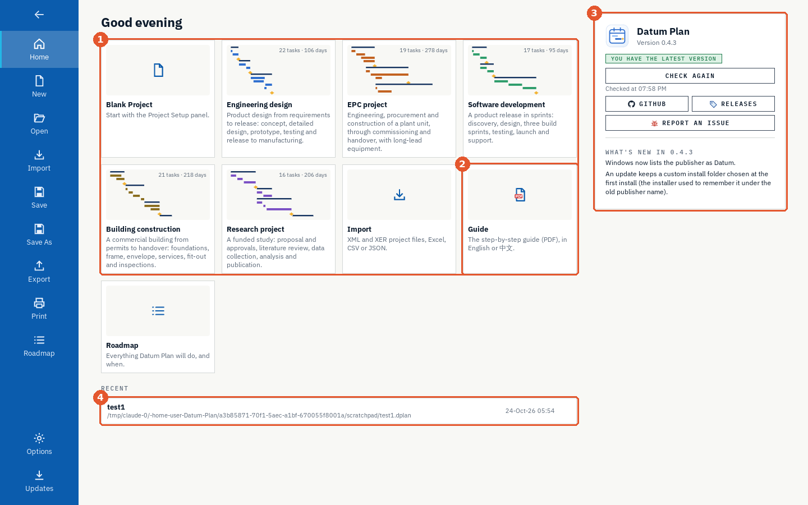

1. **New plans.** Start from a blank project or a template. Templates come with tasks, links, people, rates and man-hours, so you can see a complete plan at once.
2. **Guide.** Downloads this guide (PDF) in English or Chinese.
3. **About and updates.** The version, **Check again** for updates, links to GitHub, the release notes and **Report an issue**.
4. **Recent plans.** Click one to open it.

The left side of the File page also has **Open**, **Import**, **Save**, **Save As**, **Export**, **Print**, **Roadmap**, **Options** and **Updates**. The arrow at the top goes back to the plan. **Options › Colour-blind safe colours** switches charts and statuses to colours told apart with every common kind of colour-blindness.

### The tutorial: learn by looking

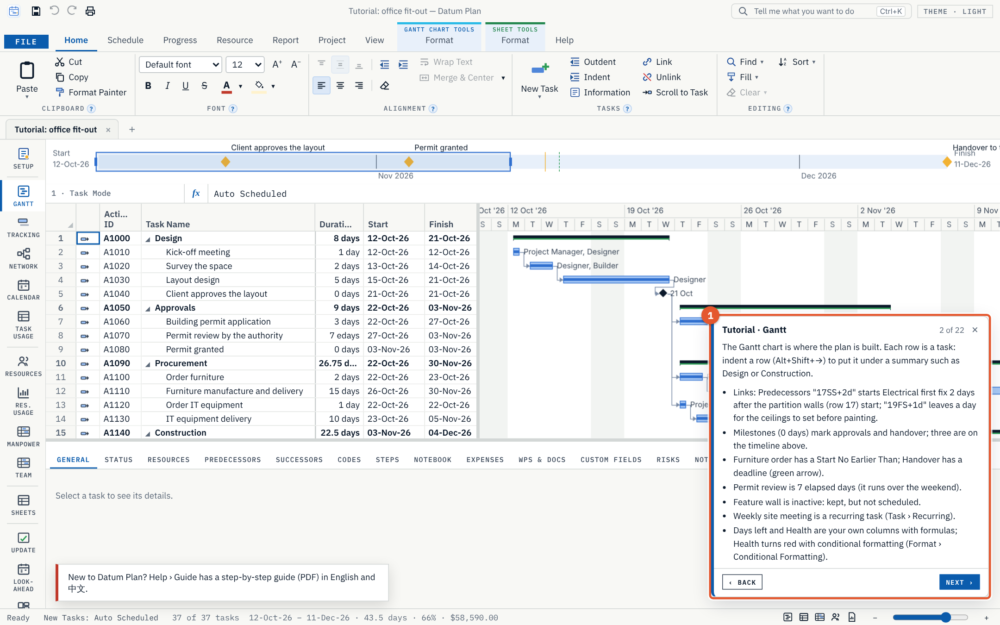

**Help › Tutorial** (or the **Tutorial (guided example)** tile on the Home page) opens a small office fit-out that uses every part of Datum Plan, five weeks into the work. It opens on **Setup**, with a note at the bottom right saying how that view was filled in and what to try.

1. **The note** changes with the view. **Next** and **Back** go through the views in the sidebar, top to bottom: Gantt, Tracking, Network, Calendar, the resource views, Sheets, Update, Look-ahead, Dashboard, Progress, S-Curves, Reports, Builder, Checks, Risks, Schedule Risk and Portfolio.
2. **Everything is filled in:**
   - links with lags, milestones on the timeline, a constraint, a deadline, elapsed days, an inactive task and a recurring meeting;
   - your own columns with formulas and conditional formatting;
   - people with rates and countries, a material, a cost and resource calendars with leave;
   - a baseline, five weeks of progress closed as periods, and a rule of credit;
   - risks, a constraint log, a sheet that reads the plan, a dashboard and a saved report.
3. **×** hides the notes; **Help › Tutorial Notes** shows them again.

The tutorial is a new plan: change anything you like, and save it if you want to keep it.

### Project Setup

When you start a new plan, **Project Setup** walks you through the basics. You can change everything later.

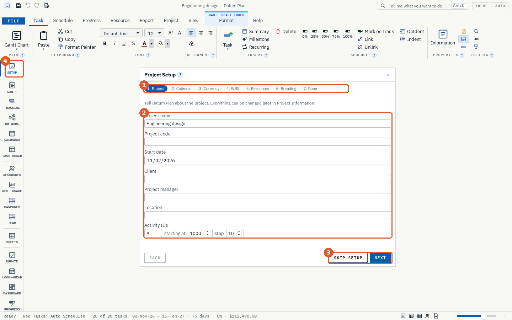

1. **The steps:** Project, Calendar, Currency, WBS, Resources, Logos and Done. Click a step to jump to it.
2. **The fields** of the current step: here the project name, code, start date, client, manager, location and how Activity IDs are numbered (for example A1000, A1010…).
3. **Next** goes to the next step; **Skip Setup** closes it and keeps what you entered.
4. **Setup** in the sidebar opens it again at any time.

## The window at a glance

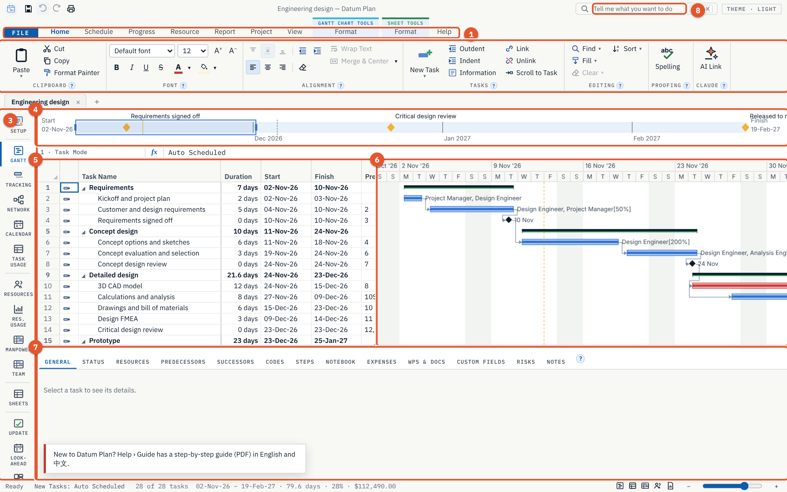

1. **File and the ribbon tabs.** **File** opens the File page. The tabs are **Home**, **Schedule**, **Progress**, **Resource**, **Report**, **Project**, **View**, **Format** and **Help**.
2. **The ribbon.** The buttons of the chosen tab, in named groups. Each group has a **?**. **Home** holds what the task sheet and the Sheets share: Clipboard, Font, Alignment and Editing (Find, Fill, Clear, Sort); each acts on what is in view. It also has the everyday task commands (New Task, Indent, Outdent, Information, Link, Unlink, Scroll to Task); they are on **Schedule** too, with the rest of building the schedule. **Gantt Chart Tools › Format** and **Sheet Tools › Format** are always on the ribbon; each opens the view it works on.
3. **The sidebar.** One click to each view: Setup, Gantt, Tracking, Network, Calendar, Task Usage, Resources, Res. Usage, Manpower, Team, Sheets, Update, Look-ahead, Dashboard, Progress, S-Curves, Reports, Builder, Checks, Risks, Sched. Risk and Portfolio.
4. **The timeline.** The whole project on one line. Drag the blue box to scroll the Gantt chart; right-click a task and choose **Add to Timeline** to show it here.
5. **The task sheet.** Works like a spreadsheet: type in the cells, select ranges, copy and paste with other spreadsheets, fill down.
6. **The Gantt chart.** Bars on a timescale. Blue bars are normal tasks, red bars are critical, black bars are summaries, diamonds are milestones. Drag a bar to move it, drag its end to change its duration.
7. **The details pane.** Everything about the selected task in tabs: General, Status, Resources, Predecessors, Successors, Codes, Steps, Notebook, Expenses, WPs & Docs, Custom Fields, Risks and Notes.
8. **Tell Me** ([[Ctrl+K]]). Type what you want to do, for example "baseline" or "level", and press [[Enter]].

The status bar at the bottom shows the number of tasks, the start and finish, the duration, % complete and the cost.

On a small screen, ribbon groups that do not fit fold into one button with the group's name (**EDITING ▾**): click it for the group's commands. The details pane and the timeline open as you last left them; **View › Split View** shows or hides them (on a short window the timeline starts closed). Dialogs can be moved by dragging their title bar.

## Build your plan

### Tasks and durations

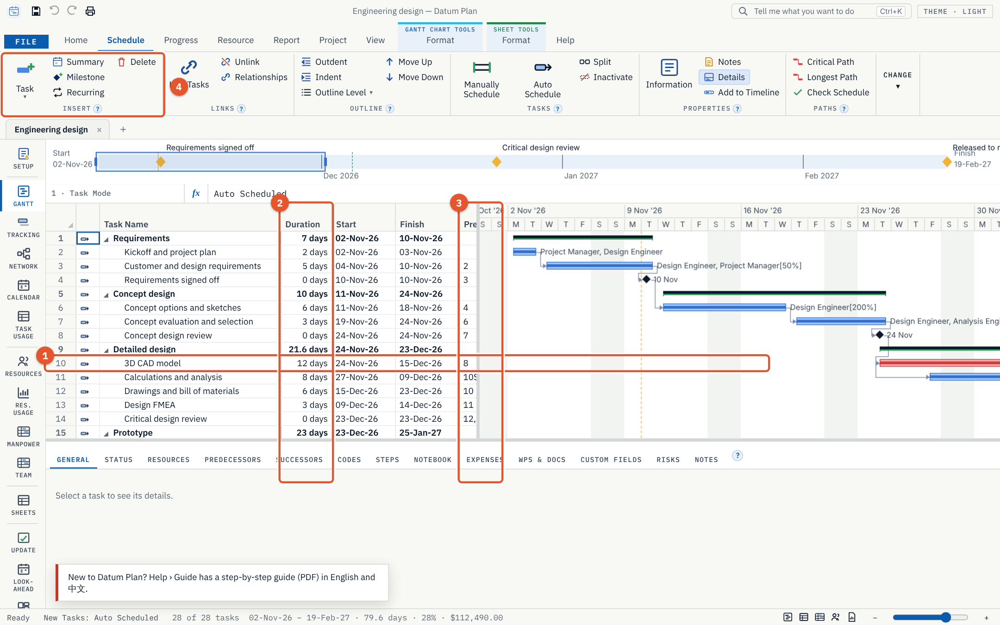

1. **A task row.** Type the name in **Task Name**. Press [[Insert]] (or **Schedule › Task**) to insert a new task above the selected one.
2. **Duration.** Type a number and a unit: `5d` (days), `2w` (weeks), `1mo` (months), `4h` (hours), `30m` (minutes). `0` makes a milestone. `3ed` is an elapsed duration that runs day and night, weekends included.
3. **Predecessors.** The tasks this one waits for, by their ID (the row number): `3`, or `3,4`, or with a link type and lag, `4SS+2d`.
4. **Insert group** (on the **Schedule** tab). **Task**, **Summary**, **Milestone**, **Recurring** and **Delete**.

Datum Plan schedules automatically: when you change a duration or a link, every date that depends on it moves.

### The outline (WBS)

Indent tasks to put them under a summary task: select them and click **Indent** on the Schedule tab or Home › Alignment (or press [[Alt+Shift+→]]). The task above becomes a summary; its dates, work and cost add up from its tasks. **Outdent** ([[Alt+Shift+←]]) moves them back. Click the small triangle beside a summary to collapse it.

### Links between tasks

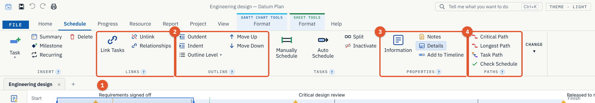

1. **Links.** **Link Tasks** links the selected tasks in order ([[Ctrl+F2]]). **Unlink** removes their links. **Relationships** shows each task's links in a diagram.
2. **Outline.** **Outdent**, **Indent**, **Outline Level** (show levels 1, 2, 3…), **Move Up** and **Move Down**.
3. **Properties.** **Information** opens all the fields of the selected task; **Notes**, **Details** (the pane under the chart) and **Add to Timeline**. Leveling, which resolves overallocated people, is on the **Resource** tab (see "People, man-hours and costs").
4. **Paths.** **Critical Path** highlights the tasks that decide the finish date; **Longest Path** follows the chain of links to the last task; **Check Schedule** checks the plan's quality.

There are four link types. Most links are Finish-to-Start.

| Type | Code | Meaning |
|---|---|---|
| Finish-to-Start | FS | B starts after A finishes. Example: pour the concrete, then strip the formwork. |
| Start-to-Start | SS | B starts after A starts. Example: start testing two days after coding starts. |
| Finish-to-Finish | FF | B finishes after A finishes. Example: documentation finishes with the build. |
| Start-to-Finish | SF | B finishes after A starts. Rare; used for hand-overs between shifts. |

A **lag** adds waiting time (`4FS+2d`: two days after task 4 finishes); a negative lag is a lead (`4FS-1d`: one day before). A lag can also be a share of the predecessor's duration (`4SS+50%`), or elapsed time that runs day and night, weekends included (`4FS+7ed`: seven calendar days, for example concrete curing).

### Constraints and deadlines

By default a task starts **As Soon As Possible**. In the details pane (**General** tab) you can give it a **Constraint Type** and **Constraint Date**: Start No Earlier Than, Finish No Later Than, Must Start On and the others. A **Deadline** does not move the task; it marks a date it should meet and shows a warning when it is late.

> **Tip.** Use constraints sparingly. A plan driven by links shows the real effect of a delay; a plan held by constraints hides it (negative float appears instead).

### Calendars

**Project › Change Working Time** sets the working days and hours (for example Monday to Friday, 08:00–12:00 and 13:00–17:00) and the exceptions: public holidays, shutdowns, a Saturday shift. You can make several calendars and give one to a task (**Task Calendar**) or to a person (**Base Calendar** in the Resource Sheet).

### Resource calendars

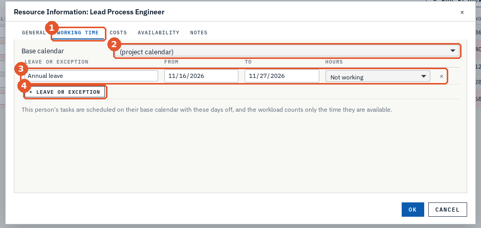

People do not all work the same days. With resource calendars, each person's work follows their own calendar, so leave, a part-time week or a site rota moves the tasks they work on.

1. Open **Resources**, click **Info…** on the person's row and choose **Working Time**.
2. **Base calendar** is the person's working week: the project calendar, or another calendar such as a six-day site week.
3. **Leave or exception** lists the days the person does not work (or works half days): annual leave, a training course, a holiday at home.
4. **+ Leave or exception** adds a line.

Then turn it on: **Project › Schedule Options › Resource calendars**. From then on each person's assignment runs on their own calendar, and a task finishes when the last person on it finishes. A task with its own **Task Calendar** works only when both the task and the person work. Plans that do not use this are not changed: it is off until you switch it on.

> **Tip.** A task that must keep its own calendar whoever works on it (a cure time, a delivery) gets **Ignore Resource Calendar = Yes** in its details.

### Check the schedule

**Schedule › Check Schedule** runs quality checks on the logic, float, durations and constraints (open ends, long lags, high float, negative float and more). Click a check to see the tasks behind it.

The **health score** (0 to 100: Good, Fair or Poor) is the weighted share of the checks passed; a failed check keeps part of its weight by how near its limit it is. **Weights…** sets how much each check counts (0 leaves it out); the limits and weights are saved with the plan. Each snapshot keeps the score of its day, and the chart shows the trend.

**Report › Compare Projects** compares the plan with another version of it (a saved .dplan, XML or XER file) and lists every change: tasks added and deleted, durations, links added, deleted or changed, constraints, calendars, actual dates, % complete and date moves, with the project finish before and after. Click a kind of change to see only those; **Export…** saves the list as a workbook. **Show ghost bars** draws the other version's bars faintly behind yours.

**Report › Milestone Trend** shows how each milestone's forecast finish moved from snapshot to snapshot (take a snapshot at each update: Progress › Snapshot). A flat line keeps its date; a rising line is slipping.

## People, man-hours and costs

### The Resource Sheet

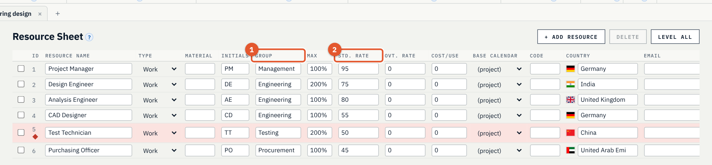

Open **Resources** in the sidebar. Each row is a person, a crew, a material or a cost.

1. **Group** is the trade or role (Engineering, Civil, Electrical…). Manpower and the Resource Graph add people up by group.
2. **Std. Rate** is the cost per hour (for a material, per unit). **Max** is how much of the person is available: 100% is one full-time person, 300% a crew of three.

**Country** says where a person, crew or vendor comes from: type a code (DE) or a name (Germany) and its flag is shown. A sheet can list resources by country with **Plan Data…**.

### Assign people to tasks

Type in the **Resource Names** column of the task sheet, for example `Design Engineer` or `Design Engineer[50%], Analysis Engineer`. A new name creates the resource. The work (man-hours) and the cost follow from the duration, the units and the rates. You can also use **Resource › Assign Resources**.

### Workload, trades and levelling

**Res. Usage** shows each person's hours per day, week or month; red means more hours than the person has. **Resource › Resource Graph** shows the same as bars against the capacity line, per person or per trade, in hours or in people.

When someone is overallocated, **Resource › Level All** (or **Level Selection**) delays the tasks that have the most float until nobody is over. A preview first shows which tasks move and the new finish date; nothing changes until you click **Level**. **Clear Leveling** removes the delays again.

### Costs

Costs come from the people's rates, from a task's **Fixed Cost** (and its accrual: start, end or prorated) and from expenses in the details pane. All amounts are kept to the cent. The currency is set in **Project Setup** or **Project › Project Information**.

## Baseline and progress

### Save a baseline

When the plan is agreed, click **Progress › Set Baseline**. A baseline is a copy of the plan's dates, durations, work and cost; Datum Plan compares the live plan with it. There are 11 baselines (Baseline 0 to 10), so you can keep re-baselined versions too.

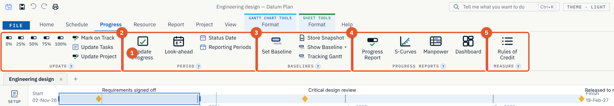

1. **Update.** Set % complete in steps (0%, 25%, 50%, 75%, 100%), **Mark on Track** (progress as planned up to the status date), **Update Tasks** and **Update Project**.
2. **Period.** **Update Progress** (the update page), **Look-ahead**, **Status Date** and **Reporting Periods** (when your weeks and months end).
3. **Baselines.** **Set Baseline**, **Store Snapshot**, **Show Baseline** (draw baseline bars) and **Tracking Gantt**.
4. **Progress Reports.** **Progress Report**, **S-Curves**, **Manpower** and **Dashboard**.
5. **Measure.** **Rules of Credit** (see below).

### The status date

The status date is the day your progress is measured to, for example the last Friday. Set it with **Progress › Status Date**. Work after the status date is planned; work before it should be done.

### Update progress each week

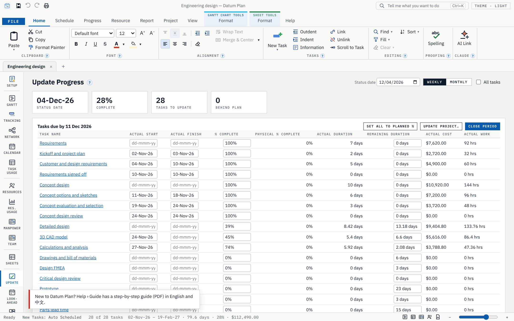

Open **Update** in the sidebar. It lists the tasks due in the period, with:

- **Actual Start** and **Actual Finish**: the real dates.
- **% Complete**: how far each task is.
- **Remaining Duration**: how long is left; change it when a task will take longer than planned.

**Set all to planned %** fills in the baseline's progress for everything, which you then correct where it differs. **Update Project…** marks work complete up to a date. When the period is updated, click **Close period**: Datum Plan stores everybody's progress at that date, so the S-curves, the dashboard and the trend reports show what really happened each period.

### The Tracking Gantt

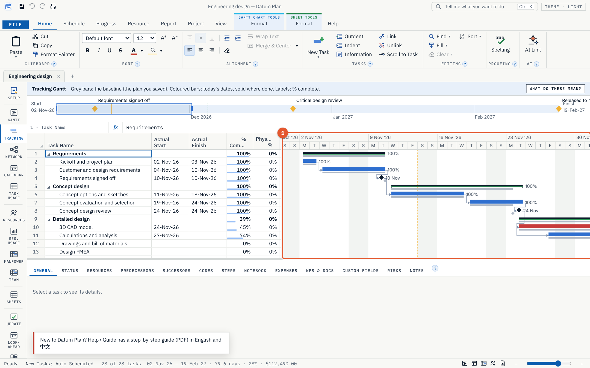

1. Each task has two bars: the grey bar underneath is the baseline, the coloured bar is the current plan, solid where the work is done. The label is % complete. A bar that has moved right of its grey bar is late against the baseline.

### Rules of credit and installed quantities

For work measured by steps or quantities, **Progress › Rules of Credit** gives tasks weighted steps, for example cable: pulled 60%, terminated 30%, tested 10%. There are built-in rules (concrete, steel, piping, cable, equipment, documents, software) and you can make your own. Tick the steps in the task's **Steps** tab and the task's physical % complete follows.

You can also type a **Quantity** and an **Installed Quantity** (insert those columns): 50 of 200 m installed is 25% physical progress.

## Reports

### The Dashboard

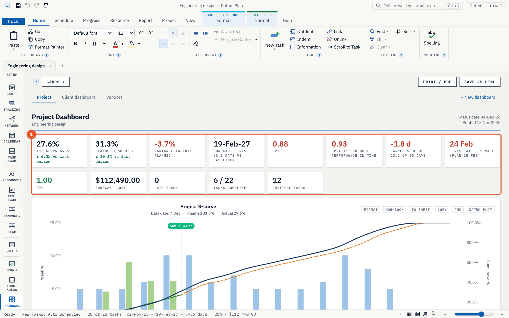

1. **The key figures:** actual and planned progress and their difference, the forecast finish, SPI and CPI, **SPI(t)** and the finish at the current pace (earned schedule), cost, late tasks, tasks complete and critical tasks. Green is good, red needs attention.

Below them, the **project S-curve** across the whole width, then progress per period, progress by phase, cost and earned value, and manpower, side by side and filling each row, then milestones and late tasks.

A card shows only when the plan has data for it: a plan without costs shows no cost cards, and one without resources no manpower. **Cards ▾** chooses the cards yourself; a card you turn on without data stays blank, also when printed. The choice is saved with the plan; **Show the cards that have data** goes back to the automatic choice. **Print / PDF** and **Save as HTML** are at the top right.

### Your own dashboards

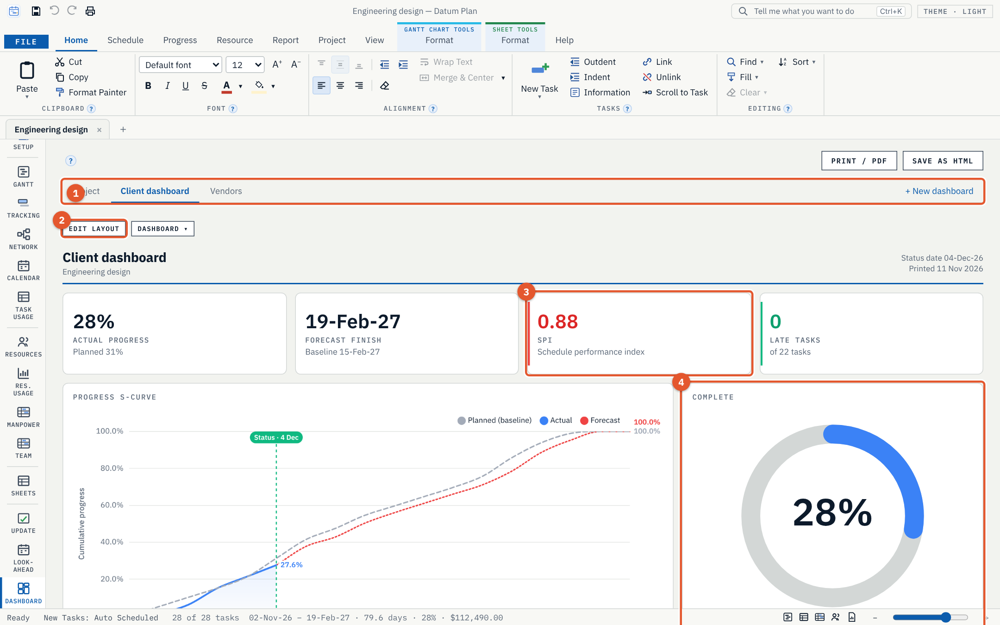

Make the dashboard your client or manager wants, as many as you like; they are saved with the plan and always show the plan as it is now.

1. **The tabs.** **Project** is the built-in dashboard. **+ New dashboard** makes a blank one or one from a template: **Client dashboard**, **Weekly progress** or **Vendors and countries**.
2. **Edit layout** shows a frame round every tile. Drag tiles to reorder them; on each tile ✎ changes it, ⤢ sets its width (a quarter to full width) and height (one to four rows), × removes it. **Dashboard ▾** renames, duplicates or deletes the dashboard.
3. **A number** comes from a formula, the same as in Sheets: `=SPI`, `=ProjectFinish`, `=COUNTIF(Tasks[Late],TRUE)` or `=Vendors!B4`. A rule can turn it green or red, for example green when SPI ≥ 1.
4. **A progress ring** shows a percentage (0–100), for example `=PercentComplete`, with a second line such as the planned %.

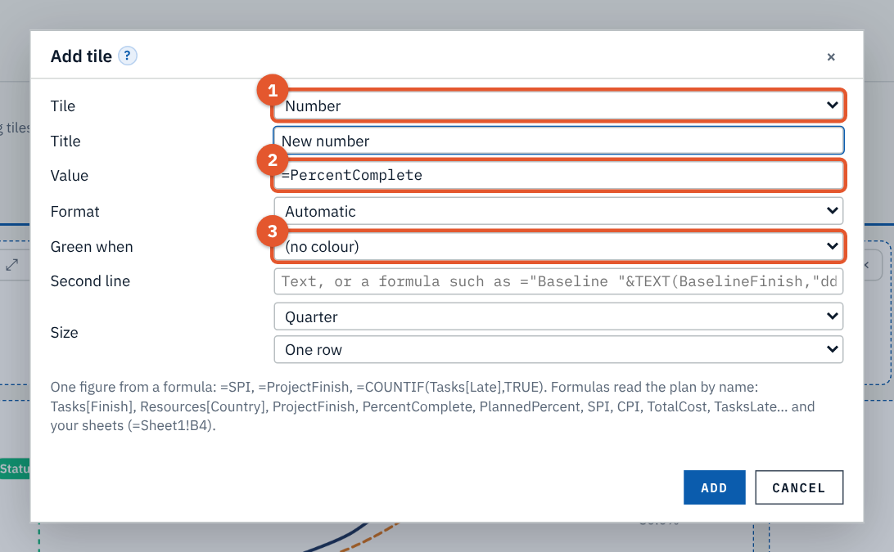

1. **Tile:** Number, Progress ring, Chart, Table, Countries or Text. A **Chart** is one of the plan's charts (S-curve, progress per period, progress by phase, cost and earned value, manpower) or a chart of a sheet range: columns, bars, line, area, doughnut or pie, with the labels in the first column and the series names in the first row. A **Table** is a plan list (milestones, late or critical tasks, starting next period, completed this period) or a sheet range or formula; a column of countries shows their flags. **Countries** counts the flags, for example of `=Resources[Country]`.
2. **Value:** the formula. Besides the task and resource tables you can use `PercentComplete`, `PlannedPercent`, `ProjectFinish`, `BaselineFinish`, `SPI`, `CPI`, `TotalCost`, `TasksLate` and the other names in the Sheets chapter.
3. **Green when:** the rule that colours a number.

> **Tip:** **Print / PDF** prints the dashboard shown. Make a sheet with the figures you report every week, then point dashboard tiles at it.

### S-curves and earned schedule

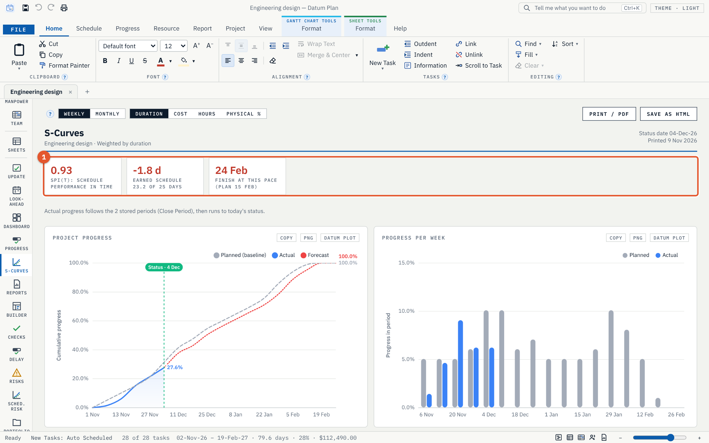

1. **Earned schedule.** SPI(t) compares when the plan expected today's progress with today: 0.92 means 92% of planned speed. **Earned schedule 23 of 25 days** means the progress made in 25 working days was planned for 23, so the project is 2 days behind, and **Finish at this pace** projects the finish date.

The S-curve shows cumulative progress: grey dashes are the baseline (planned), the blue line is actual (it follows the progress you stored at each **Close period**), and the dotted line is the forecast. The status line marks the status date, and each line ends with its latest value. You can weight progress by duration, cost, hours or physical % complete.

Every chart has two buttons at its top right. **PNG** saves it as a picture. **Datum Plot** opens a copy of its values in Datum Plot, where you can style the graph for a report or a paper. The copy is saved in **Documents › Datum Plan › To Datum Plot**. It is a one-way copy: what you change in Datum Plot never changes the plan. Charts over time keep their dates, as days from the first date with each row titled by its date.

### The progress report

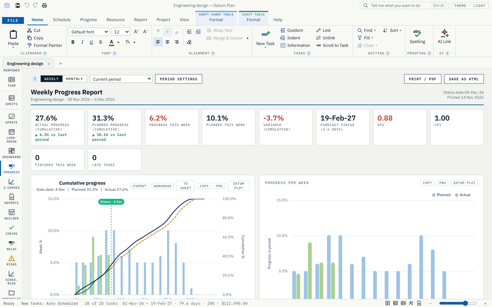

**Progress** in the sidebar makes the weekly or monthly report: the period's figures, what was completed and started, what is late, the look-ahead, and your notes (summary, progress, issues, actions) with photos. Pick a past period from the list to see it again.

### Report tab, Report Builder and printing

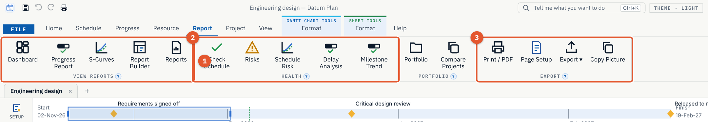

1. **View Reports:** Dashboard, Progress Report, S-Curves, **Report Builder** (your own report from ready-made sections, with templates such as weekly management, monthly client, schedule health and cost) and **Reports** (ready-made reports).
2. **Health:** **Check Schedule**, **Risks** and **Schedule Risk**.
3. **Export:** **Print / PDF**, **Page Setup** and **Export** (other file formats).

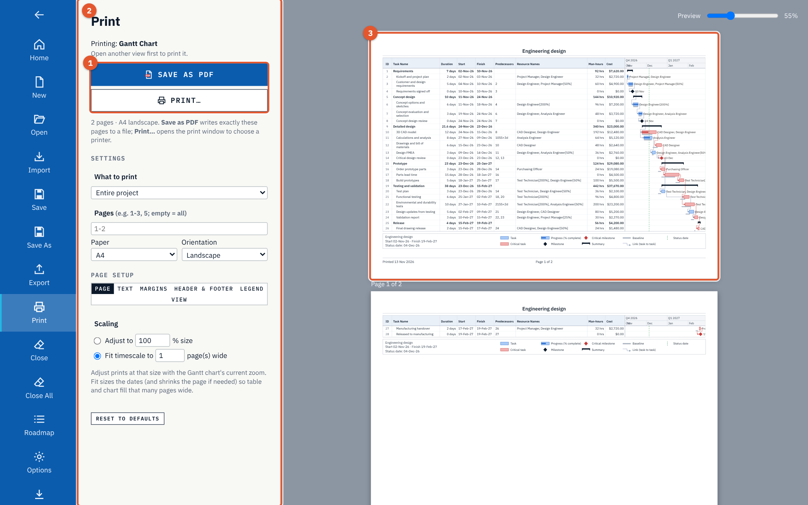

1. **Save as PDF** writes exactly the pages you see to a file you name, at the paper size and orientation you chose, with nothing added by Windows (no date, window title or web address). **Print…** opens the print window to choose a printer.
2. **Settings.** What to print, page range, paper and orientation, and **Page Setup**: scaling (or **Fit to** pages wide), margins, **Header & footer**, legend and view options.
3. **Preview.** Exactly the pages that will print. It prints the view you had open: Gantt chart, Tracking Gantt, Network Diagram, Calendar, the resource views, Dashboard, reports, Schedule Risk, Look-ahead or Manpower.

**Header & footer** keeps it simple:

- **Pictures at the top, on every page:** on the left, in the centre and on the right, as many as you like side by side (**+ Logo ▾** a logo from the plan's pictures, below; **+ Picture…** any picture file; **+ Company logo** uses the one in **File › Options**). Each picture has its own size slider; ← and → move it along the row or to the next place, and × takes it out. The header grows to fit the tallest picture.
- **Title** (the plan's name unless you type another), a **Subtitle**, for example "Revision B · Issued for review", and the **Title size**. With pictures in the centre, the title and subtitle sit under them.
- **At the bottom of each page**, only what you tick: the printed date (and time), the page number, the status date, the company name, a revision and your own text, such as "Confidential".

Nothing else is printed: no program name and no web address. **Advanced** gives the three boxes with codes such as &[Page] for exact control.

The **legend** lists only what the pages show: tasks, critical tasks, progress, milestones, summaries, subplans, baselines, deadlines, links and the status date, with the project's name, start, finish and status date beside them. Bars print with their baseline and deadline, as on screen.

**Text** (Page Setup) sets the size of the table's text in points on paper and shows the size it really prints at. Rows grow with their text, and the timescale and bar labels grow with it. Columns are as wide as their text, so the chart gets the rest of the page. With **Fit to** pages wide the text keeps its size: long task names wrap onto up to three lines before the page is shrunk. You can also give sizes by row type (top summaries, other summaries, tasks, milestones) and to rows you choose: select them in the task sheet, then type their size under **Rows you choose**.

A master plan prints its subplans as on screen: expand a subplan in the Gantt and it prints expanded. **Subplans** (under What to print) can instead print them one row each, with all their tasks, or leave them out.

### Pictures and logos

A plan keeps its own pictures: the logos of the client, your company, the main contractor, consultants, vendors and sub-vendors, and any other image. They are saved inside the .dplan file, so a plan sent to someone else prints with the same logos.

- **Project › Pictures** (or the **Logos** step of **Project Setup**) lists them. **+ Client logo…**, **+ Our company logo…**, **+ Vendor logo…**, **+ Sub-vendor logo…** and **+ Other picture…** add one; each row has its party, a name you can change and **×** to remove it.
- **In the print header:** **+ Logo ▾** in **Header & footer** puts any of them on the left, in the centre or on the right.
- **On a dashboard:** a **Picture** tile shows one of them.
- **On a sheet:** **Picture ▾** places one at the selected cell. Drag it to move it from cell to cell, drag its corner to resize it, and press [[Delete]] to take it off. It prints with the sheet and goes into an exported .xlsx workbook.

Removing a picture from the plan also takes it off the sheets that use it.

### The Network Diagram

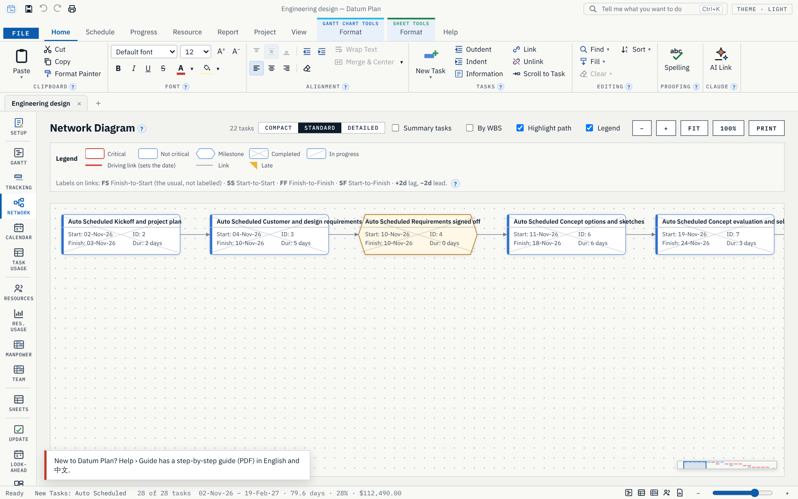

**Network** shows each task as a box joined to the next by its links, with a legend, zoom, a mini-map and options for the boxes (compact, standard, detailed), summaries and WBS bands. Critical tasks are red. It prints across as many pages as needed.

## Risk and the weeks ahead

### The Risk Register

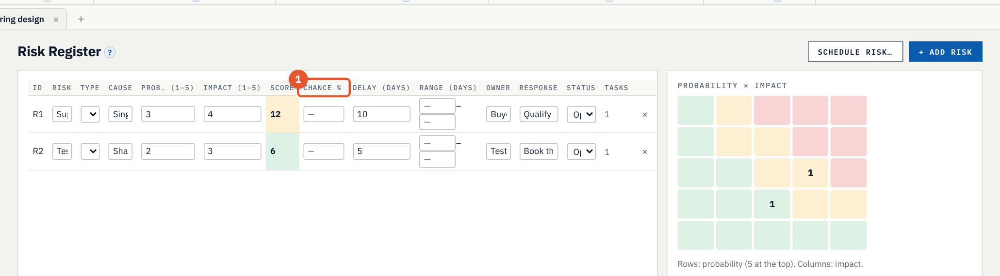

**Risks** lists threats and opportunities with their probability and impact (1 to 5); the score is their product, coloured green, amber or red, and the matrix on the right shows where they sit. Link a risk to tasks in the task's **Risks** tab.

1. **Delay (days)** is how many working days the risk adds to each linked task if it happens (an opportunity takes them off). Schedule Risk uses it.

### Schedule Risk

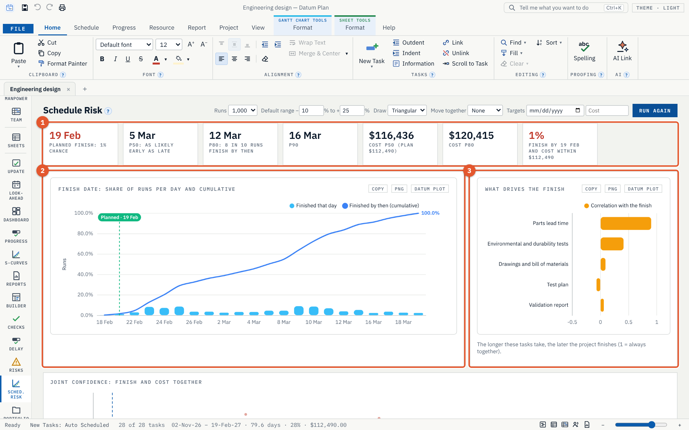

**Sched. Risk** runs the plan many times (1,000 by default). In each run every unfinished task takes a duration between its optimistic and pessimistic duration, and each open risk happens with its probability (1 = 10%, 2 = 30%, 3 = 50%, 4 = 70%, 5 = 90%).

1. **The answer:** the chance of finishing by the planned date, the **P50** date (as likely early as late), **P80** (8 in 10 runs finish by then; a common date to commit to), **P90**, and the cost at P50 and P80.
2. **Finish dates:** how many runs finished on each day, and the cumulative curve.
3. **What drives the finish:** the tasks whose duration moves the finish most. Shorten or de-risk these first.

Give tasks their own range with the **Optimistic Duration** and **Pessimistic Duration** columns; tasks without them use the default range (−10% to +25%). The same plan and settings always give the same answer, and the last run is kept with the plan.

### The look-ahead and the constraint log

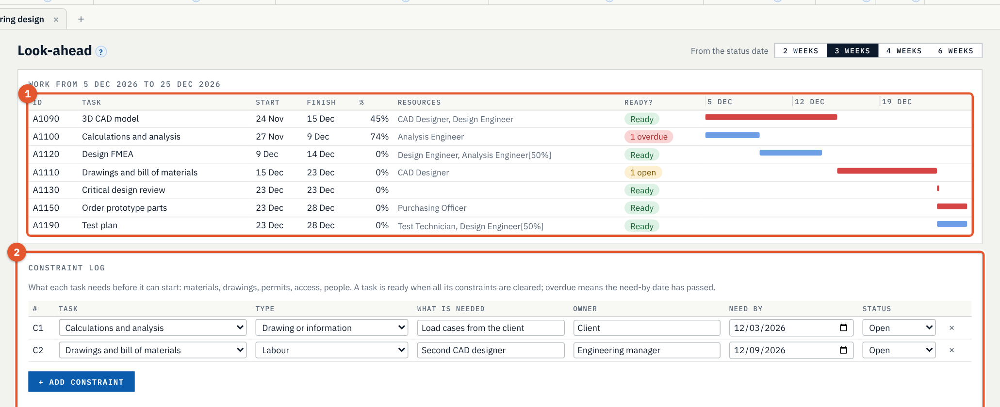

1. **The coming work:** the unfinished tasks in the next 2, 3, 4 or 6 weeks from the status date, with their bars. **Ready** means nothing in the log holds the task up; **open** or **overdue** means something does.
2. **The constraint log:** what each task needs before it can start: material, drawings or information, a permit, access, labour, equipment or previous work, with an owner, a need-by date and a status (Open or Cleared). Click a task in the table, then **+ Add constraint**.

Go through the look-ahead with your team every week: clear what is open, chase what is overdue.

### Manpower

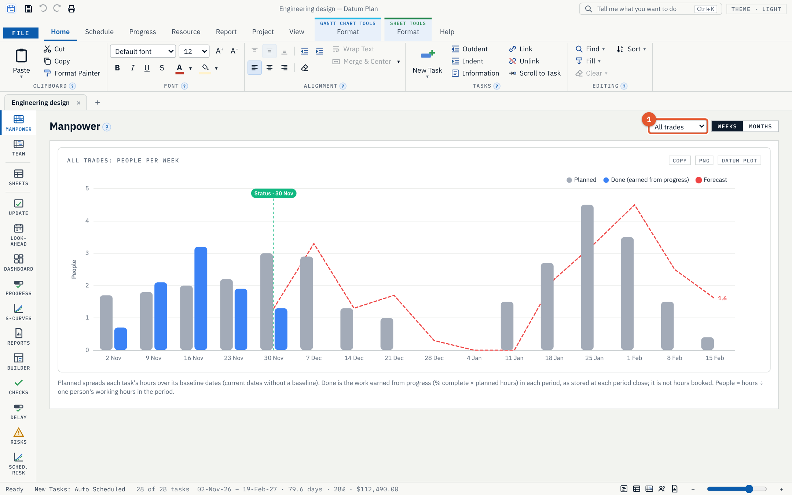

1. Choose **All trades** or one trade. The grey bars are the people planned per week (or month), the blue bars the people's work done (earned from progress), and the dashed line the forecast for the rest.

## Sheets: your own reports and dashboards

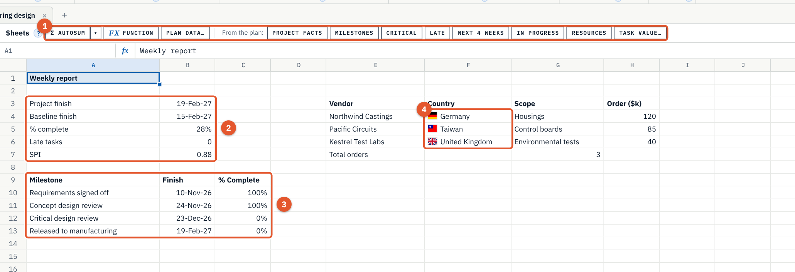

Open **Sheets** in the sidebar. A sheet is a spreadsheet saved inside your plan file. It works like any spreadsheet and reads the plan directly, so the numbers you used to copy from the schedule into a separate workbook are always up to date. Add a tab with **+**. Double-click a tab to rename it; right-click it to insert, delete, move or copy it, give it a colour, or hide and unhide it; drag a tab to move it.

1. **The toolbar.** **Σ AutoSum** adds up the numbers above the selected cell ([[Alt+=]]; the arrow offers Average, Count, Max and Min). **fx Function** finds any of the 490 functions by name or by what it does. **Plan Data…** inserts a live list. **From the plan:** one click puts **Project facts** (start, finish, status date, % complete, SPI, CPI and task counts), **Milestones**, **Critical**, **Late**, **Next 4 weeks**, **In progress** or **Resources** at the selected cell, and **Task value…** puts one value of one task (its finish, % complete…). They all stay live. The formatting tools are on the ribbon (below).
2. **Plan numbers by name.** `=ProjectFinish`, `=BaselineFinish`, `=PercentComplete`, `=SPI` or `=COUNTIF(Tasks[Late],TRUE)`. Dates and percentages are formatted for you.
3. **A live list from Plan Data….** Choose Tasks or Resources, the columns, which rows (milestones, critical, late, not finished, in progress, starting in the next four weeks), the order and how many. One formula fills the rows and changes with the plan.
4. **Country flags.** Give cells the **Country with flag** number format and type a code (DE, cn) or a name (Germany, UK). The flag and the country's name are shown.

### Format and print a sheet: Sheet Tools

When you open **Sheets**, the ribbon opens on **Home**; **Sheet Tools › Format** is beside it.

**Home** has the tools the task sheet and the Sheets share:

- **Clipboard:** Paste (with Paste Special), Cut, Copy and Format Painter. A paste brings the copied cells' formulas, look and number formats in one step; one copied cell pasted on a larger selection fills all of it.
- **Font:** font, size (up to 48), bold, italic, underline, strikethrough, font colour and fill. The colour arrows open a palette (theme colours with lighter and darker shades, standard and recent colours, **More Colors…**).
- **Alignment:** top, middle and bottom; left, centre and right; indent; **Wrap Text**; **Merge & Center** (the arrow: Merge Across, Merge Cells, Unmerge Cells).
- **Editing:** **Find** (Find and Replace), **Fill** (Down and Right), **Clear** (All, Formats or Contents) and **Sort** A to Z or Z to A (formulas move with their rows, empty cells go last).

**Sheet Tools › Format** holds the tools only a sheet has. Sheet Tools is always on the ribbon; from another view it opens Sheets.

- **Lines:** **Borders**, each choice drawn beside its name, with line colour and style; **All Borders**, **Outside** and **No Border** at one click.
- **Number:** the number format list, currency, percent, comma style and decimals.
- **Look:** **Conditional** formatting and **Cell Styles**, the whole gallery: good, bad and neutral, data and checks, titles and headings, accents at 20, 40, 60 % and full, and number styles.
- **Rows & Columns:** **Insert** and **Delete** (rows, columns, sheets, or cells shifted right, left, down or up); **Size** for row height, column width, AutoFit, **Hide** and **Unhide** rows or columns, **Format Cells…** and the tab. A double line marks where rows or columns are hidden. Hidden rows and columns don't print, and stay hidden in an exported workbook.
- **Data:** **Filter**, **Drop-down List** and **Note** (below).
- **Insert:** **Picture** places a logo from the plan's pictures at the selected cell; **AutoSum** (the arrow: Average, Count, Max and Min), Function, Plan Data and Workbook….
- **Views:** **Normal** (the cells), **Page Layout** (the pages exactly as they will print, with the header and footer) and **Page Breaks** (each printed page over the cells, with its number). The same three are at the bottom right, by the sheet tabs. **Freeze Panes** is here too.
- **Page Setup:** size, orientation and margins (Normal, Narrow, Wide, None or your own); **Print Area** (only the selected cells print), **Titles** (the selected rows print at the top of every page, also when they are above the print area) and **Breaks** (**Insert Page Break** starts a new page above the selected cell's row and left of its column; or only at the row or the column; **Reset All Page Breaks**); fit to so many pages wide and tall, or a scale. Each sheet keeps its own setup; the plan's stays as it is.
- **Print:** **Print Options** (header and footer, gridlines, row and column labels, centre on page), **Print Preview** (File › Print, where the same choices sit at the top) and **Save as Workbook**.

**Zoom:** the slider at the bottom right, its **−** and **+**, View › Zoom or [[Ctrl]] with the mouse wheel show the sheet from 10 % to 400 %; click the percentage to go back to 100 %.

**Right-click** a cell for the commands you use most: Cut, Copy, Paste and Paste Special (Values, Formatting, Transpose); Insert… and Delete… (shift cells or whole rows and columns); Clear Contents; Sort (A to Z, Z to A, Custom Sort…); Filter; New Note; Format Cells…; Number Format, Borders, Merge & Center and Wrap Text; Rows and Columns; Freeze Panes; AutoSum, Insert Function, Plan Data and Drop-down List. Right-click a row number or a column letter for insert, delete, clear, height or width, AutoFit, hide and unhide.

- **Format Cells…** ([[Ctrl+1]]) has five tabs: **Number** (General, Number with decimals and the 1,000 separator, Currency, Percentage, Date, Time, Text, Country with flag, Custom, with the format code shown), **Alignment**, **Font**, **Border** and **Fill**. It changes only what you touched, in one step.
- **Notes:** **New Note** ([[Shift+F2]]) writes a note on the cell; a red corner marks it and pointing at the cell shows it. Notes move with sorting and inserted cells, and go into an exported workbook as notes.
- **Filter** ([[Ctrl+Shift+L]]) puts a button on each heading of the list around the cell. A button sorts, ticks the values to show (with a search box and blanks), or sets a condition: equals, greater than, between, contains, begins or ends with, blank, top N, above or below average. **Clear Filter** shows every row again. Copy, Clear and formatting skip the rows the filter hides. The filter goes into an exported workbook and comes back.
- **Data Validation…:** what a cell may hold. A **list** (the values typed in or read from cells, also on another sheet, for example `Lists!A1:A9`; an arrow shows on the cell and [[Alt+Down]] opens it), a **whole number**, **decimal**, **date**, **time** or **text length** between, above or below limits (values or cells), or a **custom** formula that must be TRUE, written for the first cell (`=AND(A2>0,A2<=B2)`). Limits, list sources and conditional formats that point at cells follow them when rows, columns or cells move. An optional message shows while the cell is selected; a wrong value is refused (**Stop**) or asked about (**Warn**). **Circle Invalid Data** rings the cells that already break their rules.
- **Remove Duplicates…** (Home › Sort) removes repeated rows, comparing the columns you choose.
- **Find All** lists every match to click through; **Look in** chooses the values shown or the formulas typed, and **Every sheet** searches all the tabs.
- **Go To:** [[F5]] or [[Ctrl+G]], or type an address in the box left of the formula bar (B12, A1:D20, Sheet2!A1), or a defined name.
- **Several lines in a cell:** [[Alt+Enter]] while typing starts a new line; the row grows to show them.
- **Links:** a typed web or e-mail address, or `=HYPERLINK(address, text)`, shows as a link. [[Ctrl]]+click (or right-click › **Open Link**) shows the full address and opens it in your browser. **Link…** (Insert › Link…, or right-click) adds or edits one; [[Ctrl+K]] stays Tell Me.
- **Defined names:** **Define Name…** names the selected cells or a value (`Rates`, `VAT = 0.05`) to use in any sheet formula, in dashboard tiles and in task-sheet formula columns (`=[Cost]*(1+VAT)`); the **Name Manager** lists, edits and deletes them. A name's **Scope** is the whole plan or one sheet, where it wins over a plan-wide name spelt the same. Names go into an exported workbook.
- **Move a sheet to another plan:** right-click the sheet tab › **Move to Plan**, or **Move or Copy…** › **To plan**, sends the sheet to another open plan, for example from the master to a subplan, with its pictures and its own names. Its formulas on plan data (Tasks[…], ProjectFinish…) then read that plan; the message says if some formulas read other sheets of the first plan. Save both plans to keep the change.

In **Page Breaks** view you set the pages by hand, on the cells:

- The **solid blue line** is the edge of the print area, and everything outside it is grey. Drag an edge to print more or fewer rows or columns.
- The **dashed lines** are where a page ends by itself; a **solid line** is a break you set. Drag a break to move it; a dashed one becomes a break you set. Drag a break out of the print area to remove it.
- If a page becomes bigger than the paper, the sheet's scale goes down so it fits, as **Fit** › **Scale** shows.
- Right-click a cell for **Insert Page Break**, **Remove Page Break**, **Reset All Page Breaks**, **Set Print Area** and **Reset Print Area**.

A new picture on a sheet sits inside its cell, or its merged cells, clear of the borders, and follows the cell's size. When it is selected, the small button at its top right lets it float over the cells at its own size; click again to place it back in the cell. Rows grow to fit a bigger font or wrapped text unless you set their height; drag the line under a row number to set it. Long text runs on over the empty cells to its right.

Keys: [[Ctrl+Arrow]] goes to the edge of the data, [[Ctrl+Home]] to A1, [[Ctrl+End]] to the last used cell, [[Page Up]] and [[Page Down]] by a screen, [[Ctrl+Enter]] puts what you typed in every selected cell, and [[Ctrl+D]] on one cell copies the cell above. Dates follow the plan's date format (Options), so 05/01/2026 is 5 January when the plan writes the day first; a formula on a date shows a date.

### Conditional formatting

Select the cells, then Sheet Tools › Format › Look › **Conditional**:

- **Highlight Cells:** greater than, less than, between, equal to, text that contains, a date occurring (before today, today, this week, in the next 7 days, this month and more), blank cells, duplicate values;
- **Top and Bottom:** top 10, bottom 10, above or below average;
- **Data Bars** in six colours, and **Colour Scales** (green to red, red to green, white to green and more).

**New Rule…** sets any rule by hand: the cells, the condition, the value and the look. **Manage Rules…** lists the sheet's rules in order; for each cell the first rule that matches gives its look, and data bars and colour scales show with it. The looks change as the values do, print, and go into an exported workbook as its own conditional formats.

**Find and Replace:** [[Ctrl+F]] and [[Ctrl+H]] (or Home › Editing › Find) look in the values shown and in what was typed, formulas too.

### Sheets and workbooks (.xlsx)

- **Bring a workbook in:** Sheet Tools › Format › Insert › **Workbook…** (or **Bring in a workbook…** when the plan has no sheets yet). Every sheet of an .xlsx, .xlsm, .xls, .xlsb or .ods file becomes a sheet tab, with:
  - values, formulas and number formats;
  - fonts, fills, borders and alignment;
  - merged cells, column widths and row heights;
  - frozen panes, the tab colour, the page setup and the pictures.

  Tab names already in use get " (2)". One Undo takes the whole import back.
- **Share the sheets:** Sheet Tools › Format › Print › **Save as Workbook** writes the sheets as a workbook, with:
  - real numbers and dates, formulas with their last results, and number formats;
  - styles, merged cells, sizes, pictures, frozen panes, tab colours and each sheet's page setup;
  - notes, filters and drop-down lists.

  Formulas that read the plan (Tasks[Finish], ProjectFinish) keep working: the plan's data goes on hidden sheets in the same workbook. **File › Export › Workbook (.xlsx)** writes the task table as well.
- **Country flags** show in a spreadsheet program as the country's name. A hidden "DatumPlan" sheet remembers which cells are flags (and which pictures are placed in cells), so the workbook opens in Datum Plan with its flags again.

### Write formulas

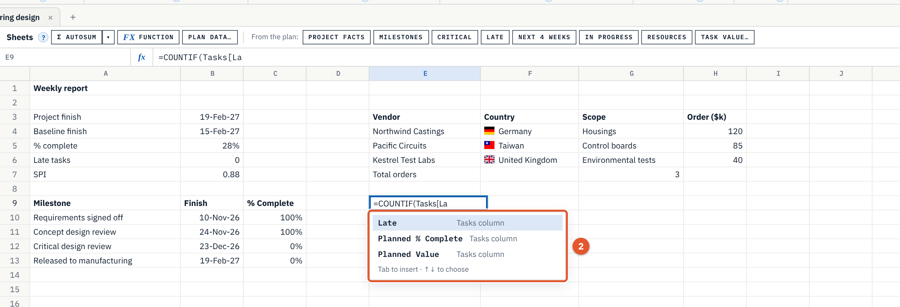

1. Type `=` to start a formula. Click a cell, or drag over several, to add them (A1, A1:A5); click another sheet's tab to read from it. Each reference gets a coloured box. [[F4]] cycles the $ anchors. [[Enter]] saves and closes any open bracket.
2. As you type, functions, the plan's names and table columns are suggested; [[Tab]] inserts the chosen one. Inside a function, the hint shows its arguments with the current one underlined.

What a formula can read from the plan:

| Write | What it is |
| --- | --- |
| `Tasks[Finish]` | One value per task. Columns include Name, WBS, Start, Finish, Duration, % Complete (0–100), Baseline Start, Baseline Finish, Cost, Work, Total Float, Critical, Late, Milestone, Summary, Resources, Status, Planned Value, Earned Value, and your custom fields. |
| `Resources[Country]` | One value per resource: Name, Type, Group, Initials, Max Units, Rate, Work (hours), Cost, Country, Email. |
| `ProjectFinish` | Also ProjectName, ProjectStart, StatusDate, BaselineFinish, FinishVariance (working days), PercentComplete (0–100), PlannedPercent (0–100), TotalCost, PlannedValue, EarnedValue, ActualCost, SPI, CPI, TaskCount, TasksDone, TasksLate, CriticalCount, MilestoneCount. |

- The fill handle and copy and paste move references: `=A1*2` filled down becomes `=A2*2`. Ctrl+D and Ctrl+R fill down and right.
- Right-click a cell to insert or delete rows and columns; every formula that points at the moved cells follows. Drag a column's edge to resize it; double-click the edge to fit the text.
- Point at an error (#N/A, #NAME?, #SPILL!…) to see what it means.
- Older formulas such as `=SUM(Plan!M2:M200)` keep working.

> **Tip:** **File › Export** to a workbook (.xlsx) keeps the formulas and adds the Tasks and Resources tables and the names, so the workbook also works in other spreadsheet programs.

### Formula columns

**Formula columns** (**Format › Formula Column**) add a column to the task sheet calculated from other columns, for example `=[% Complete]-[Baseline % Complete]` or `=IF([Finish]>[Baseline Finish],"Late","On time")`.

## Several plans: tabs and links

A large job is often several plans: a main schedule and the plans of engineering, procurement and construction, each kept by its own team. Datum Plan opens each in its own tab and links tasks from one plan to another, so a delay in one plan shows in the others.

### Tabs

Every plan you open or create gets a tab, in the row between the ribbon and the timeline, even when it is the only plan open. Click a tab to show that plan; a dot means it has unsaved changes, and × closes it (it asks to save first). **＋** opens another plan in a new tab: **Blank plan** (start scheduling at once, then link it to the other tabs), a template, a saved plan, an example or the tutorial. [[Ctrl+Tab]] goes to the next tab and [[Ctrl+W]] closes the one shown. **File › Close** closes the plan shown and **File › Close All** closes every plan (also on a tab's right-click menu); New and Open add a tab and leave the others open. When you close the window, Datum Plan lists every plan with unsaved changes and can save them all.

### A project: the master and its subplans

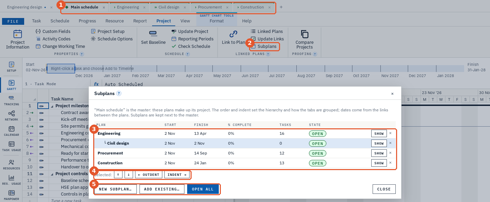

A large job is one **project** made of plans: a **master plan** (often milestones) and its **subplans**, each in its own file, kept next to the master. The master keeps the list.

1. **A project's tabs sit in one framed group**, in the project's colour, with **Project · name** on the frame. The master comes first with a filled **Master** badge; its subplans follow with an outlined **Sub** badge (↳ for a subplan under another). A plan outside the project keeps a plain tab. When a subplan is open without its master, **Open master** appears beside the tabs.
2. **Project › Subplans** shows the project's plans.
3. Each subplan with its dates, % complete, number of tasks and whether it is open. **Show** or **Open** goes to it; × takes it out of the project (its file is kept).
4. **↑ ↓** change the order; **Indent** puts a subplan under the one above (for example two engineering plans under Engineering), **Outdent** moves it back up.
5. **New Subplan…** makes a plan: a name and its place, saved next to the master with the same calendars, and opened in its tab. **Add Existing…** takes a saved plan into the project. **Open All** opens every subplan in tabs.

To start a project from scratch: save your master plan, then **Project › Subplans › New Subplan…** for each part (Engineering, Procurement…). Then link them: in the master, select a milestone and **Project › Link to Plan** to the subplan's task it waits for. The order and hierarchy only arrange the plans; dates always come from links.

Opening a master offers to open its subplans. A tab's right-click menu has **Open All Subplans**, **Apply Setup to Subplans…**, **New Subplan…** and **Close Project** (the master and its open subplans).

**Project › Apply Setup to Subplans** gives the subplans the master's setup, so you fill it in once. Tick what to give (project details, logos and pictures, the print header, footer and page setup, calendars, currency, reporting periods, activity codes and custom fields) and the open subplans to give it to, then **Apply**. Each subplan keeps its own name, code, description, print title and logos. Save the subplans to keep the change; each can undo it on its own.

### The combined view

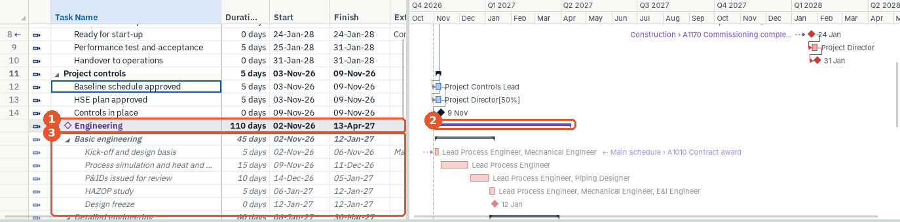

The master shows the whole project in one Gantt: under its own tasks, each subplan has a row.

1. **◇ The subplan's row** shows its duration, start, finish and the other columns, worked out from its file (open or not), in the order and hierarchy of **Subplans**. ▷ expands it.
2. **Its bar** is purple, so the subplans stand out from the master's own tasks.
3. **Its tasks**, when expanded, are shown greyed and in italics: they are read-only here. Double-click one (or right-click › **Go to this task in its plan**) to open the subplan's tab with that task selected, and change it there.

**Format › Show/Hide › Subplans** turns the combined view on and off.

### The example

**File › Linked plans (example)** (or **＋ › Example**) asks for a folder, saves a project of four plans for a compressor station there and opens them in tabs: **Main schedule**, **Engineering**, **Procurement** and **Construction**. The main schedule's milestones wait for the subplans, construction waits for the drawings and for the compressor package to arrive, and the engineering and construction plans use resource calendars (a lead engineer's leave, a six-day site week). Every plan's calendar closes for Christmas and New Year (**Project › Change Working Time** shows the holidays). Change a duration in Procurement, then update the links and watch the main schedule move.

### Link a task to another plan

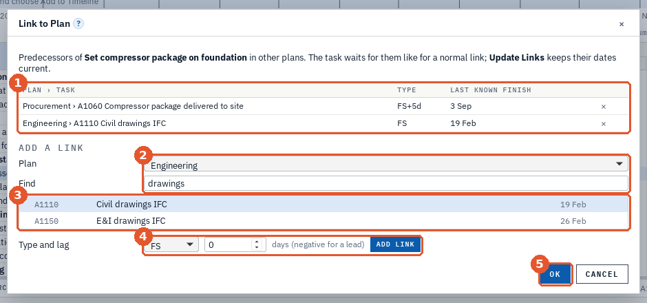

Save the other plan first, so the link knows its file. Then select the task that has to wait and choose **Project › Link to Plan** (or right-click › **Link to Plan…**). The other plan can be open in a tab, or a saved file you pick with **Browse…**.

1. The links this task already has, with the date it last knew. × removes one.
2. **Plan** is any other open plan; **Find** narrows its tasks by name or ID.
3. Click the task to wait for (double-click adds it at once).
4. **Type and lag**: FS, SS, FF or SF, and a lag in days (negative for a lead). **Add Link** adds it to the list.
5. **OK** saves the links with the plan.

The task now waits for the other plan's task like for a normal link. The **External Predecessors** column shows its links, for example `Engineering › E1180 Final documentation issued FS+5d`.

### See what is linked

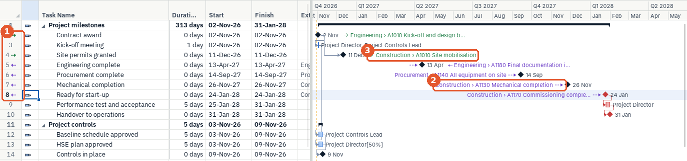

A main schedule is usually milestones (0 days): each one is the moment a subplan reaches a point, such as "Engineering complete". You can see at a glance which tasks are linked:

1. **By the ID:** ⇠ (purple) means the task waits for a task in another plan; click it to see or change the link. ⇢ (green) means a task in another open plan waits for this one. Point at either mark to read the tasks.
2. **Before the bar (purple):** what the task waits for, with a dashed arrow into it: "Construction › A1130 Mechanical completion ⇢ ◆ 26 Nov".
3. **After the bar (green):** which other plan waits for this task: "→ Construction › A1010 Site mobilisation".

**Click a mark to go there:** the menu lists the linked tasks; **Go to** shows the other plan's tab (opening the file if it is not open) with that task selected. The same menu is on the task's right-click menu as **Linked Tasks…**.

**When the other plan moves,** the mark turns amber (⇠!), the label on the Gantt says "moved, update links", and the plan's tab shows ⟳ with the number of tasks to update. **Project › Update Links** (or the mark's menu) brings the new dates in.

The **External Predecessors** column lists every link in words, and **Project › Linked Plans** lists them all in both directions.

### Keep the links up to date

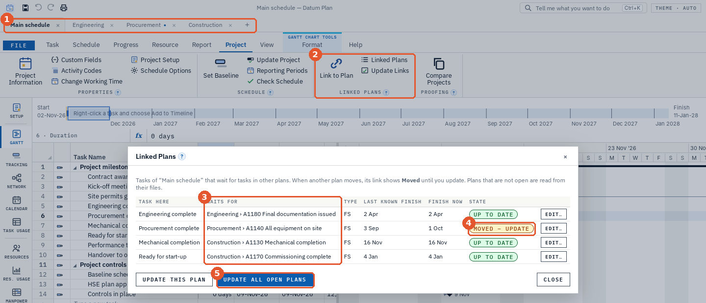

A link keeps the date the other task had when it was last updated, so a plan never changes behind your back. **Project › Linked Plans** shows them all:

1. The tabs of the open plans.
2. **Project › Linked Plans**: **Link to Plan**, **Linked Plans** and **Update Links**.
3. **Waits for**: the plan and the task, with the type and lag, the last known finish and the finish now.
4. **Moved – update**: the other plan has moved since the last update.
5. **Update All Open Plans** brings in the new dates in every open plan, in the right order, until nothing moves (**Update This Plan** does only the one shown). Plans that are not open are read from their files.

If two plans wait for each other in a loop, the update stops and says so.

Below, **Other open plans wait for** lists the tasks of this plan that tasks in other open plans wait for; **Show plan** opens that plan's tab.

## Modules: registers when you need them

A plan can take on extra registers, called **modules**: Contract Dates & Payments, the Document Register and the Procurement Register. **Project › Modules** lists them. Tick one and **Apply**: its view joins the sidebar and the Project tab. A plan without modules stays exactly as it was. Untick a module to hide it; the dialog asks whether to keep its data in the plan (the default) or delete it.

### Contract Dates & Payments

**Contract** (sidebar) shows the dates the contract fixes against the forecast, the delay damages at risk, and the payments.

1. Type the contract number and value at the top.
2. Select the task that meets a contract date, for example a delivery milestone, and click **+ Contract date**. Type the date the contract fixes.
3. The row shows the task's forecast (its actual finish once done), the baseline, the days late or early, and a status: **On track**, **At risk** (less float than the days set at the top), **Late**, **Met** or **Met late**. **Trend** draws the forecast at each period close, so a slipping date shows as a rising red line.
4. **Delay damages:** a % per week or part week late, after the **grace** days, up to the **cap** %, of **Of value** (the unit's price; empty means the contract value). **At risk** shows the damages at today's forecast.
5. **Payment milestones:** **+ Payment**, then the task whose finish triggers it, the share (%) or an amount, and the **terms** (days to payment). Type the invoiced and paid dates as they happen. The chart shows planned, forecast and received cash.

On a master, a table at the bottom adds up the contract dates, damages and payments of its open subplans, with a button to open each one.

### Document Register

**Documents** (sidebar) keeps the vendor documents of a package and every submission of them.

1. **Settings…** first: the **P date** (purchase order or kick-off; empty means the plan's start) and whether P + n counts in weeks or days; the client's **review** and our **turnaround** in working days. Each counts on **the plan's calendar** or **a calendar of its own**: pick one, or **New calendar…** to make one (the client's working week, or an engineering office abroad with its own holidays) and set its working time. Then the issue purposes of the cycle, the return codes (which accept a document, which ask for it again) and the progress weights of the six steps for each class (each class adds up to 100 %).
2. **Import…** the register from a workbook (.xlsx): choose the sheet; the heading row is found by itself; check what each column holds (document number, title, discipline, class, first issue P + n, MRB/VDB/IOM/PIM, …). Import again later to update documents with the same number. A transmittal log comes in the same way. Or add documents with **+ Document**.
3. Each submission goes in the **Transmittal log**: **+ Sub** on a document adds its next one (next revision, the purpose its cycle needs, today's date). When the client answers, type the return date and pick the code.
4. The **Register** shows, for every document, the planned and actual first issue, the latest submission, the review due date, the status, the earned progress, the **days the client kept it past the review period** and the forecast final issue. **Late for task** marks a document that will not be ready for the task that needs it.
5. **Progress** draws the weighted planned and actual S-curve by week or month, the first issues per period, and progress by vendor, discipline, type and class. **Export to Workbook** writes the register and the log.

Classes 1 and 2 go first issue → approval issue → construction issue → final issue; class 3 goes construction issue → final issue. A recurring submission, such as a monthly report, is never counted in progress.

### Procurement Register

**Procurement** (sidebar) follows each sub-order or equipment item from enquiry to delivery.

1. **Settings…**: the milestone weights (balanced, more credit at the order, more credit at delivery, or your own), how orders weigh against each other (PO value, equally, or a typed weight), how many days before delivery the inspection release is planned, the days of float under which an order turns amber, and whether **orders link to the Document Register**.
2. **Import…** a procurement status register from a workbook (.xlsx) (the heading row and the planned and actual columns are found by themselves), or add orders with **+ Order**. In each order (**✎**), choose the task for its manufacture and delivery (its planned manufacturing start and delivery come from it) and the task that needs it (the required date), or type dates of their own.
3. Keep it up to date in the register: the **manufacturing %**, the vendor's **promised** delivery, and **Done on** for the next milestone. **Float** is the required date less the forecast delivery: red when late for the plan.
4. **Expediting log**: dated notes per order (**✉** on a row opens it for that order).
5. **Progress**: the weighted planned and actual S-curve by week or month, and orders by sub-vendor and country. **Export to Workbook** writes the register and the log.

With the link to the Document Register on, an order lists the vendor documents it waits for; the register shows how many are accepted and flags orders whose drawings hold up manufacturing. With it off, orders stand on their own.

### Portfolio and the resource pool

**Portfolio** (sidebar) shows every plan in a workspace folder (**Choose folder…**; subfolders are the EPS levels), with totals across them at the top.

- **Plans:** each plan's dates, finish against the baseline, progress, cost, SPI and CPI, late tasks, and the figures of its modules (contract dates late, documents and procurement earned against planned). Click a plan to open it.
- **Timeline:** every plan as one bar, with its progress and ◆ its baseline finish; red when it finishes after the baseline.
- **Resource Pool:** each resource's work across all the plans, matched by name, against its capacity, as a heat strip by week or month (green within capacity, amber up to 30 % over, red more). Click a resource for its hours by plan.

To share resources between plans, keep one plan whose Resource Sheet lists them with their rates, units and calendars, and choose it as the **Pool plan**. Its units and availability set the capacity. In any other plan, **Take resources from the pool** gives its resources with the same names the pool's rates, units, availability and calendars; **…and add the others** adds the rest of the pool's resources.

### Copy a picture

**Report › Copy Picture** copies the task sheet and the Gantt chart as you see them (scroll and zoom first) as a picture; paste it into a document, slides or a workbook. Every chart has a **Copy** button beside **PNG** for the same. For whole pages with a header and footer, use **File › Print**.

## Files: save, import and export

- **Save** ([[Ctrl+S]]) keeps the plan as a `.dplan` file on your computer. Saving is safe: the file is replaced only when the new one is complete.
- **Import** opens plans from other scheduling programs (Project XML and XER files) and tables from workbook (.xlsx) or CSV files (you choose which column is which). After an import, a short **import report** lists anything Datum Plan changed or left out, and whether every task got the same dates as in the file.
- **Export** writes workbooks (.xlsx, with formulas and formatting), OpenDocument spreadsheets (.ods, values), CSV, Project XML, XER, PMXML, MPX, HTML, iCalendar and JSON.
- **Send an XER.** **File › Export › XER** asks which version to write for: choose the version the receiving program runs, or an older one (a program cannot open a file written for a newer version). The file carries the WBS, activities, relationships, calendars, resources and assignments, activity codes, custom fields, steps and notes. A report then lists what went in and anything the format could not hold, such as baselines. Activity IDs must be unique in an XER: a repeated ID gets "-2".
- **Recovery.** Datum Plan keeps a recovery copy as you work (**File › Options** sets how often). If it ever closes before you save, it offers to recover your work the next time it starts.

## Command line and AI assistants

`datum-cli` (on the Releases page) works with plans without the window: show a plan's facts or schedule, change it, export it, or run the risk analysis. `datum-cli mcp` lets an AI assistant open a plan, read it, change it with the same operations the window uses, and save it. Type `datum-cli help` for the commands.

## Help in the app

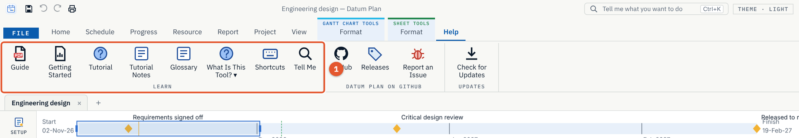

1. **Learn:** **Guide** (this guide), **Getting Started** (a short tour), **Glossary** (planning terms explained), **What Is This Tool?** (every ? card in one list), **Shortcuts** and **Tell Me**.

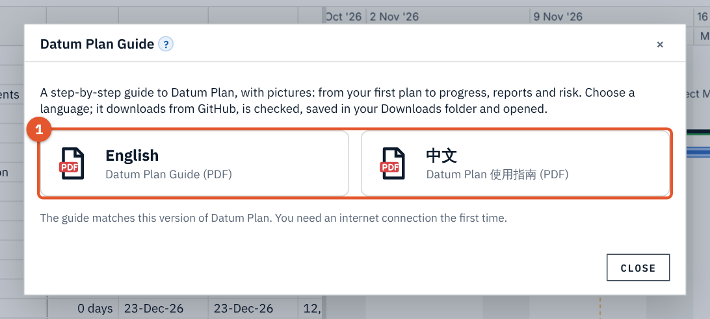

1. Choose **English** or **中文**. The guide downloads from GitHub, is checked, saved in your Downloads folder and opened.

## Glossary

| Term | Meaning |
|---|---|
| Activity ID | A task's short code, such as A1020. |
| Baseline | A saved copy of the agreed plan, to compare progress against. |
| Constraint | A date that holds a task, such as Start No Earlier Than. |
| Critical path | The chain of tasks that decides the finish date; if one slips, the project finishes late. |
| Duration | Working time a task takes, such as 5 days. |
| External predecessor | A task in another plan that this task waits for. |
| Earned value, SPI, CPI | Progress measured in money or hours. SPI below 1 is behind schedule, CPI below 1 is over budget. |
| Earned schedule, SPI(t) | Progress measured in time: when the plan expected the work done so far. |
| Float (slack) | How long a task can slip without delaying the finish (total float) or the next task (free float). |
| Lag, lead | Waiting time on a link (lag), or overlap (lead, a negative lag). |
| Levelling | Delaying tasks so nobody has more work than hours. |
| Look-ahead | The work of the next few weeks, checked for readiness. |
| Milestone | A task of zero duration that marks an event. |
| P50, P80 | Finish dates that 5 or 8 out of 10 risk-analysis runs meet. |
| Resource calendar | A person's own working week and leave; when switched on, it decides when their work is done. |
| Rules of credit | Weighted steps that measure physical progress. |
| Status date | The day progress is measured to. |
| Summary task | A task that groups others; its dates come from them. |
| WBS | Work breakdown structure: the outline of the work. |

## Shortcuts and troubleshooting

| Keys | Action |
|---|---|
| [[Insert]] | New task |
| [[Delete]] | Delete tasks |
| [[F2]] or [[Enter]] | Edit the cell |
| [[Alt+Shift+→]] / [[Alt+Shift+←]] | Indent / outdent |
| [[Ctrl+F2]] | Link the selected tasks |
| [[Shift+F2]] | Task information |
| [[Ctrl+C]] [[Ctrl+X]] [[Ctrl+V]] | Copy, cut, paste (also with other spreadsheets) |
| [[Ctrl+Z]] / [[Ctrl+Y]] | Undo / redo |
| [[Ctrl+S]] / [[Ctrl+O]] / [[Ctrl+P]] | Save / open / print |
| [[Ctrl+K]] | Tell me what you want to do |
| [[Ctrl+Tab]] / [[Ctrl+W]] | Next plan tab / close the plan shown |
| [[Ctrl]] + mouse wheel | Zoom the timescale |

**Windows protected your PC** on the first install: click **More info**, then **Run anyway**.

**A date did not move as expected.** Check the task's constraint and its links in the details pane (**Predecessors** tab), and whether it is set to **Manually Schedule**.

**Something went wrong.** Datum Plan stops that action and leaves your plan as it was. Details are written to `crash.log` in Datum Plan's data folder (`%APPDATA%\com.edgarmendonca.datumplan`). Please report it with **Help › Report an Issue**; nothing is sent automatically.

**Questions and ideas** are welcome on GitHub: github.com/Edgar-Mendonca/Datum-Plan/issues.
