# Datum Plan 使用指南

## 欢迎使用

Datum Plan 是一款 Windows 上的项目进度计划与控制软件。您列出工作内容、建立任务之间的逻辑关系、分配人员和费用，Datum Plan 会自动算出日期、关键路径和工作负荷。项目执行过程中，您录入实际进度，Datum Plan 会告诉您项目现在的状况：与基准计划的对比、挣值、S 曲线，以及可以打印或导出为 PDF 的各类报告。

本指南一步一步介绍 Datum Plan 的用法，从安装到完整的进度报告。不必一次读完，每一章都可以单独阅读。

阅读说明：

- 软件界面是英文的。本指南中**粗体**的英文是软件中按钮、选项卡和输入框的原名，后面括号里是中文意思，例如 **Set Baseline**（设置基准计划）。照着英文名称就能在软件里找到对应的按钮。
- 箭头 › 表示操作路径：**Progress › Set Baseline** 表示先点 **Progress**（进度）选项卡，再点 **Set Baseline** 按钮。
- 键盘按键这样表示：[[Ctrl+S]]。
- 截图上的橙色数字与图下方的编号说明一一对应。

> **提示：** Datum Plan 中几乎每个工具名称旁边都有一个小小的 **?**。点击它会弹出一张简短的说明卡片，告诉您这个工具是做什么的、怎么用。

## 安装、更新与启动

### 安装

1. 从发布页面下载 `DatumPlan-x.y.z-setup.exe`：github.com/Edgar-Mendonca/Datum-Plan/releases。
2. 运行安装程序。它只为当前 Windows 用户安装，不需要管理员权限。
3. 第一次安装时，Windows 可能会弹出 **Windows protected your PC**（Windows 已保护你的电脑），因为安装程序目前还没有代码签名。点击 **More info**（更多信息），再点 **Run anyway**（仍要运行）即可。

### 更新

Datum Plan 每次启动时都会检查是否有新版本。有新版本时，标题栏会出现琥珀色的 **Update available**（有可用更新）标记；点击它，或者打开 **File**（文件）页面点击 **Update now**（立即更新）。下载的安装包会先经过校验和核对再安装，安装完成后 Datum Plan 会自动重新启动。您的项目文件不受影响。

### 主页

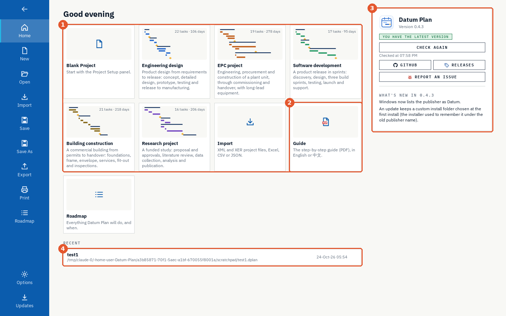

1. **新建计划。** 可以从空白项目或模板开始。模板中已经包含任务、逻辑关系、人员、费率和工时，一打开就能看到一个完整的计划。
2. **Guide**（指南）。下载本指南（PDF），有英文版和中文版。
3. **关于与更新。** 显示版本号，**Check again**（重新检查）更新，以及 GitHub、版本说明和 **Report an issue**（报告问题）的链接。
4. **最近使用的计划。** 点击即可打开。

文件页面左侧还有 **Open**（打开）、**Import**（导入）、**Save**（保存）、**Save As**（另存为）、**Export**（导出）、**Print**（打印）、**Roadmap**（路线图）、**Options**（选项）和 **Updates**（更新）。左上角的箭头返回到计划。

### 项目设置向导

新建计划时，**Project Setup**（项目设置）向导会带您完成基本设置。所有设置以后都可以修改。

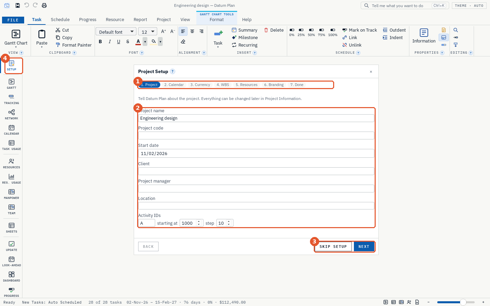

1. **步骤：** Project（项目）、Calendar（日历）、Currency（货币）、WBS（工作分解结构）、Resources（资源）、Branding（品牌标识）和 Done（完成）。点击某一步可直接跳转。
2. **当前步骤的内容：** 这里是项目名称、项目代码、开始日期、客户、项目经理、地点，以及作业代码（Activity ID）的编号方式（例如 A1000、A1010……）。
3. **Next**（下一步）进入下一步；**Skip Setup**（跳过设置）关闭向导，并保留已填写的内容。
4. 侧边栏的 **Setup** 可随时重新打开向导。

## 软件界面一览

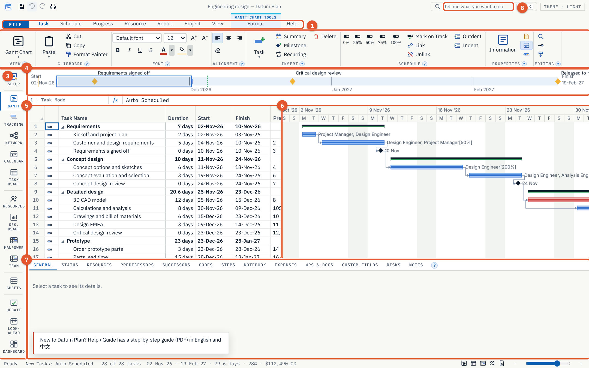

1. **File（文件）和功能区选项卡。** **File** 打开文件页面。选项卡依次为 **Task**（任务）、**Schedule**（进度安排）、**Progress**（进度）、**Resource**（资源）、**Report**（报告）、**Project**（项目）、**View**（视图）、**Format**（格式）和 **Help**（帮助）。
2. **功能区。** 当前选项卡的按钮，按组排列，每组都有 **?** 说明。
3. **侧边栏。** 一键切换各个视图：Setup（设置）、Gantt（甘特图）、Tracking（跟踪甘特图）、Network（网络图）、Calendar（日历）、Task Usage（任务分配状况）、Resources（资源表）、Res. Usage（资源使用状况）、Manpower（人力）、Team（团队规划器）、Sheets（工作表）、Update（更新进度）、Look-ahead（前瞻计划）、Dashboard（仪表板）、Progress（进度报告）、S-Curves（S 曲线）、Reports（报告）、Builder（报告生成器）、Checks（进度检查）、Risks（风险登记册）、Sched. Risk（进度风险分析）和 Portfolio（项目组合）。
4. **时间线。** 整个项目显示在一条线上。拖动蓝色方框可以滚动甘特图；在任务上点右键选择 **Add to Timeline**（添加到时间线），即可把任务显示在这里。
5. **任务表。** 用法和电子表格一样：在单元格里输入、选择区域、与 Excel 互相复制粘贴、向下填充。
6. **甘特图。** 时间刻度上的横道。蓝色是普通任务，红色是关键任务，黑色是摘要任务，菱形是里程碑。拖动横道可以移动任务，拖动横道末端可以改变工期。
7. **详细信息窗格。** 所选任务的全部信息，分为多个选项卡：General（常规）、Status（状态）、Resources（资源）、Predecessors（紧前任务）、Successors（紧后任务）、Codes（代码）、Steps（步骤）、Notebook（记事本）、Expenses（费用）、WPs & Docs（工作包与文件）、Custom Fields（自定义字段）、Risks（风险）和 Notes（备注）。
8. **Tell Me**（告诉我您想要做什么，[[Ctrl+K]]）。输入想做的事，例如 “baseline” 或 “level”，然后按 [[Enter]]。

窗口底部的状态栏显示任务数量、开始和完成日期、工期、完成百分比和费用。

## 编制计划

### 任务与工期

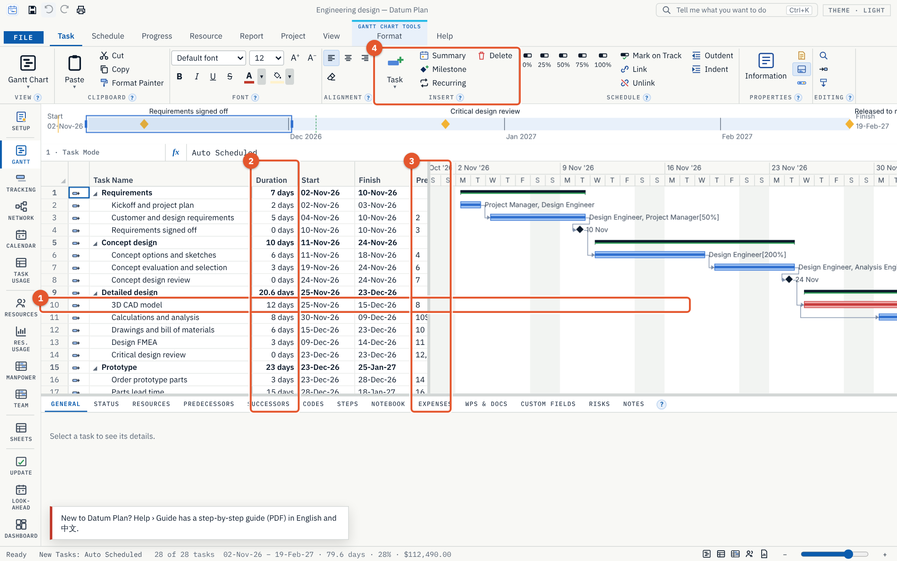

1. **一行任务。** 在 **Task Name**（任务名称）中输入名称。按 [[Insert]] 键（或 **Task › Task**）在所选任务上方插入新任务。
2. **Duration（工期）。** 输入数字和单位：`5d`（天）、`2w`（周）、`1mo`（月）、`4h`（小时）、`30m`（分钟）。输入 `0` 即为里程碑。`3ed` 是日历工期（昼夜连续计算，包括周末）。
3. **Predecessors（紧前任务）。** 本任务要等待的任务，填写其 ID（行号）：`3`、`3,4`，或带关系类型和延隔时间，如 `4SS+2d`。
4. **Insert（插入）组。** **Task**（任务）、**Summary**（摘要任务）、**Milestone**（里程碑）、**Recurring**（周期性任务）和 **Delete**（删除）。

Datum Plan 自动排程：修改工期或逻辑关系后，所有相关的日期都会随之更新。

### 大纲（WBS 工作分解结构）

把任务降级，就可以放到摘要任务下面：选中任务，点击 Task 选项卡上的 **Indent**（降级，或按 [[Alt+Shift+→]]）。上方的任务就成为摘要任务，它的日期、工时和费用由下属任务汇总而来。**Outdent**（升级，[[Alt+Shift+←]]）恢复原级别。点击摘要任务旁的小三角可以折叠。

### 任务之间的逻辑关系

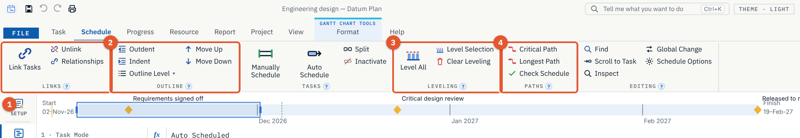

1. **Links（链接）。** **Link Tasks**（链接任务）按顺序链接所选任务（[[Ctrl+F2]]）。**Unlink**（取消链接）删除它们的逻辑关系。**Relationships**（关系图）以图形显示每个任务的逻辑关系。
2. **Outline（大纲）。** **Outdent**（升级）、**Indent**（降级）、**Outline Level**（显示第 1、2、3……级）、**Move Up**（上移）和 **Move Down**（下移）。
3. **Leveling（资源平衡）。** 解决人员过度分配（见“人员、工时与费用”一章）。
4. **Paths（路径）。** **Critical Path**（关键路径）突出显示决定完工日期的任务；**Longest Path**（最长路径）沿逻辑关系一直追溯到最后一个任务；**Check Schedule**（进度检查）检查计划质量。

逻辑关系共有四种，最常用的是“完成-开始”。

| 类型 | 代码 | 含义 |
|---|---|---|
| 完成-开始 | FS | A 完成后 B 才能开始。例如：混凝土浇筑完成后才能拆模。 |
| 开始-开始 | SS | A 开始后 B 才能开始。例如：编码开始两天后开始测试。 |
| 完成-完成 | FF | A 完成后 B 才能完成。例如：文档编写与构建同时收尾。 |
| 开始-完成 | SF | A 开始后 B 才能完成。很少用，常见于交接班。 |

**延隔时间**（lag）表示等待时间（`4FS+2d`：任务 4 完成后两天）；负的延隔时间是**提前量**（lead，`4FS-1d`：提前一天）。延隔时间也可以按紧前任务工期的百分比计算（`4SS+50%`）。

### 限制条件与截止日期

任务默认是 **As Soon As Possible**（越早越好）。在详细信息窗格的 **General**（常规）选项卡中，可以设置 **Constraint Type**（限制类型）和 **Constraint Date**（限制日期），例如 Start No Earlier Than（不得早于……开始）、Finish No Later Than（不得晚于……完成）、Must Start On（必须开始于）等。**Deadline**（截止日期）不会移动任务，只标出应当完成的日期，延误时会显示警告。

> **提示：** 尽量少用限制条件。由逻辑关系驱动的计划能真实反映延误的影响；用限制条件“钉住”的计划会掩盖延误（只会出现负浮动时间）。

### 日历

**Project › Change Working Time**（更改工作时间）用来设置工作日和工作时间（例如周一至周五，08:00–12:00 和 13:00–17:00），以及例外日期：法定节假日、停工期、周六加班等。可以建立多个日历，分配给某个任务（**Task Calendar**，任务日历）或某个人（资源表中的 **Base Calendar**，基准日历）。

### 资源日历

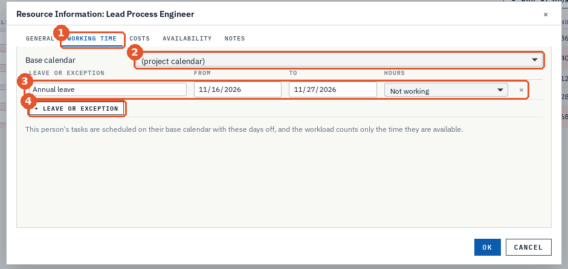

每个人的工作日不一定相同。启用资源日历后，每个人的工作按自己的日历安排，休假、非全日工作周或现场轮班都会推动他们所做的任务。

1. 打开 **Resources**（资源表），在此人那一行点击 **Info…**，选择 **Working Time**（工作时间）。
2. **Base calendar**（基准日历）是此人的工作周：项目日历，或其他日历，例如每周六天的现场日历。
3. **Leave or exception**（休假或例外）列出此人不工作（或只工作半天）的日期：年假、培训、本国节假日。
4. **+ Leave or exception** 添加一行。

然后启用：**Project › Schedule Options › Resource calendars**（资源日历）。此后每个人的分配按自己的日历进行，任务在最后一个人完成时完成。任务若有自己的 **Task Calendar**（任务日历），只在任务和人员都工作的时间进行。不使用此功能的计划不受影响：在您启用之前它是关闭的。

> **提示：** 无论谁来做都必须按自己日历进行的任务（养护时间、交货），在详细信息中设置 **Ignore Resource Calendar = Yes**（忽略资源日历）。

### 检查进度计划

**Schedule › Check Schedule**（进度检查）对逻辑关系、浮动时间、工期和限制条件进行质量检查（例如开口任务、过长的延隔时间、过大的浮动时间、负浮动时间等）。点击某项检查，即可看到对应的任务。

## 人员、工时与费用

### 资源表

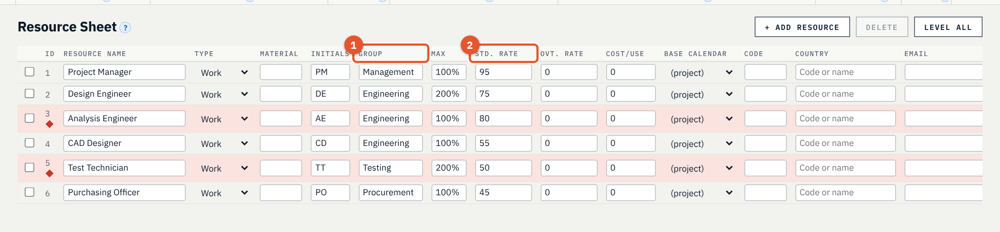

在侧边栏打开 **Resources**（资源表）。每一行是一个人、一个班组、一种材料或一项费用。

1. **Group**（组）表示工种或岗位（工程、土建、电气……）。Manpower（人力）和 Resource Graph（资源图表）按组汇总人数。
2. **Std. Rate**（标准费率）是每小时的费用（材料则为每单位）。**Max**（最大单位）表示可用程度：100% 是一名全职人员，300% 是三人班组。

**Country**（国家）表示人员、班组或供应商来自哪个国家：输入代码（DE）或英文名称（Germany），即显示国旗。工作表可用 **Plan Data…** 按国家列出资源。

### 给任务分配人员

在任务表的 **Resource Names**（资源名称）列中输入，例如 `Design Engineer` 或 `Design Engineer[50%], Analysis Engineer`。输入新名称会自动新建资源。工时和费用由工期、分配单位和费率自动算出。也可以使用 **Resource › Assign Resources**（分配资源）。

### 工作负荷、工种与资源平衡

**Res. Usage**（资源使用状况）显示每个人每天、每周或每月的工时；红色表示工时超过了可用时间。**Resource › Resource Graph**（资源图表）以柱状图显示同样的内容，并画出可用能力线，可以按人或按工种、以工时或人数显示。

出现人员过度分配时，**Resource › Level All**（全部资源平衡，或 **Level Selection**，平衡所选任务）会推迟浮动时间最多的任务，直到没有人超负荷。系统会先显示预览：哪些任务会移动、新的完工日期是哪天；点击 **Level**（平衡）之前不会做任何修改。**Clear Leveling**（清除资源平衡）可以撤销这些推迟。

### 费用

费用来自人员费率、任务的 **Fixed Cost**（固定成本，以及其累算方式：开始时、结束时或按比例），以及详细信息窗格中的费用明细。所有金额精确到分。货币在 **Project Setup** 或 **Project › Project Information**（项目信息）中设置。

## 基准计划与进度更新

### 保存基准计划

计划确定后，点击 **Progress › Set Baseline**（设置基准计划）。基准计划是计划日期、工期、工时和费用的一份副本，Datum Plan 会把当前计划与它进行对比。共有 11 个基准计划（Baseline 0 至 10），因此重新确定基准后，旧版本也可以保留。

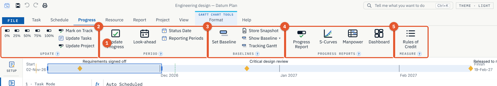

1. **Update（更新）。** 按档设置完成百分比（0%、25%、50%、75%、100%），**Mark on Track**（按计划标记，即按计划推进到状态日期）、**Update Tasks**（更新任务）和 **Update Project**（更新项目）。
2. **Period（期间）。** **Update Progress**（进度更新页面）、**Look-ahead**（前瞻计划）、**Status Date**（状态日期）和 **Reporting Periods**（报告期间：每周、每月在哪天结束）。
3. **Baselines（基准）。** **Set Baseline**（设置基准计划）、**Store Snapshot**（保存快照）、**Show Baseline**（显示基准横道）和 **Tracking Gantt**（跟踪甘特图）。
4. **Progress Reports（进度报告）。** **Progress Report**（进度报告）、**S-Curves**（S 曲线）、**Manpower**（人力）和 **Dashboard**（仪表板）。
5. **Measure（测量）。** **Rules of Credit**（进度测量规则，见下文）。

### 状态日期

状态日期（数据日期）是进度测量截止的那一天，例如上周五。用 **Progress › Status Date** 设置。状态日期之后的工作是计划，之前的工作应当已经完成。

### 每周更新进度

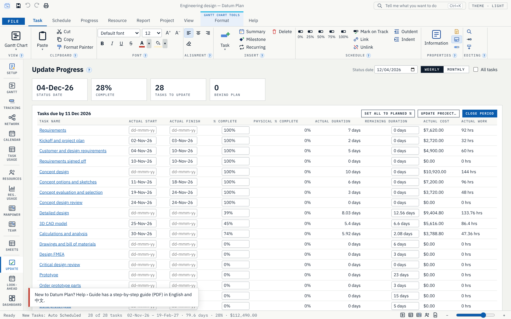

在侧边栏打开 **Update**（更新）。页面列出本期间到期的任务，可填写：

- **Actual Start**（实际开始）和 **Actual Finish**（实际完成）：实际日期。
- **% Complete**（完成百分比）：任务完成了多少。
- **Remaining Duration**（剩余工期）：还需要多久；如果任务会比计划更久，就修改它。

**Set all to planned %**（全部设为计划百分比）先把所有任务填为基准计划的进度，再逐项修正与实际不符的地方。**Update Project…**（更新项目）把截至某一日期的工作标记为完成。本期更新完毕后，点击 **Close period**（关闭期间）：Datum Plan 会保存所有任务在该日期的进度，这样 S 曲线、仪表板和趋势报告就能显示每个期间的真实情况。

### 跟踪甘特图

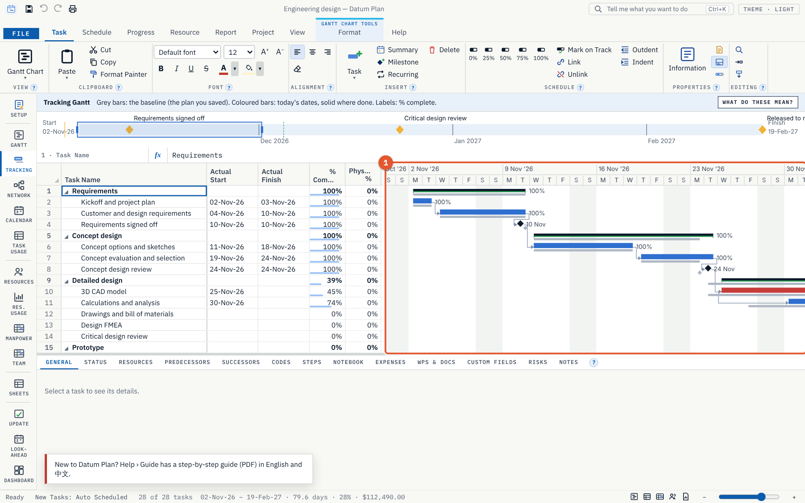

1. 每个任务有两条横道：下方灰色的是基准计划，上方彩色的是当前计划，已完成部分为实心。标签是完成百分比。如果彩色横道移到了灰色横道的右边，说明相对基准计划已经延误。

### 进度测量规则与安装工程量

对于按步骤或按工程量测量的工作，**Progress › Rules of Credit**（进度测量规则）可以给任务设定带权重的步骤，例如电缆：敷设 60%、接线 30%、测试 10%。软件内置了常用规则（混凝土、钢结构、管道、电缆、设备、文件、软件），也可以自己新建。在任务的 **Steps**（步骤）选项卡中勾选已完成的步骤，任务的实际完成百分比（physical % complete）随之更新。

也可以填写 **Quantity**（工程量）和 **Installed Quantity**（已安装量，需先插入这两列）：200 米中已安装 50 米，即实际进度 25%。

## 报告

### 仪表板

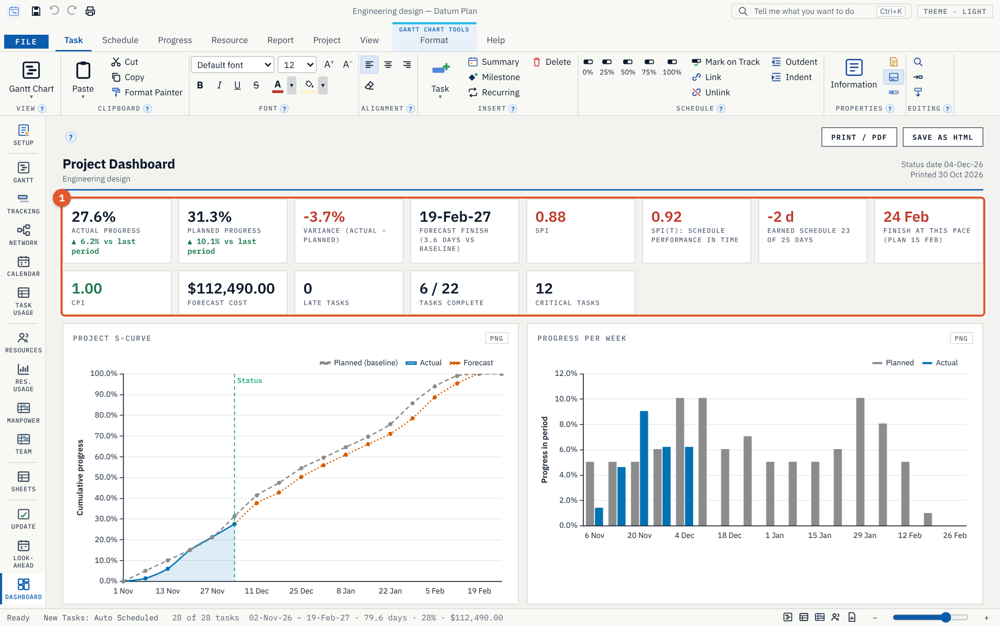

1. **关键指标：** 实际进度和计划进度及其偏差、预测完工日期、SPI 和 CPI、**SPI(t)** 以及按当前速度推算的完工日期（挣得进度）、费用、延误任务数、已完成任务数和关键任务数。绿色表示良好，红色表示需要关注。

下方是项目 S 曲线、每周进度、费用、人力、里程碑和延误任务。右上角有 **Print / PDF**（打印/PDF）和 **Save as HTML**（另存为 HTML）。

### 自定义仪表板

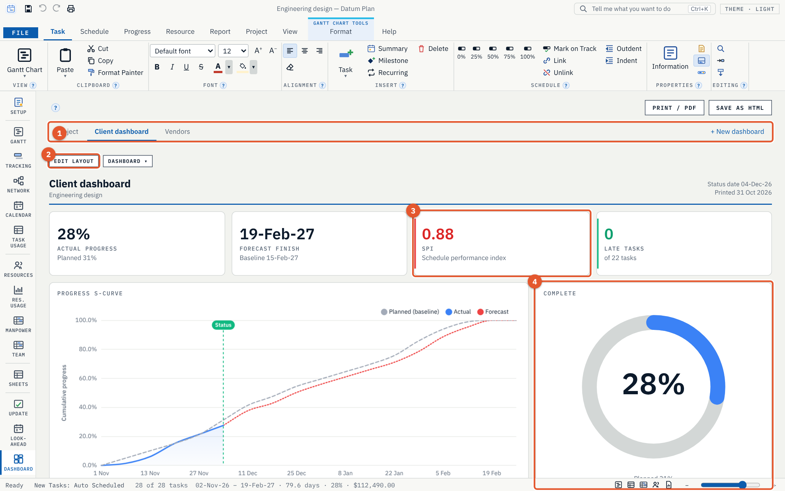

按客户或领导的要求制作自己的仪表板，数量不限；它们随计划保存，并始终显示计划的最新情况。

1. **标签。** **Project**（项目）是内置仪表板。**+ New dashboard**（新建仪表板）可新建空白仪表板或使用模板：**Client dashboard**（客户仪表板）、**Weekly progress**（每周进度）或 **Vendors and countries**（供应商与国家）。
2. **Edit layout**（编辑布局）在每个图块周围显示边框。拖动图块可调整顺序；每个图块上的 ✎ 用于修改，⤢ 设置宽度（四分之一到整行）和高度（一到四行），× 用于删除。**Dashboard ▾** 可重命名、复制或删除仪表板。
3. **数字图块**来自公式，与工作表中的写法相同：`=SPI`、`=ProjectFinish`、`=COUNTIF(Tasks[Late],TRUE)` 或 `=Vendors!B4`。可设置规则使其显示为绿色或红色，例如 SPI ≥ 1 时为绿色。
4. **进度环**显示一个百分比（0–100），例如 `=PercentComplete`，下方可加第二行，例如计划百分比。

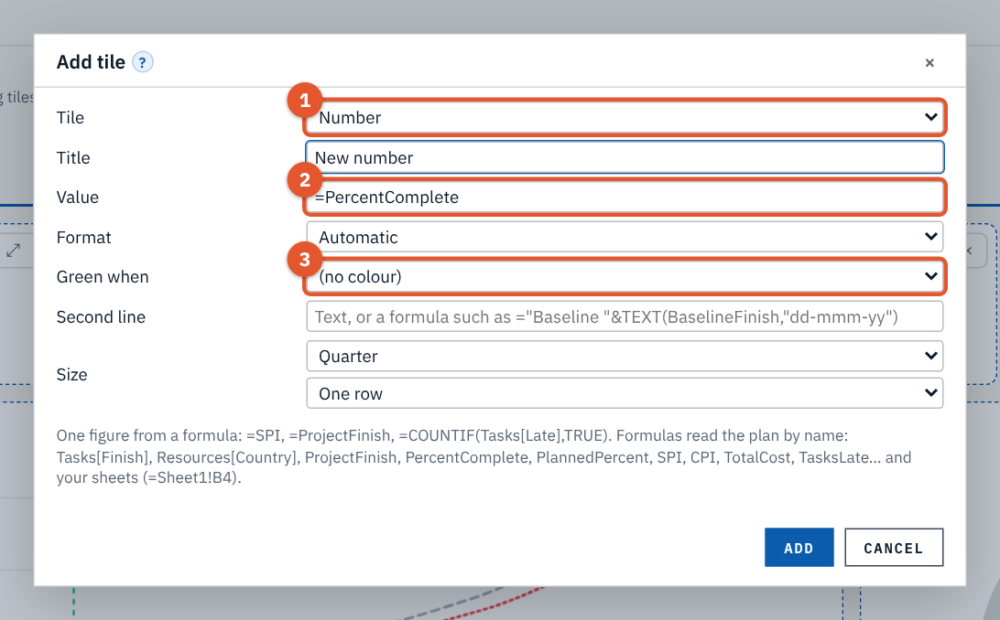

1. **Tile**（图块类型）：Number（数字）、Progress ring（进度环）、Chart（图表）、Table（表格）、Countries（国家）或 Text（文字）。**Chart** 可以是计划自带的图表（S 曲线、每期进度、各阶段进度、费用与挣值、人力），也可以是工作表区域的图表：柱形图、条形图、折线图、面积图、环形图或饼图，第一列为标签，第一行为系列名称。**Table** 可以是计划清单（里程碑、延误或关键任务、下期开始、本期完成），也可以是工作表区域或公式；国家列会显示国旗。**Countries** 统计各国旗出现的次数，例如 `=Resources[Country]`。
2. **Value**（值）：公式。除任务表和资源表外，还可以使用 `PercentComplete`、`PlannedPercent`、`ProjectFinish`、`BaselineFinish`、`SPI`、`CPI`、`TotalCost`、`TasksLate` 以及工作表一章中列出的其他名称。
3. **Green when**（绿色条件）：决定数字颜色的规则。

> **提示：** **Print / PDF** 打印当前显示的仪表板。可以先在工作表中整理每周要汇报的数据，再让仪表板图块引用它们。

### S 曲线与挣得进度

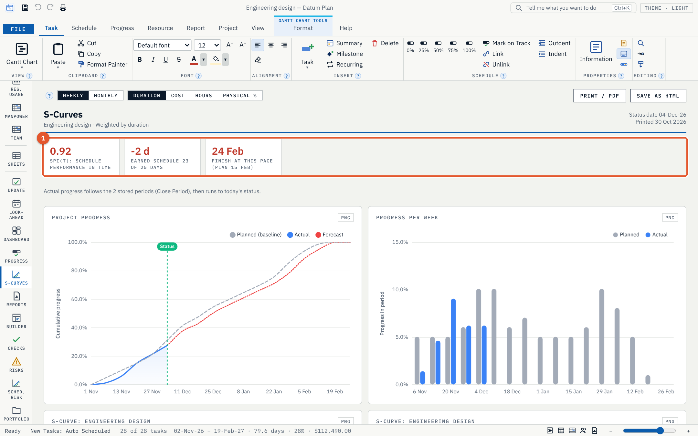

1. **挣得进度（Earned schedule）。** SPI(t) 把“计划预计在什么时候达到今天的进度”与今天进行比较：0.92 表示速度是计划的 92%。**Earned schedule 23 of 25 days** 表示用 25 个工作日完成的工作，计划只需 23 天，即项目落后 2 天；**Finish at this pace**（按当前速度完工）给出推算的完工日期。

S 曲线显示累计进度：灰色虚线是基准计划，蓝线是实际进度（它经过每次 **Close period** 保存的进度点），点线是预测。状态线标出状态日期。进度可以按工期、费用、工时或实际完成百分比加权。

### 进度报告

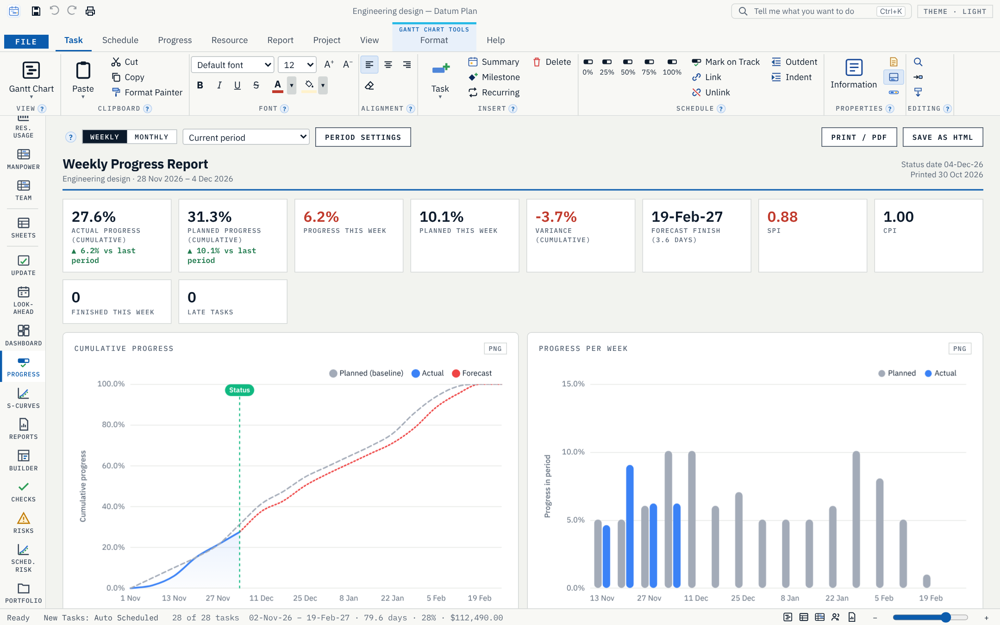

侧边栏的 **Progress**（进度报告）生成周报或月报：本期数据、已完成和已开始的工作、延误的工作、后续工作，以及您的说明（概要、进展、问题、措施）和照片。在下拉列表中选择以前的期间，可以再次查看。

### 报告选项卡、报告生成器与打印

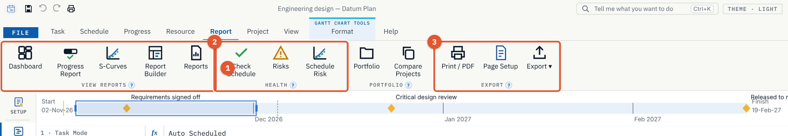

1. **View Reports（查看报告）：** Dashboard（仪表板）、Progress Report（进度报告）、S-Curves（S 曲线）、**Report Builder**（报告生成器：用现成的模块组合自己的报告，带有管理周报、客户月报、进度健康度、费用等模板）和 **Reports**（现成报告）。
2. **Health（健康度）：** **Check Schedule**（进度检查）、**Risks**（风险）和 **Schedule Risk**（进度风险分析）。
3. **Export（导出）：** **Print / PDF**（打印/PDF）、**Page Setup**（页面设置）和 **Export**（导出为其他格式）。

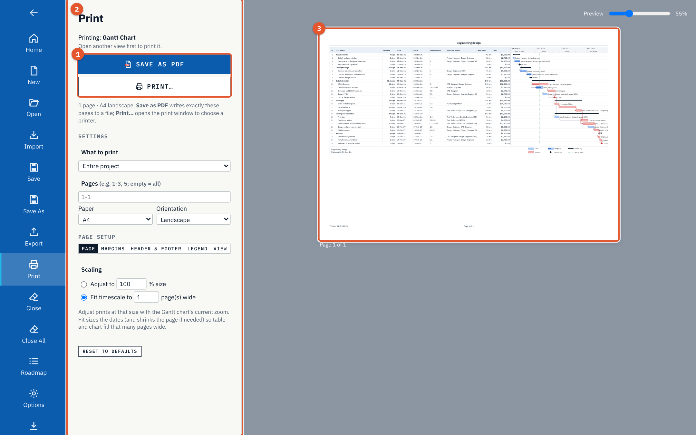

1. **Print / Save as PDF**（打印/另存为 PDF）。打开 Windows 打印窗口；选择打印机，或选择 **Microsoft Print to PDF** / **Save as PDF** 保存为 PDF。
2. **设置。** 打印内容、页码范围、纸张和方向，以及 **Page Setup**（页面设置）：缩放（或 **Fit to**，调整为几页宽）、页边距、页眉和页脚（可放公司标识、页码和日期）、图例和视图选项。
3. **预览。** 与实际打印完全一致的页面。打印的是您当前打开的视图：甘特图、跟踪甘特图、网络图、日历、资源视图、仪表板、各类报告、进度风险分析、前瞻计划或人力图表。

### 网络图

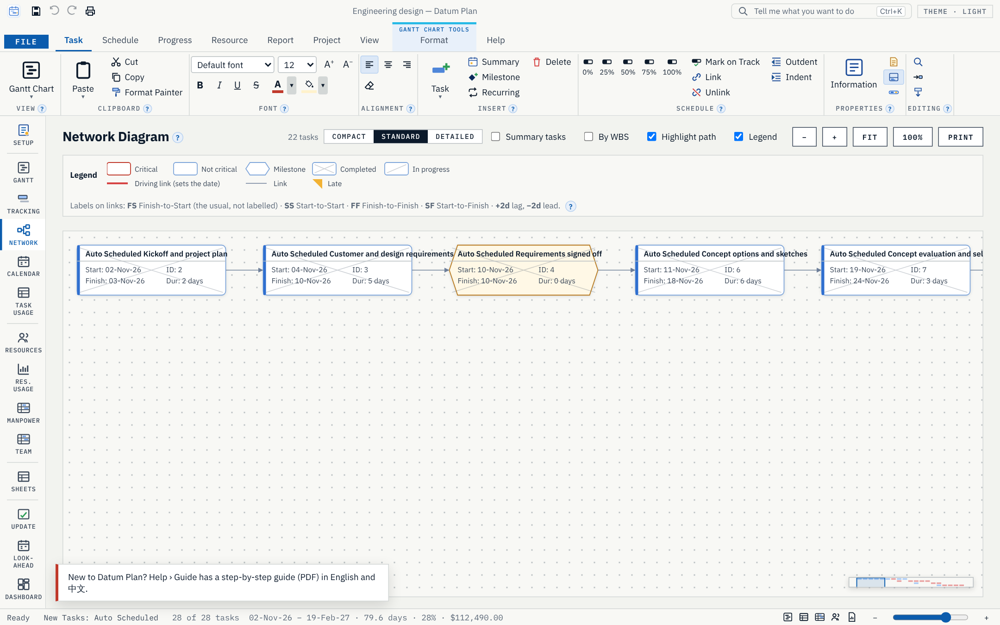

**Network**（网络图）把每个任务显示为一个方框，用逻辑关系连接到下一个任务，带有图例、缩放、缩略图，并可选择方框样式（紧凑、标准、详细）、显示摘要任务和按 WBS 分带。关键任务为红色。网络图可以跨多页打印。

## 风险与近期工作

### 风险登记册

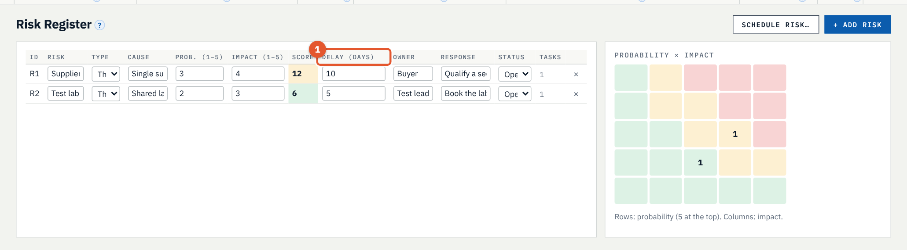

**Risks**（风险登记册）列出威胁和机会，以及其概率和影响（1 至 5）；风险值为两者之积，以绿、黄、红显示，右侧矩阵显示其分布。在任务的 **Risks**（风险）选项卡中把风险关联到任务。

1. **Delay (days)**（延误天数）表示风险发生时给每个关联任务增加多少个工作日（机会则减少）。进度风险分析会用到它。

### 进度风险分析

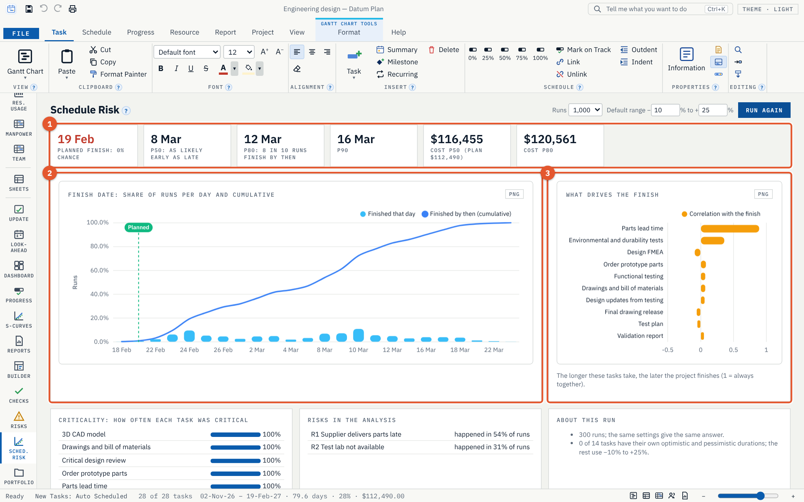

**Sched. Risk**（进度风险分析）将计划运行很多次（默认 1000 次，即蒙特卡洛模拟）。每一次运行中，每个未完成任务的工期在乐观工期和悲观工期之间取值，每个未关闭的风险按其概率发生（1 = 10%，2 = 30%，3 = 50%，4 = 70%，5 = 90%）。

1. **结果：** 按计划日期完工的概率、**P50** 日期（提前和延误的可能性各半）、**P80**（10 次中有 8 次能在此日期前完成，常用作承诺日期）、**P90**，以及 P50 和 P80 对应的费用。
2. **完工日期分布：** 每天完工的次数，以及累计曲线。
3. **影响完工的因素：** 工期对完工日期影响最大的任务。应优先压缩这些任务的工期或降低其风险。

可以用 **Optimistic Duration**（乐观工期）和 **Pessimistic Duration**（悲观工期）两列给任务设定各自的范围；没有设定的任务使用默认范围（−10% 至 +25%）。同样的计划和设置总是得到同样的结果，最近一次的分析结果会随计划一起保存。

### 前瞻计划与制约因素清单

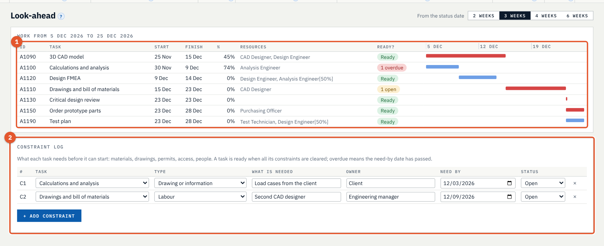

1. **近期工作：** 从状态日期起未来 2、3、4 或 6 周内未完成的任务及其横道。**Ready**（就绪）表示清单中没有阻碍该任务的事项；**open**（未解决）或 **overdue**（已逾期）表示还有阻碍。
2. **制约因素清单（Constraint log）：** 每个任务开工前需要具备的条件：材料、图纸或资料、许可证、作业面、人员、设备或前序工作，以及负责人、需要日期和状态（Open 未解决 / Cleared 已解决）。先在表中点击任务，再点 **+ Add constraint**（添加制约因素）。

建议每周与团队一起过一遍前瞻计划：解决未解决的事项，催办已逾期的事项。

### 人力

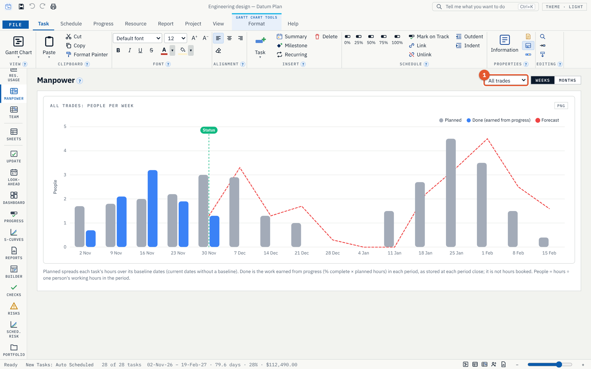

1. 选择 **All trades**（全部工种）或某一工种。灰色柱是每周（或每月）计划的人数，蓝色柱是已完成工作所对应的人数（按进度挣得），虚线是剩余工作的预测。

## 工作表：自己的报告和仪表板

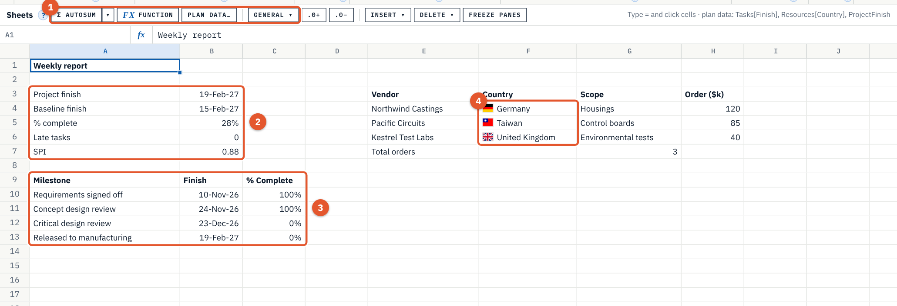

在侧边栏打开 **Sheets**（工作表）。工作表是保存在计划文件中的电子表格，用法和 Excel 一样，并且直接读取计划数据，所以以前要从进度计划复制到另一个 Excel 文件的数字，现在始终是最新的。用 **+** 新建工作表标签；右键单击标签可重命名或删除。

1. **工具栏。** **Σ AutoSum**（自动求和）对所选单元格上方的数字求和（[[Alt+=]]；旁边的箭头还提供 Average 平均值、Count 计数、Max 最大值、Min 最小值）。**fx Function**（插入函数）可按名称或用途查找全部 490 个函数。**Plan Data…**（计划数据）插入一份实时清单。其后是数字格式、增加或减少小数位，以及插入（**Insert**）和删除（**Delete**）行和列。
2. **按名称读取计划数据。** 例如 `=ProjectFinish`（项目完成日期）、`=BaselineFinish`（基准完成日期）、`=PercentComplete`（完成百分比）、`=SPI` 或 `=COUNTIF(Tasks[Late],TRUE)`（延误任务数）。日期和百分比会自动设置格式。
3. **Plan Data… 生成的实时清单。** 选择 Tasks（任务）或 Resources（资源）、要显示的列、哪些行（里程碑、关键任务、延误任务、未完成、进行中、未来四周开始）、排序方式和行数。一个公式填满所有行，并随计划变化。
4. **国旗。** 给单元格设置 **Country with flag**（国家及国旗）数字格式，然后输入国家代码（DE、cn）或英文名称（Germany、UK），即显示国旗和国家名称。

### 像在 Excel 中一样编写公式

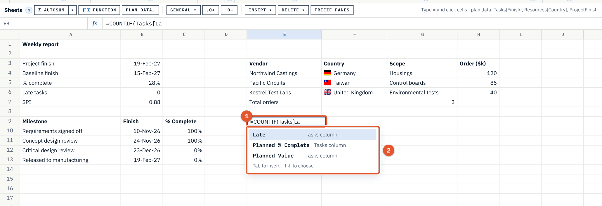

1. 输入 `=` 开始编写公式。单击一个单元格，或拖过多个单元格，即可把它们加入公式（A1、A1:A5）；单击其他工作表标签可引用该表。每个引用都有彩色边框。[[F4]] 切换 $ 绝对引用。[[Enter]] 保存公式，并自动补上缺少的右括号。
2. 输入时会推荐函数、计划名称和表格列；[[Tab]] 插入所选项。在函数内部，提示会显示它的参数，当前参数带下划线。

公式可以读取的计划数据：

| 写法 | 含义 |
| --- | --- |
| `Tasks[Finish]` | 每个任务一个值。列包括 Name（名称）、WBS、Start（开始）、Finish（完成）、Duration（工期）、% Complete（完成百分比，0–100）、Baseline Start / Baseline Finish（基准开始/完成）、Cost（费用）、Work（工时）、Total Float（总浮动时间）、Critical（关键）、Late（延误）、Milestone（里程碑）、Summary（摘要）、Resources（资源）、Status（状态）、Planned Value / Earned Value（计划值/挣值），以及自定义字段。 |
| `Resources[Country]` | 每个资源一个值：Name、Type（类型）、Group（组）、Initials（缩写）、Max Units（最大单位）、Rate（费率）、Work（工时，小时）、Cost、Country（国家）、Email。 |
| `ProjectFinish` | 另有 ProjectName、ProjectStart、StatusDate（状态日期）、BaselineFinish、FinishVariance（完成偏差，工作日）、PercentComplete（0–100）、PlannedPercent（计划百分比，0–100）、TotalCost、PlannedValue、EarnedValue、ActualCost、SPI、CPI、TaskCount、TasksDone、TasksLate、CriticalCount、MilestoneCount。 |

- 与 Excel 相同，填充柄和复制粘贴会移动引用：`=A1*2` 向下填充变为 `=A2*2`。Ctrl+D 和 Ctrl+R 向下和向右填充。
- 右键单击单元格可插入或删除行和列；指向被移动单元格的公式会自动跟随。拖动列边界可调整列宽；双击边界自动适应文字。
- 鼠标指向错误值（#N/A、#NAME?、#SPILL! 等）可查看含义。
- 旧公式（如 `=SUM(Plan!M2:M200)`）仍然有效。

> **提示：** 用 **File › Export** 导出为 Excel 时会保留公式，并附带 Tasks 和 Resources 表以及上述名称，因此工作簿在 Excel 中同样可用。

### 公式列

**公式列**（**Format › Formula Column**）在任务表中增加一列，由其他列计算得出，例如 `=[% Complete]-[Baseline % Complete]` 或 `=IF([Finish]>[Baseline Finish],"Late","On time")`。

## 文件：保存、导入与导出

- **Save**（保存，[[Ctrl+S]]）把计划保存为电脑上的 `.dplan` 文件。保存是安全的：只有新文件完整写好后才会替换旧文件。
- **Import**（导入）可以打开其他进度计划软件的计划（Project XML 和 XER 文件），以及 Excel 或 CSV 表格（由您指定每一列的含义）。导入后会显示一份简短的**导入报告**，列出 Datum Plan 修改或略去的内容，以及每个任务的日期是否与原文件一致。
- **Export**（导出）可导出为 Excel（保留公式和格式）、CSV、Project XML、XER、PMXML、MPX、HTML、iCalendar 和 JSON。
- **恢复。** Datum Plan 在您工作时会自动保存恢复副本（在 **File › Options** 中设置频率）。如果软件在保存前意外关闭，下次启动时会提示恢复您的工作。

## 命令行与 AI 助手

`datum-cli`（在发布页面下载）无需打开窗口即可处理计划：查看计划概况或进度表、修改计划、导出，或运行风险分析。`datum-cli mcp` 让 AI 助手可以打开计划、读取计划、用与窗口相同的操作修改计划并保存。输入 `datum-cli help` 查看全部命令。

## 软件内的帮助

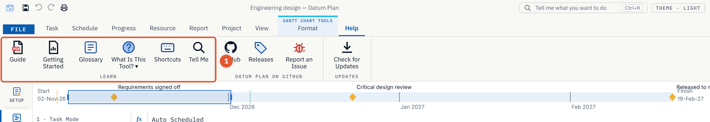

1. **Learn（学习）：** **Guide**（指南，即本指南）、**Getting Started**（入门简介）、**Glossary**（术语表）、**What Is This Tool?**（所有 ? 说明卡片汇总）、**Shortcuts**（快捷键）和 **Tell Me**（告诉我）。

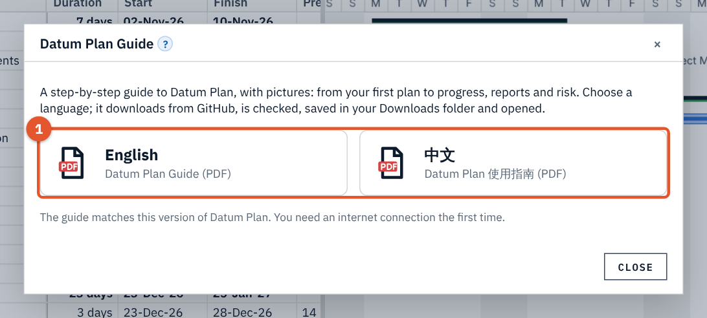

1. 选择 **English**（英文）或 **中文**。指南会从 GitHub 下载、经过校验，保存到“下载”文件夹并自动打开。

## 术语表（英文—中文）

| 英文 | 中文 | 含义 |
|---|---|---|
| Activity ID | 作业代码 | 任务的简短编号，如 A1020。 |
| Baseline | 基准计划 | 已确认计划的保存副本，用于对比进度。 |
| Constraint | 限制条件 | 约束任务日期的条件，如“不得早于……开始”。 |
| Critical path | 关键路径 | 决定完工日期的任务链；其中任一任务延误，项目就会延期。 |
| Duration | 工期 | 任务所需的工作时间，如 5 天。 |
| Earned value, SPI, CPI | 挣值、进度绩效指数、成本绩效指数 | 用金额或工时衡量进度。SPI 小于 1 表示进度落后，CPI 小于 1 表示费用超支。 |
| Earned schedule, SPI(t) | 挣得进度、时间进度绩效指数 | 用时间衡量进度：计划预计在什么时候完成目前已完成的工作。 |
| Float (slack) | 浮动时间（时差） | 任务可以推迟而不影响完工日期（总浮动时间）或紧后任务（自由浮动时间）的时间。 |
| Lag, lead | 延隔时间、提前量 | 逻辑关系上的等待时间（延隔）或搭接时间（提前量，即负延隔）。 |
| Levelling | 资源平衡 | 推迟任务，使任何人的工作量都不超过其可用时间。 |
| Look-ahead | 前瞻计划 | 未来几周的工作，并检查是否具备开工条件。 |
| Milestone | 里程碑 | 工期为零、标志某一事件的任务。 |
| P50, P80 | P50、P80 | 风险分析中 10 次有 5 次、8 次能够达到的完工日期。 |
| Resource calendar | 资源日历 | 个人的工作周和休假；启用后决定其工作在何时完成。 |
| Rules of credit | 进度测量规则 | 用带权重的步骤测量实际进度的方法。 |
| Status date | 状态日期（数据日期） | 进度测量截止的日期。 |
| Summary task | 摘要任务 | 包含其他任务的任务，其日期由下属任务汇总。 |
| WBS | 工作分解结构 | 工作内容的层级大纲。 |

## 快捷键与常见问题

| 按键 | 作用 |
|---|---|
| [[Insert]] | 新建任务 |
| [[Delete]] | 删除任务 |
| [[F2]] 或 [[Enter]] | 编辑单元格 |
| [[Alt+Shift+→]] / [[Alt+Shift+←]] | 降级 / 升级 |
| [[Ctrl+F2]] | 链接所选任务 |
| [[Shift+F2]] | 任务信息 |
| [[Ctrl+C]] [[Ctrl+X]] [[Ctrl+V]] | 复制、剪切、粘贴（也可与 Excel 互通） |
| [[Ctrl+Z]] / [[Ctrl+Y]] | 撤销 / 恢复 |
| [[Ctrl+S]] / [[Ctrl+O]] / [[Ctrl+P]] | 保存 / 打开 / 打印 |
| [[Ctrl+K]] | 告诉我您想要做什么 |
| [[Ctrl]] + 鼠标滚轮 | 缩放时间刻度 |

**第一次安装时出现 Windows protected your PC：** 点击 **More info**（更多信息），再点 **Run anyway**（仍要运行）。

**日期没有按预期变化：** 在详细信息窗格中检查任务的限制条件和逻辑关系（**Predecessors** 选项卡），以及任务是否被设为 **Manually Schedule**（手动计划）。

**出现问题：** Datum Plan 会中止该操作，计划保持原样。详细信息写在 Datum Plan 数据文件夹中的 `crash.log` 文件里（`%APPDATA%\com.edgarmendonca.datumplan`）。请通过 **Help › Report an Issue**（报告问题）反馈；软件不会自动发送任何信息。

**问题和建议**欢迎在 GitHub 上提出：github.com/Edgar-Mendonca/Datum-Plan/issues。
