# Datum Plan 使用指南

## 欢迎使用

Datum Plan 是一款 Windows 上的项目进度计划与控制软件。您列出工作内容、建立任务之间的逻辑关系、分配人员和费用，Datum Plan 会自动算出日期、关键路径和工作负荷。项目执行过程中，您录入实际进度，Datum Plan 会告诉您项目现在的状况：与基准计划的对比、挣值、S 曲线，以及可以打印或导出为 PDF 的各类报告。

本指南一步一步介绍 Datum Plan 的用法，从安装到完整的进度报告。不必一次读完，每一章都可以单独阅读。

阅读说明：

- 软件界面是英文的。本指南中**粗体**的英文是软件中按钮、选项卡和输入框的原名，后面括号里是中文意思，例如 **Set Baseline**（设置基准计划）。照着英文名称就能在软件里找到对应的按钮。
- 箭头 › 表示操作路径：**Progress › Set Baseline** 表示先点 **Progress**（进度）选项卡，再点 **Set Baseline** 按钮。
- 键盘按键这样表示：[[Ctrl+S]]。
- 截图上的橙色数字与图下方的编号说明一一对应。

> **提示：** Datum Plan 中几乎每个工具名称旁边都有一个小小的 **?**。点击它会弹出一张简短的说明卡片，告诉您这个工具是做什么的、怎么用。

## 安装、更新与启动

### 安装

1. 从发布页面下载 `DatumPlan-x.y.z-setup.exe`：github.com/Edgar-Mendonca/Datum-Plan/releases。
2. 运行安装程序。它只为当前 Windows 用户安装，不需要管理员权限。
3. 第一次安装时，Windows 可能会弹出 **Windows protected your PC**（Windows 已保护你的电脑），因为安装程序目前还没有代码签名。点击 **More info**（更多信息），再点 **Run anyway**（仍要运行）即可。

### 更新

Datum Plan 每次启动时都会检查是否有新版本。有新版本时，标题栏会出现琥珀色的 **Update available**（有可用更新）标记；点击它，或者打开 **File**（文件）页面点击 **Update now**（立即更新）。下载的安装包会先经过校验和核对再安装，安装完成后 Datum Plan 会自动重新启动。您的项目文件不受影响。

### 主页

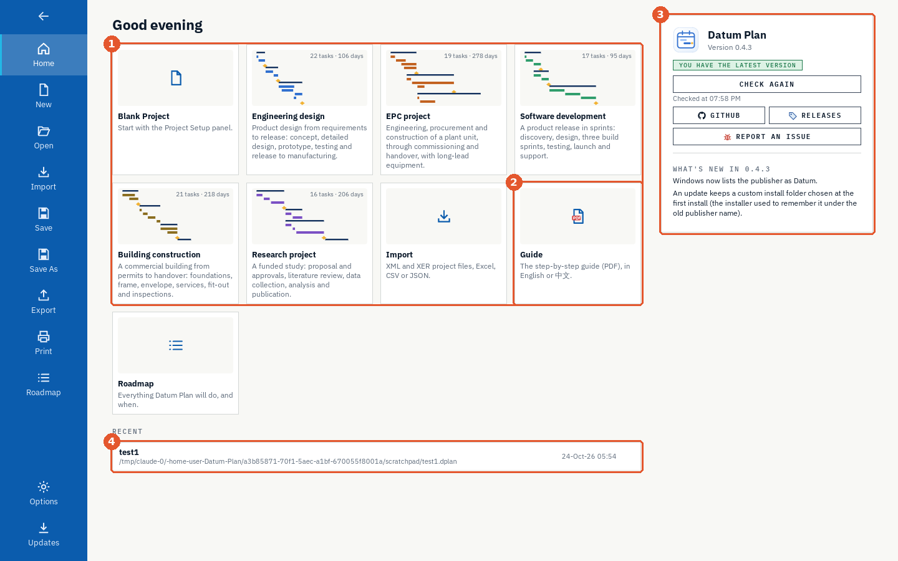

1. **新建计划。** 可以从空白项目或模板开始。模板中已经包含任务、逻辑关系、人员、费率和工时，一打开就能看到一个完整的计划。
2. **Guide**（指南）。下载本指南（PDF），有英文版和中文版。
3. **关于与更新。** 显示版本号，**Check again**（重新检查）更新，以及 GitHub、版本说明和 **Report an issue**（报告问题）的链接。
4. **最近使用的计划。** 点击即可打开。

文件页面左侧还有 **Open**（打开）、**Import**（导入）、**Save**（保存）、**Save As**（另存为）、**Export**（导出）、**Print**（打印）、**Roadmap**（路线图）、**Options**（选项）和 **Updates**（更新）。左上角的箭头返回到计划。**Options › Colour-blind safe colours**（色盲友好配色）可将图表和状态改为各种常见色盲都能分辨的颜色。

### 教程：边看边学

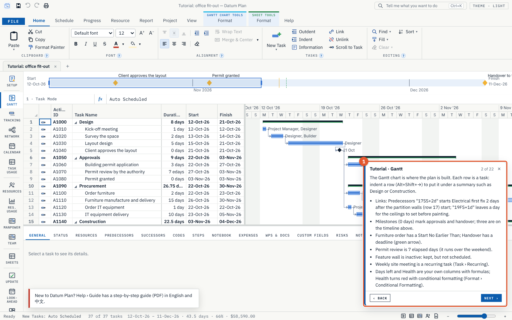

**Help › Tutorial**（帮助 › 教程），或主页上的 **Tutorial (guided example)**（教程示例）磁贴，会打开一个小型办公室装修项目。它用到了 Datum Plan 的每一个部分，工作已进行到第五周。项目打开时显示 **Setup**（设置）视图，右下角有一条说明，介绍这个视图是如何填写的，以及可以尝试的操作。

1. **说明** 随视图变化。**Next**（下一个）和 **Back**（上一个）按侧边栏从上到下的顺序浏览各个视图：甘特图、跟踪甘特图、网络图、日历、资源视图、表格、更新、前瞻计划、仪表板、进度报告、S 曲线、报告、报告生成器、检查、风险、进度风险分析和项目组合。
2. **所有内容都已填写：**
   - 带延隔时间的链接、时间线上的里程碑、限制条件、期限、日历天工期、未激活任务和周期性会议；
   - 带公式和条件格式的自定义列；
   - 带费率和国家的人员、材料、费用，以及带休假的资源日历；
   - 比较基准、已关闭为期间的五周进度，以及一条完成规则；
   - 风险、限制条件日志、读取计划数据的表格、仪表板和已保存的报告。
3. **×** 隐藏说明；**Help › Tutorial Notes**（帮助 › 教程说明）可再次显示。

教程是一个新计划：您可以随意修改，需要保留时再保存。

### 项目设置向导

新建计划时，**Project Setup**（项目设置）向导会带您完成基本设置。所有设置以后都可以修改。

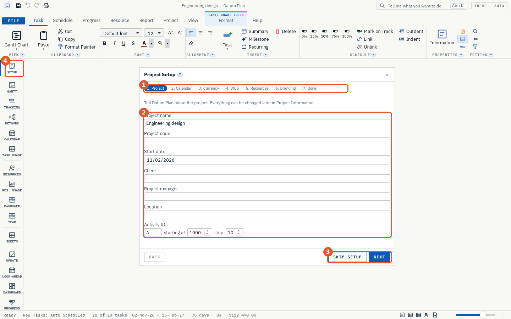

1. **步骤：** Project（项目）、Calendar（日历）、Currency（货币）、WBS（工作分解结构）、Resources（资源）、Logos（标识）和 Done（完成）。点击某一步可直接跳转。
2. **当前步骤的内容：** 这里是项目名称、项目代码、开始日期、客户、项目经理、地点，以及作业代码（Activity ID）的编号方式（例如 A1000、A1010……）。
3. **Next**（下一步）进入下一步；**Skip Setup**（跳过设置）关闭向导，并保留已填写的内容。
4. 侧边栏的 **Setup** 可随时重新打开向导。

## 软件界面一览

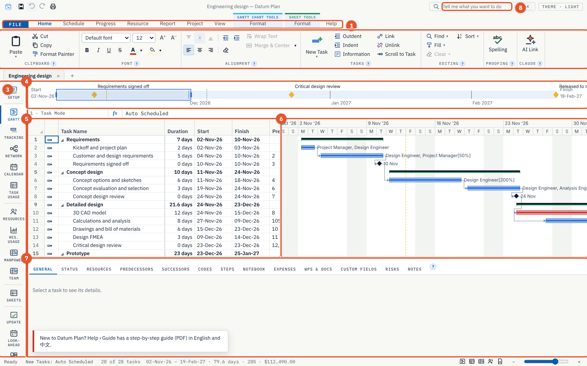

1. **File（文件）和功能区选项卡。** **File** 打开文件页面。选项卡依次为 **Home**（开始）、**Schedule**（进度安排）、**Progress**（进度）、**Resource**（资源）、**Report**（报告）、**Project**（项目）、**View**（视图）、**Format**（格式）和 **Help**（帮助）。
2. **功能区。** 当前选项卡的按钮，按组排列，每组都有 **?** 说明。**Home** 包含任务表和工作表共用的工具（剪贴板、字体、对齐、编辑和校对）。**Proofing › Spelling**（校对 › 拼写检查，[[F7]]）检查任务名称、备注、文本自定义字段以及所有工作表中文字的英文拼写（英式或美式英语，在对话框底部选择）。它逐个显示未识别的单词并选中对应任务；**Change**（更改）或 **Change All**（全部更改）写入您选择的单词（可用 Undo 撤销），**Ignore**（忽略）和 **Ignore All**（全部忽略）跳过该单词，**Add to Dictionary**（添加到词典）把它作为您自己的单词保存在本机。缩写（如 HAZOP）、带数字的代号（如 PX-200B）以及网址和电子邮件地址不会被检查。Home 还包含常用的任务命令（新建任务、降级、升级、任务信息、链接、取消链接、滚动到任务）；这些任务命令在 **Schedule** 上也有。**Gantt Chart Tools › Format** 和 **Sheet Tools › Format** 始终显示在功能区上，点击会打开其对应的视图。
3. **侧边栏。** 一键切换各个视图：Setup（设置）、Gantt（甘特图）、Tracking（跟踪甘特图）、Network（网络图）、Calendar（日历）、Task Usage（任务分配状况）、Resources（资源表）、Res. Usage（资源使用状况）、Manpower（人力）、Team（团队规划器）、Sheets（工作表）、Update（更新进度）、Look-ahead（前瞻计划）、Dashboard（仪表板）、Progress（进度报告）、S-Curves（S 曲线）、Reports（报告）、Builder（报告生成器）、Checks（进度检查）、Risks（风险登记册）、Sched. Risk（进度风险分析）和 Portfolio（项目组合）。
4. **时间线。** 整个项目显示在一条线上。拖动蓝色方框可以滚动甘特图；在任务上点右键选择 **Add to Timeline**（添加到时间线），即可把任务显示在这里。
5. **任务表。** 用法和电子表格一样：在单元格里输入、选择区域、与其他电子表格互相复制粘贴、向下填充。
6. **甘特图。** 时间刻度上的横道。蓝色是普通任务，红色是关键任务，黑色是摘要任务，菱形是里程碑。拖动横道可以移动任务，拖动横道末端可以改变工期。
7. **详细信息窗格。** 所选任务的全部信息，分为多个选项卡：General（常规）、Status（状态）、Resources（资源）、Predecessors（紧前任务）、Successors（紧后任务）、Codes（代码）、Steps（步骤）、Notebook（记事本）、Expenses（费用）、WPs & Docs（工作包与文件）、Custom Fields（自定义字段）、Risks（风险）和 Notes（备注）。
8. **Tell Me**（告诉我您想要做什么，[[Ctrl+K]]）。输入想做的事，例如 “baseline” 或 “level”，然后按 [[Enter]]。

窗口底部的状态栏显示任务数量、开始和完成日期、工期、完成百分比和费用。

在小屏幕上，放不下的功能区组会折叠成一个带组名的按钮（如 **EDITING ▾**）：单击即可显示该组的命令。详细信息窗格和时间线会保持上次关闭时的状态；可在 **View › Split View** 中显示或隐藏（在较矮的窗口中，时间线默认关闭）。对话框可以拖动其标题栏来移动。

## 编制计划

### 任务与工期

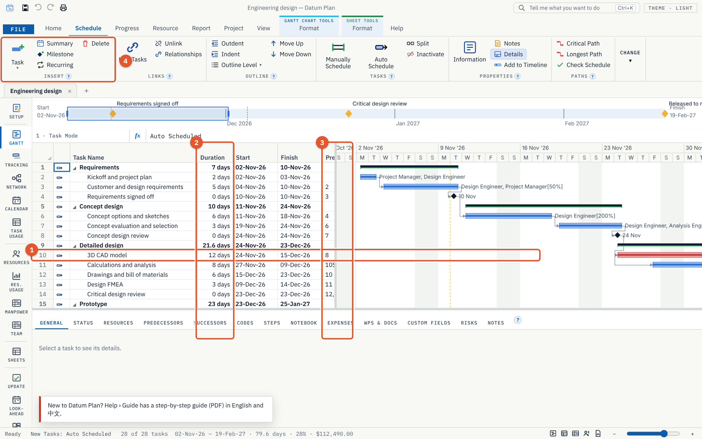

1. **一行任务。** 在 **Task Name**（任务名称）中输入名称。按 [[Insert]] 键（或 **Schedule › Task**）在所选任务上方插入新任务。
2. **Duration（工期）。** 输入数字和单位：`5d`（天）、`2w`（周）、`1mo`（月）、`4h`（小时）、`30m`（分钟）。输入 `0` 即为里程碑。`3ed` 是日历工期（昼夜连续计算，包括周末）。
3. **Predecessors（紧前任务）。** 本任务要等待的任务，填写其 ID（行号）：`3`、`3,4`，或带关系类型和延隔时间，如 `4SS+2d`。
4. **Insert（插入）组**（在 **Schedule** 选项卡上）。**Task**（任务）、**Summary**（摘要任务）、**Milestone**（里程碑）、**Recurring**（周期性任务）和 **Delete**（删除）。

Datum Plan 自动排程：修改工期或逻辑关系后，所有相关的日期都会随之更新。

### 大纲（WBS 工作分解结构）

把任务降级，就可以放到摘要任务下面：选中任务，点击 Schedule 选项卡或 Home › Alignment 上的 **Indent**（降级，或按 [[Alt+Shift+→]]）。上方的任务就成为摘要任务，它的日期、工时和费用由下属任务汇总而来。**Outdent**（升级，[[Alt+Shift+←]]）恢复原级别。点击摘要任务旁的小三角可以折叠。

### 任务之间的逻辑关系

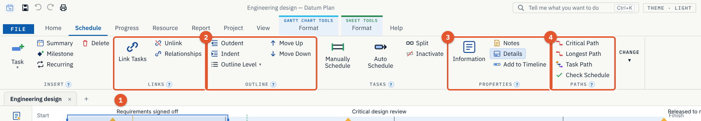

1. **Links（链接）。** **Link Tasks**（链接任务）按顺序链接所选任务（[[Ctrl+F2]]）。**Unlink**（取消链接）删除它们的逻辑关系。**Relationships**（关系图）以图形显示每个任务的逻辑关系。
2. **Outline（大纲）。** **Outdent**（升级）、**Indent**（降级）、**Outline Level**（显示第 1、2、3……级）、**Move Up**（上移）和 **Move Down**（下移）。
3. **Properties（属性）。** **Information**（任务信息）打开所选任务的全部字段；还有 **Notes**（备注）、**Details**（图表下方的详细信息窗格）和 **Add to Timeline**（添加到时间线）。解决人员过度分配的资源平衡在 **Resource** 选项卡上（见“人员、工时与费用”一章）。
4. **Paths（路径）。** **Critical Path**（关键路径）突出显示决定完工日期的任务；**Longest Path**（最长路径）沿逻辑关系一直追溯到最后一个任务；**Check Schedule**（进度检查）检查计划质量。

逻辑关系共有四种，最常用的是“完成-开始”。

| 类型 | 代码 | 含义 |
|---|---|---|
| 完成-开始 | FS | A 完成后 B 才能开始。例如：混凝土浇筑完成后才能拆模。 |
| 开始-开始 | SS | A 开始后 B 才能开始。例如：编码开始两天后开始测试。 |
| 完成-完成 | FF | A 完成后 B 才能完成。例如：文档编写与构建同时收尾。 |
| 开始-完成 | SF | A 开始后 B 才能完成。很少用，常见于交接班。 |

**延隔时间**（lag）表示等待时间（`4FS+2d`：任务 4 完成后两天）；负的延隔时间是**提前量**（lead，`4FS-1d`：提前一天）。延隔时间也可以按紧前任务工期的百分比计算（`4SS+50%`），或按日历时间（昼夜连续、包括周末）计算（`4FS+7ed`：七个日历日，例如混凝土养护）。

### 限制条件与截止日期

任务默认是 **As Soon As Possible**（越早越好）。在详细信息窗格的 **General**（常规）选项卡中，可以设置 **Constraint Type**（限制类型）和 **Constraint Date**（限制日期），例如 Start No Earlier Than（不得早于……开始）、Finish No Later Than（不得晚于……完成）、Must Start On（必须开始于）等。**Deadline**（截止日期）不会移动任务，只标出应当完成的日期，延误时会显示警告。

> **提示：** 尽量少用限制条件。由逻辑关系驱动的计划能真实反映延误的影响；用限制条件“钉住”的计划会掩盖延误（只会出现负浮动时间）。

### 日历

**Project › Change Working Time**（更改工作时间）用来设置工作日和工作时间（例如周一至周五，08:00–12:00 和 13:00–17:00），以及例外日期：法定节假日、停工期、周六加班等。可以建立多个日历，分配给某个任务（**Task Calendar**，任务日历）或某个人（资源表中的 **Base Calendar**，基准日历）。

### 资源日历

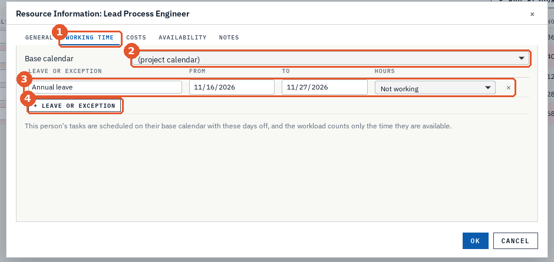

每个人的工作日不一定相同。启用资源日历后，每个人的工作按自己的日历安排，休假、非全日工作周或现场轮班都会推动他们所做的任务。

1. 打开 **Resources**（资源表），在此人那一行点击 **Info…**，选择 **Working Time**（工作时间）。
2. **Base calendar**（基准日历）是此人的工作周：项目日历，或其他日历，例如每周六天的现场日历。
3. **Leave or exception**（休假或例外）列出此人不工作（或只工作半天）的日期：年假、培训、本国节假日。
4. **+ Leave or exception** 添加一行。

然后启用：**Project › Schedule Options › Resource calendars**（资源日历）。此后每个人的分配按自己的日历进行，任务在最后一个人完成时完成。任务若有自己的 **Task Calendar**（任务日历），只在任务和人员都工作的时间进行。不使用此功能的计划不受影响：在您启用之前它是关闭的。

> **提示：** 无论谁来做都必须按自己日历进行的任务（养护时间、交货），在详细信息中设置 **Ignore Resource Calendar = Yes**（忽略资源日历）。

### 检查进度计划

**Schedule › Check Schedule**（进度检查）对逻辑关系、浮动时间、工期和限制条件进行质量检查（例如开口任务、过长的延隔时间、过大的浮动时间、负浮动时间等）。点击某项检查，即可看到对应的任务。

**健康分数**（0 到 100：Good 良好、Fair 一般、Poor 较差）是通过检查的加权比例；未通过的检查会按其距离限值的远近保留部分权重。**Weights…**（权重）设置每项检查的权重（0 表示不计入）；限值和权重随计划一起保存。每个快照都会保存当天的分数，图表显示其趋势。

**Report › Compare Projects**（比较项目）把当前计划与其另一个版本（已保存的 .dplan、XML 或 XER 文件）进行比较，列出所有变化：新增和删除的任务、工期、新增、删除或修改的逻辑关系、限制条件、日历、实际日期、完成百分比和日期变化，以及项目完工日期的前后对比。点击某类变化即可只看这一类；**Export…**（导出）把清单保存为工作簿。**Show ghost bars**（显示幽灵横道）会在您的横道后面淡淡地画出另一版本的横道。

任何图表上的 **Copy**（复制）都会按文档版式绘制图表：页面宽度、较大的文字、浅色配色并带有标题，粘贴为 16 厘米宽时仍清晰可读。**PNG** 保存同样的图片。

**Report › Milestone Trend**（里程碑趋势）显示每个里程碑的预测完成日期在各个快照之间的变化（每次更新时拍一个快照：Progress › Snapshot）。水平线表示日期不变；上升的线表示在延误。

## 人员、工时与费用

### 资源表

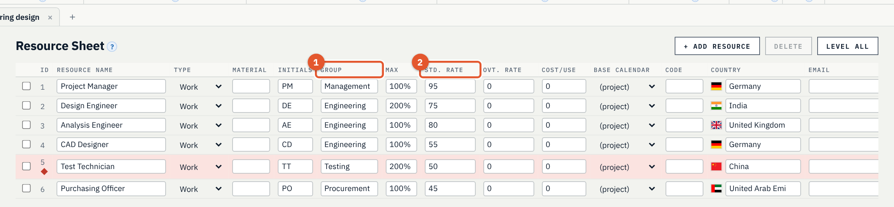

在侧边栏打开 **Resources**（资源表）。每一行是一个人、一个班组、一种材料或一项费用。

1. **Group**（组）表示工种或岗位（工程、土建、电气……）。Manpower（人力）和 Resource Graph（资源图表）按组汇总人数。
2. **Std. Rate**（标准费率）是每小时的费用（材料则为每单位）。**Max**（最大单位）表示可用程度：100% 是一名全职人员，300% 是三人班组。

**Country**（国家）表示人员、班组或供应商来自哪个国家：输入代码（DE）或英文名称（Germany），即显示国旗。工作表可用 **Plan Data…** 按国家列出资源。

### 给任务分配人员

在任务表的 **Resource Names**（资源名称）列中输入，例如 `Design Engineer` 或 `Design Engineer[50%], Analysis Engineer`。输入新名称会自动新建资源。工时和费用由工期、分配单位和费率自动算出。也可以使用 **Resource › Assign Resources**（分配资源）。

### 工作负荷、工种与资源平衡

**Res. Usage**（资源使用状况）显示每个人每天、每周或每月的工时；红色表示工时超过了可用时间。**Resource › Resource Graph**（资源图表）以柱状图显示同样的内容，并画出可用能力线，可以按人或按工种、以工时或人数显示。

出现人员过度分配时，**Resource › Level All**（全部资源平衡，或 **Level Selection**，平衡所选任务）会推迟浮动时间最多的任务，直到没有人超负荷。系统会先显示预览：哪些任务会移动、新的完工日期是哪天；点击 **Level**（平衡）之前不会做任何修改。**Clear Leveling**（清除资源平衡）可以撤销这些推迟。

### 费用

费用来自人员费率、任务的 **Fixed Cost**（固定成本，以及其累算方式：开始时、结束时或按比例），以及详细信息窗格中的费用明细。所有金额精确到分。货币在 **Project Setup** 或 **Project › Project Information**（项目信息）中设置。

## 基准计划与进度更新

### 保存基准计划

计划确定后，点击 **Progress › Set Baseline**（设置基准计划）。基准计划是计划日期、工期、工时和费用的一份副本，Datum Plan 会把当前计划与它进行对比。共有 11 个基准计划（Baseline 0 至 10），因此重新确定基准后，旧版本也可以保留。

要更改基准计划，可以再次保存（**Set Baseline** 会覆盖原有基准；选择 **For: Selected tasks** 则只更改所选任务），清除它（**Action: Clear baseline**），或直接输入新日期。基准计划默认处于**锁定**状态：Baseline Start（基准开始）和 Baseline Finish（基准完成）不能直接输入。点击 **Progress › Unlock Baseline**（解锁基准）后，即可在这两列中输入新日期（基准工期按任务日历自动计算，可用 Undo 撤销）。点击 **Lock Baseline**（锁定基准）再次锁定；计划每次打开时都处于锁定状态。若要查看每项任务到状态日期按基准应完成多少，可插入 **Baseline % Complete**（基准完成百分比）列，并在旁边插入 **% Complete Variance**（完成百分比偏差，实际减基准）；项目摘要行显示整个计划的数值。**Gantt Chart Tools › Format › Percent**（百分比）设置所有百分比显示的小数位数（0 到 2 位，随计划保存），这样 0.01% 的进度也能看到。

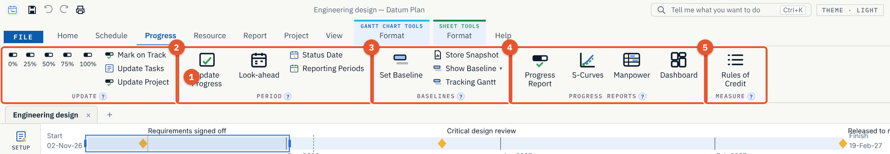

1. **Update（更新）。** 按档设置完成百分比（0%、25%、50%、75%、100%），**Mark on Track**（按计划标记，即按计划推进到状态日期）、**Update Tasks**（更新任务）和 **Update Project**（更新项目）。
2. **Period（期间）。** **Update Progress**（进度更新页面）、**Look-ahead**（前瞻计划）、**Status Date**（状态日期）和 **Reporting Periods**（报告期间：每周、每月在哪天结束）。
3. **Baselines（基准）。** **Set Baseline**（设置基准计划）、**Store Snapshot**（保存快照）、**Show Baseline**（显示基准横道）、**Tracking Gantt**（跟踪甘特图）以及 **Unlock Baseline** / **Lock Baseline**（解锁/锁定基准）。
4. **Progress Reports（进度报告）。** **Progress Report**（进度报告）、**S-Curves**（S 曲线）、**Manpower**（人力）和 **Dashboard**（仪表板）。
5. **Measure（测量）。** **Rules of Credit**（进度测量规则，见下文）。

### 状态日期

状态日期（数据日期）是进度测量截止的那一天，例如上周五。用 **Progress › Status Date** 设置。状态日期之后的工作是计划，之前的工作应当已经完成。

### 每周更新进度

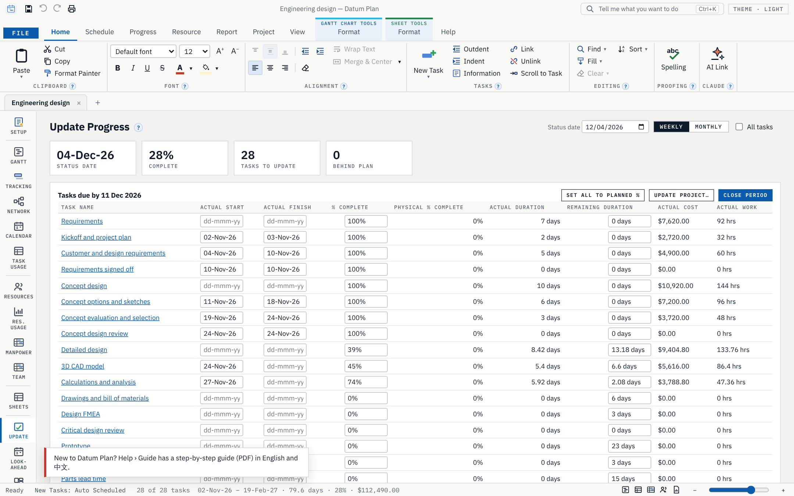

在侧边栏打开 **Update**（更新）。页面列出本期间到期的任务，可填写：

- **Actual Start**（实际开始）和 **Actual Finish**（实际完成）：实际日期。
- **% Complete**（完成百分比）：任务完成了多少。
- **Remaining Duration**（剩余工期）：还需要多久；如果任务会比计划更久，就修改它。

**Set all to planned %**（全部设为计划百分比）先把所有任务填为基准计划的进度，再逐项修正与实际不符的地方。**Update Project…**（更新项目）把截至某一日期的工作标记为完成。本期更新完毕后，点击 **Close period**（关闭期间）：Datum Plan 会保存所有任务在该日期的进度，这样 S 曲线、仪表板和趋势报告就能显示每个期间的真实情况。

### 跟踪甘特图

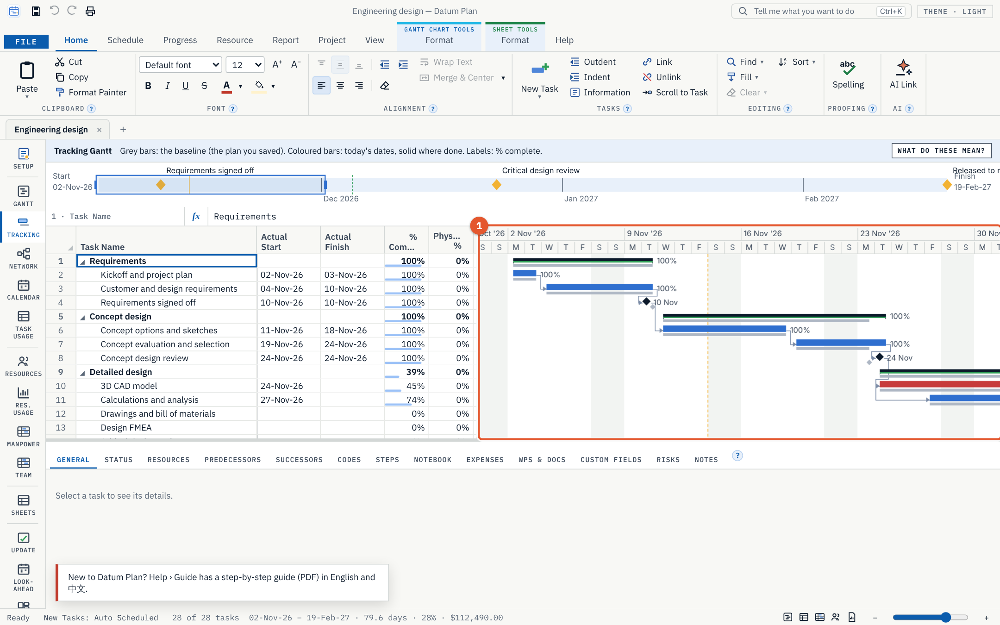

1. 每个任务有两条横道：下方灰色的是基准计划，上方彩色的是当前计划，已完成部分为实心。标签是完成百分比。如果彩色横道移到了灰色横道的右边，说明相对基准计划已经延误。

### 进度测量规则与安装工程量

对于按步骤或按工程量测量的工作，**Progress › Rules of Credit**（进度测量规则）可以给任务设定带权重的步骤，例如电缆：敷设 60%、接线 30%、测试 10%。软件内置了常用规则（混凝土、钢结构、管道、电缆、设备、文件、软件），也可以自己新建。在任务的 **Steps**（步骤）选项卡中勾选已完成的步骤，任务的实际完成百分比（physical % complete）随之更新。

也可以填写 **Quantity**（工程量）和 **Installed Quantity**（已安装量，需先插入这两列）：200 米中已安装 50 米，即实际进度 25%。

## 报告

### 仪表板

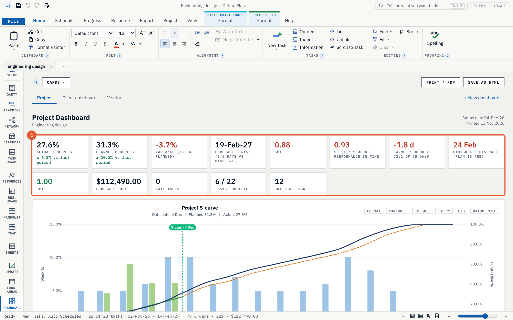

1. **关键指标：** 实际进度和计划进度及其偏差、预测完工日期、SPI 和 CPI、**SPI(t)** 以及按当前速度推算的完工日期（挣得进度）、费用、延误任务数、已完成任务数和关键任务数。绿色表示良好，红色表示需要关注。

下方首先是占满整个宽度的 **项目 S 曲线**，然后是每期进度、按阶段的进度、费用与挣值以及人力图表，并排填满每一行，最后是里程碑和延误任务。

只有计划中有相应数据时才显示该卡片：没有费用的计划不显示费用卡片，没有资源的计划不显示人力图表。**Cards ▾**（卡片）可自行选择要显示的卡片；在没有数据时打开的卡片保持空白，打印时也是如此。所做的选择随计划一起保存；**Show the cards that have data**（显示有数据的卡片）恢复为自动选择。右上角有 **Print / PDF**（打印/PDF）和 **Save as HTML**（另存为 HTML）。

### 自定义仪表板

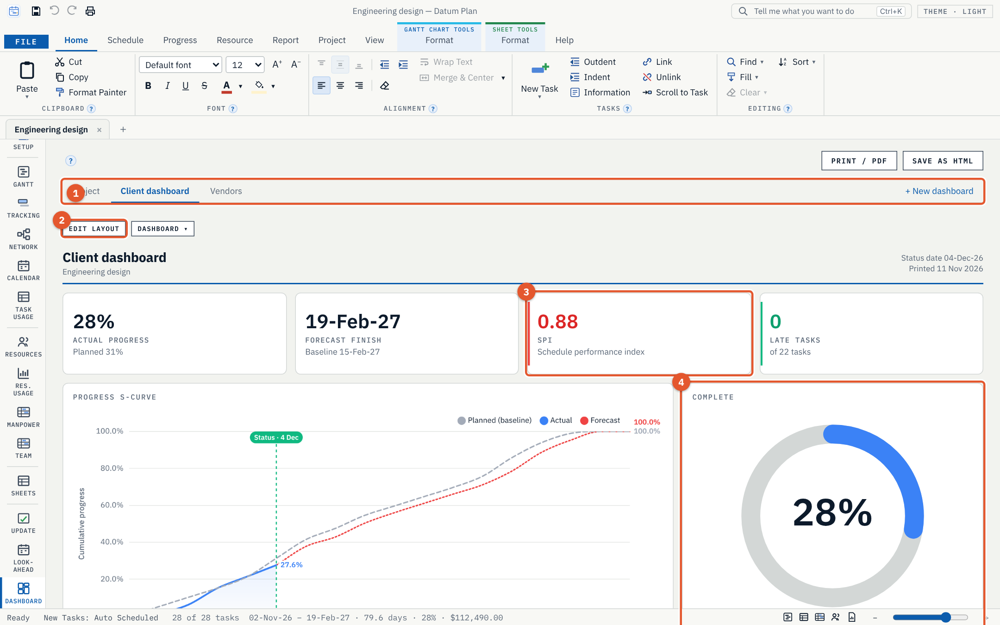

按客户或领导的要求制作自己的仪表板，数量不限；它们随计划保存，并始终显示计划的最新情况。

1. **标签。** **Project**（项目）是内置仪表板。**+ New dashboard**（新建仪表板）可新建空白仪表板或使用模板：**Client dashboard**（客户仪表板）、**Weekly progress**（每周进度）或 **Vendors and countries**（供应商与国家）。
2. **Edit layout**（编辑布局）在每个图块周围显示边框。拖动图块可调整顺序；每个图块上的 ✎ 用于修改，⤢ 设置宽度（四分之一到整行）和高度（一到四行），× 用于删除。**Dashboard ▾** 可重命名、复制或删除仪表板。
3. **数字图块**来自公式，与工作表中的写法相同：`=SPI`、`=ProjectFinish`、`=COUNTIF(Tasks[Late],TRUE)` 或 `=Vendors!B4`。可设置规则使其显示为绿色或红色，例如 SPI ≥ 1 时为绿色。
4. **进度环**显示一个百分比（0–100），例如 `=PercentComplete`，下方可加第二行，例如计划百分比。

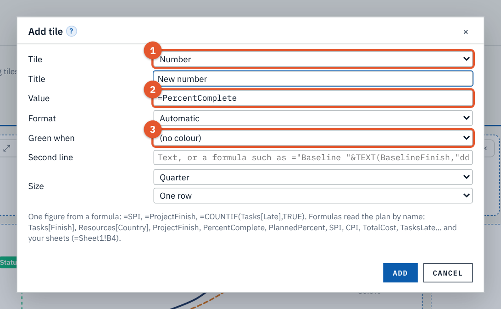

1. **Tile**（图块类型）：Number（数字）、Progress ring（进度环）、Chart（图表）、Table（表格）、Countries（国家）或 Text（文字）。**Chart** 可以是计划自带的图表（S 曲线、每期进度、各阶段进度、费用与挣值、人力），也可以是工作表区域的图表：柱形图、条形图、折线图、面积图、环形图或饼图，第一列为标签，第一行为系列名称。**Table** 可以是计划清单（里程碑、延误或关键任务、下期开始、本期完成），也可以是工作表区域或公式；国家列会显示国旗。**Countries** 统计各国旗出现的次数，例如 `=Resources[Country]`。
2. **Value**（值）：公式。除任务表和资源表外，还可以使用 `PercentComplete`、`PlannedPercent`、`ProjectFinish`、`BaselineFinish`、`SPI`、`CPI`、`TotalCost`、`TasksLate` 以及工作表一章中列出的其他名称。
3. **Green when**（绿色条件）：决定数字颜色的规则。

> **提示：** **Print / PDF** 打印当前显示的仪表板。可以先在工作表中整理每周要汇报的数据，再让仪表板图块引用它们。

### S 曲线与挣得进度

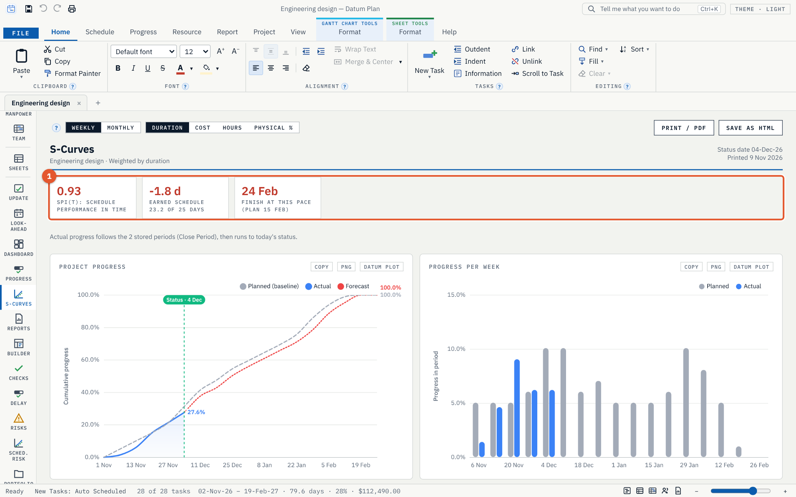

1. **挣得进度（Earned schedule）。** SPI(t) 把“计划预计在什么时候达到今天的进度”与今天进行比较：0.92 表示速度是计划的 92%。**Earned schedule 23 of 25 days** 表示用 25 个工作日完成的工作，计划只需 23 天，即项目落后 2 天；**Finish at this pace**（按当前速度完工）给出推算的完工日期。

S 曲线按进度报告的样式绘制：浅色柱形表示每周或每月计划和实际完成的进度（左轴），曲线表示累计的计划和实际进度（右轴，0 到 100%）。实际曲线经过每次 **Close period** 保存的进度点。预测（虚线）从状态日期开始，在偏离计划曲线时显示。居中的标题下方是数据日期以及该日期的计划和实际百分比；图例在下方。进度可以按工期、费用、工时或实际完成百分比加权。

S 曲线右上角的 **Format**（格式）设置计划中所有 S 曲线的外观：**Bars and curves**（柱形和曲线）或 **Curves only**（仅曲线）、自定义标题（例如“Weekly S-curve: Planned vs Actual”）、标题下的数据日期行、显示哪些柱形、何时绘制预测、图例在上方或下方、平滑曲线、状态日期线、倾斜的日期以及五种颜色。**Reset**（重置）恢复标准外观。该设置随计划保存，**Copy**、**PNG** 和打印都会使用它。

**Workbook**（工作簿）把 S 曲线另存为工作簿，其中有 **Weekly**（每周）和 **Monthly**（每月）两个工作表。每个工作表都包含数据（期末日期、本期计划和实际进度、累计计划、实际和预测进度）以及一个电子表格程序自己的图表，使用您在 Format 中设置的颜色：左轴为每期柱形，右轴为累计曲线。您可以像编辑其他图表一样在那里修改它；本期列是基于累计列的公式，因此修正一个数值后柱形和曲线会随之变化。**To Sheet** 把相同的数据放到计划的一个工作表中（**S-Curve Weekly** 或 **S-Curve Monthly**），用于核对、在公式中使用或在仪表板上显示；更新后再按一次即可刷新数据。

每个图表右上角有这些按钮。**Copy**（复制）把一张页面宽度、清晰的图片放到剪贴板，可粘贴到 Word、幻灯片或工作簿中。**PNG** 将图表另存为图片。**Datum Plot** 在 Datum Plot 中打开图表数值的副本，您可以在其中为报告或论文设置图表样式。副本保存在 **Documents › Datum Plan › To Datum Plot**（文档 › Datum Plan › To Datum Plot）中。这是单向副本：在 Datum Plot 中所做的更改不会改变计划。随时间变化的图表会保留日期：以距第一个日期的天数表示，每一行以其日期命名。

### 进度报告

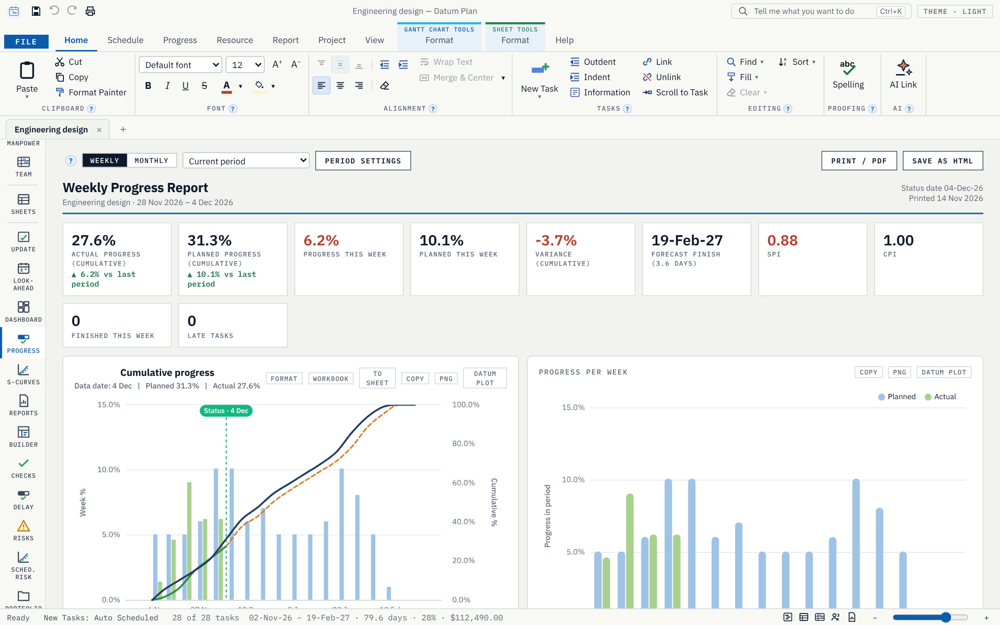

侧边栏的 **Progress**（进度报告）生成周报或月报：本期数据、已完成和已开始的工作、延误的工作、后续工作，以及您的说明（概要、进展、问题、措施）和照片。在下拉列表中选择以前的期间，可以再次查看。

### 报告选项卡、报告生成器与打印

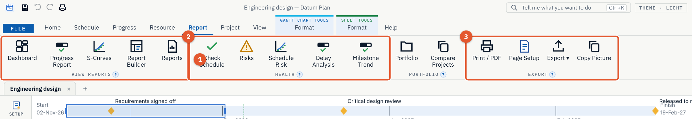

1. **View Reports（查看报告）：** Dashboard（仪表板）、Progress Report（进度报告）、S-Curves（S 曲线）、**Report Builder**（报告生成器：用现成的模块组合自己的报告，带有管理周报、客户月报、进度健康度、费用等模板）和 **Reports**（现成报告）。
2. **Health（健康度）：** **Check Schedule**（进度检查）、**Risks**（风险）和 **Schedule Risk**（进度风险分析）。
3. **Export（导出）：** **Print / PDF**（打印/PDF）、**Page Setup**（页面设置）和 **Export**（导出为其他格式）。

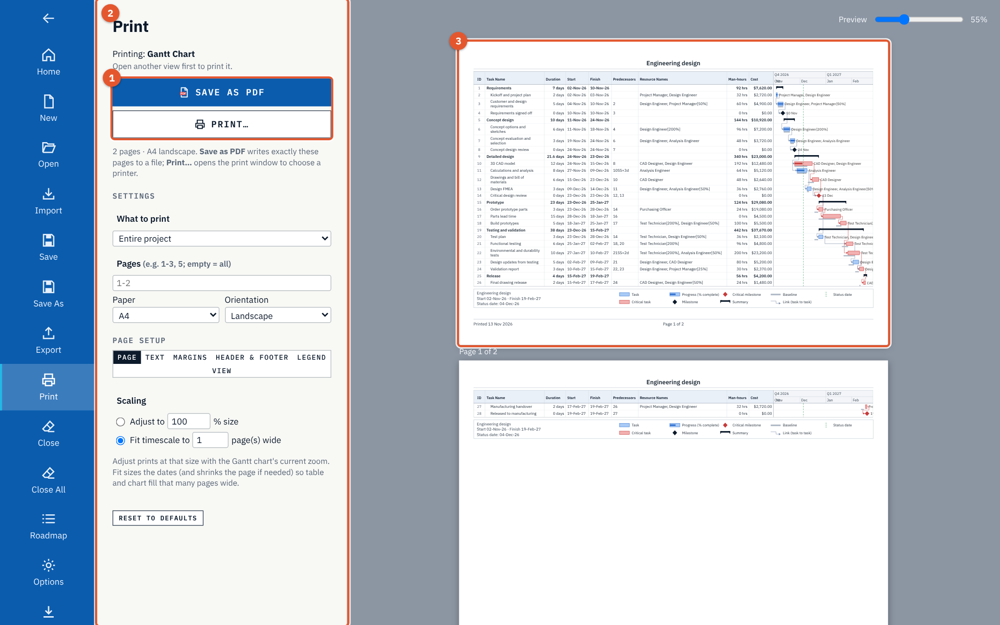

1. **Save as PDF**（另存为 PDF）把您看到的页面按所选纸张和方向直接写入您命名的文件，Windows 不会添加任何内容（没有日期、窗口标题或网址）。**Print…**（打印）打开打印窗口以选择打印机。
2. **设置。** 打印内容、页码范围、纸张和方向，以及 **Page Setup**（页面设置）：缩放（或 **Fit to**，调整为几页宽）、页边距、**Header & footer**（页眉和页脚）、图例和视图选项。
3. **预览。** 与实际打印完全一致的页面。打印的是您当前打开的视图：甘特图、跟踪甘特图、网络图、日历、资源视图、仪表板、各类报告、进度风险分析、前瞻计划或人力图表。

**Header & footer**（页眉和页脚）简单易用：

- **每页顶部的图片：** 左、中、右三处，每处可并排放置任意多张图片（**+ Logo ▾** 选择计划图片库中的标识，见下文；**+ Picture…** 选择任意图片文件；**+ Company logo** 使用 **File › Options** 中的公司标识）。每张图片都有自己的大小滑块；← 和 → 在同一行内移动图片或移到下一处，× 将其删除。页眉会随最高的图片自动加高。
- **Title**（标题，默认为计划名称，也可输入其他文字）、**Subtitle**（副标题，例如 "Revision B · Issued for review"）和 **Title size**（标题大小）。中间放有图片时，标题和副标题显示在图片下方。
- **每页底部** 只打印您勾选的内容：打印日期（及时间）、页码、状态日期、公司名称、修订版本和您自己的文字，例如 "Confidential"。

不会打印其他任何内容：没有程序名称，也没有网址。**Advanced**（高级）提供三个可使用 &[Page] 等代码的文本框，用于精确控制。

**图例** 只列出页面上出现的内容：任务、关键任务、进度、里程碑、摘要任务、子计划、比较基准、期限、链接和状态日期，并在旁边显示项目名称、开始、完成和状态日期。打印的横道与屏幕一致，带有比较基准和期限。

**Text**（文字，在 Page Setup 中）设置表格文字在纸上的大小（磅），并显示实际打印的大小。行高随文字变大，时间刻度和横道标签也随之变大。列宽与其文字相符，其余页面留给横道图。使用 **Fit to**（调整为几页宽）时文字保持大小：页面缩小之前，较长的任务名称先换行（最多三行）。还可以按行类型（顶层摘要、其他摘要、任务、里程碑）设置大小，或为选定的行设置大小：先在任务表中选择这些行，再在 **Rows you choose** 下输入大小。

主计划按屏幕所示打印其子计划：在甘特图中展开的子计划打印时也是展开的。**Subplans**（在 What to print 下方）也可选择每个子计划一行、打印其全部任务，或不打印子计划。

### 图片与标识

计划保存自己的图片：业主、本公司、总承包商、咨询方、供应商和分包供应商的标识，以及其他任意图片。图片保存在 .dplan 文件中，因此把计划发给他人时，打印出来的标识完全相同。

- **Project › Pictures**（或 **Project Setup** 中的 **Logos** 步骤）列出这些图片。**+ Client logo…**（业主标识）、**+ Our company logo…**（本公司标识）、**+ Vendor logo…**（供应商标识）、**+ Sub-vendor logo…**（分包供应商标识）和 **+ Other picture…**（其他图片）用于添加；每一行显示所属单位、可修改的名称，以及用于删除的 **×**。
- **打印页眉中：** 在 **Header & footer** 中点击 **+ Logo ▾**，可将任一标识放在左侧、中间或右侧。
- **仪表板上：** **Picture**（图片）磁贴显示其中一张图片。
- **工作表上：** **Picture ▾** 将图片放在所选单元格处。拖动图片可在单元格之间移动，拖动其右下角可调整大小，按 [[Delete]] 删除。图片会随工作表一起打印，也会导出到 .xlsx 工作簿中。

从计划中删除某张图片时，使用该图片的工作表上也会一并删除。

### 网络图

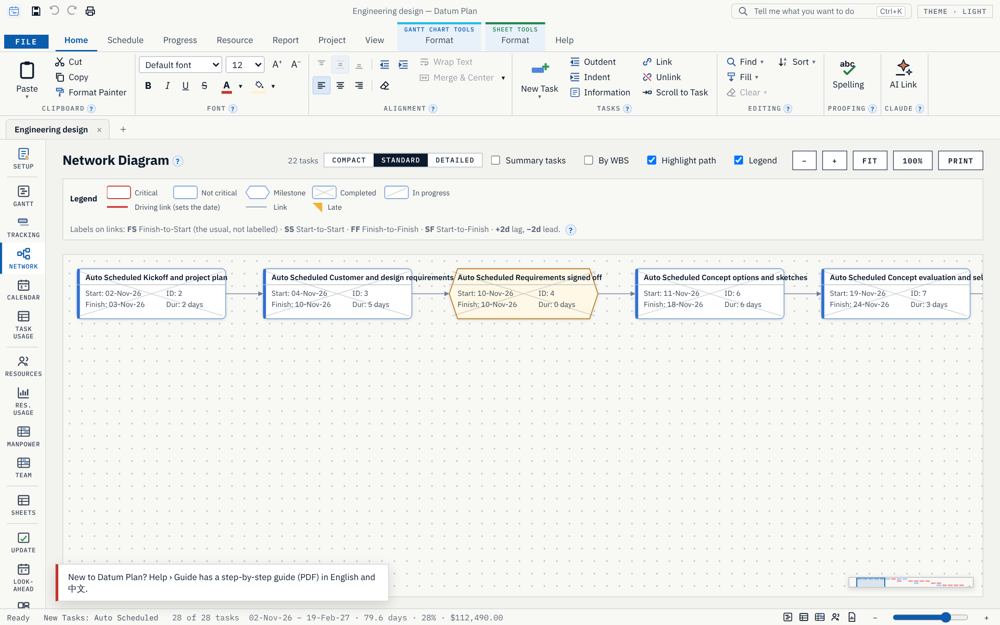

**Network**（网络图）把每个任务显示为一个方框，用逻辑关系连接到下一个任务，带有图例、缩放、缩略图，并可选择方框样式（紧凑、标准、详细）、显示摘要任务和按 WBS 分带。关键任务为红色。网络图可以跨多页打印。

## 风险与近期工作

### 风险登记册

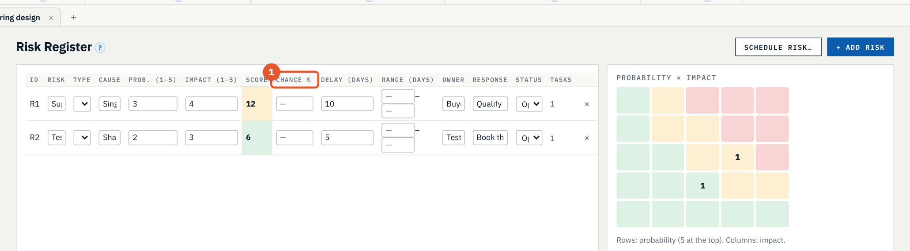

**Risks**（风险登记册）列出威胁和机会，以及其概率和影响（1 至 5）；风险值为两者之积，以绿、黄、红显示，右侧矩阵显示其分布。在任务的 **Risks**（风险）选项卡中把风险关联到任务。

1. **Delay (days)**（延误天数）表示风险发生时给每个关联任务增加多少个工作日（机会则减少）。进度风险分析会用到它。

### 进度风险分析

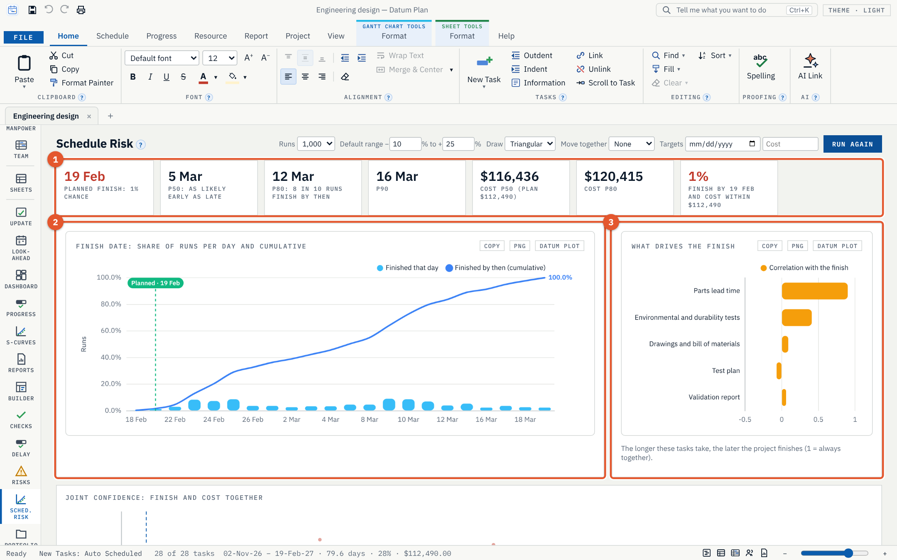

**Sched. Risk**（进度风险分析）将计划运行很多次（默认 1000 次，即蒙特卡洛模拟）。每一次运行中，每个未完成任务的工期在乐观工期和悲观工期之间取值，每个未关闭的风险按其概率发生（1 = 10%，2 = 30%，3 = 50%，4 = 70%，5 = 90%）。

1. **结果：** 按计划日期完工的概率、**P50** 日期（提前和延误的可能性各半）、**P80**（10 次中有 8 次能在此日期前完成，常用作承诺日期）、**P90**，以及 P50 和 P80 对应的费用。
2. **完工日期分布：** 每天完工的次数，以及累计曲线。
3. **影响完工的因素：** 工期对完工日期影响最大的任务。应优先压缩这些任务的工期或降低其风险。

可以用 **Optimistic Duration**（乐观工期）和 **Pessimistic Duration**（悲观工期）两列给任务设定各自的范围；没有设定的任务使用默认范围（−10% 至 +25%）。同样的计划和设置总是得到同样的结果，最近一次的分析结果会随计划一起保存。

4. **取值方式：** 三角分布（计划工期最有可能）或均匀分布（范围内任何值的可能性相同）。
5. **同步变化：** 一起变长或变短的任务（同一班组、同样的天气）可以设为相关：全部任务，或作业代码取值相同的任务，相关强度为 0 到 0.99。相关的任务会使完工日期的范围变宽。
6. **目标与联合置信度：** 设定目标日期和目标费用（留空则使用计划的完工日期和费用）。结果给出在同一次运行中两者同时满足的概率，散点图显示每次运行的完工日期与费用：阴影框内是同时满足两个目标的运行。

在 **Risk Register**（风险登记册）中，用 **Link tasks…**（关联任务）把每个风险关联到它会延误的任务（也可以在任务的详细信息窗格的 Risks 选项卡中关联）；概率 × 影响矩阵会在相应格子中显示每个未关闭的风险。风险可以有自己的 **Chance %**（发生概率百分比，代替 1–5 评分）和延误的 **Range**（范围，最少和最多天数）：进度风险分析会在该范围内抽取延误天数，最可能的是 Delay（延误天数）。

### 延误分析

**Report › Delay Analysis**（延误分析）基于计划中已有的数据衡量延误。页面顶部列出计划中的数据（有基线的任务、已开始的任务、快照）以及每种方法所需的数据：数据齐备时该方法即可运行。这些数字衡量的是变化本身，并不判定责任方。

1. **As-planned v as-built**（计划与实际对比）把每个任务的基线日期和工期与其实际日期（标记为 A）或预测日期进行比较，以工作日计，并显示计划完工日期、当前完工日期及二者之间的延误。图表显示延迟完成的关键任务。可以只显示延迟的任务、关键任务或全部任务。
2. **Windows**（窗口分析）查看各快照之间的时段：每个窗口内及累计的项目完工日期变化、取得的进展，以及延误最多的任务（窗口开始时为关键任务的排在前面）。每次更新时拍一个快照（Progress › Snapshot），并在其备注中写明发生的情况：它会显示为该窗口的说明。
3. **Delay events**（延误事件）记录发生的情况：每个事件的名称、发生日期、说明（事实，以及支持它的信函、会议纪要或现场日志）以及它对计划造成的影响：某项任务增加的天数（**+ Extension**）、某项任务不能早于某日开始（**+ Hold**），或在任务之间新增的作业（**+ New activity**，即片段网络）。取消勾选即可不计入该事件。**Add to plan**（加入计划）把事件的新增作业加入计划。
4. **Time impact**（时间影响分析）按发生顺序把事件逐个加入今天计划的副本，显示每个事件对完工日期的影响及合计。
5. **Impacted as-planned**（影响计划法）重建约定的计划（基线工期，无进度），再把事件加入其中，并说明重建的计划与基线完工日期的接近程度。
6. **Collapsed as-built**（实际进度扣除法）根据实际日期重建实际计划，再从最晚的事件开始逐个扣除：每个事件的影响就是它所节省的完工时间，并说明重建的计划与今天完工日期的接近程度。
7. **Export…**（导出）把分析结果保存为工作簿，每种方法一张工作表。

每种方法都会说明它基于哪个计划。影响是在较早的事件已计入的情况下衡量的，因此相互重叠的影响不会重复计算。分析从不修改计划。

### 前瞻计划与制约因素清单

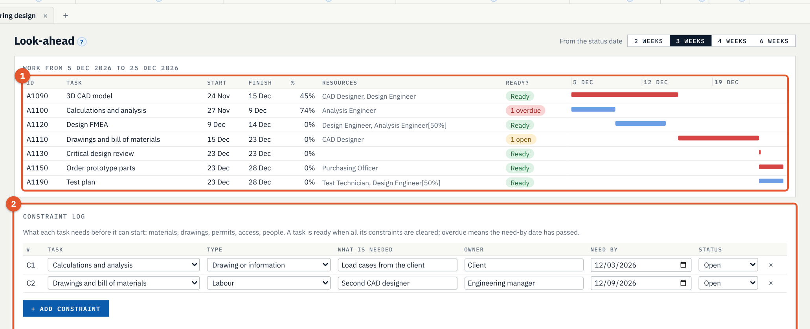

1. **近期工作：** 从状态日期起未来 2、3、4 或 6 周内未完成的任务及其横道。**Ready**（就绪）表示清单中没有阻碍该任务的事项；**open**（未解决）或 **overdue**（已逾期）表示还有阻碍。
2. **制约因素清单（Constraint log）：** 每个任务开工前需要具备的条件：材料、图纸或资料、许可证、作业面、人员、设备或前序工作，以及负责人、需要日期和状态（Open 未解决 / Cleared 已解决）。先在表中点击任务，再点 **+ Add constraint**（添加制约因素）。

建议每周与团队一起过一遍前瞻计划：解决未解决的事项，催办已逾期的事项。

### 人力

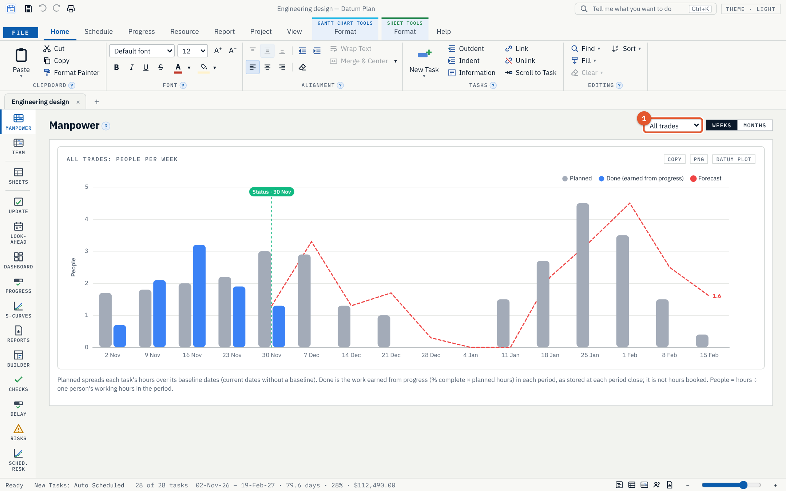

1. 选择 **All trades**（全部工种）或某一工种。灰色柱是每周（或每月）计划的人数，蓝色柱是已完成工作所对应的人数（按进度挣得），虚线是剩余工作的预测。

## 工作表：自己的报告和仪表板

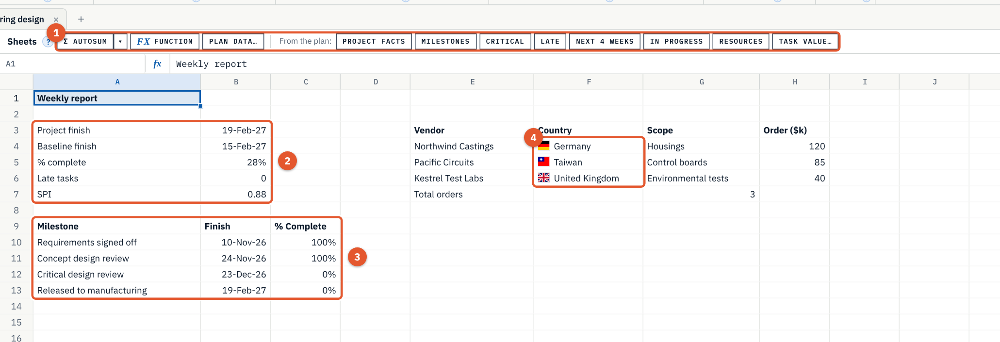

在侧边栏打开 **Sheets**（工作表）。工作表是保存在计划文件中的电子表格，用法和普通电子表格一样，并且直接读取计划数据，所以以前要从进度计划复制到另一个工作簿的数字，现在始终是最新的。用 **+** 新建工作表标签。双击标签可直接重命名；右键单击标签可插入、删除、移动或复制工作表，设置标签颜色，或隐藏和取消隐藏；拖动标签可调整顺序。

1. **工具栏。** **Σ AutoSum**（自动求和）对所选单元格上方的数字求和（[[Alt+=]]；旁边的箭头还提供 Average 平均值、Count 计数、Max 最大值、Min 最小值）。**fx Function**（插入函数）可按名称或用途查找全部 490 个函数。**Plan Data…**（计划数据）插入一份实时清单。**From the plan**（来自计划）：单击即可在所选单元格放入 **Project facts**（项目概况：开始、完成、状态日期、完成百分比、SPI、CPI 和任务数）、**Milestones**（里程碑）、**Critical**（关键任务）、**Late**（延误任务）、**Next 4 weeks**（未来四周）、**In progress**（进行中）或 **Resources**（资源）；**Task value…**（任务数值）放入某个任务的一个数值（如完成日期、完成百分比）。这些内容都会实时更新。格式工具位于功能区（见下文）。
2. **按名称读取计划数据。** 例如 `=ProjectFinish`（项目完成日期）、`=BaselineFinish`（基准完成日期）、`=PercentComplete`（完成百分比）、`=SPI` 或 `=COUNTIF(Tasks[Late],TRUE)`（延误任务数）。日期和百分比会自动设置格式。
3. **Plan Data… 生成的实时清单。** 选择 Tasks（任务）或 Resources（资源）、要显示的列、哪些行（里程碑、关键任务、延误任务、未完成、进行中、未来四周开始）、排序方式和行数。一个公式填满所有行，并随计划变化。
4. **国旗。** 给单元格设置 **Country with flag**（国家及国旗）数字格式，然后输入国家代码（DE、cn）或英文名称（Germany、UK），即显示国旗和国家名称。

### 设置工作表格式与打印：Sheet Tools

打开 **Sheets** 时，功能区显示 **Home**（开始）选项卡，旁边是 **Sheet Tools › Format**（工作表工具 › 格式）。

**Home** 包含任务表和工作表共用的工具：

- **Clipboard（剪贴板）：** 粘贴（含选择性粘贴）、剪切、复制和格式刷。粘贴时一次带上所复制单元格的公式、外观和数字格式；把一个单元格粘贴到更大的选区会填满整个选区。
- **Font（字体）：** 字体、字号（最大 48）、加粗、倾斜、下划线、删除线、字体颜色和填充色。颜色箭头打开调色板（主题颜色及深浅变化、标准颜色、最近使用的颜色、**More Colors…** 其他颜色）。
- **Alignment（对齐）：** 顶端、居中、底端；左、中、右；缩进；**Wrap Text**（自动换行）；**Merge & Center**（合并后居中，箭头中有跨越合并、合并单元格、取消合并）。合并只保留左上角的值；撤销可恢复其他值。
- **Editing（编辑）：** **Find**（查找和替换）、**Fill**（向下和向右填充）、**Clear**（全部、格式或内容）和 **Sort**（升序或降序排序；公式随所在行移动，空单元格排在最后）。

**Sheet Tools › Format**（工作表工具 › 格式）包含只有工作表才有的工具。Sheet Tools 始终显示在功能区上；在其他视图中点击会打开 Sheets。

- **Lines（线条）：** **Borders**（边框，每个选项旁都画出其效果），可选线条颜色和线型；**All Borders**（所有框线）、**Outside**（外侧框线）和 **No Border**（无框线）一键完成。
- **Number（数字）：** 数字格式列表、货币、百分比、千位分隔样式和小数位。
- **Look（外观）：** **Conditional**（条件格式）和 **Cell Styles**（单元格样式库）：好、差、适中，数据与检查，标题，20 %、40 %、60 % 和完整强调色，以及数字样式。
- **Rows & Columns（行和列）：** **Insert**（插入）和 **Delete**（删除）行、列、工作表，或使单元格右移、左移、下移、上移；**Size**（大小）用于行高、列宽、自动调整、**Hide**（隐藏）和 **Unhide**（取消隐藏）行或列、**Format Cells…**（设置单元格格式）以及标签。双线标出隐藏行列的位置。隐藏的行和列不会打印，导出的工作簿中也保持隐藏。
- **Data（数据）：** **Filter**（筛选）、**Drop-down List**（下拉列表）和 **Note**（批注），见下文。
- **Insert（插入）：** **Picture** 把计划图片库中的标识放在所选单元格；**AutoSum**（自动求和，箭头中有平均值、计数、最大值和最小值）、插入函数、计划数据和 Workbook…（导入工作簿）。
- **Views（视图）：** **Normal**（普通，显示单元格）、**Page Layout**（页面布局，按打印效果显示各页，含页眉页脚）和 **Page Breaks**（分页预览，在单元格上显示每一打印页并标出页码）。工作表标签右下角也有这三个按钮。**Freeze Panes**（冻结窗格）也在这里。
- **Page Setup（页面设置）：** 纸张大小、方向和页边距（常规、窄、宽、无或自定义）；**Print Area**（打印区域：只打印所选单元格）、**Titles**（标题行：所选行在每页顶部重复打印，位于打印区域上方时也会打印）和 **Breaks**（分页符：**Insert Page Break** 在所选单元格所在行的上方和所在列的左侧开始新的一页；也可只按行或只按列；**Reset All Page Breaks** 清除全部分页符）；缩放到指定页宽和页高，或按比例缩放。每个工作表有自己的设置，计划的页面设置保持不变。
- **Print（打印）：** **Print Options**（打印选项：页眉页脚、网格线、行号和列标、页面居中）、**Print Preview**（打印预览，打开 File › Print，顶部有同样的选项）和 **Save as Workbook**（另存为 工作簿）。

**缩放：** 右下角的滑块及其 **−** 和 **+**、View › Zoom，或按住 [[Ctrl]] 滚动鼠标滚轮，可在 10 % 到 400 % 之间缩放工作表；点击百分比可回到 100 %。

**右键单击**单元格可使用最常用的命令：剪切、复制、粘贴和选择性粘贴（数值、格式、转置）；Insert…（插入）和 Delete…（删除，移动单元格或整行整列）；清除内容；排序（升序、降序、自定义排序…）；筛选；新建批注；设置单元格格式…；数字格式、边框、合并后居中和自动换行；行和列；冻结窗格；自动求和、插入函数、计划数据和下拉列表。右键单击行号或列标可插入、删除、清除、设置行高或列宽、自动调整、隐藏和取消隐藏。

- **Format Cells…**（设置单元格格式，[[Ctrl+1]]）有五个选项卡：**Number**（数字：常规、带小数位和千位分隔符的数值、货币、百分比、日期、时间、文本、带国旗的国家、自定义，并显示格式代码）、**Alignment**（对齐）、**Font**（字体）、**Border**（边框）和 **Fill**（填充）。只更改您动过的项目，一步完成。
- **批注：** **New Note**（新建批注，[[Shift+F2]]）在单元格上写批注；单元格角上的红色标记表示有批注，指向单元格即可显示。批注随排序和插入的单元格移动，并作为批注导出到工作簿。
- **筛选**（[[Ctrl+Shift+L]]）在单元格所在列表的每个标题上放一个按钮。按钮可以排序、勾选要显示的值（带搜索框和空白项），或设置条件：等于、大于、介于、包含、开头或结尾是、空白、前 N 项、高于或低于平均值。**Clear Filter**（清除筛选）重新显示所有行。复制、清除和设置格式会跳过被筛选隐藏的行。筛选会随工作簿导出并能再导入。
- **Data Validation…（数据验证）：** 单元格允许输入的内容。**列表**（直接输入的值，或从单元格读取，也可在其他工作表上，例如 `Lists!A1:A9`；单元格上显示箭头，[[Alt+Down]] 打开列表），或介于、大于、小于某些界限（数值或单元格）的**整数**、**小数**、**日期**、**时间**或**文本长度**，或必须为 TRUE 的**自定义**公式（按第一个单元格书写，例如 `=AND(A2>0,A2<=B2)`）。行、列或单元格移动时，引用单元格的界限、列表来源和条件格式会随之更新。选中单元格时可显示提示信息；错误的值会被拒绝（**Stop**）或询问（**Warn**）。**Circle Invalid Data**（圈释无效数据）圈出已经违反规则的单元格。
- **Remove Duplicates…**（删除重复项，在 Home › Sort 中）按您选择的列比较，删除重复的行。
- **Find All**（查找全部）列出所有匹配项，可逐个点击；**Look in**（查找范围）选择显示的值或输入的公式，**Every sheet**（所有工作表）在全部标签中查找。
- **选定区域合计：** 选中两个或更多单元格，工作表标签旁的栏会显示它们的**平均值**、**计数**和**求和**（不含隐藏和筛选掉的行）。
- **复制到文档：** 复制的单元格粘贴到 Word 或电子邮件中时是一个表格，保留字体、填充、列宽和合并；粘贴到电子表格程序中时是单元格。
- **定位：** [[F5]] 或 [[Ctrl+G]]，或在编辑栏左侧的框中输入地址（B12、A1:D20、Sheet2!A1）或已定义的名称。
- **单元格中多行：** 输入时按 [[Alt+Enter]] 换行；行高会自动增加以显示各行。
- **链接：** 输入的网址或电子邮件地址，或 `=HYPERLINK(地址, 文本)`，显示为链接。按住 [[Ctrl]] 单击（或右键 › **Open Link**）会显示完整地址，并在浏览器中打开。**Link…**（Insert › Link…，或右键单击）添加或编辑链接；[[Ctrl+K]] 仍是 Tell Me。
- **定义名称：** **Define Name…** 为所选单元格或某个值命名（`Rates`、`VAT = 0.05`），可在任何工作表公式、仪表板磁贴和任务表公式列（`=[Cost]*(1+VAT)`）中使用；**Name Manager**（名称管理器）列出、编辑和删除名称。名称的 **Scope**（范围）为整个计划或单个工作表；在该工作表上，它优先于同名的计划级名称。名称会随工作簿导出。
- **把工作表移到另一个计划：** 右键单击工作表标签 › **Move to Plan**，或 **Move or Copy…** › **To plan**，可把工作表连同其图片和自身的名称发送到另一个打开的计划，例如从主计划移到子计划。其中读取计划数据的公式（Tasks[…]、ProjectFinish…）随后读取该计划；如果有公式读取原计划的其他工作表，提示信息会说明。请保存两个计划以保留更改。

在 **Page Breaks**（分页预览）视图中，可以直接在单元格上手动设置页面：

- **蓝色实线**是打印区域的边界，区域外显示为灰色。拖动边界可增加或减少打印的行或列。
- **虚线**是自动分页的位置；**实线**是您设置的分页符。拖动分页符可移动它，拖动虚线后它就成为您设置的分页符。把分页符拖出打印区域即可删除。
- 如果某页变得比纸张大，工作表的缩放比例会自动减小以适应纸张，可在 **Fit** › **Scale** 中看到。
- 右键单击单元格可选择 **Insert Page Break**（插入分页符）、**Remove Page Break**（删除分页符）、**Reset All Page Breaks**（重设所有分页符）、**Set Print Area**（设置打印区域）和 **Reset Print Area**（重设打印区域）。

新放到工作表上的图片位于所在单元格或合并单元格之内，不压住边框，并随单元格大小变化。选中图片时，右上角的小按钮可让它以自身大小浮动在单元格上；再次点击则重新置于单元格中。行会随较大的字号或自动换行的文字自动加高，除非您手动设置了行高；拖动行号下方的分隔线可设置行高。较长的文字会延伸显示到右侧的空单元格上。

快捷键：[[Ctrl+Arrow]] 跳到数据边缘，[[Ctrl+Home]] 回到 A1，[[Ctrl+End]] 到最后使用的单元格，[[Page Up]] 和 [[Page Down]] 按屏翻页，[[Ctrl+Enter]] 把输入内容填入所有选中的单元格，在单个单元格上按 [[Ctrl+D]] 复制上方单元格。日期按计划的日期格式（Options）读取，所以计划以日开头时 05/01/2026 表示 1 月 5 日；基于日期的公式结果显示为日期。

### 条件格式

选中单元格，然后点击 Sheet Tools › Format › Look › **Conditional**（条件格式）：

- **Highlight Cells**（突出显示单元格）：大于、小于、介于、等于、文本包含、发生日期（今天之前、今天、本周、未来 7 天、本月等）、空白单元格、重复值；
- **Top and Bottom**（最前/最后）：前 10 项、后 10 项、高于或低于平均值；
- 六种颜色的 **Data Bars**（数据条），以及 **Colour Scales**（色阶，如绿到红、红到绿、白到绿等）。

**New Rule…**（新建规则）可手动设置任意规则：单元格范围、条件、数值和外观。**Manage Rules…**（管理规则）按顺序列出本工作表的规则；每个单元格采用第一条匹配规则的外观，数据条和色阶会同时显示。外观随数值变化，可打印，并作为工作簿自身的条件格式导出。

**查找和替换：** [[Ctrl+F]] 和 [[Ctrl+H]]（或 Home › Editing › Find）在显示的值和输入内容（包括公式）中查找。

### 工作表与工作簿（.xlsx）

- **导入工作簿：** Sheet Tools › Format › Insert › **Workbook…**（计划还没有工作表时，可点击 **Bring in a workbook…**）。.xlsx、.xlsm、.xls、.xlsb 或 .ods 文件中的每个工作表都会成为一个工作表标签，并保留：
  - 数值、公式和数字格式；
  - 字体、填充、边框和对齐方式；
  - 合并单元格、列宽和行高；
  - 冻结窗格、标签颜色、页面设置和图片。

  名称已被占用的标签会加上“ (2)”。一次撤销即可撤回整个导入。
- **共享工作表：** Sheet Tools › Format › Print › **Save as Workbook** 把工作表保存为工作簿，包括：
  - 真实的数字和日期、带最近计算结果的公式，以及数字格式；
  - 样式、合并单元格、尺寸、图片、冻结窗格、标签颜色和每个工作表的页面设置；
  - 批注、筛选和下拉列表。

  读取计划数据的公式（Tasks[Finish]、ProjectFinish）照常可用：计划数据放在同一工作簿的隐藏工作表中。**File › Export › Workbook (.xlsx)** 还会同时导出任务表。
- **国旗** 在电子表格程序中显示为国家名称。隐藏的“DatumPlan”工作表记录哪些单元格是国旗（以及哪些图片置于单元格中），因此在 Datum Plan 中重新打开时国旗会恢复显示。

### 编写公式

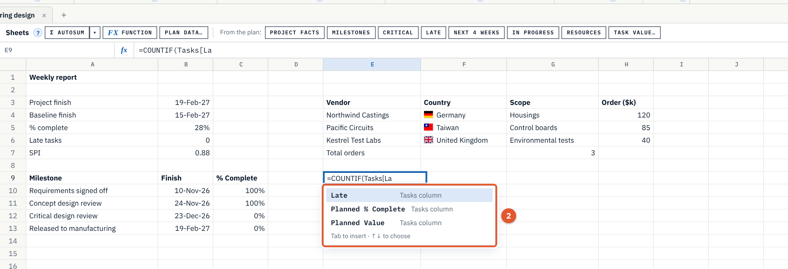

1. 输入 `=` 开始编写公式。单击一个单元格，或拖过多个单元格，即可把它们加入公式（A1、A1:A5）；单击其他工作表标签可引用该表。每个引用都有彩色边框。[[F4]] 切换 $ 绝对引用。[[Enter]] 保存公式，并自动补上缺少的右括号。
2. 输入时会推荐函数、计划名称和表格列；[[Tab]] 插入所选项。在函数内部，提示会显示它的参数，当前参数带下划线。

公式可以读取的计划数据：

| 写法 | 含义 |
| --- | --- |
| `Tasks[Finish]` | 每个任务一个值。列包括 Name（名称）、WBS、Start（开始）、Finish（完成）、Duration（工期）、% Complete（完成百分比，0–100）、Baseline Start / Baseline Finish（基准开始/完成）、Cost（费用）、Work（工时）、Total Float（总浮动时间）、Critical（关键）、Late（延误）、Milestone（里程碑）、Summary（摘要）、Resources（资源）、Status（状态）、Planned Value / Earned Value（计划值/挣值），以及自定义字段。 |
| `Resources[Country]` | 每个资源一个值：Name、Type（类型）、Group（组）、Initials（缩写）、Max Units（最大单位）、Rate（费率）、Work（工时，小时）、Cost、Country（国家）、Email。 |
| `ProjectFinish` | 另有 ProjectName、ProjectStart、StatusDate（状态日期）、BaselineFinish、FinishVariance（完成偏差，工作日）、PercentComplete（0–100）、PlannedPercent（计划百分比，0–100）、TotalCost、PlannedValue、EarnedValue、ActualCost、SPI、CPI、TaskCount、TasksDone、TasksLate、CriticalCount、MilestoneCount。 |

- 填充柄和复制粘贴会移动引用：`=A1*2` 向下填充变为 `=A2*2`。Ctrl+D 和 Ctrl+R 向下和向右填充。
- 右键单击单元格可插入或删除行和列；指向被移动单元格的公式会自动跟随。拖动列边界可调整列宽；双击边界自动适应文字。
- 鼠标指向错误值（#N/A、#NAME?、#SPILL! 等）可查看含义。
- 旧公式（如 `=SUM(Plan!M2:M200)`）仍然有效。

> **提示：** 用 **File › Export** 导出为工作簿时会保留公式，并附带 Tasks 和 Resources 表以及上述名称，因此工作簿在其他电子表格软件中同样可用。

### 公式列

**公式列**（**Format › Formula Column**）在任务表中增加一列，由其他列计算得出，例如 `=[% Complete]-[Baseline % Complete]` 或 `=IF([Finish]>[Baseline Finish],"Late","On time")`。

## 多个计划：选项卡与跨计划链接

大型项目常常由多个计划组成：一个主进度计划，以及设计、采购和施工各自的计划，由各自的团队维护。Datum Plan 将每个计划放在自己的选项卡中，并可以把一个计划的任务链接到另一个计划的任务，这样一个计划的延误会在其他计划中体现出来。

### 选项卡

打开或新建的每个计划都会在功能区和时间线之间的一行中获得一个选项卡，即使只打开了一个计划也是如此。点击选项卡即显示该计划；圆点表示有未保存的更改，× 关闭它（会先询问是否保存）。**＋** 在新选项卡中打开另一个计划：**Blank plan**（空白计划，可立即开始编排进度，再与其他选项卡中的计划建立链接）、模板、已保存的计划、示例或教程。[[Ctrl+Tab]] 切换到下一个选项卡，[[Ctrl+W]] 关闭当前选项卡。**File › Close**（关闭）关闭当前计划，**File › Close All**（全部关闭）关闭所有计划（选项卡的右键菜单中也有）；新建和打开会增加一个选项卡，其他计划保持打开。关闭窗口时，Datum Plan 会列出所有有未保存更改的计划，并可一次全部保存。

### 假设情景

**Project › Scenarios**（情景）保存计划的副本，用于尝试另一种做法（两班倒、另一种顺序、推迟开工），而不改动计划本身。先保存计划，再点击 **New scenario…**（新建情景）：副本以“计划 - 名称.dplan”保存在计划旁边，并在自己的选项卡中打开。可以随意修改。

列表显示每个情景相对计划的完工日期差异（以工作日计）及其健康分数。**Compare**（比较）列出情景相对计划的所有变化，并可把计划的横道显示为幽灵横道。**Merge…**（合并）把您勾选的变化类型（新增和删除的任务、工期、逻辑关系、限制条件、日历、资源分配、进度）并入计划；其他内容保持不变，**Undo**（撤销）可以撤回合并。

### 项目：主计划及其子计划

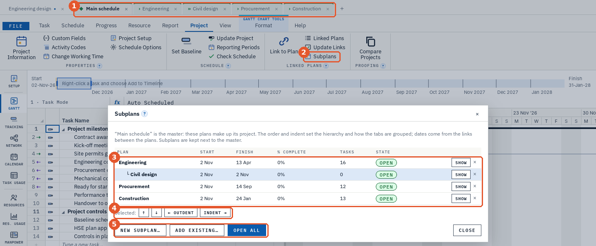

大型工程是一个由多个计划组成的**项目**：一个**主计划**（通常是里程碑）及其**子计划**，每个计划都有自己的文件，保存在主计划旁边。主计划保存这份清单。

1. **项目的选项卡放在一个带框的组中**，使用项目的颜色，框上标有 **Project · 名称**。主计划排在最前，带实心的 **Master** 标记；其子计划随后，带空心的 **Sub** 标记（↳ 表示位于另一个子计划之下）。项目之外的计划保持普通选项卡。当子计划打开而其主计划未打开时，选项卡旁会出现 **Open master**（打开主计划）。
2. **Project › Subplans** 显示项目中的计划。
3. 每个子计划及其日期、完成百分比、任务数以及是否已打开。**Show** 或 **Open** 转到该计划；× 将其移出项目（文件保留）。
4. **↑ ↓** 调整顺序；**Indent**（缩进）将子计划放到上一个子计划之下（例如 Engineering 之下的两个设计计划），**Outdent**（凸出）将其移回上一级。
5. **New Subplan…**（新建子计划）创建一个计划：名称和位置，以相同日历保存在主计划旁边，并在其选项卡中打开。**Add Existing…**（添加现有计划）将已保存的计划加入项目。**Open All** 在选项卡中打开所有子计划。

从零开始建立项目：先保存主计划，然后对每个部分（设计、采购……）使用 **Project › Subplans › New Subplan…**。再进行链接：在主计划中选中一个里程碑，使用 **Project › Link to Plan** 链接到它所等待的子计划任务。顺序和层级只用于排列计划；日期始终来自链接。

打开主计划时会询问是否同时打开其子计划。选项卡的右键菜单中有 **Open All Subplans**、**Apply Setup to Subplans…**、**New Subplan…** 和 **Close Project**（关闭主计划及其已打开的子计划）。

**Project › Apply Setup to Subplans**（把设置应用到子计划）把主计划的设置交给子计划，只需填写一次。勾选要交出的内容（项目详情、徽标和图片、打印页眉页脚和页面设置、日历、货币、报告期间、作业代码和自定义字段）以及要接收的已打开子计划，然后单击 **Apply**。每个子计划保留自己的名称、代码、说明、打印标题和徽标。保存子计划以保留更改；每个子计划都可以单独撤消。

### 合并视图

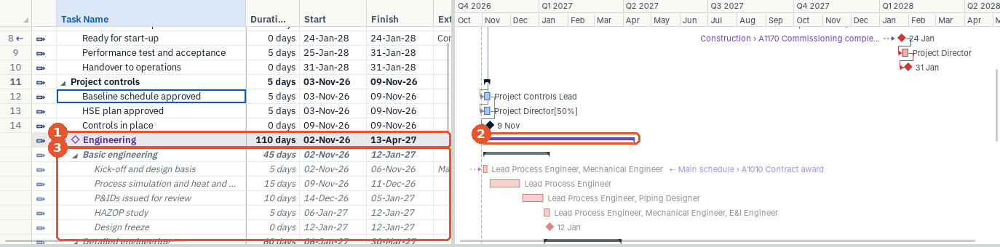

主计划在一个甘特图中显示整个项目：在主计划自身的任务下方，每个子计划占一行。

1. **◇ 子计划行** 显示其工期、开始、完成和其他列，根据其文件计算（无论是否打开），并按 **Subplans** 中的顺序和层级排列。▷ 可展开。
2. **其横道** 为紫色，使子计划与主计划自身的任务区分开来。
3. **其任务** 展开后以灰色斜体显示：在这里是只读的。双击某个任务（或右键 › **Go to this task in its plan**）即可打开子计划的选项卡并选中该任务，在那里进行修改。

**Format › Show/Hide › Subplans** 用于打开或关闭合并视图。

### 示例

**File › Linked plans (example)**（链接计划示例，或 **＋ › Example**）会让您选择一个文件夹，在其中保存一个由四个计划组成的压缩机站项目，并在选项卡中打开：**Main schedule**（主进度计划）、**Engineering**（设计）、**Procurement**（采购）和 **Construction**（施工）。主进度计划的里程碑等待各子计划，施工等待图纸和压缩机组到货；设计和施工计划使用资源日历（首席工程师休假、每周六天的现场日历）。每个计划的日历在圣诞节和新年期间停工（在 **Project › Change Working Time** 中可以看到这些假日）。在 Procurement 中修改一个工期，然后更新链接，即可看到主进度计划随之移动。

### 把任务链接到另一个计划

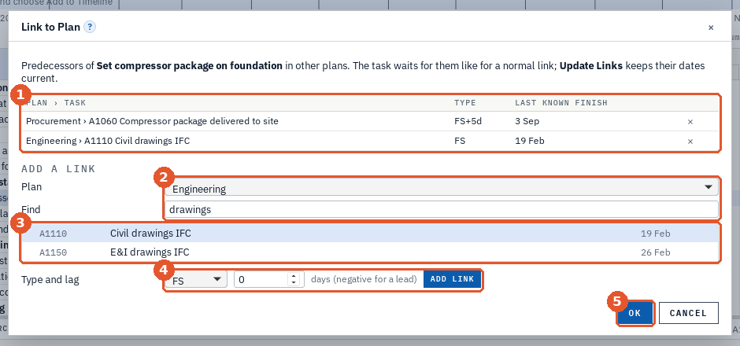

请先保存另一个计划，链接才能知道它的文件。然后选中需要等待的任务，选择 **Project › Link to Plan**（或右键 › **Link to Plan…**）。另一个计划可以在选项卡中打开，也可以用 **Browse…**（浏览）选择一个已保存的文件。

1. 此任务已有的链接，以及上次获知的日期。× 删除一条。
2. **Plan**（计划）可选任何其他已打开的计划；**Find**（查找）按名称或 ID 筛选其任务。
3. 点击要等待的任务（双击直接添加）。
4. **Type and lag**（类型和延隔）：FS、SS、FF 或 SF，以及以天为单位的延隔时间（负数为提前量）。**Add Link** 将其加入列表。
5. **OK** 将链接随计划保存。

此任务现在像普通链接一样等待另一个计划的任务。**External Predecessors**（外部前置任务）列显示其链接，例如 `Engineering › E1180 Final documentation issued FS+5d`。

### 查看链接关系

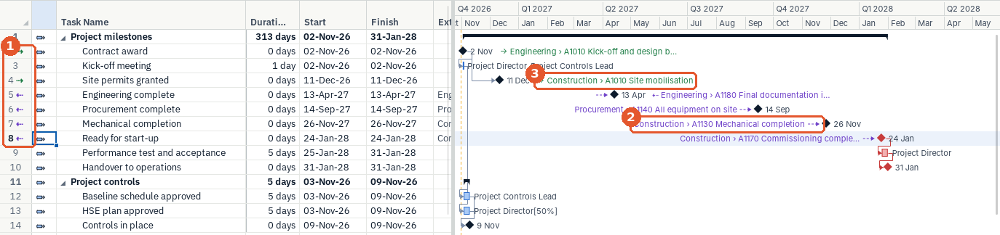

主进度计划通常由里程碑（0 天）组成：每个里程碑表示某个子计划到达某一节点的时刻，例如 "Engineering complete"（设计完成）。一眼即可看出哪些任务有链接：

1. **ID 旁：** ⇠（紫色）表示此任务等待另一个计划中的任务；点击它可查看或修改链接。⇢（绿色）表示另一个已打开计划中的任务在等待此任务。将鼠标指向标记即可看到具体任务。
2. **横道之前（紫色）：** 此任务等待什么，带一条指向它的虚线箭头，例如 "Construction › A1130 Mechanical completion ⇢ ◆ 26 Nov"。
3. **横道之后（绿色）：** 哪个其他计划在等待此任务，例如 "→ Construction › A1010 Site mobilisation"。

**点击标记即可跳转：** 菜单列出链接的任务；**Go to**（转到）显示另一个计划的选项卡（如未打开则打开其文件），并选中该任务。任务的右键菜单中也有同样的 **Linked Tasks…**（链接的任务）。

**当另一个计划移动后，** 标记变为琥珀色（⇠!），甘特图上的标签显示 "moved, update links"，该计划的选项卡显示 ⟳ 和需要更新的任务数。**Project › Update Links**（或标记的菜单）可带入新日期。

**External Predecessors**（外部前置任务）列用文字列出每条链接，**Project › Linked Plans** 则列出两个方向的全部链接。

### 保持链接最新

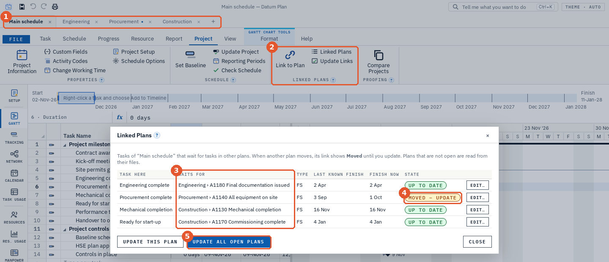

链接保存的是上次更新时另一个任务的日期，因此计划不会在您不知情时改变。**Project › Linked Plans** 显示全部链接：

1. 已打开计划的选项卡。
2. **Project › Linked Plans** 组：**Link to Plan**、**Linked Plans** 和 **Update Links**（更新链接）。
3. **Waits for**（等待）：计划和任务、类型和延隔、上次获知的完成日期和当前完成日期。
4. **Moved – update**（已移动，请更新）：自上次更新以来另一个计划已经移动。
5. **Update All Open Plans**（更新所有已打开计划）按正确顺序把新日期带入每个已打开的计划，直到不再移动为止（**Update This Plan** 只更新当前计划）。未打开的计划从其文件中读取。

如果两个计划相互等待形成循环，更新会停止并给出提示。

下方的 **Other open plans wait for**（其他已打开计划在等待）列出本计划中被其他已打开计划的任务所等待的任务；**Show plan** 打开该计划的选项卡。

## 模块：需要时才添加的登记表

计划可以添加额外的登记表，称为**模块**。**Project › Modules**（项目 › 模块）列出所有模块。勾选一个模块并单击 **Apply**：它的视图会出现在侧边栏和 Project 选项卡中。没有模块的计划保持原样。取消勾选即可隐藏模块；对话框会询问保留其数据（默认）还是删除。

### Contract Dates & Payments（合同日期与付款）

侧边栏中的 **Contract**（合同）显示合同规定的日期与预测日期的对比、面临的延误赔偿以及付款。

1. 在顶部输入合同编号和合同金额。
2. 选择完成某个合同日期的任务（例如交货里程碑），单击 **+ Contract date**，然后输入合同规定的日期。
3. 该行显示任务的预测完成日期（完成后为实际完成日期）、比较基准、提前或延迟的天数以及状态：**On track**（正常）、**At risk**（有风险：浮动时间少于顶部设置的天数）、**Late**（延迟）、**Met**（已达成）或 **Met late**（延迟达成）。**Trend**（趋势）绘出每个期间结束时的预测日期，日期推迟时显示为上升的红线。
4. **延误赔偿：** 宽限天数（**grace**）之后，每延迟一周或不足一周按 **Of value**（单元价格；留空表示合同金额）的一定百分比计算，最高不超过 **cap** 百分比。**At risk** 显示按当前预测计算的赔偿金额。
5. **付款里程碑：** 单击 **+ Payment**，选择其完成即触发付款的任务，输入比例（%）或金额，以及 **terms**（付款天数）。发生时输入开票日期和付款日期。图表显示计划、预测和已收现金。

在主计划中，底部的表格汇总其已打开子计划的合同日期、赔偿和付款，并可逐个打开子计划。

### Document Register（文件登记表）

侧边栏中的 **Documents**（文件）保存一个包的供应商文件及其每一次提交。

1. 先打开 **Settings…**（设置）：**P date**（采购订单或开工会日期；留空表示计划开始日期），P + n 按周还是按天计算；业主的**审查**天数和我方的**周转**天数（工作日）。两者各自可按**计划的日历**或**单独的日历**计算：选择一个，或单击 **New calendar…** 新建一个（例如业主的工作周，或有自己假日的海外设计办公室）并设置其工作时间。然后设置流程中的发布目的、返回代码（哪些表示接受，哪些要求重新提交）以及每个类别六个步骤的进度权重（每个类别合计 100%）。
2. 用 **Import…** 从工作簿导入登记表：选择工作表；标题行会自动找到；检查每一列的内容（文件编号、标题、专业、类别、首次提交 P + n、MRB/VDB/IOM/PIM……）。以后再次导入会更新编号相同的文件。传送记录也可以同样导入。也可以用 **+ Document** 添加文件。
3. 每次提交记录在 **Transmittal log**（传送记录）中：在文件上单击 **+ Sub** 会添加下一次提交（下一版次、流程所需的发布目的、今天的日期）。业主回复后，输入返回日期并选择代码。
4. **Register**（登记表）为每个文件显示计划和实际首次提交、最近一次提交、审查到期日、状态、已获得进度、**业主超出审查期限的天数**以及预测的最终版提交日期。**Late for task** 表示文件无法在需要它的任务开始前准备好。
5. **Progress**（进度）按周或按月绘制加权的计划与实际 S 曲线、每期的首次提交数，以及按供应商、专业、类型和类别的进度。**Export to Workbook** 导出登记表和传送记录。

类别 1 和 2 的流程为：首次提交 → 批准版 → 施工版 → 最终版；类别 3 为：施工版 → 最终版。周期性提交（例如月报）从不计入进度。

### Procurement Register（采购登记表）

侧边栏中的 **Procurement**（采购）跟踪每个分包订单或设备从询价到交货的全过程。

1. **Settings…**（设置）：里程碑权重（均衡、侧重下单、侧重交货，或自定义）、订单之间的权重方式（按采购订单金额、平均，或手动输入的权重）、检验放行（IRN）计划在交货前多少天、浮动时间少于多少天时显示为琥珀色，以及**订单是否与文件登记表关联**。
2. 用 **Import…** 从工作簿导入采购状态登记表（标题行以及计划和实际列会自动识别），或用 **+ Order** 添加订单。在每个订单（**✎**）中选择代表其制造和交货的任务（计划的制造开始和交货日期取自该任务）以及需要它的任务（需求日期），或直接输入日期。
3. 在登记表中随时更新：**制造百分比**、供应商**承诺**的交货日期，以及下一个里程碑的 **Done on**（完成日期）。**浮动时间**等于需求日期减去预测交货日期：对计划已延迟时显示为红色。
4. **Expediting log**（催交记录）：每个订单的带日期备注（在行上单击 **✉** 可为该订单添加）。
5. **Progress**（进度）：按周或按月的加权计划与实际 S 曲线，以及按分包商和原产国统计的订单。**Export to Workbook** 导出登记表和催交记录。

开启与文件登记表的关联后，订单会列出其等待的供应商文件；登记表显示其中已接受的数量，并标出因图纸未批准而影响制造的订单。关闭关联时，订单各自独立。

### 项目组合与资源池

侧边栏中的 **Portfolio**（项目组合）显示工作区文件夹（**Choose folder…**；子文件夹即 EPS 层级）中的每个计划，顶部显示所有计划的汇总。

- **Plans**（计划）：每个计划的日期、相对比较基准的完成日期、进度、成本、SPI 和 CPI、延迟任务，以及其模块的数据（延迟的合同日期、文件和采购的已获得与计划进度）。单击计划即可打开。
- **Timeline**（时间线）：每个计划显示为一根横道，带进度和 ◆ 比较基准完成日期；完成日期晚于比较基准时显示为红色。
- **Resource Pool**（资源池）：每个资源（按名称匹配）在所有计划中的工作量与其能力的对比，按周或按月显示为热度条（绿色为能力范围内，琥珀色为超出不超过 30%，红色为超出更多）。单击资源可查看其在各计划中的工时。

要在计划之间共享资源，可保留一个计划，在其资源工作表中列出这些资源及其费率、单位和日历，并将其选为 **Pool plan**（资源池计划）。其单位和可用性决定能力。在任何其他计划中，**Take resources from the pool** 会让同名资源采用资源池的费率、单位、可用性和日历；**…and add the others** 会添加资源池中的其他资源。

### 复制图片

**Report › Copy Picture**（复制图片）把当前看到的任务表和甘特图（先滚动和缩放以选择范围）复制为图片，可粘贴到文档、幻灯片或工作簿中。每个图表的 **PNG** 旁都有 **Copy** 按钮，作用相同。需要带页眉页脚的整页时，请使用 **File › Print**。

## 文件：保存、导入与导出

- **Save**（保存，[[Ctrl+S]]）把计划保存为电脑上的 `.dplan` 文件。保存是安全的：只有新文件完整写好后才会替换旧文件。
- **计划按您离开时的样子重新打开。** Datum Plan 为每个已保存的计划记住其表格、筛选、分组、排序、折叠的摘要任务和大纲级别、甘特图缩放、显示的基线、打开的工作表及其缩放和视图，以及显示的仪表板。每个打开的计划各自保留自己的设置。窗口布局（显示/隐藏勾选项、任务表宽度、详细信息窗格的选项卡、网络图方框大小）对所有计划相同。这些设置保存在您的电脑上，而不在 .dplan 文件中，因此不会把计划标记为已更改。
- **Import**（导入）可以打开其他进度计划软件的计划（Project XML 和 XER 文件），以及工作簿（.xlsx）或 CSV 表格文件（由您指定每一列的含义）。导入后会显示一份简短的**导入报告**，列出 Datum Plan 修改或略去的内容，以及每个任务的日期是否与原文件一致。
- **Export**（导出）可导出为工作簿（保留公式和格式）、OpenDocument 电子表格（.ods，仅数值）、CSV、Project XML、XER、PMXML、MPX、HTML、iCalendar 和 JSON。
- **发送 XER 文件。** **File › Export › XER** 会先询问要按哪个版本写出：请选择接收方软件所用的版本或更早的版本（软件无法打开按更新版本写出的文件）。文件包含 WBS、作业、逻辑关系、日历、资源及其分配、作业代码、自定义字段、步骤和备注。导出后会显示一份报告，列出写入的内容以及该格式无法保存的内容（例如基线）。XER 中的作业 ID 必须唯一：重复的 ID 会加上“-2”。
- **恢复。** Datum Plan 在您工作时会自动保存恢复副本（在 **File › Options** 中设置频率）。如果软件在保存前意外关闭，下次启动时会提示恢复您的工作。

## 与 Claude 协作：AI Link

**Home › AI Link**（AI 链接）让 Claude Desktop 应用中的 Claude 读取并修改您当前打开的计划，修改过程您可以实时看到。您用日常语言提出要求，Claude 在 Datum Plan 中完成。无需 API 密钥：Claude 使用您自己的 Claude 账户。

1. **打开链接。** Home › AI Link › **Turn on**（打开）。只有本机上的 Claude 能访问计划，且每次使用不同的密钥；关闭时不监听任何连接。状态栏显示 **Claude linked**。下次启动时保持打开，直到您关闭为止。
2. **设置 Claude**（只需一次）。该按钮会把 Datum Plan 添加到 Claude Desktop 的设置中，并保留旧文件的备份。如需手动设置，对话框中会显示要添加的文本（Claude Desktop › Settings › Developer › Edit Config）以及 Claude Code 的命令。
3. **重启 Claude Desktop**（完全退出，包括托盘中的图标），然后提问，例如：*"Datum Plan 中打开的是哪个计划？完工日期是哪天？"*

之后即可就当前显示的计划提出任何要求，例如：

- *"截至今天哪些任务延误了？延误多少？"*
- *"在任务 24 之后添加 3 天的水泵测试，完成-开始链接，并把移交链接到它。"*
- *"把 Site survey 设为 100%，11 月 26 日完成。"*
- *"检查进度计划并列出缺少逻辑关系的任务。"*
- *"为什么完工日期相对基准计划推迟了？"*、*"写一份简短的进度总结。"*

Claude 的每项修改都会立即显示，底部有提示，并且是一个 **Undo**（撤销）步骤（[[Ctrl+Z]]）。Claude 在当前显示的选项卡中的计划上工作（也可以列出已打开的计划并切换选项卡），遵守与您相同的规则（锁定的基准计划保持锁定），并且除非您要求，否则绝不保存文件。Claude 可以读取进度计划、检查结果、S 曲线、风险结果、前瞻计划和工作表，也可以添加、修改、链接、删除和更新任务，设置状态日期并在工作表中输入内容。

## 命令行与 AI 助手

`datum-cli`（在发布页面下载）无需打开窗口即可处理计划：查看计划概况或进度表、修改计划、导出，或运行风险分析。`datum-cli mcp` 让 AI 助手可以打开计划、读取计划、用与窗口相同的操作修改计划并保存。输入 `datum-cli help` 查看全部命令。

## 软件内的帮助

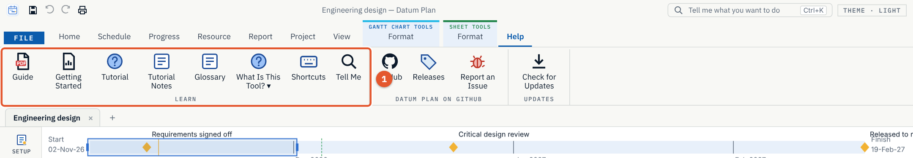

1. **Learn（学习）：** **Guide**（指南，即本指南）、**Getting Started**（入门简介）、**Glossary**（术语表）、**What Is This Tool?**（所有 ? 说明卡片汇总）、**Shortcuts**（快捷键）和 **Tell Me**（告诉我）。

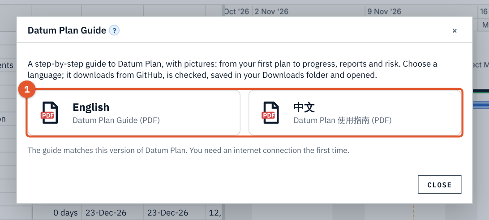

1. 选择 **English**（英文）或 **中文**。指南会从 GitHub 下载、经过校验，保存到“下载”文件夹并自动打开。

## 术语表（英文—中文）

| 英文 | 中文 | 含义 |
|---|---|---|
| Activity ID | 作业代码 | 任务的简短编号，如 A1020。 |
| Baseline | 基准计划 | 已确认计划的保存副本，用于对比进度。 |
| Constraint | 限制条件 | 约束任务日期的条件，如“不得早于……开始”。 |
| Critical path | 关键路径 | 决定完工日期的任务链；其中任一任务延误，项目就会延期。 |
| Duration | 工期 | 任务所需的工作时间，如 5 天。 |
| External predecessor | 外部前置任务 | 此任务所等待的另一个计划中的任务。 |
| Earned value, SPI, CPI | 挣值、进度绩效指数、成本绩效指数 | 用金额或工时衡量进度。SPI 小于 1 表示进度落后，CPI 小于 1 表示费用超支。 |
| Earned schedule, SPI(t) | 挣得进度、时间进度绩效指数 | 用时间衡量进度：计划预计在什么时候完成目前已完成的工作。 |
| Float (slack) | 浮动时间（时差） | 任务可以推迟而不影响完工日期（总浮动时间）或紧后任务（自由浮动时间）的时间。 |
| Lag, lead | 延隔时间、提前量 | 逻辑关系上的等待时间（延隔）或搭接时间（提前量，即负延隔）。 |
| Levelling | 资源平衡 | 推迟任务，使任何人的工作量都不超过其可用时间。 |
| Look-ahead | 前瞻计划 | 未来几周的工作，并检查是否具备开工条件。 |
| Milestone | 里程碑 | 工期为零、标志某一事件的任务。 |
| P50, P80 | P50、P80 | 风险分析中 10 次有 5 次、8 次能够达到的完工日期。 |
| Resource calendar | 资源日历 | 个人的工作周和休假；启用后决定其工作在何时完成。 |
| Rules of credit | 进度测量规则 | 用带权重的步骤测量实际进度的方法。 |
| Status date | 状态日期（数据日期） | 进度测量截止的日期。 |
| Summary task | 摘要任务 | 包含其他任务的任务，其日期由下属任务汇总。 |
| WBS | 工作分解结构 | 工作内容的层级大纲。 |

## 快捷键与常见问题

| 按键 | 作用 |
|---|---|
| [[Insert]] | 新建任务 |
| [[Delete]] | 删除任务 |
| [[F2]] 或 [[Enter]] | 编辑单元格 |
| [[Alt+Shift+→]] / [[Alt+Shift+←]] | 降级 / 升级 |
| [[Ctrl+F2]] | 链接所选任务 |
| [[Shift+F2]] | 任务信息 |
| [[Ctrl+C]] [[Ctrl+X]] [[Ctrl+V]] | 复制、剪切、粘贴（也可与其他电子表格互通） |
| [[Ctrl+Z]] / [[Ctrl+Y]] | 撤销 / 恢复 |
| [[Ctrl+S]] / [[Ctrl+O]] / [[Ctrl+P]] | 保存 / 打开 / 打印 |
| [[Ctrl+K]] | 告诉我您想要做什么 |
| [[Ctrl+Tab]] / [[Ctrl+W]] | 下一个计划选项卡 / 关闭当前计划 |
| [[Ctrl]] + 鼠标滚轮 | 缩放时间刻度 |

**第一次安装时出现 Windows protected your PC：** 点击 **More info**（更多信息），再点 **Run anyway**（仍要运行）。

**日期没有按预期变化：** 在详细信息窗格中检查任务的限制条件和逻辑关系（**Predecessors** 选项卡），以及任务是否被设为 **Manually Schedule**（手动计划）。

**出现问题：** Datum Plan 会中止该操作，计划保持原样。详细信息写在 Datum Plan 数据文件夹中的 `crash.log` 文件里（`%APPDATA%\com.edgarmendonca.datumplan`）。请通过 **Help › Report an Issue**（报告问题）反馈；软件不会自动发送任何信息。

**问题和建议**欢迎在 GitHub 上提出：github.com/Edgar-Mendonca/Datum-Plan/issues。
